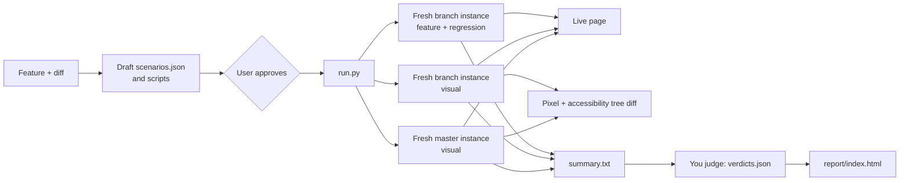

# Test an Instance AI feature

Use this skill to test a UI feature of the n8n Assistant end to end. In code,
the Assistant is "Instance AI". You draft the test paths, the user approves
them, and the skill runs them all at the same time. A local page shows each run
live. At the end, you judge each run and build one report.

The skill uses the scripts of `compare-workflow-builders` for the n8n API, the
LangSmith usage, the live page server, and the report template. Do not copy
those scripts.

## What the skill does



- Each run is one scenario: a Playwright script that drives the real
  Assistant UI in Chrome, with a real LLM.
- There are three kinds of scenario:
  - `feature`: tests a path of the new feature.
  - `regression`: tests an existing flow that the feature touches.
  - `visual`: captures screens. The skill runs it on the branch and on master,
    then compares the captures.
- All instances are fresh: a new data folder, a new owner, and no workflows or
  threads. Thus the screens of the branch and master are the same when the
  code is the same.
- The branch instances start from this checkout's build. The master instance
  starts from a git worktree at `~/.cache/n8n-feature-test/master`. The skill
  builds it the first time, and then again only when `origin/master` moves.

## Requirements

- Build this checkout before a run: `pnpm build > build.log 2>&1`. The run
  uses the built files, not the source. When source files are newer than
  their build, `run.py` prints a warning, and the report shows it.
- Google Chrome. The scripts use the Playwright package of the repository.
- The Instance AI model settings in `.env.local` or `.env.ai-surfaces`, as for
  your own instance. Fresh instances get the same settings, without the
  license, the database, the port and the encryption key.
- `LANGSMITH_API_KEY` and LangSmith tracing, for the tokens and cost. Without
  them, the report shows no tokens or cost. Do not set
  `N8N_DIAGNOSTICS_ENABLED=false`: then Instance AI sends no traces.
- About 3 GB of disk space for the master worktree and its build.

Never put a key on the command line. Read settings from the env files and the
environment only.

## 1. Understand the feature

Find what changed and what the user wants to test:

```bash
git diff origin/master...HEAD --stat -- packages/frontend packages/@n8n/instance-ai packages/cli/src/modules/instance-ai
git diff origin/master...HEAD -- <the files of the feature>
```

Read the changed Vue components, the stores, and the backend events that they
use. Find the `data-test-id` values of the new elements. If the user did not
describe the feature, ask for one or two sentences about it.

Start the master baseline now, in the background. The first build takes 15 to
20 minutes, and you can draft the plan while it builds:

```bash
S=.agents/skills/test-instance-ai-feature/scripts
python3 $S/baseline.py prepare    # in the background
python3 $S/baseline.py status     # later: is it ready?
```

## 2. Draft the test paths

Write a plan folder in the run root, for example
`/tmp/feature-test/plans/<feature>/`. It holds `scenarios.json` and one script
for each scenario.

Draft these paths:

- **Feature paths.** The main path, then each branch of it: other user
  choices, empty and long inputs, cancel and stop, a reload in the middle, a
  second thread, errors that the user can see. One path for each scenario.
- **Regression paths.** The existing flows near the change: a plain chat
  reply, approvals, the plan review, the preview panel, the thread list. The
  library has `smoke-chat` for the plain chat reply.
- **Visual screens.** The screens that the change can affect, on the branch
  and on master. Capture each screen in a stable state. Mask all text that
  comes from the LLM, and all data that changes between runs. The library has
  `visual-assistant-home` and `visual-thread-reply`.

Keep each scenario short and focused. A scenario that fails must show where it
failed. Use more scenarios, not longer ones. A visual scenario must not need
the new feature, because it also runs on master.

Scenarios that share an instance see each other's data. For example, a
credential that one scenario creates shows in the credential card of another
scenario. Set `"isolated": true` on each scenario that depends on the data of
the instance.

Some UI states show only for a moment, for example a status line that folds
away when the run ends. Check them while the run is active, not after it.

Show the user the list of paths: the id, the kind, the title and the expected
result of each. Change the plan until the user approves it. Tell the user the
number of LLM runs, because each one costs money.

### scenarios.json

```json
{
  "title": "Stop button in the Assistant",
  "feature": "The user can stop a run while the Assistant works.",
  "scenarios": [
    {
      "id": "stop-mid-run",
      "title": "Stop a run in the middle",
      "kind": "feature",
      "script": "stop-mid-run.mjs",
      "expected": "The stop button shows during the run. A click ends the run without an error message.",
      "timeoutMin": 6
    },
    {
      "id": "smoke-chat",
      "title": "A prompt gets a reply",
      "kind": "regression",
      "script": "lib:smoke-chat.mjs",
      "expected": "A short prompt gets the reply OK."
    }
  ]
}
```

| Field | Required | Description |
|---|---|---|
| `id` | yes | Lowercase letters, digits and `-`. No `--`. Unique. |
| `title` | yes | A short name for the report. |
| `kind` | yes | `feature`, `regression` or `visual`. |
| `script` | yes | A path relative to `scenarios.json`, or `lib:<file>` for a library script. |
| `expected` | yes | The expected result, for the judge. |
| `autoConfirm` | no | Answer the Assistant's confirmations automatically. Default `true`. Credential and setup cards get "Later". Set `false` when the script answers a confirmation or a card. |
| `isolated` | no | Run the scenario on its own fresh instance. Default `false`: the feature and regression scenarios share one branch instance. Set `true` when the scenario creates or reads instance data, such as credentials or workflows, that another scenario can change. Each isolated scenario adds about 20 seconds to start its instance. |
| `timeoutMin` | no | The time limit of the scenario. Default 10. |
| `viewport` | no | The window size, for example `1600x1000` (the default). |

`examples/stop-button/` is a full example plan.

### Scenario scripts

A script exports one async function. It gets the kit `t`:

```js
export default async function (t) {
	await t.step('Open the Assistant', () => t.goto());
	await t.step('Send a prompt', () => t.send('Reply with exactly the word OK and nothing else.'));
	await t.step('Wait until the run ends', () => t.waitForIdle({ timeout: 180_000 }));
	await t.check('The reply says OK', () => t.expect(t.ai.assistantMessages().last()).toContainText('OK'));
	await t.capture('thread', { mask: [t.ai.assistantMessages()] });
}
```

| Kit member | What it does |
|---|---|
| `t.step(title, fn)` | Runs an action. Records a screenshot and the time. A failure stops the scenario. |
| `t.check(title, fn)` | Runs an assertion, with a screenshot. A failure is recorded, and the scenario continues. |
| `t.note(title)` | Adds a step with a screenshot and no action. |
| `t.goto(path = '/assistant')` | Opens a page and waits for the chat input. Closes the "Try new n8n Assistant" dialog. |
| `t.send(text)` | Types into the chat input, sends, and waits for the thread URL. Records the thread for the trace. |
| `t.waitForIdle({timeout, settle})` | Waits until the thread has no active run. Returns `'idle'`, or `'suspended'` when the run waits for the user. |
| `t.capture(name, {mask, maskText, root, fullPage})` | Saves a screen and its accessibility tree for the visual check. `mask` takes locators, and `maskText` takes texts: all elements with that text. Masked areas show as one color, and their text shows as `[masked]` in the tree. |
| `t.api(method, path, body)` | Calls the n8n REST API as the signed-in user. Returns `data`. |
| `t.threadStatus(threadId)` | Returns `{hasActiveRun, isSuspended, backgroundTasks}`. |
| `t.ai.*` | Locators for the Assistant: `chatInput`, `sendButton`, `stopButton`, `userMessages`, `assistantMessages`, `assistantText(text)`, `panelText(text)`, `sidebarToggle`, `threadList`, `newThreadButton`, `approveButton`, `denyButton`, `planApproveButton`, `previewPanel`, `previewCanvasNodes`, and more in `scripts/kit.mjs`. |
| `t.expect`, `t.page`, `t.baseUrl`, `t.sleep(ms)` | Playwright `expect`, the page, the instance URL, and a pause. |

Rules for scripts:

- Use `data-test-id` locators (`page.getByTestId`). Use text only for text that
  the test controls.
- Use `t.expect(...).toBeVisible()` and other assertions that wait. Do not use
  `t.sleep` to wait for the UI.
- LLM answers change from run to run. Check the UI state, not the exact words.
  Ask for a fixed reply, such as "Reply with exactly the word OK", when you
  need a known answer.
- To test an approval, set `"autoConfirm": false`, wait with
  `t.waitForIdle()` until it returns `'suspended'`, then click the button.
- Check each new script against a running instance before the full run:

  ```bash
  N8N_BASE_URL=http://localhost:5678 node $S/run_scenario.mjs --out /tmp/feature-test/try/<id> --script <plan>/<id>.mjs
  ```

  This uses your own instance and leaves the thread there.

## 3. Run

Open the live page for the user on each run. Do not skip this step. Do this:

1. Find out if your harness has a browser tool that opens a tab in the
   editor. In Cursor, this is `browser_navigate` of the `cursor-ide-browser`
   MCP server.
2. If it has one, start the run in the background with `--no-open`:

   ```bash
   python3 $S/run.py --plan <plan>/scenarios.json --no-open
   ```

   Wait for the `live page: <url>` line in the output, which comes in a few
   seconds. Then open that URL in a new editor tab that the user can see (in
   Cursor: `newTab: true` and `position: "active"`). If the tab does not open,
   run `open <url>` (macOS) or `xdg-open <url>` (Linux).
3. If it has none, start the run in the background without `--no-open`.
   `run.py` opens the live page in the default browser:

   ```bash
   python3 $S/run.py --plan <plan>/scenarios.json
   ```

4. Give the user the URL in both cases.

`run.py` does not read `$BROWSER`, so do not set it.

`run.py` does these steps:

1. Copies the plan into a new run folder, `/tmp/feature-test/<time>-<title>/`.
2. Starts the live page and prints its URL. Without `--no-open`, it opens the
   page in the default browser.
3. Starts a fresh branch instance for the feature and regression scenarios.
4. Prepares the master build, if it is not ready. Then it starts a fresh
   master instance and a second fresh branch instance for the visual
   scenarios.
5. Runs the scenarios, 4 at a time. Each run records a video, the steps with
   screenshots, the browser errors, the thread events, and the LangSmith ids.
6. Stops the instances, gets the tokens and cost from LangSmith, compares
   the visual captures, writes `summary.txt`, and builds the report without
   verdicts.

The last output line is JSON: `runDir`, `report`, `live`, `summary`,
`results` (the status of each run), and `visual` (the number of captures and
the changed ones).

| Option | Use |
|---|---|
| `--only id1,id2` | Run only these scenarios. |
| `--rerun <run-dir>` | Run the plan of an earlier run again, in a new folder. |
| `--concurrency N` | Runs at the same time. Default 4, or `FEATURE_TEST_CONCURRENCY`. |
| `--branch-url URL` | Use a running instance for the branch runs, not a fresh one. The threads stay on that instance. The visual check is not reliable then. |
| `--no-baseline` | Do not run master. There is no visual check. |
| `--no-fetch` | Do not fetch `origin/master`. Use the master that the worktree has. |
| `--no-open` | Do not open the live page in the default browser. Use this when you open it in the editor tab. |
| `--no-live` | Do not start the live page. Use this only when the user asks for it. |
| `--keep-instances` | Keep the fresh instances running after the run, for a manual check. Stop them yourself. |
| `--run-dir DIR` | Use this run folder. |

| Setting | Default |
|---|---|
| `FEATURE_TEST_RUNS_DIR` | `/tmp/feature-test` |
| `FEATURE_TEST_CACHE` | `~/.cache/n8n-feature-test` (the master worktree, its build state and log) |
| `FEATURE_TEST_CONCURRENCY` | `4` |

### Watch the runs

The live page shows each run as a row, with its status and its last
screenshot. The screenshot changes every few seconds. When the run is done,
the same address shows the report. The page stops 30 minutes after its last
request.

## 4. Judge

Read `<runDir>/summary.txt`. It has, for each run: the expected result, the
steps and their status, the prompts, the last reply, the browser errors, and
the visual results. Look at the step screenshots in `runs/<name>/` and the
diff images in `visual/<id>/` when the text is not enough.

A script that passed is not always a pass. Check that the run shows the
expected result, not only that the script ended. Check for these problems:

- a browser error or a failed request that comes from the feature
- a step that passed, but the screenshot shows the wrong state
- a visual change that the feature did not intend
- a script that failed because of the script, not the feature. Say so, and
  fix the script

Write `<runDir>/verdicts.json`. Use the run names as keys. A master run has
the name `<id>--master`, and does not need a verdict:

```json
{
  "stop-mid-run": {
    "verdict": "pass",
    "summary": "One sentence about the result.",
    "checks": [
      { "ok": true, "text": "The stop button ends the run" },
      { "ok": false, "text": "The send button comes back after 9 seconds" },
      { "ok": null, "text": "Could not confirm the stopped label" }
    ]
  }
}
```

Use `pass` when all checks pass, `fail` when the main goal is not met, and
`partial` for all other results. For a visual scenario, judge each change:
intended by the feature, a regression, or noise (for example, a timestamp
that is not masked). Be strict and factual.

## 5. Build the report again

```bash
python3 $S/report.py <runDir>
```

The report is `<runDir>/report/index.html`. It is one folder with all its
files, so you can copy or share it. It has, from top to bottom:

- the video replays of all runs
- a table of all runs: kind, result, steps passed, time, LLM calls, tool calls,
  tokens, cost and browser errors. The result is your verdict. A master run
  shows `Baseline`, and a run without a verdict shows `Not judged`, or
  `Failed` when its script failed
- the visual check: the branch screen, the master screen, and the diff image
  of each capture, with the accessibility tree diff
- for each run: the expected result and the verdict, the steps with their
  screenshots, the browser errors, and the LLM steps from the trace

If the page still runs, load the `live` URL again in the tab that you opened,
so that the user sees the verdicts. Give the user the path, and the `live`
URL. Tell the
user the result of each scenario, the visual changes, and the problems that
you found.

## Single steps

| Step | Command |
|---|---|
| Prepare the master baseline | `python3 $S/baseline.py prepare` |
| Show the baseline state | `python3 $S/baseline.py status` |
| Run one script on any instance | `N8N_BASE_URL=<url> node $S/run_scenario.mjs --out <dir> --script <file>` |
| Compare the visual captures again | `node $S/visual_diff.mjs <runDir>` |
| Print the judge summary | `python3 $S/report.py <runDir> --summary` |
| Serve the live page of a run | `python3 $S/live_page.py --run-dir <runDir>` |

## Limits

- LLM answers change from run to run, and a run can fail because of the LLM.
  Run a failed scenario again with `--rerun <runDir> --only <id>` before you
  call it a bug.
- Each LLM scenario costs money. The tokens and cost show in the report.
- Parallel runs share the CPU and the LLM rate limits. The times include the
  shared load.
- The visual check compares pixels with a small tolerance. Fonts and
  animations can cause small changes. Masks hide the parts that change between
  runs. The accessibility tree diff shows changes in structure and text.
- The worktree shows in `git worktree list`. To remove it, run
  `git worktree remove ~/.cache/n8n-feature-test/master`.
