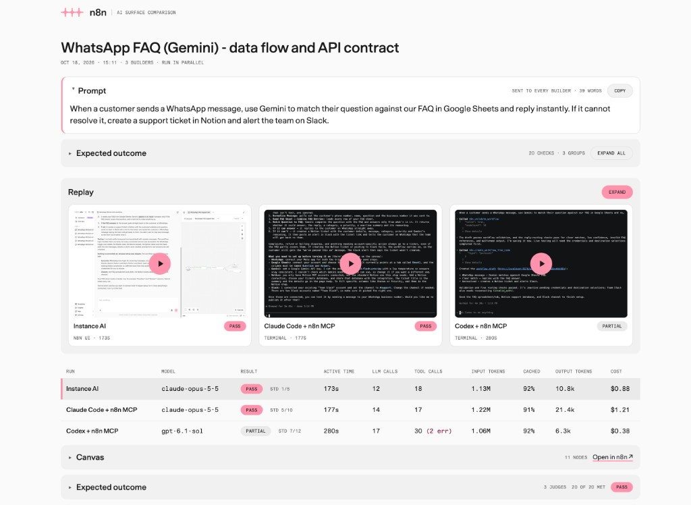

# Compare workflow builders

This skill sends the same prompt to up to three builders on the local n8n
instance. The builders run at the same time, and a local page shows them
live. It then builds one page that shows, for each run:

- the result against the expected outcome (pass, partial or fail, with reasons
  and the evidence that a panel of blind judges cited)
- deterministic checks of each workflow: the node definitions, the node
  issues in the n8n editor, the graph, the expression references, and a run
  of each branch with pinned data
- a separate n8n standards score, from the rules in
  [n8n-io/skills](https://github.com/n8n-io/skills) and the workflow-sdk best
  practices. This score does not change the verdict
- the canvas of the workflow that the builder made
- a replay of the run: the exact terminal screen, or a video of the n8n UI
- the cost
- the LLM steps: one entry for each LLM call, with its tokens (cache read,
  cache write, uncached input, output) and the agent text, reasoning and tool
  calls (with input and output) that the call made

The page uses the light mode of the
[n8n brand guidelines](https://guidelines.n8n.design/).



All scripts are in `scripts/` next to this file. They use only the Python
standard library and the Playwright copy in the repository.

```bash
S="$(git rev-parse --show-toplevel)/.agents/skills/testmax-n8n-ai/scripts"
```

## Settings

All settings are in `.env.ai-surfaces` in the repository root. Git ignores
this file. The template is `.env.ai-surfaces.example`, also in the
repository root. The scripts read,
from low to high priority: `.env.local`, `.env.ai-surfaces`, the shell
environment. Empty values are ignored. Thus keys that are already in
`.env.local` work without a change.

If `.env.ai-surfaces` does not exist, copy `.env.ai-surfaces.example` to it. Tell the user
which values to fill in. Never read the values back to the user, never print
them, and never put a secret on a command line.

The most important settings:

| Setting | Use |
|---|---|
| `COMPARE_BUILDERS` | Default builders, for example `iai,claude,codex` |
| `COMPARE_PARALLEL` | `1` (default) runs the builders at the same time. `0` runs them one at a time |
| `COMPARE_LIVE` | `1` (default) opens a live page of the runs. `0` turns it off |
| `COMPARE_LIVE_WINDOWS` | `1` also opens the Instance AI thread and a terminal window for each CLI. Default `0` |
| `COMPARE_RECORD` | `1` (default) records the Instance AI video for the replay. `0` turns it off |
| `COMPARE_CLI_MODE` | `interactive` (default) records the real CLI screen. `headless` uses the JSON event stream |
| `COMPARE_RECORD_REQUESTS` | `1` (default) records the Codex request bodies, without headers, for the tool list. `0` turns it off |
| `COMPARE_SCENARIOS` | `1` (default) runs each workflow with pinned data through the n8n MCP server. `0` turns it off |
| `COMPARE_WIRE` | `1` (default) runs each workflow in process with recorded API fixtures (`run_wire.mjs`). `0` turns it off |
| `COMPARE_BINARY_CHECKS` | `1` (default) runs the deterministic binary checks of the Instance AI eval suite. `0` turns it off |
| `GOOGLE_GENERATIVE_AI_API_KEY`, `OPENAI_API_KEY`, `ANTHROPIC_API_KEY`, `MISTRAL_API_KEY`, `GROQ_API_KEY` | Model keys for the real AI runs. A workflow model without a key skips those runs |
| `CLAUDE_MODEL`, `CODEX_MODEL` | Model ids. Empty uses the CLI default. A prefix such as `anthropic/` is removed |
| `COMPARE_CLAUDE_TOOLS` | `none` (default) gives Claude Code only the n8n tools. `default` also gives it its built-in tools, all allowed (see "How the builders run") |
| `CLAUDE_API_KEY` | Anthropic key for Claude Code. Falls back to `ANTHROPIC_API_KEY` |
| `CODEX_API_KEY` | OpenAI key for Codex. Falls back to `OPENAI_API_KEY` |
| `N8N_MCP_TOKEN` | MCP key of the n8n user. Optional |
| `LANGSMITH_*` | Instance AI cost and tokens |

## 1. Ask the user

Ask for these two items. If the harness has a structured question tool, use
it. If not, ask in chat. Do not guess them.

1. **Prompt.** The exact text to send to each builder.
2. **Expected outcome.** What a correct result does. Ask for concrete checks,
   for example "WhatsApp trigger", "Gemini compares the question to the FAQ
   sheet", "the false branch makes a Notion ticket and a Slack message".

Use the builders and models from the settings. Ask about them only if the
user wants a change for this run.

Write one expected outcome item on each line, numbered or bulleted. The
number of an item is its id: the judges cite it, and the page groups the
checks by it.

Then write the scenarios for the pinned-data runs, from the expected
outcome. You do not need to ask the user for them. A scenario sets the data
of the trigger, the service nodes and the AI nodes, and says which nodes
must or must not run. Logic nodes (IF, Switch, Set, Code, Aggregate and
others) run for real. Make one scenario for each branch of the expected
outcome:

```json
{
  "pinByType": {
    "googleSheets": [{ "Question": "What are your opening hours?", "Answer": "9:00 to 17:00" }]
  },
  "scenarios": [
    { "name": "The FAQ answers the question", "ai": { "booleans": true },
      "expect": { "reach": ["whatsApp"], "skip": ["notion", "slack"] } },
    { "name": "The FAQ does not answer the question", "ai": { "booleans": false },
      "expect": { "reach": ["notion", "slack"] } }
  ]
}
```

- `pinByType`: output items for every node of a type, in all scenarios. A
  type is the full name or the part after the last dot. A scenario can have
  its own `pinByType`.
- `trigger`: output items of the trigger. Without it, the trigger gets a
  fixture in the shape that the trigger code emits (WhatsApp, Webhook, Chat,
  Schedule, Telegram, Form and Manual triggers have one).
- `ai`: the output of each AI node. `booleans` sets every boolean in the
  output, `set` sets fields, and `text` sets the whole text of a node
  without a structured output parser. The output follows the schema of the
  structured output parser, or the JSON example in the prompt of the node.
- `expect`: `reach` lists node types that must run without an error,
  `skip` lists node types that must not run.
- `triggerNode`: the name of the trigger that the scenario starts from, for a
  workflow with more than one trigger. Without it, the scenario starts from
  the trigger that reaches the most `reach` types.

Without a scenarios file, `run_scenarios.py` makes one scenario for each
value of the AI booleans, with no expectations.

`run_wire.mjs` runs the same scenarios in process. There, service nodes
send real requests that recorded fixtures answer, so a scenario can also
check the API contract. Add these keys to the scenarios file:

```json
{
  "scenarios": [
    { "name": "The FAQ does not answer the question", "ai": { "booleans": false },
      "expect": { "reach": ["notion", "slack"], "requests": [
        { "type": "notion", "method": "POST", "contains": ["\"title\"", "@trigger.messages[0].from"] },
        { "type": "slack", "method": "POST",
          "contains": ["@trigger.messages[0].text.body", ["@response.notion.id", "@response.notion.url"]] } ] } }
  ],
  "edge": [
    { "name": "The FAQ sheet is empty", "pinByType": { "googleSheets": [] }, "ai": { "booleans": false },
      "expect": { "reach": ["notion", "slack"] } }
  ],
  "questions": [
    { "name": "Opening hours, which the FAQ answers", "message": "Hi! What time do you open?",
      "expect": { "skip": ["notion"], "requests": [
        { "type": "whatsApp", "method": "POST", "contains": ["@trigger.messages[0].from", "9:00"] } ] } }
  ]
}
```

- `expect.requests`: each entry needs a request from a node of `type`,
  optionally with `method` and an exact `count`, whose URL, query or body
  contains every value in `contains`. An array in `contains` means any one
  of its values. `@trigger.<path>` is a value of the trigger item.
  `@response.<type>.<path>` is a value of the response to the last write
  request of that node type, for example the id of the Notion page.
- `expect.noWrites`: the scenario must send no write request.
- `edge`: inputs that the prompt does not describe. The trigger kits in
  `sdk.mjs` add standard edge cases, for example two WhatsApp messages in one
  webhook call (each sender must get a request) and a status update (no
  writes). Edge cases are a score, not part of the verdict.
- `questions`: the AI nodes call the real model with this customer
  `message`. The trigger fixture carries the message. A real-AI run needs a
  model key, and is a score, not part of the verdict.

## 2. Run the builders

```bash
python3 $S/compare.py --title "<short title>" \
  --prompt-file <file with the prompt> --expected-file <file with the outcome> \
  --scenarios-file <file with the scenarios>
```

Write the prompt, the expected outcome and the scenarios to files with the
file tool first. Do not put them on the command line, because they can
contain quotes. Use `--builders iai,claude` to change the builders for one
run. Use `--rerun <old run dir>` to run the same case again. It also copies
`scenarios.json`.

The command takes 5 to 30 minutes. Start it in the background if the harness
supports it, and read its output until it ends. It prints one line for each
tool call, with the builder name in front, so the user can follow the run.
It does these steps:

1. Checks the setup and skips a builder that cannot run. It prints the
   reason.
2. Starts the live page (see below).
3. Runs the builders at the same time. `--sequential` or
   `COMPARE_PARALLEL=0` runs them one at a time.
4. Fetches the Instance AI cost from LangSmith.
5. Takes a screenshot of each canvas, and saves the node issues that the
   n8n editor shows (`canvas-issues.json`).
6. Runs each workflow once for each scenario, with pinned data, through the
   `test_workflow` tool of the n8n MCP server (`exec.json`). It turns on
   "Available in MCP" for a workflow that does not have it.
7. Runs each workflow in process with recorded API fixtures, for the
   scenarios, the edge cases and the real AI questions (`wire.json`).
8. Runs the deterministic eval binary checks (`binary-checks.json`) and
   checks the final-message claims (`claims.json`).
9. Derives the deterministic checks (`auto-checks.json`). See "Checks on
   the page".
10. Writes `summary.txt`, and `judge/summary-blind.txt` for the judges.
11. Builds the page without verdicts.

The last output is JSON with `runDir`, `report`, `live`, `parallel`,
`summary`, `blindSummary`, `models` and `skipped`.

Parallel runs share one n8n instance and one machine. Thus the times of the
builders include the shared load. The page says "run in parallel" under
the title. Use
`--sequential` when the user wants to compare times exactly.

### Watch the runs

`compare.py` starts `live_server.py` and opens its page in the default
browser. It prints `live page: <url>`. Give the user this URL. The page
shows each builder while it runs, and updates every 2 seconds without a
reload:

- the table: status, time, LLM calls, tool calls and tokens of each builder
- **Live:** the real terminal screen of Claude Code and Codex, streamed from
  the tmux recording, and a screenshot of the Instance AI thread every
  2.5 seconds
- the LLM steps of each builder. Claude Code and Codex steps come from the
  session files of the CLIs, with tokens. Instance AI steps come from its
  event stream, without tokens until the run ends

The cost, the canvases and the Instance AI tokens come after the run. Until
then, the Expected outcome box shows "Not verified yet", and the
Correctness, Execution and n8n standards boxes show "Not run yet". When
the report is ready, the page changes to it. The server listens on
`127.0.0.1` only. It stops 30 minutes after the last request, when the run
is done.

The report shows the price and judge steps (steps 3 and 4) as queued until
you start them. The Result column shows "Judge queued" or "Judging", and
the Cost column of a CLI builder without a price shows "Price queued" or
"Finding price". Each `build_report.py --step` call builds the page again.
While a step is queued or running, the page on the live server reloads
itself when the page changes. A page that you open from the file needs a
manual reload.

Headless mode and clean isolation have no terminal screen. For them, the
page shows only the table and the LLM steps. `COMPARE_RECORD=0` removes the
Instance AI screenshot.

`COMPARE_LIVE_WINDOWS=1` also opens the old live views:

- **Instance AI:** the thread opens in the default browser. The browser must
  be logged in as `N8N_EVAL_EMAIL`, because a thread is visible only to its
  owner. The script answers the confirmation cards, so the user must not
  click them.
- **Claude Code and Codex:** a terminal window shows the real screen of the
  CLI, read-only (`docker exec … tmux attach -r`). In headless mode, the
  window follows `<builder>/live.log` instead. On macOS the window opens in
  Terminal. The first time, macOS asks if the agent's app can control
  Terminal.

Use `--no-live` or `COMPARE_LIVE=0` for runs without a display, for example
in CI.

### Replay on the page

The Replay section shows the last screen of each builder. The play button
on a screen plays that run in place on the page. **Expand** opens a
full-screen player. In that player, the user sees all builders side by
side, or picks one builder, and plays the runs at 1× to 8×:

- **Claude Code and Codex:** `<builder>/screen.cast` is an asciinema
  recording of the exact terminal screen. The page plays it with the
  asciinema player.
- **Instance AI:** `iai/screen.webm` is a video of the thread in the n8n UI.
  A headless browser records it while the run continues.

`COMPARE_RECORD=0` skips the Instance AI video. The terminal recordings come
with interactive mode. `COMPARE_CLI_MODE=headless` has no terminal
recording.

### Canvas on the page

`capture_canvas.mjs` expands the node groups, zooms to fit, and crops the
screenshot to the nodes, their labels and their subtitles. Empty click areas
and hidden hover toolbars do not change the crop. The page shows the canvas
next to the expected outcome, at its real size and at most 360 px high.

A click on the canvas opens a full-screen viewer. It has a tab for each run
that has a canvas, the verdict and the n8n link of the run, and a zoom
button. The left and right arrow keys switch runs. A click on the image
zooms in to that point. Esc closes the viewer, and the page then shows the
last run that the user looked at. Cmd-click or Ctrl-click still opens the
image in a new tab.

### Checks on the page

Under the expected outcome and the canvas, each run has sections from
`derive_checks.mjs`. No LLM makes these checks, except the model calls of
the real AI runs. Correctness, Execution with pinned data and Service calls
change the verdict. The other sections show a score only.

**Correctness.** A failed check changes the verdict.

| Id | Check | Source |
|---|---|---|
| C1 | Node parameters match the node definitions | `validateWorkflow` of `@n8n/workflow-sdk`, with the built node definitions |
| C2 | The n8n editor shows no node errors | The issues of each node in the editor. Missing credentials and empty required pickers are setup for the user (C2s, information only) |
| C3 | Every node can be reached from a trigger | The connections |
| C4 | Each `$('Node')` names a node that exists and runs before the node that reads it | The expressions |
| C5 | Each expression field is in the output of the node that it reads | The real output of the pinned-data runs |
| C6 | No keys or tokens in node parameters | The parameters |

C5 fails only when the output is real: a node that ran, the trigger
fixture, the case data, or the schema of the structured output parser. A
field that is missing only from a node schema sample or a prompt example
shows as "Unconfirmed".

**Execution with pinned data.** One check for each scenario that ran without
an error, and one for each `reach` or `skip` expectation. A failed check
changes the verdict.

**Service calls.** `run_wire.mjs` loads the n8n execution engine from the
built `packages/core` and runs each workflow in process. Triggers and AI
nodes get pinned data. Service nodes run their real code, and the core
eval hook answers each HTTP request with a recorded fixture before any
credential is used. The process has no sandbox, and the hook sees only the
requests that go through the n8n request helpers. Thus each node that runs
must be on an allow-list (`runsInProcess` in `run_wire.mjs`):

- logic nodes from `LOGIC_TYPES`, HTTP Request, Wait and Telegram
- declarative nodes
- nodes whose credentials all authenticate HTTP requests (an `authenticate`
  block or OAuth)
- a fixed set of AI nodes, with models that have a key in `MODEL_CREDENTIALS`

Code, Function and AI Transform nodes, and nodes with database, SSH, FTP,
SMTP, file or shell access, are not on the list. Each scenario checks the
nodes that run from its trigger. Pinned nodes do not run, so a node under
a pinned AI node counts only in the real AI runs. If a node outside the list
would run, the scenario is skipped. The report shows it as skipped, not
failed, with the names of the nodes.
The pinned-data runs still run Code nodes in the n8n task runner. No request
leaves the machine, except the model calls of the real AI runs. Empty pickers get
`mock-<parameter>` values for the run. Each scenario row lists the nodes
that ran with their item counts, and each request. A failed check changes
the verdict.

**Edge cases** and **Real AI runs.** The same in-process runs for the
`edge` and `questions` entries of the scenarios file. A score.

**Final message claims.** `claims.py` compares the final message with the
trace and the workflow. A score.

| Id | Claim | Source |
|---|---|---|
| M1 | The workflow id or URL is a workflow of this run | `run.json` |
| M2 | The publish state (draft or active) | `workflow.json` `active` |
| M3 | The workflow passed validation | The last validation tool call |
| M4 | The workflow was tested, or was not run | Test and execution tool calls. Scripts that report passed tests count, with a note that they ran outside n8n |
| M5 | Values in `code spans` | The workflow, the prompt and the tool calls |
| M6 | A claim that the workflow was checked agrees with the service-call runs | `wire.json` |

**Eval binary checks.** `binary_checks.mts` runs the deterministic binary
checks of the Instance AI eval suite
(`packages/@n8n/instance-ai/evaluations/binaryChecks`), for example
`no_empty_set_nodes` and `no_unnecessary_code_nodes`. Checks that do not
apply are left out. A score.

**Eval quality checks.** The judges answer the LLM binary checks of the
same suite: `valid_data_flow`, `correct_node_operations`,
`handles_multiple_items`, `descriptive_node_names` and
`response_describes_changes_accurately`. `summarize_runs.py` reads their
rules from the check sources. A score.

**n8n standards.** A score, not part of the verdict. The builders do not get
these rules: Claude Code and Codex run without the n8n skills, and Instance
AI uses its own prompts. Only the rules that apply to the workflow count.

| Id | Rule | Source |
|---|---|---|
| S1 | An unattended workflow has an error workflow | `n8n-error-handling-official` |
| S12 | A failed node goes to a wired error output, not on as data | `n8n-error-handling-official` |
| S2 | Nodes that call a service have `retryOnFail` | `n8n-error-handling-official` |
| S3 | Expressions read data by node name, not `$json` | `n8n-expressions-official` |
| S4 | Structured AI output uses a manual schema with `autoFix` | `n8n-ai-nodes-official` STRUCTURED_OUTPUT.md |
| S5 | Messages do not carry the n8n attribution | `n8n-node-configuration-official` COMMS_NODES.md, and the node definitions |
| S6 | References do not read only the first item of a node that can output several | `n8n-expressions-official`, and the trigger code |
| S7 | A model that decides a branch has a temperature of 0.2 or lower | workflow-sdk best practices: triage |
| S8 | AI output that decides a branch has a reasoning field | workflow-sdk best practices: triage |
| S9 | Every branch after an AI decision, including the fallback, goes somewhere | workflow-sdk best practices: triage |
| S10 | A chatbot agent has memory | workflow-sdk best practices: chatbot |
| S11 | The memory session key names a node and identifies the conversation | workflow-sdk best practices: chatbot, and `n8n-ai-nodes-official` MEMORY.md |

The skill rules come from commit `27b6b9f` of n8n-io/skills. Each check
links to its source.

**The verdict** comes from the checks, not from the judges alone:

- `fail` when there is no workflow, or the judges say that the workflow does
  not do what the prompt asks (`goalMet: false`)
- `pass` when every expected outcome item is met, and no correctness,
  execution or service-call check failed
- `partial` for all other results

A met item must cite evidence that the workflow contains. Without evidence,
or with evidence that is not in the workflow, the item shows as not
confirmed. The Result column shows the verdict and the standards score
(`Std 5/10`).

An old `verdicts.json` without ids or evidence keeps the verdict of the
judge. A failed correctness or execution check changes its `pass` to
`partial`.

### LLM steps on the page

Each run has a list of LLM steps, like the LLM steps view in the Instance AI
debug panel. The box is collapsed by default. Click its title to open it. On
the live page, a box that you open stays open when the page updates. The list
shows the tools or text of each call, its time and a
token bar. Select a step, or use the arrow keys, to see the token counts and
what the call did. Step 1 starts with what the model gets before the first
call, then the user message. Tool output is collapsed, except when the tool
failed.

- **Claude Code:** the system prompt and the tool definitions, from the
  request shape in the session file. The tools show as chips in groups:
  System (the built-in tools of the CLI), one group for each MCP server, and
  Other (for example tools that the model provider runs). System and MCP
  show "None" when the model had no such tools. The tools that the run
  called are highlighted, with a call count and a dot for failures. Select a chip to see the description and a table of
  the parameters. A filter box searches names and descriptions.
- **Codex:** the system prompt (base instructions), the developer messages
  and the environment context, from the session file. Codex does not save
  its tool definitions, so the runner records them (see "Isolation"). The
  tools use the same chips. Codex declares most system tools inside the
  description of its `exec` tool, so they show as "System · in exec" with
  their TypeScript declaration. Codex does not put MCP tools in the prompt:
  its scripts look them up in `ALL_TOOLS` at run time. The MCP group thus
  shows only the MCP tools that the run called, with a dashed border and no
  schema. Runs from before the recorder show no Codex tools.
- **Instance AI:** the system prompt, the context that n8n puts before the
  prompt (for example `<thread-context>`), and the tools, from the first
  LangSmith LLM call of each agent. `langsmith_usage.py` saves them in
  `context.json`. Tools that the agent loads later with `load_tool` show as
  "System · loaded with load_tool". A sub-agent shows its own system prompt,
  briefing and tools at its first step. Runs from before `context.json` show
  no Instance AI context: run `langsmith_usage.py` again for them.

- **Claude Code:** the session file links each event to its LLM call.
- **Codex:** text goes to the response that wrote it. A tool call goes to the
  response that asked for it. Codex calls the n8n tools from scripts that it
  runs with its `exec` tool. The page shows these scripts too, but does not
  count them as tool calls.
- **Instance AI:** the LangSmith call times place each event. Text times are
  approximate. An asterisk on a time marks text that the page puts at the
  previous tool call.

### When a check fails

- Cannot log in: n8n is not running, or `N8N_BASE_URL`, `N8N_EVAL_EMAIL` or
  `N8N_EVAL_PASSWORD` is wrong.
- The MCP token does not work: n8n shows the full MCP key only once. Ask the
  user to put the key in `N8N_MCP_TOKEN`, or ask before you run
  `python3 $S/prepare.py --rotate`. Rotation makes the old key stop working
  in every other MCP client of this user.
- Docker is not running: Codex is skipped, and Claude runs as a clean
  process.

## 3. Find the prices

Codex reports no cost, and the estimate of Claude Code can be out of date
for new models. Thus, find the published price of each model that a CLI
builder used. The models are in `models` in the output of `compare.py`, and
in `<runDir>/models.json`. Instance AI cost comes from LangSmith, so do not
look up its model.

Do not skip this step. In interactive mode neither CLI reports a cost, so
without prices the page shows "not reported" for both. `build_report.py`
prints `models without a published price in case.json: …` while a model has
no price.

First, tell the page that you look for the prices:

```bash
python3 $S/build_report.py <runDir> --step prices=running
```

For each model:

1. Search the web for the official price page of the provider, for example
   the Anthropic pricing page or the OpenAI pricing page. Do not use
   third-party price lists if the provider page has the model.
2. Read four prices in USD per million tokens: input, cache read, cache
   write, output. If the provider has no cache-write price, use the input
   price. Anthropic has two cache-write prices. Use the 5-minute price, and
   tell the user that the 1-hour price is higher.
3. If you cannot find the model, write no price for it. The page then shows
   the estimate of Claude Code, or "not reported" for Codex. Tell the user.

Add the prices to `<runDir>/case.json`, with the URL that you used:

```json
"prices": {
  "<model id as in models.json>": {
    "input": 5, "cached": 0.5, "cacheWrite": 6.25, "output": 25,
    "source": "https://..."
  }
}
```

The page calculates the cost of each call from its tokens. The tooltip of a
Cost cell shows the source of the cost, the prices and the URL.

## 4. Judge each run

Show the costs and tell the page that you judge the runs:

```bash
python3 $S/build_report.py <runDir> --step prices=done --step judge=running
```

A panel of three judges judges the runs blind. Each judge reads only
`<runDir>/judge/summary-blind.txt`. In that file the builders are called A,
B and C in a random order, and the final messages have no builder or model
names. `judge/blind-map.json` maps the letters back. Do not give a judge
`summary.txt`, the map, the trace files or this conversation.

If the harness can start sub-agents, start three sub-agents with a fresh
context, one for each judge. Use a model that is not one of the builder
models when the harness lets you choose. If the harness cannot start
sub-agents, judge once yourself from the blind file only, and write
`verdicts-1.json`.

Give each judge these instructions:

> Read `<runDir>/judge/summary-blind.txt`. It lists the expected outcome
> criteria with their ids, and for each builder the final message, every
> node with all its parameters, the connections, and deterministic facts
> (AUTO-CHECK FACTS). Trust the facts: they come from the node definitions,
> the n8n editor and real pinned-data runs. For each builder, make one check
> for each criterion id. A met check must cite evidence: the node name, the
> parameter path, and the exact value in the workflow. Without evidence,
> set `ok` to `null`. Set `goalMet` to false when the workflow does not do
> what the prompt asks, and give the reason in `goalReason`. Then answer
> each QUALITY CHECK in `quality`, with the check name as the `id`. Write
> the result to `<runDir>/judge/verdicts-<n>.json`.

The format of each judge file, with the builder letters as keys:

```json
{
  "A": {
    "summary": "One or two sentences about the result.",
    "goalMet": true,
    "goalReason": "",
    "checks": [
      { "id": "1", "ok": true, "text": "A WhatsApp trigger starts the workflow on `messages`",
        "evidence": [{ "node": "WhatsApp Message Received", "path": "parameters.updates", "value": "messages" }] },
      { "id": "9", "ok": false, "text": "Send Reply reads `$json.from`, which does not exist" },
      { "id": "16", "ok": null, "text": "Could not confirm the sheet columns" },
      { "ok": false, "text": "The Slack node is not connected" }
    ],
    "quality": [
      { "id": "valid_data_flow", "ok": true, "text": "Every expression reads a field that its source outputs" },
      { "id": "descriptive_node_names", "ok": false, "text": "Two nodes keep the default names `Code` and `IF`" }
    ]
  }
}
```

- `id` is the id of the criterion in brackets, as a string. Leave out `id`
  for a problem that is not a criterion. The page shows it under "Other
  findings".
- `evidence` lists `{node, path, value}` entries. `path` is a dotted path in
  the node, for example `parameters.textBody` or
  `parameters.conditions.conditions[0].leftValue`. The page checks that the
  node has the path and that the path contains the value. An entry with
  `"source": "message"` and a `value` quotes the final message and is not
  checked.
- Write each check as one short sentence with one fact. Put expressions,
  field paths and parameter names in backticks. The page shows them as
  code. Do not repeat the failed checks in the summary.

Then merge the panel into `verdicts.json`:

```bash
python3 $S/merge_verdicts.py <runDir>
```

For each criterion, the merged check takes the value that all judges or a
majority gave. A split shows on the page ("3 judges · 1 split", and "2 of 3
judges" on the check). Without a majority, the check is not confirmed. The
summary and the other findings come from judge 1. The page computes the
verdict (see "Checks on the page").

## 5. Build the page again

```bash
python3 $S/build_report.py <runDir> --step judge=done
```

If the command prints `models without a published price`, do step 3 for
those models and build the page again.

The page is `<runDir>/report/index.html`. It works offline. Give the user the
path, and the `live` URL from the output of `compare.py` while the server
runs. Then, in a few sentences, report:

- the verdict of each builder, with the most important reason
- failed correctness, execution or service-call checks, and judge splits
- the standards, edge-case, real-AI, claims and eval scores of each
  builder, as separate results
- the cost, time and number of LLM calls of each builder
- builders that were skipped, and data that is missing

## How the builders run

**Instance AI** runs through the REST API of the instance, with its model.
The runner answers every confirmation card with one fixed policy, so runs
can be compared. It approves actions and plans, picks the first option of a
question, allows a domain once, defers workflow and credential setup cards,
and denies access to local files and MCP connections. `iai/run.json` lists
each decision.

**Claude Code and Codex** run in a Docker container (`COMPARE_ISOLATION=container`):

- The container mounts only the run folder of the builder. The builder
  cannot see host files, skills, memory, `CLAUDE.md`, `AGENTS.md` or user
  settings.
- The container has no Linux capabilities and a read-only root file system.
- Claude starts with a new config folder, no built-in tools, and only the
  `n8n` MCP server. It does not use `--bare`, because `--bare` replaces the
  normal system prompt with a 150-byte one. The container already keeps out
  host settings, so Claude gets its normal system prompt, like Codex does.
  `CLAUDE_CODE_DISABLE_NONESSENTIAL_TRAFFIC=1` stops update checks and
  telemetry.
- `COMPARE_CLAUDE_TOOLS=default` gives Claude the built-in tools of a normal
  Claude Code session, such as Bash, Read, Write, Edit and WebFetch, with
  `--permission-mode bypassPermissions`. Claude then uses every tool without
  a question, as Codex does. The tools can change files in the run folder
  and read the environment, which holds the model key and the MCP token.
  The secret check after the run finds a key that a tool wrote to a file.
  Claude Code also turns on tool search: the model gets only the names of
  the n8n tools and of some built-in tools, and loads a schema with
  `ToolSearch`. The page shows these deferred tools with a dashed border.
  The default `none` keeps runs comparable with older runs, because the
  extra tools change the tokens and the cost.
- Codex gets a new `CODEX_HOME` that holds only the n8n MCP server.
  Its plugins, apps, browser use, computer use and image generation are off.
- The container can still reach the internet and the host network. It needs
  them for the model API and for n8n.
- Codex sends its model requests through a local recorder
  (`request_recorder.py`). The recorder sends each request to OpenAI without
  changes and writes the request body, but not the headers, to
  `codex/requests.jsonl`. The key is in a header, so it stays out of the file.
  The file does not hold the conversation input. It holds the tools and the
  instructions only when they change. The recorder listens on `127.0.0.1`,
  which Docker Desktop forwards to `host.docker.internal`. On Linux, set
  `COMPARE_RECORDER_BIND` to the address of the Docker bridge. Set
  `COMPARE_RECORD_REQUESTS=0` to send Codex straight to OpenAI.

By default the CLIs run in interactive mode (`COMPARE_CLI_MODE=interactive`):

- The normal terminal screen of the CLI runs in tmux, at 120 × 36
  characters. tmux answers the terminal queries of the CLI, and its output
  goes to `screen.cast`.
- The CLIs connect MCP servers in the background. Thus the script pastes the
  prompt when the input box shows, plus a short wait, not as an argument.
- Claude uses `--permission-mode dontAsk`: the n8n tools are pre-approved,
  and all other tools are denied without a question.
- The model key reaches the CLI through a variable that only the CLI reads
  (`apiKeyHelper` for Claude, a provider `env_key` for Codex). Thus no screen
  asks to confirm the key or shows part of it, and no key is in a file.
- The script reads the session file of the CLI for the progress lines, the
  end of the turn, the trace and the tokens. Claude Code then shows no cost
  estimate, so the cost needs the published prices.
- After each run, the script searches the run folder for the model key and
  the MCP token. It prints a warning with the file name if it finds one.

`COMPARE_CLI_MODE=headless` uses `claude -p` and `codex exec` with a JSON
event stream instead.

The first run builds the image `n8n-builder-sandbox` from
`sandbox/Dockerfile`. A change to the Dockerfile rebuilds the image on the
next run. The image has `python3`, `jq` and `ripgrep`, because Codex and
Claude Code with `COMPARE_CLAUDE_TOOLS=default` use them in their shell. To get new CLI
versions, run `docker rmi n8n-builder-sandbox`.

`COMPARE_ISOLATION=clean` runs Claude as a clean process on the host: an
empty environment, a new config folder, no built-in tools, and only the n8n
MCP server. It ignores `COMPARE_CLAUDE_TOOLS`. It uses `--bare` to keep out host settings, so it gets the
minimal system prompt. It needs an API key, because `--bare` does not read
the subscription login. Codex has no clean mode, because its shell tool can
read the host disk.

## Single steps

`compare.py` calls these scripts. Use them to repeat one step.

| Script | Step |
|---|---|
| `prepare.py` | Check the setup. `--rotate` makes a new MCP key |
| `run_instance_ai.py --out <dir>/iai --prompt-file <file>` | Run Instance AI |
| `run_cli_builder.py --builder claude\|codex --out <dir>/<name> --prompt-file <file>` | Run a CLI builder. `--mode headless` skips the screen |
| `node record_iai.mjs <dir>/iai` | Record the Instance AI video. `run_instance_ai.py` starts it |
| `live_server.py --run-dir <dir>` | Serve the live page and the report of a run folder. Prints nothing. The URL is in `<dir>/live-url.txt` |
| `langsmith_usage.py --run-dir <dir>/iai` | Fetch Instance AI usage and model context |
| `node capture_canvas.mjs <dir>` | Save `workflow.json`, `canvas.png` and `canvas-issues.json` for each run |
| `run_scenarios.py <dir>` | Run each workflow with pinned data. Writes `<name>/exec.json` |
| `node sdk.mjs pin-plan <workflow.json> [scenarios.json]` | Print the pin data of each scenario, without a run |
| `node run_wire.mjs <dir>` | Run each workflow in process with recorded API fixtures. Writes `<name>/wire.json` |
| `pnpm --filter @n8n/instance-ai exec tsx $S/binary_checks.mts <dir>` | Run the deterministic eval binary checks. Writes `<name>/binary-checks.json` |
| `claims.py <dir>` | Check the final-message claims. Writes `<name>/claims.json` |
| `node derive_checks.mjs <dir>` | Write `<name>/auto-checks.json` from all the files above |
| `summarize_runs.py <dir> [--blind]` | Print the judge summary. `--blind` writes `judge/summary-blind.txt` and `judge/blind-map.json` |
| `merge_verdicts.py <dir>` | Merge `judge/verdicts-*.json` into `verdicts.json` |
| `build_report.py <dir> [--step judge\|prices=queued\|running\|done]` | Build the page. `--step` first sets the state of a step after the run |

If a runner did not find a workflow id, read its trace for the id. Set
`workflowId` in that `run.json`, then run `capture_canvas.mjs`,
`run_scenarios.py`, `run_wire.mjs`, `binary_checks.mts`, `claims.py`,
`derive_checks.mjs` and `summarize_runs.py` again.

## Notes

- Cost sources: Instance AI cost comes from LangSmith. For Claude Code and
  Codex, the cost is tokens × the published prices in `case.json`. Without a
  price, Claude Code in headless mode shows its own estimate. All other runs
  show "not reported".
  The tooltip of each Cost cell shows the source of the cost.
- The workflows stay in the n8n instance. Archive them in n8n when they are
  no longer necessary. The pinned-data runs add test executions to them.
- The n8n skills stay out of the sandboxes, so the standards score shows
  what each builder does without them. Do not add the skills to the
  sandboxes to raise the score.
