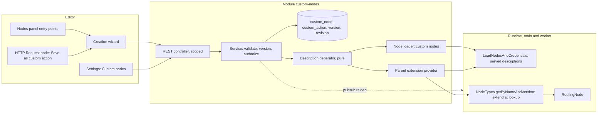

# Custom nodes and custom actions: design

Status: draft for approval. Author: Jason Schell. Date: 2026-11-22.

Reference implementation: branch `feat/custom-nodes-mockup` (a demo, not a base
to merge). Its docs are in `docs/custom-nodes-mockup/` on that branch.

## 1. Intent

Most APIs are much larger than their n8n node. Today the only answer is the
HTTP Request node. That configuration lives in one workflow. It has no name,
no icon, no typed fields, and no central place to fix it. Teams copy it between
workflows, and each copy drifts.

This feature lets a user turn an HTTP request into a reusable building block:

- A **custom action** adds an action to an existing node, for example Stripe.
  It appears in the node's Resource and Operation dropdowns. It uses the
  credential of that node.
- A **custom node** is a new node for a service that has no node. It has a
  name, a logo, a base URL, an authentication method, and one or more actions.

The community has asked for this for years. The demo got strong positive
feedback inside n8n. Reviewers asked for two more things: set up an action
without leaving the canvas, and let the n8n Assistant create actions.

## 2. Goals, non-goals, anti-goals

### Goals

1. A user can create a custom action or a custom node from an HTTP request.
   Entry points are on the canvas: the nodes panel and the HTTP Request node.
2. A custom action behaves like a built-in action of its parent node. This
   includes the nodes panel, the parameter panel, credentials, and execution.
3. Execution uses the existing declarative engine (`RoutingNode`). The feature
   adds no new execution engine.
4. The feature works in regular mode, queue mode, and multi-main mode.
5. An edit to an action cannot silently break a running workflow (section 6).
6. An administrator manages all definitions in one settings page.
7. The service API is complete enough for a later n8n Assistant tool
   (section 10). No UI-only logic.
8. The feature ships to `master` behind an opt-in flag, as a stack of small
   pull requests.

### Non-goals for the first version

- Promotion of Code nodes to custom nodes. A custom action is an HTTP request
  template. Arbitrary code needs a different execution path and a different
  security model.
- The n8n Assistant tool itself (project 2, section 10).
- Project-scoped definitions. All definitions are instance-wide.
- Source control (environments) sync. Section 9 defines the minimum for
  portability.
- Export as a community node package.
- Pagination, binary upload and download, multipart bodies, and streaming.
- Custom triggers.
- Parent nodes that have neither a `resource` nor an `operation` parameter. A
  new `operation` parameter would change the behavior of existing workflows.

### Anti-goals

The feature fails, even if it works, when one of these is true:

- A user without administrator rights can cause a request that carries another
  user's credential to a host that the credential owner did not approve.
- The feature changes the source or the loaded class of a built-in node.
- A workflow that uses no custom action behaves differently when the flag is on.
- An edit to a definition changes the fields of a node in a published workflow
  without a user action on that workflow.

## 3. Constraints

- Follow `AGENTS.md`. Important rules here: no `any`, no `as` outside tests,
  TypeORM only in the persistence layer, all UI text through i18n, no
  hardcoded pixel spacing, technical text in Simplified Technical English.
- New modules live in `packages/modules/<name>/{backend,frontend}`. Use the
  module CLI. Read `docs/backend/how-to/build-a-backend-module.md` and
  `packages/@n8n/module-cli/frontend-module-guide.md` first.
- Database changes follow the `n8n:db-migrations` skill and need a review by
  `@n8n-io/migrations-review`.
- `packages/cli` belongs to `@n8n-io/core-application`. `packages/core` and
  `packages/workflow` belong to `@n8n-io/core-execution`. Changes there need
  their approval.
- Do not edit `packages/nodes-base` node implementations.
- No new dependencies without a written reason.
- This is a public repository. Follow the security fix hygiene and customer
  confidentiality rules in `AGENTS.md`.

## 4. Approaches

The main question was how a custom action becomes part of its parent node.

| | Approach | Trade-off |
| --- | --- | --- |
| **A (chosen)** | Extend the node type when it is resolved. `NodeTypes.getByNameAndVersion` returns a prototype-backed copy of the parent with the custom actions added. | Needs changes in two files owned by core-application: three lookup paths in `node-types.ts` and an ordering option in `load-nodes-and-credentials.ts` (section 5.3). Uses an existing pattern: `getByNameAndVersion` builds AI tool variants this way. The loaded node does not change. Main and worker instances use the same path. |
| B | Patch the loaded node class in memory and wrap its `execute`. This is what the demo does. | Almost no change in core files. Changes shared state at run time. Depends on load order. Does not run on workers. Hard to test. |
| C | A general extension point in core that lets a module add actions to a node. | The cleanest end state. A much larger design discussion. Delays the feature. Approach A is a first step toward it. |
| D (rejected earlier) | A separate hidden node type that the nodes panel shows as an action of the parent. | On the canvas it is not a Stripe node and it is not in the Stripe dropdowns. Jason rejected this after the first demo. |

Jason chose A on 2026-11-22.

## 5. Architecture

### 5.1 Description generator

A pure function turns a stored definition into `INodeTypeDescription` data.
It has no I/O. It is the most tested unit. The demo generator
(`node-description.generator.ts` on the demo branch) is the starting point.

- Fixed request data goes into `requestDefaults` or into the `routing.request`
  of an operation option.
- Each input becomes a node property with `routing`.
- Required inputs are top-level properties. Optional inputs are in an
  "Additional Fields" collection.
- **A definition never widens a credential restriction.** `RoutingNode` on
  `master` treats a host from `requestDefaults.baseURL` as node-owned
  (`routing-node.ts`, base URL ownership check). For a node-owned host,
  `getCredentialAllowedDomains` adds the host to the allowed-domains list of
  the credential and lets mode `none` pass. That is correct for a node that
  n8n ships. It is wrong for a definition that an administrator wrote. The
  host of a custom action or custom node must count as caller-chosen:
  mode `none` blocks the request, and mode `domains` applies the list of the
  credential owner without additions. This can need a small, explicit signal
  in `RoutingNode`, which `@n8n-io/core-execution` owns. Add execution tests
  for modes `all`, `domains` (host in list, host not in list), and `none`.

### 5.2 Custom nodes

A `NodeLoader` serves custom nodes under the package name `n8n-custom`. The
precedent is `McpRegistryNodeLoader`. A custom node is a declarative node. Its
actions are options of one `operation` parameter.

### 5.3 Custom actions in a parent node (approach A)

Four places need the extended description. All four must give the same
result for the same definitions.

1. **Type files** (`types/nodes.json`). A post-processor of
   `LoadNodesAndCredentials` adds the "Custom" resource, the operation options,
   and the input properties to copies of the parent descriptions. It must run
   before the post-processors of `FrontendService`, `NodeCatalogService`,
   `AiWorkflowBuilderService`, and the Instance AI adapter, which read the
   same `types`. `addPostProcessor` only appends today, so it needs an ordering
   option.
2. **Single-node descriptions** (`POST /rest/node-types` and
   `/by-identifier`). These call `NodeTypes.getWithSourcePath`, which reads the
   loaded node directly. The editor replaces its stored description with this
   response. Without a hook here, an open parent node loses its custom
   actions.
3. **`NodeTypes.getByName`**, which also reads the loaded node directly.
4. **Run time.** `NodeTypes.getByNameAndVersion` asks a registered provider if
   the node type can have custom actions. If yes, it returns a prototype-backed
   copy with the extended description and an `execute` that dispatches:
   - selected operation is a known custom action: run `RoutingNode` with the
     generated runtime description and the credentials of the parent;
   - the reserved custom resource is selected but the action is unknown: fail
     with an error that names the action (section 9);
   - any other operation: call the original `execute` unchanged.

Put the extension in one private method of `NodeTypes` that all three lookup
paths use.

Rules:

- The loaded node object and its description are never mutated.
- The provider is an interface that the module registers. `NodeTypes` must not
  import the module.
- With no registered provider, or when the flag is off, `NodeTypes` behaves
  exactly as today.
- Cache the extended copies. Invalidate the cache when definitions change.
- A parent node needs a `resource` or an `operation` options parameter.
  Parents with only `operation` get the options appended. Trigger nodes and
  nodes with `supplyData` cannot be parents.
- A parent needs a credential that the declarative engine can apply. Reuse the
  existing `supportsProxyAuth` check. Exclude parents whose credential
  selector is not the `authentication` parameter.
- The run-time copy wraps every eligible parent when the module is on, not
  only parents that have actions on this instance. This is what makes the
  "missing definition" error possible.
- **AI tool variants (decided).** Custom actions do not appear in the `Tool`
  and `HitlTool` variants of a parent in the first version, and custom nodes
  are not usable as tools. Served and run-time descriptions must agree on
  this. Add a test for it. Support for tools is a follow-up.
- Input parameter names of custom actions share the namespace of the parent.
  Prefix them so that they cannot collide with parent parameters.

### 5.4 Reload and scaling

- After each write, the service rebuilds the affected descriptions and
  broadcasts `nodeDescriptionUpdated` to editors.
- A pubsub command reloads definitions on other main instances and on
  workers. The precedent is `reload-mcp-registry`.
- The module runs on `main` and `worker` instance types. Webhook instances
  need it too if they execute workflows.
- One lock serializes registry rebuilds. The precedent is `packageMutex` in
  the community packages service.

### 5.5 Edits to a custom node

- The authentication method of a custom node is fixed after creation. A change
  would break the credential of every node that uses it.
- The base URL is request-side data. An edit applies in place and keeps the
  earlier values for rollback, like a revision (section 6).
- Name, description, and logo are cosmetic and apply in place.

## 6. Versioning (decided)

Jason chose "split by kind of change" on 2026-11-22.

- A **version** is the input contract of an action: the set of inputs with
  name, type, required flag, option values, and default value.
- A **revision** is the request template of a version: method, URL, fixed
  headers, fixed query, fixed body, and the place where each input goes.
- An edit that changes only the revision applies in place. All nodes on that
  version use it on the next execution. The service keeps the revision
  history. An administrator can roll back to an earlier revision.
- An edit that changes the input contract creates a new version. Existing
  nodes stay on their version. New nodes get the newest version.
- Display names and descriptions of inputs are cosmetic. They apply in place.
- The **server** decides if an edit is a revision or a new version. The client
  does not choose.
- A node stores its pinned version in its parameters. The pin must survive
  save, reload, copy and paste, duplication, and workflow export and import.
- A version that a workflow uses cannot be deleted.
- A node stores the name of its custom action next to the id, so that an
  error can name an action that no longer exists.
- **Move to a newer version (decided).** A user upgrades one node at a time.
  - In the parameter panel, a node on an older version shows a notice that a
    newer version exists, with an upgrade button. The upgrade changes only
    that node. The user sees the changed fields before the workflow runs
    again.
  - The settings page shows which workflows still use an older version
    (section 9).
  - No bulk upgrade of all workflows in the first version.

**Version pin (decided, 2026-11-22).** The `operation` value carries the
action id and the version: `<actionId>@<version>`. Each version of an action is
one option of `operation`. An older version has option-level `displayOptions`
that show it only to a node that already uses it. The newest version hides
when the node uses an older version of the same action. The input properties
of a version show only for its option value. Two hidden parameters,
`customActionId` and `customActionName`, store the action name for an error
about an action that no longer exists. They have no `displayOptions`, and
their default is empty. Example of stored parameters:
`{ "operation": "a1@1", "customActionId": "a1", "customActionName": "Get Invoice", "invoiceId": "inv_1" }`.
Rules for later work:

- The default of `operation` must never be a custom action value. Use the
  default of the parent, or an empty string in a custom node. If the default
  is the newest version, a save strips the value and the node moves to the
  next new version.
- The `operation` property has `noDataExpression: true`. An expression in
  `operation` would show the options and inputs of every version.
- **One owner of the value format.** `version-pin.ts` in the backend module
  is the only code that builds or parses the `operation` value. The editor
  cannot import it, and it must not copy the format. The backend sends
  ready-made values instead: each version in an API response carries its
  `pinValues` (the parameter values that select that version). The editor
  writes those values as they are. To find out if a node is on an older
  version, the editor compares the `operation` value of the node with the
  `pinValues.operation` of the newest version.
- Editor change, nodes panel: `operationsCategory` and `resourceCategories`
  in `useActionsGeneration.ts` list all options. They must skip an option
  whose option-level `displayOptions` do not match the default parameters of
  a new node, as `getParameterDisplayableOptions` does. Without this change,
  old versions show as separate actions.
- Editor change, nodes panel and parameter panel: when the user selects a
  custom action, the editor writes `pinValues` (the operation value, the id
  and the name). If the name is missing, or belongs to another action, the
  run-time code uses the action id in its place.
- The module `version-pin.ts` owns the value format. Other code calls
  `operationOptions`, `showFor`, `pinProperties`, `readPin`, and `pinValues`,
  and does not parse the value.

## 7. Data model

Replace the single JSON column of the demo with tables and foreign keys.

| Table | Content | Relations |
| --- | --- | --- |
| `custom_node` | name, display name, description, base URL, authentication, icon | created-by user |
| `custom_action` | name, description, parent node type or custom node | `customNodeId` → `custom_node`, cascade. A check constraint requires exactly one of `parentNodeType` and `customNodeId`. |
| `custom_action_version` | version number, input contract | → `custom_action`, cascade. Unique on action and version. |
| `custom_action_revision` | revision number, request template, change note, author | → `custom_action_version`, cascade. Unique on version and revision. |

- Scaffold migrations with `pnpm --filter=@n8n/db migration:new`.
- Writes that touch more than one row run in one transaction through
  `TransactionRunner`.
- Shared types and zod schemas live in `@n8n/api-types`.
- The exact columns are left to the builder and the migrations review.

## 8. Security (decided)

A definition is code. Its templates are evaluated with access to
`$credentials`, and it selects the request host. Treat the right to create a
definition like the right to install a community package.

- New global scopes, for example `customNode:list`, `customNode:create`,
  `customNode:update`, `customNode:delete`. Owner and admin roles get the write
  scopes. All roles that can edit workflows get `customNode:list`.
- Every route has a `@GlobalScope`. Use the `n8n:protect-endpoints` skill.
- The service enforces the same permission, so that a later Assistant tool
  cannot bypass the controller.
- Templates accept only placeholders of the form `{inputName}` in the URL
  path. The service rejects any value that contains `{{` or starts with `=`
  at save time. The generator percent-encodes URL input values. A definition cannot read
  `$credentials`, `$env`, `$vars`, or other workflow data.
- For a custom action on a parent node, the request host is fixed in the
  definition and shown to the administrator at save time. A user of the action
  cannot change the host through an input.
- Icons: accept PNG and SVG up to a size limit. Reject an SVG that contains
  script elements, event handler attributes, `javascript:` URLs, or
  `foreignObject`. `packages/cli` has no sanitizer dependency, and a new
  dependency is not justified for this. Serve
  with a restrictive `Content-Security-Policy`, `X-Content-Type-Options:
  nosniff`, and no script execution. Apply the same validation on every route
  that accepts an icon.
- The icon route stays on the browser-id skip list, because image requests
  cannot send that header.
- Record the creator and the last editor of each definition.
- Run `/security-review` before each pull request that touches the module.

## 9. Lifecycle and portability

- **Used-in.** Extend the workflow dependency index with a dependency type for
  custom actions. The index entry records the action id and the pinned
  version. Bump `WORKFLOW_DEPENDENCY_INDEX_VERSION`.
- **Version usage view (decided).** The settings page is the central place to
  see which workflows are behind.
  - The version history of an action lists, for each version, the workflows
    that use it: workflow name, project, a link that opens the workflow, and
    whether the usage is in the draft or in the published version. The index
    already separates the two through `publishedVersionId`.
  - Versions older than the newest one are marked. The list of actions shows
    a count of workflows on an older version, so that an administrator sees
    at a glance where work is left.
  - A custom node has no version of its own. Its view shows the same data for
    each of its actions.
  - The view is read-only. The upgrade happens in the node (section 6).
  - The view shows only workflows that the current user can read.
- **Delete.** The service refuses to delete an action or a version that a
  workflow uses. The error lists the workflows.
- **Missing definition.** A workflow that references a missing custom action
  must fail with a clear error that names the action. This covers import from
  another instance. It must not fail with a generic "unknown option" message.
- **Export and import of definitions** as JSON files is a later step. The
  schemas in `@n8n/api-types` are the export format.

## 10. What project 2 needs from this design

The n8n Assistant gets a tool that creates and edits definitions. The layer
order of Instance AI is Tool → Service interface → Adapter → n8n internals.

- The service accepts a complete definition as data and validates it. It
  returns structured validation errors.
- The preview endpoint returns the generated parameters for a draft without a
  save.
- Permissions are enforced in the service (section 8).
- Creation by the Assistant goes through the existing approval flow.

Do not build the tool in project 1.

## 11. Frontend

- A frontend module at `packages/modules/custom-nodes/frontend`. It declares
  routes, settings page, and modals in its descriptor.
- **Settings page** "Custom nodes" in the Integrations section: list, edit,
  version and revision history, rollback, logo upload, delete with the used-in
  guard, and the version usage view (section 9).
- **Upgrade notice** in the parameter panel of a node on an older version
  (section 6). It needs the same shell extension surface as the entry points.
- **Wizard** with four steps: choose, request, fields, review. The demo wizard
  is one 966-line component. Split it into one component per step and a draft
  composable with unit tests. The review step renders the real parameter
  components if the module boundaries allow it.
- **Entry points on the canvas:**
  - last item of the nodes panel list, highlighted when a search has no result;
  - "Add custom action" at the end of the actions list of each node, with that
    node preselected;
  - "Save as custom action" in the HTTP Request node, prefilled from the node.
- The nodes panel and the node settings must not import the module. Add a
  small extension surface to the shell, or keep the entry point components in
  the shell behind the flag. The builder decides after reading the frontend
  module guide.
- Users without the create scope do not see the entry points.
- User-facing text says "action", never "operation". Use `n8n:content-design`
  for copy and `n8n:ui-design` for components.

## 12. Rollout

- **One switch for an instance.** The module `custom-nodes` is not a default
  module. `N8N_ENABLED_MODULES=custom-nodes` turns it on. This is the standard
  switch for a backend module. It decides if routes, node loaders, and the
  `NodeTypes` provider exist. It is per process and needs no user. Set it to
  the same value on main, worker, and webhook instances.
- The editor shows the feature when the module is active
  (`settingsStore.isModuleActive('custom-nodes')`).
- Do not use a remote PostHog evaluation to gate the registry or execution. It
  is cached, it can differ between instances, and it is off when diagnostics
  are disabled.
- A PostHog flag for a gradual rollout of the UI is a later step for the n8n
  team. It is not part of the first version.
- Switch off: no routes, no node types, no extended parents, no UI. Workflows
  that use custom actions or custom nodes then fail, as they do after the
  removal of a community package. Document this.
- **Preview branch (decided).** A colleague who wants to test the feature
  checks out one branch, builds, and starts n8n. No environment variable and
  no flag.
  - The preview branch holds the complete stack plus one commit that adds
    `custom-nodes` to `defaultModules`. That commit never merges to `master`.
  - Pull requests to `master` are cut without that commit. Their default is
    off.
  - The same commit seeds the demo definitions on first start, so that a
    tester sees working examples at once.
  - Keep the preview branch current with the top of the stack.
  - The demo branch `feat/custom-nodes-mockup` stays as it is until the
    preview branch is usable.
- No demo data in the code that merges. Demo seeds live in a test fixture and
  in the preview commit.
- Telemetry: creation, edit, and execution counts for each parent node type.
  Use the `n8n:telemetry` skill.

### Proposed pull request stack

1. Types and schemas in `@n8n/api-types`, flag, scopes.
2. Tables, entities, repositories.
3. Description generator with tests.
4. Custom nodes: loader, service, controller, reload.
5. Custom actions: provider hook in `NodeTypes`, served descriptions, version
   pin.
6. Frontend module: settings page.
7. Frontend: wizard and canvas entry points.
8. Dependency index, version usage view, delete guard, upgrade notice.
9. Telemetry and docs.

The order and size are the builder's call. Use the `n8n:gh-stack` skill.

## 13. Testing

- Unit tests for the generator, the version and revision classifier, the
  template validator, the provider hook, and the wizard draft logic.
- Integration tests for the controller and the service, including permission
  checks for each role.
- One execution test for each of: custom node, custom action on a programmatic
  parent, custom action on a declarative parent, credential with an
  allowed-domains restriction.
- One Playwright test for the main flow: HTTP Request node → save as custom
  action → add from nodes panel → execute against a mock.
- `AGENTS.md` requires that the user confirms test cases before they are
  written. The plan must include that step.

## 14. Left to the builder

- Exact column types and names.
- ~~Whether the backend module can live in `packages/modules/`~~ Decided
  2026-11-22: the backend module lives in `packages/cli/src/modules/custom-nodes/`.
  It needs `LoadNodesAndCredentials`, `NodeTypes`, and `Push`. The module guide
  allows this location for a module that depends on code in `packages/cli`.
  `mcp-registry` is the precedent. Confirm in `#team-backend`.
- The version pin mechanism, after the spike in section 6.
- The shape of the shell extension surface for the nodes panel.
- Names of scopes, routes, and i18n keys.
- What to port from the demo branch. Good candidates: the generator, the
  mapping from HTTP Request parameters to a draft, and the seed definitions as
  test fixtures.

## 15. Open items for Jason

- Linear ticket and branch name. `AGENTS.md` asks for the branch name from
  Linear. The working branch is `custom-nodes-and-actions` until a ticket
  exists.
- A sponsor in `@n8n-io/core-application` for the changes in `node-types.ts`
  (three lookup paths) and `load-nodes-and-credentials.ts` (post-processor
  order), and in `@n8n-io/core-execution` if `RoutingNode` needs the signal
  from section 5.1. Get agreement before pull request 5.

## 16. Plans

- Plan 1, backend foundation and custom nodes:
  `.agents/specs/2026-11-22-custom-nodes-and-actions-plan-1-backend-foundation.md`
- Plans 2 to 4 are listed at the end of plan 1. Each is written when the plan
  before it is done.

## 17. Review record

A builder check on 2026-11-22 found one factual error and six open points.
Jason's decisions are marked "decided". These points are the author's calls
and are open to correction:

- A definition never widens a credential restriction (5.1).
- Hooks in three lookup paths of `NodeTypes`, one shared method (5.3).
- Parents without `resource` and `operation` are out of the first version (2).
- Parent eligibility follows `supportsProxyAuth` (5.3).
- Authentication of a custom node is fixed after creation; base URL edits
  apply in place with history (5.5).
- `N8N_ENABLED_MODULES` turns the feature on; a PostHog flag is a later step (12).
- The missing-definition error comes from the run-time copy, and the node
  stores the action name (5.3, 6, 9).
