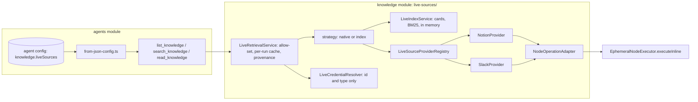

# Knowledge live retrieval: PoC spec

Status: plan, not started. Setup decisions of 2026-11-19 applied (see
"Decisions"). Ticket: https://linear.app/n8n/issue/KNO-338
(project "Knowledge live retrieval"). Research notes (internal):
[Knowledge live retrieval: PoC approach and session notes](https://app.notion.com/p/41b5b6e0c94f81148174fb637547c64f).

This branch is a proof of concept. It never merges as is. It produces
measurements and a recommendation, not a release.

## Goal

Agents read picked items of external services at run time. No copy stays in
n8n. The agent reads only the picked items and nothing else in the source.
Every answer links to the source item.

The PoC compares two retrieval strategies behind one tool surface with the
plain MCP baseline, for Notion and Slack:

- `native`: the provider's own search, plus in-process search over cached
  picked items.
- `index`: an in-memory card index (BM25) over the picked containers; reads
  stay live.
- ~~`mirror`: fetched text in the sandbox mirror, searched with the existing
  ripgrep commands.~~ Dropped: no sandbox is available locally. The design
  stays on the Notion page.
- `C0` (baseline): the hosted Notion and Slack MCP servers attached as
  `mcpServers`, read-only tool permissions, picked items listed in the
  instructions.

Out of scope: Google Drive, Salesforce, the browse picker, the P1 collection
tables, the unified facade over files and vector stores, telemetry events,
and tests except one (see "Decisions").

## What the code gives us (verified)

| Need | What exists | Note |
|---|---|---|
| Run one node operation | `EphemeralNodeExecutor.executeInline(request)` in `packages/cli/src/node-execution/ephemeral-node-executor.ts` | Needs no workflow id. Takes `nodeType`, `nodeTypeVersion`, `nodeParameters`, `credentialDetails`, `inputData`, `projectId`. Returns `{ status, data, error?, violations? }`; validation failures come back as `status: 'error'`. |
| `authentication` parameter | `detectAuthenticationParameterValue` in `@n8n/ai-utilities/node-catalog` | The agent node-tool path does not call it. The adapter must set the parameter from the credential type. |
| OAuth refresh | The node HTTP helpers refresh inside `executeInline` | The live path never decrypts a credential. It resolves `{ id, type }` only. |
| Notion v3 | `page:getMarkdown`, `page:search`, `dataSource:search`, `databasePage:getAll`, `block:getAll` | No page `listSearch`. Containers list through execute operations. |
| Slack v2.7 | `message:search` (`assistant.search.context`, appends `in:<channel>`), `channel:history`, `channel:replies`, `message:getPermalink` | Needs a user token with the 2.7 `search:read` scopes. |
| MCP baseline | `buildMcpClientForServer`, `toolPermissions` | The registry Notion and Slack entries are test mocks. C0 uses the hosted URLs with `mcpOAuth2Api` credentials. |
| Tool pattern | `modules/agents/tools/knowledge/search-knowledge.tool.ts` | Error wrapping, output caps, `redactText`, `truncateKnowledgeText`. |
| Attach point | `buildFromJson` in `modules/agents/json-config/from-json-config.ts` | `attachWorkspaceAndKnowledge` needs the sandbox; live tools attach here instead. |
| Run data | `GET /rest/projects/:projectId/agents/v2/:agentId/threads/:threadId` | `executions[]` carry tokens, duration and `timeline[]` tool calls. |

Runtimes are cached. Per-run state must key on `ctx.runId` inside the
service, not on tool build. No BM25 library exists in the repo.

## Architecture



## Config

In `packages/@n8n/api-types/src/agents/agent-json-config.schema.ts`, next to
`vectorStores`. The `provider` field is an open string. The registry validates
it, not the schema.

```ts
knowledge: z.object({
  liveSources: z.array(z.object({
    id: z.string().min(1).max(64).regex(/^[a-zA-Z0-9_-]+$/), // used in refs
    provider: z.string().min(1),                 // 'notion' | 'slack' in the PoC
    name: z.string().min(1).max(64),
    description: z.string().max(512).optional(), // shown in the knowledge map
    credential: z.string().min(1),
    retrieval: z.enum(['native', 'index']).optional(), // default per provider; 'mirror' reserved
    items: z.array(z.object({
      id: z.string().min(1),
      kind: z.enum(['item', 'container']),
      containerType: z.string().optional(), // notion: page | dataSource; slack: channel
      title: z.string().min(1),
      url: z.string().url().optional(),
      parentId: z.string().optional(),
    })).max(200),
  })).max(20),
}).strict().optional(),
```

One row in `CREDENTIAL_LOCATIONS`
(`modules/agents/utils/visit-agent-credential-references.ts`):
`{ path: ['knowledge', 'liveSources', '[]', 'credential'] }`. This row gives
the save-time credential check, the `agent_credential_dependency` rows and the
runtime eviction on credential change.

Feature flag: `N8N_KNOWLEDGE_LIVE_SOURCES_ENABLED` on `KnowledgeConfig`
(`liveSourcesEnabled`, default `false`), read by
`KnowledgeAvailabilityService.isLiveSourcesEnabled()`. The flag gates the
tools and the routes.

## Files

```
packages/cli/src/modules/knowledge/
  knowledge.config.ts                      + liveSourcesEnabled
  knowledge-availability.service.ts        + isLiveSourcesEnabled()
  knowledge.module.ts                      + register the built-in providers on init
  live-sources/
    live-source-provider.ts                contract and helper types
    live-source-provider-registry.ts       get(id), list(); throws on an unknown provider
    live-credential-resolver.ts            the one seam: (projectId, principal, credentialId, allowedTypes) -> { id, type }
    node-operation-adapter.ts              execute(ctx, op) over EphemeralNodeExecutor.executeInline
    live-source.errors.ts                  LiveSourceUnavailableError and the sanitiser
    live-retrieval-schemas.ts              zod inputs of the three tools, ref parsing, result types
    live-retrieval.service.ts              allow-set, per-run cache, provenance, strategy dispatch, endRun(runId)
    live-index.service.ts                  cards and BM25 per agentId:sourceId
    strategies/native.strategy.ts
    strategies/index.strategy.ts
    providers/notion.provider.ts
    providers/slack.provider.ts
    __tests__/live-retrieval.service.test.ts   the one test: the allow-set refusal
packages/cli/src/modules/agents/
  tools/knowledge/live-knowledge.tool.ts   the three tools
  json-config/from-json-config.ts          + options.buildLiveKnowledgeTools after the vector-store block
  agent-runtime-reconstruction.service.ts  implements the hook in buildConfiguredRuntime, gated by the flag
  agent-turn-execution.service.ts          + liveRetrievalService.endRun(runId) next to sendRunUsage
  agent-knowledge-live.controller.ts       POST .../:agentId/knowledge/live-sources/:sourceId/index
  BUILT_IN_TOOLS.md                        + the three tools and their attach condition
packages/@n8n/api-types/src/agents/agent-json-config.schema.ts   + knowledge.liveSources
scripts/knowledge-live-harness/            run.mjs, seed-sources.mjs, fixtures/, results/
```

The existing boundary files (`knowledge-retriever.ts`,
`knowledge-sandbox-provider.ts`) do not change. The knowledge module imports
nothing from `modules/agents`.

## Contracts

```ts
type Principal = { kind: 'project' } | { kind: 'person'; user: User }; // serviceAccount, delegated reserved

type RunContext = {
  projectId: string;
  principal: Principal;
  credential: { id: string; type: string }; // never decrypted here
  runId: string;
  signal?: AbortSignal;
};

type LiveSourceItem = { id: string; kind: 'item' | 'container'; containerType?: string; title: string; url?: string; parentId?: string };
type LiveEntry = LiveSourceItem & { icon?: string; hasChildren?: boolean; updatedAt?: string };
type LiveEntryRef = { sourceId: string; itemId: string }; // knowledge://live/<sourceId>/<itemId>
type LiveHit = { ref: string; sourceId: string; title: string; snippet: string; url?: string; lineRange?: { start: number; end: number }; updatedAt?: string; retrieval: 'native' | 'index' };
type LiveDocument = { id: string; title: string; url: string; text: string; updatedAt?: string };

interface KnowledgeLiveSourceProvider {
  readonly id: string;                           // registry key
  readonly credentialTypes: readonly string[];   // notion: notionOAuth2Api, notionApi; slack: slackOAuth2Api, slackApi
  readonly capabilities: { nestedContainers: boolean; nativeContainerSearch: boolean; persistableContent: boolean };
  readonly defaultRetrieval: 'native' | 'index';
  resolveLink(ctx: RunContext, url: string): Promise<LiveEntry | null>; // paste-a-link, replaces browse
  list(ctx: RunContext, container: LiveSourceItem, req: { cursor?: string; limit?: number }): Promise<{ entries: LiveEntry[]; cursor?: string }>;
  search(ctx: RunContext, scope: LiveSourceItem[], query: string, limit: number): Promise<LiveHit[]>;
  read(ctx: RunContext, ref: LiveEntryRef): Promise<LiveDocument>;
}
```

`NodeOperationAdapter.execute(ctx, { nodeType, nodeTypeVersion, parameters, input? })`:

1. Sets `parameters.authentication` from `ctx.credential.type` when the node
   has that parameter.
2. Builds `credentialDetails: { [ctx.credential.type]: { id, name: '' } }`.
   `executeInline` fills the name.
3. Calls `executeInline` with `ctx.projectId`.
4. Maps `status: 'error'` and `violations` to `LiveSourceUnavailableError`
   with a sanitised message. Raw node errors never reach the model.

Providers never touch credentials or the executor directly. `listSearch` is
not needed in the PoC; it comes with the picker.

`LiveRetrievalService`:

- `describe(sources)`: the knowledge map, no API call.
- `list`, `search`, `read(scope, sources, callCtx, request)`.
- `endRun(runId)`.
- Per-run state `{ allowSet: Map<sourceId, Set<itemId>>, docs: Map<ref, LiveDocument>, credentials }`
  in a `Map<runId, …>` with a TTL sweep plus the explicit `endRun`.
- The allow-set starts from `items[]`. Only ids that `list` or `search` of a
  picked container return extend it. `read` of any other id returns
  `{ error: 'Not in the selected knowledge', errorType: 'out_of_scope' }`.
- Every hit carries `{ ref, sourceId, title, url, retrieval, runId }`.
- Every provider error, policy refusal and auth failure becomes an explicit
  "source unavailable" result, never an empty result.

## Tools

Built in the agents module with the SDK `Tool` builder.

| Tool | Input | Behaviour |
|---|---|---|
| `list_knowledge` | `{ scope?: string; filter?: string; cursor?: string }` | No arguments: the map and the picked items, no API call. A container ref: `provider.list`. |
| `search_knowledge` | `{ query: string; scope?: string[]; limit?: number }` (limit 1-20, default 10) | Strategy of each source. Hits with refs and urls. |
| `read_knowledge` | `{ ref: string; ranges?: Array<{ startLine; endLine }> }` (max 10 ranges) | Allow-set check, per-run cache, line ranges, citation. |

All three: `.untrustedOutput()`, `.systemInstruction()` with the guidance
(read before you cite, cite the url, say "not in the selected knowledge" when
nothing matches, prefer the most recently edited item when two conflict and
name it), `toModelOutput` caps that reuse `truncateKnowledgeText`,
`redactText` and the constants in `retrieval/retrieval-schemas.ts`. Errors are
returned as `{ error, errorType }`, never thrown.

Attach: `BuildFromJsonOptions.buildLiveKnowledgeTools?: (sources) => Promise<BuiltTool[]>`,
called in `buildFromJson` after the vector-store block when
`config.knowledge?.liveSources?.length > 0`. The reconstruction service
implements the hook, gated by `isLiveSourcesEnabled()`. Neither strategy
needs a sandbox.

## Strategies

| Strategy | search | read | Notes |
|---|---|---|---|
| `native` | `provider.search` per picked container, plus in-process search over the cached picked items | live | Floor of the PoC. |
| `index` | BM25 over cards `{ ref, title, path, head ≤500 chars (redacted), updatedAt }` built on rebuild or first search; caps: 500 entries, depth 2 | live | In memory per `agentId:sourceId`. Lost on restart. Slack cards hold channel metadata only. `list_knowledge()` shows `indexed N of M` and the build time. |

BM25: about 80 lines in `live-index.service.ts`. No new dependency.

`mirror` (fetched text under `<home>/knowledge-mirror/live/<sourceId>/`,
searched with the existing `rg` and `awk` commands) is dropped from the PoC:
no sandbox is available locally. If one becomes available, it is a day-4
optional again.

## Provider mapping

| | Notion v3 (`n8n-nodes-base.notion`, version 3) | Slack v2.7 (`n8n-nodes-base.slack`, version 2.7) |
|---|---|---|
| resolveLink | `pageLocator` url regex (`v3/actions/common.descriptions.ts`), then `page:get` for the title | archive-URL regex: channel id and optional `p<ts>` |
| list | `block:getAll` (`child_page`, `child_database`), `databasePage:getAll` with `dataSourceLocator` | `channel:history` (`oldest` = 30 days by default, cap 200) |
| search | `page:search` post-filtered by the allow-set; data sources through `databasePage:getAll` with a title filter; in-process over cached items | `message:search` per picked channel, post-filter by `channel` |
| read | `page:getMarkdown` | `channel:replies` for the thread; url from `message:getPermalink` |
| defaultRetrieval | `index` for containers, `native` for items | `native` |
| persistableContent | `true` | `false` (terms forbid stored messages) |
| credential in the PoC | `notionApi` internal integration token first; `notionOAuth2Api` before the final runs if time allows | `slackOAuth2Api` user token from a new app in a test workspace; the n8n default user scopes include `search:read.*` |

## Harness

Two dev scripts in the private root package, like `scripts/instance-seeding`.
Secrets come from env vars, never from arguments.

`scripts/knowledge-live-harness/seed-sources.mjs` (root script
`knowledge:seed-sources`) creates the test content, so every run sees the same
fixtures:

- Notion, through the API with `NOTION_SEED_TOKEN` (the internal integration
  that the `notionApi` credential also uses) under `NOTION_SEED_ROOT_PAGE_ID`:
  a root page "Knowledge PoC" with "Refund policy (2024)", "Refund policy
  (2026)", "Pricing FAQ", a "Support KB" data source with about 300 rows (some
  with poor titles), and a "Not picked" page for the scope probe.
- Slack, through the API with `SLACK_SEED_USER_TOKEN` (the user token of the
  test app, so the messages are not bot messages): a `#support` channel with
  a few threads, and a `#not-picked` channel for the scope probe.
- Writes the created ids to `fixtures/items.json`. A re-run replaces its own
  content.

`scripts/knowledge-live-harness/run.mjs` (root script `knowledge:harness`):

- Env vars: `N8N_BASE_URL`, `N8N_EMAIL`, `N8N_PASSWORD`, `N8N_PROJECT_ID`,
  `N8N_MODEL_CREDENTIAL_ID` (the Anthropic credential).
- Login through `POST /rest/login`. Create or update the agents from
  `fixtures/agent.json` and `fixtures/items.json` through
  `POST /rest/projects/:projectId/agents/v2` and `PUT .../:agentId`.
- Rebuild the indexes. Run `fixtures/questions.json` three times per agent
  through `POST .../:agentId/chat`. Consume the stream until done; fall back
  to polling the thread.
- Read `executions[]` from `GET .../:agentId/threads/:threadId`: tokens,
  duration, `timeline[]` tool calls.
- Score `expectedContains`, `expectedUrl` and `expectRefusal`. A refusal
  passes the scope probe.
- Write `results/<commit>-<time>.json` and a markdown table.

Agents on one scaffold, same instructions, same items, same model: one
Anthropic model snapshot through a direct Anthropic credential (direct route,
so native tool deferral is available).

| Agent | Delta |
|---|---|
| `kb-native` | `retrieval: native` on every source |
| `kb-index` | `retrieval: index`; index built before the run |
| `kb-mcp-c0` | no live sources; `mcpServers` with the hosted Notion and Slack servers, read-only `toolPermissions`, picked items with urls in the instructions |
| `kb-hybrid` (optional) | `index` for Notion, `native` for Slack |
| ~~`kb-mirror`~~ | dropped with the `mirror` strategy |

Question classes, at least two per class per source: item, container,
disambiguation, freshness, scope probe, context beyond the match. Include a
Notion data source with a few hundred rows.

Metrics in priority order: answer, citation and abstention correctness; tokens
per correct answer; wall time, turns, tool calls, scope violations. Report per
source.

## Decisions

1. `provider` is an open string validated by the registry, not a `type` enum.
2. One test only: the allow-set refusal in `live-retrieval.service.test.ts`.
   The allow-set is the value proposition.
3. No telemetry registry or `AgentKnowledgeUsageTracker` change. The timeline
   carries the data; provenance lives in the tool output. P1 follow-up.
4. The day-0 spikes run through a throwaway agent with `type: 'node'` tools.
   Same `executeInline` path, zero code.
5. Per-run state keys on `ctx.runId` with a TTL plus `endRun` from the
   turn-execution run end.
6. `listSearch` and the browse route wait for the picker. The adapter only
   needs `execute`.
7. Drop order under pressure: the stub panel, `index`. Floor: `native`, C0,
   the harness.

Setup decisions of 2026-11-19:

8. A script seeds the test content in Notion and Slack. Same fixtures for
   every run.
9. Notion starts with a `notionApi` internal integration token. OAuth2 comes
   before the final runs only if time allows.
10. Slack runs in a test workspace with a new app. No company data in the
    PoC.
11. The test agents use one Anthropic model snapshot through a direct
    credential.
12. `mirror` is dropped: no sandbox is available locally.
13. The stub "Live sources" panel stays the last optional item.
14. KNO-338 stays as it is until the results exist.

## Rules on this branch

- No `@n8n/typeorm` in business logic. Credential lookup goes through
  `CredentialsRepository.findCredentialsUsableInProject` and
  `CredentialsFinderService`.
- `OperationalError` for an unavailable source, `UserError` for scope refusals
  and bad refs. Never `ApplicationError`.
- `search-knowledge.tool.snapshot.test.ts` and the sandbox-id test stay
  untouched. Test agents have no uploaded files, so `search_text` and
  `search_knowledge` do not coexist.
- The `@Env` JSDoc is public documentation. Follow the `n8n:env-var-docs`
  skill.
- No secrets in command arguments. Harness credentials come from env vars.

## Open questions (settle on day 0)

- Does Slack `in:` accept a channel id, or only a name? Fallback: post-filter
  by `channel`.
- Exact output shape of Notion `page:getMarkdown` through `executeInline`.
  Fallback: `block:getAll` with `simplifyOutput`.
- Is the hosted Slack MCP server reachable, and does the Notion MCP OAuth grant
  work, for C0?
- Which model snapshot and which route (deferred or eager tools; the new tools
  are not in `harnessEagerToolNames`).
- Completion signal for the harness: stream end or polling the thread.
- Storage policy per source before the `index` tier persists anything. The
  PoC keeps everything in memory.

## Implementation TODO

### Day 0: branch, flag, spikes, C0 check

- [x] Branch `kno-338-research-track` from fresh master
- [ ] `liveSourcesEnabled` on `KnowledgeConfig`, `isLiveSourcesEnabled()` on the availability service
- [ ] Notion internal integration (token, root page shared with it); `notionApi` credential in the local project
- [ ] Slack test workspace and app (n8n default user scopes); `slackOAuth2Api` credential in the local project; user token for the seed script
- [ ] Anthropic credential in the local project
- [ ] `seed-sources.mjs` seeds the Notion and Slack content and writes `fixtures/items.json`
- [ ] Spike 1: Notion `page:getMarkdown` output shape through a node-tool agent
- [ ] Spike 2: Slack `message:search` with `in:` and a channel id
- [ ] Spike 3: `executeInline` runs both operations without a workflow id
- [ ] C0: hosted Notion and Slack MCP servers connect; tool lists recorded
- [ ] Spike outputs saved under `scripts/knowledge-live-harness/fixtures/spikes/`

### Day 1: vertical slice, Notion, `native`

- [ ] `knowledge.liveSources` schema and types in `@n8n/api-types`
- [ ] `CREDENTIAL_LOCATIONS` row
- [ ] Provider contract, registry, credential resolver, adapter, errors, schemas
- [ ] `LiveRetrievalService` with the `native` strategy
- [ ] Notion provider: `resolveLink`, `list`, `search`, `read`
- [ ] The three tools and the `buildLiveKnowledgeTools` hook
- [ ] `BUILT_IN_TOOLS.md` entry
- [ ] Exit: an agent with one Notion source answers an item question with a url and refuses an unpicked page

### Day 2: Slack, per-run state, C0 agent, the test

- [ ] Slack provider: `resolveLink`, `list`, `search`, `read`
- [ ] `endRun` hook in the turn-execution run end
- [ ] Allow-set refusal test
- [ ] `fixtures/agent.json` for `kb-native`, `kb-index`, `kb-mcp-c0`
- [ ] Exit: `kb-native` answers a Slack channel question with a permalink; `kb-mcp-c0` runs

### Day 3: `index`, harness, question set

- [ ] `LiveIndexService`: cards, BM25, caps, status
- [ ] Rebuild route in `agent-knowledge-live.controller.ts` (flag-gated, `agent:update`)
- [ ] Index status in `list_knowledge()`
- [ ] Harness script, fixtures, root `knowledge:harness` script
- [ ] Question set with the large Notion data source
- [ ] Exit: a results table for `kb-native` and `kb-mcp-c0`

### Day 4: runs, write-up

- [ ] Three runs per question and agent, same model snapshot
- [x] ~~`mirror` strategy and `kb-mirror`, if time allows~~ Dropped: no sandbox available locally
- [ ] `notionOAuth2Api` credential and a re-run of the Notion questions, if time allows
- [ ] Stub "Live sources" panel, if time allows
- [ ] Write-up on the Notion page: per-source correctness, tokens per correct answer, wall time, turns, tool calls, scope violations, effort actuals, recommendation
