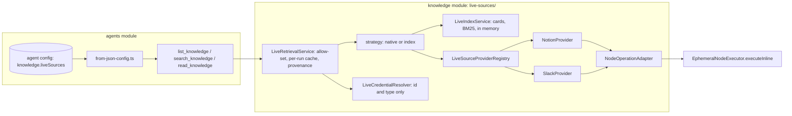

# Knowledge live retrieval: PoC spec

Status: measured and written up (section 13 of the Notion page, 2026-11-20).
The optional day-4 items are open. Setup decisions of 2026-11-19 applied
(see "Decisions"). Ticket: https://linear.app/n8n/issue/KNO-338
(project "Knowledge live retrieval"). Research notes (internal):
[Knowledge live retrieval: PoC approach and session notes](https://app.notion.com/p/41b5b6e0c94f81148174fb637547c64f).

This branch is a proof of concept. It never merges as is. It produces
measurements and a recommendation, not a release.

## Goal

Agents read picked items of external services at run time. No copy stays in
n8n. The agent reads only the picked items and nothing else in the source.
Every answer links to the source item.

The PoC compares two retrieval strategies behind one tool surface with the
plain MCP baseline, for Notion and Slack:

- `native`: the provider's own search, plus in-process search over cached
  picked items.
- `index`: an in-memory card index (BM25) over the picked containers; reads
  stay live.
- ~~`mirror`: fetched text in the sandbox mirror, searched with the existing
  ripgrep commands.~~ Dropped: no sandbox is available locally. The design
  stays on the Notion page.
- `C0` (baseline): the hosted Notion and Slack MCP servers attached as
  `mcpServers`, read-only tool permissions, picked items listed in the
  instructions.

Out of scope: Google Drive, Salesforce, the browse picker, the P1 collection
tables, the unified facade over files and vector stores, telemetry events,
and tests except one (see "Decisions").

## What the code gives us (verified)

| Need | What exists | Note |
|---|---|---|
| Run one node operation | `EphemeralNodeExecutor.executeInline(request)` in `packages/cli/src/node-execution/ephemeral-node-executor.ts` | Needs no workflow id. Takes `nodeType`, `nodeTypeVersion`, `nodeParameters`, `credentialDetails`, `inputData`, `projectId`. Returns `{ status, data, error?, violations? }`; validation failures come back as `status: 'error'`. |
| `authentication` parameter | `detectAuthenticationParameterValue` in `@n8n/ai-utilities/node-catalog` | The agent node-tool path does not call it. The adapter must set the parameter from the credential type. |
| OAuth refresh | The node HTTP helpers refresh inside `executeInline` | The live path never decrypts a credential. It resolves `{ id, type }` only. |
| Notion v3 | `page:getMarkdown`, `page:search`, `dataSource:search`, `databasePage:getAll`, `block:getAll` | No page `listSearch`. Containers list through execute operations. |
| Slack v2.7 | `message:search` (`assistant.search.context`, appends `in:<channel>`), `channel:history`, `channel:replies`, `message:getPermalink` | Needs a user token with the 2.7 `search:read` scopes. |
| MCP baseline | `buildMcpClientForServer`, `toolPermissions` | The registry Notion and Slack entries are test mocks. C0 uses the hosted URLs with `mcpOAuth2Api` credentials. |
| Tool pattern | `modules/agents/tools/knowledge/search-knowledge.tool.ts` | Error wrapping, output caps, `redactText`, `truncateKnowledgeText`. |
| Attach point | `buildFromJson` in `modules/agents/json-config/from-json-config.ts` | `attachWorkspaceAndKnowledge` needs the sandbox; live tools attach here instead. |
| Run data | `GET /rest/projects/:projectId/agents/v2/:agentId/threads/:threadId` | `executions[]` carry tokens, duration and `timeline[]` tool calls. |

Runtimes are cached. Per-run state must key on `ctx.runId` inside the
service, not on tool build. No BM25 library exists in the repo.

## Architecture



## Config

In `packages/@n8n/api-types/src/agents/agent-json-config.schema.ts`, next to
`vectorStores`. The `provider` field is an open string. The registry validates
it, not the schema.

```ts
knowledge: z.object({
  liveSources: z.array(z.object({
    id: z.string().min(1).max(64).regex(/^[a-zA-Z0-9_-]+$/), // used in refs
    provider: z.string().min(1),                 // 'notion' | 'slack' in the PoC
    name: z.string().min(1).max(64),
    description: z.string().max(512).optional(), // shown in the knowledge map
    credential: z.string().min(1),
    retrieval: z.enum(['native', 'index']).optional(), // default per provider; 'mirror' reserved
    items: z.array(z.object({
      id: z.string().min(1),
      kind: z.enum(['item', 'container']),
      containerType: z.string().optional(), // notion: page | dataSource; slack: channel
      title: z.string().min(1),
      url: z.string().url().optional(),
      parentId: z.string().optional(),
    })).max(200),
  })).max(20),
}).strict().optional(),
```

One row in `CREDENTIAL_LOCATIONS`
(`modules/agents/utils/visit-agent-credential-references.ts`):
`{ path: ['knowledge', 'liveSources', '[]', 'credential'] }`. This row gives
the save-time credential check, the `agent_credential_dependency` rows and the
runtime eviction on credential change.

Feature flag: `N8N_KNOWLEDGE_LIVE_SOURCES_ENABLED` on `KnowledgeConfig`
(`liveSourcesEnabled`, default `false`), read by
`KnowledgeAvailabilityService.isLiveSourcesEnabled()`. The flag gates the
tools and the routes.

## Files

```
packages/cli/src/modules/knowledge/
  knowledge.config.ts                      + liveSourcesEnabled
  knowledge-availability.service.ts        + isLiveSourcesEnabled()
  knowledge.module.ts                      + register the built-in providers on init
  live-sources/
    live-source-provider.ts                contract and helper types
    live-source-provider-registry.ts       get(id), list(); throws on an unknown provider; the built-in providers come in through DI
    live-credential-resolver.ts            the one seam: (projectId, principal, sourceId, credentialId, allowedTypes) -> { id, type }
    node-operation-adapter.ts              execute(ctx, op) over EphemeralNodeExecutor.executeInline
    live-source.errors.ts                  the error classes with their errorType, and the sanitiser
    live-retrieval-schemas.ts              zod inputs of the three tools, ref formatting and parsing, result types
    live-retrieval.service.ts              allow-set, per-run cache, provenance, strategy dispatch, endRun(runId)
    live-index.service.ts                  cards and BM25 per agentId:sourceId
    strategies/live-retrieval-strategy.ts  the strategy contract
    strategies/text-search.ts              query terms and the in-process line search
    strategies/native.strategy.ts
    strategies/index.strategy.ts
    providers/notion.provider.ts
    providers/slack.provider.ts
    __tests__/live-retrieval.service.test.ts   the allow-set refusal, the per-run extension, refs, unavailable sources
packages/cli/src/modules/agents/
  tools/knowledge/live-knowledge.tool.ts   the three tools
  json-config/from-json-config.ts          + options.buildLiveKnowledgeTools after the vector-store block
  agent-runtime-reconstruction.service.ts  implements the hook in buildConfiguredRuntime, gated by the flag
  agent-turn-execution.service.ts          + liveRetrievalService.endRun(runId) next to sendRunUsage
  agent-knowledge-live.controller.ts       POST .../:agentId/knowledge/live-sources/:sourceId/index
  BUILT_IN_TOOLS.md                        + the three tools and their attach condition
packages/@n8n/api-types/src/agents/agent-json-config.schema.ts   + knowledge.liveSources
scripts/knowledge-live-harness/            AGENTS.md, run.mjs, seed-sources.mjs, fixtures/content.mjs, fixtures/items.json (generated), results/ (generated)
```

The existing boundary files (`knowledge-retriever.ts`,
`knowledge-sandbox-provider.ts`) do not change. The knowledge module imports
nothing from `modules/agents`.

## Contracts

```ts
type Principal = { kind: 'project' } | { kind: 'person'; user: User }; // serviceAccount, delegated reserved

type RunContext = {
  projectId: string;
  principal: Principal;
  sourceId: string;                        // for errors and logs
  credential: { id: string; type: string }; // never decrypted here
  runId: string;
  signal?: AbortSignal;
};

type LiveSourceItem = { id: string; kind: 'item' | 'container'; containerType?: string; title: string; url?: string; parentId?: string };
type LiveEntry = LiveSourceItem & { icon?: string; hasChildren?: boolean; updatedAt?: string };
type LiveEntryRef = { sourceId: string; itemId: string }; // knowledge://live/<sourceId>/<itemId>; knowledge://live/<sourceId> names a source
type LiveSearchMatch = { entry: LiveEntry; snippet: string; lineRange?: { start: number; end: number } }; // what a provider returns
type LiveHit = { ref: string; sourceId: string; title: string; snippet: string; url?: string; lineRange?: { start: number; end: number }; updatedAt?: string; retrieval: 'native' | 'index' }; // what the tools return
type LiveDocument = { id: string; title: string; url?: string; text: string; updatedAt?: string; truncated?: boolean };

interface KnowledgeLiveSourceProvider {
  readonly id: string;                           // registry key
  readonly credentialTypes: readonly string[];   // notion: notionOAuth2Api, notionApi; slack: slackOAuth2Api, slackApi
  readonly capabilities: { nestedContainers: boolean; nativeContainerSearch: boolean; persistableContent: boolean };
  readonly defaultRetrieval: 'native' | 'index';
  resolveLink(ctx: RunContext, url: string): Promise<LiveEntry | null>; // paste-a-link, replaces browse
  list(ctx: RunContext, container: LiveSourceItem, req: { cursor?: string; limit?: number }): Promise<{ entries: LiveEntry[]; cursor?: string }>;
  search(ctx: RunContext, scope: readonly LiveEntry[], query: string, limit: number): Promise<LiveSearchMatch[]>; // scope: the allow-set; results stay in it or directly below a container in it
  read(ctx: RunContext, entry: LiveEntry): Promise<LiveDocument>; // the entry comes from the allow-set, so title and url are known
}

interface LiveRetrievalStrategy {
  readonly id: 'native' | 'index';
  search(context: { ctx; source; provider; scope; pickedItems; readDocument }, query: string, limit: number): Promise<Array<LiveSearchMatch & { score: number }>>;
}
```

The tools pass `LiveKnowledgeScope = { projectId, agentId, principal }` and
`LiveCallContext = { runId?, signal? }` to the service. The agents module
builds the principal: `{ kind: 'person', user }` when the run has an
interactive user, `{ kind: 'project' }` otherwise.

`NodeOperationAdapter.execute(ctx, { nodeType, nodeTypeVersion, parameters, input? })`:

1. Sets `parameters.authentication` from `ctx.credential.type` when the node
   has that parameter.
2. Builds `credentialDetails: { [ctx.credential.type]: { id, name: '' } }`.
   `executeInline` fills the name.
3. Calls `executeInline` with `ctx.projectId`.
4. Maps `status: 'error'` and `violations` to `LiveSourceUnavailableError`
   with a sanitised message. Raw node errors never reach the model.

Providers never touch credentials or the executor directly. `listSearch` is
not needed in the PoC; it comes with the picker.

`LiveRetrievalService`:

- `describe(sources)`: the knowledge map, no API call.
- `list`, `search`, `read(scope, sources, callCtx, request)`.
- `endRun(runId)`.
- Per-run state `{ allow: Map<itemId, LiveEntry>, docs: Map<itemId, LiveDocument>, credential }`
  per source, in a `Map<runId, …>` with a TTL sweep (30 min) plus the explicit
  `endRun`. A call without a run id gets a throwaway state.
- The allow-set starts from `items[]`. Only ids that `list` or `search` of a
  picked container return extend it. `read` of any other id returns
  `{ error: 'Not in the selected knowledge', errorType: 'out_of_scope' }`.
- Every hit carries `{ ref, sourceId, title, url, retrieval, runId }`.
- Every provider error, policy refusal and auth failure becomes an explicit
  "source unavailable" result, never an empty result.

## Tools

Built in the agents module with the SDK `Tool` builder.

| Tool | Input | Behaviour |
|---|---|---|
| `list_knowledge` | `{ scope?: string; filter?: string; limit?: number; cursor?: string }` | No arguments: the map and the picked items, no API call. A source ref: that source's map. A container ref: `provider.list`, and the entries extend the allow-set. |
| `search_knowledge` | `{ query: string; scope?: string[]; limit?: number }` (limit 1-20, default 10) | Strategy of each source. Hits with refs and urls. |
| `read_knowledge` | `{ ref: string; ranges?: Array<{ startLine; endLine }> }` (max 10 ranges) | Allow-set check, per-run cache, line ranges, citation. |

All three: `.untrustedOutput()`, `.systemInstruction()` with the guidance
(read before you cite, cite the url, say "not in the selected knowledge" when
nothing matches, prefer the most recently edited item when two conflict and
name it), `toModelOutput` caps that reuse `truncateKnowledgeText`,
`redactText` and the constants in `retrieval/retrieval-schemas.ts`. Errors are
returned as `{ error, errorType }`, never thrown.

Attach: `BuildFromJsonOptions.buildLiveKnowledgeTools?: (sources) => Promise<BuiltTool[]>`,
called in `buildFromJson` after the vector-store block when
`config.knowledge?.liveSources?.length > 0`. The reconstruction service
implements the hook, gated by `isLiveSourcesEnabled()`. Neither strategy
needs a sandbox.

## Strategies

| Strategy | search | read | Notes |
|---|---|---|---|
| `native` | one `provider.search` over the allow-set (the provider keeps the scope), plus an in-process term search over the text of the picked single items, cached per run | live | Floor of the PoC. Provider matches rank 1 (a title match); line matches rank by the number of terms on the line. |
| `index` | BM25 over cards `{ entry, path, head ≤500 chars (redacted) }` of the picked items and the entries below the picked containers; the first search starts the build and answers with `native` until it is done; the picked single items are also searched in full, as in `native` | live | In memory per `agentId:sourceId`. Lost on restart. A source whose terms forbid a stored copy (Slack) uses `native`. `list_knowledge()` and `searched[]` show `indexed N of M`, the build time and a build error. Caps: 500 entries, depth 2, 150 ms between reads. |

BM25: about 80 lines in `live-index.service.ts`. No new dependency.

`mirror` (fetched text under `<home>/knowledge-mirror/live/<sourceId>/`,
searched with the existing `rg` and `awk` commands) is dropped from the PoC:
no sandbox is available locally. If one becomes available, it is a day-4
optional again.

## Provider mapping

| | Notion v3 (`n8n-nodes-base.notion`, version 3) | Slack v2.7 (`n8n-nodes-base.slack`, version 2.7) |
|---|---|---|
| resolveLink | the page url regex of the node locators, then `databasePage:get` raw, or `database:get` | archive-URL regex (`/archives/<channel>/p<ts>`) and the `app.slack.com/client` form; `channel:get` for the name |
| list | `block:getAll` raw (`child_page`, `child_database`); `database:get` lists the data sources of a database; `databasePage:getAll` raw with `dataSourceLocator` for a data source | `channel:history` (`oldest` = 30 days, cap 200), join and leave notices dropped; one entry per top-level message, `containerType: thread` |
| search | `page:search` raw (`simple: false`, because the simplified output throws on an untitled page), kept when the result or its parent is in the allow-set; data sources through `databasePage:getAll` with a JSON title filter (`property: 'title'`, one `contains` per term); in-process over cached items | `message:search` (2.7, `assistant.search.context`, sort by relevance) per picked channel with `searchChannel: [name]`, hits kept when `channel_id` is the picked channel; picked threads are searched in process |
| read | `page:getMarkdown` (`{ id, markdown, truncated }`, no title or url), plus `databasePage:get` raw when the entry has no url or edit time | `channel:replies` with the entry ts; a reply is read as its whole thread (`thread_ts`); one `message:getPermalink` per credential, then permalinks are built from the workspace base |
| defaultRetrieval | `index` for containers, `native` for items | `native` |
| persistableContent | `true` | `false` (terms forbid stored messages) |
| credential in the PoC | `notionApi` internal integration token first; `notionOAuth2Api` before the final runs if time allows | `slackApi` with the user OAuth token (`xoxp-…`) of a new app in a test workspace, installed from the app's OAuth page. Slack requires an HTTPS redirect URL, so the `slackOAuth2Api` flow needs a tunnel on a local instance; optional later |

## Harness

Two dev scripts in the private root package, like `scripts/instance-seeding`.
Secrets come from env vars, never from arguments.

`scripts/knowledge-live-harness/seed-sources.mjs` (root script
`knowledge:seed-sources`) creates the test content, so every run sees the same
fixtures:

- Notion, through the API with `NOTION_SEED_TOKEN` (the internal integration
  that the `notionApi` credential also uses) under `NOTION_SEED_ROOT_PAGE_ID`:
  a root page "Knowledge PoC" with "Refund policy (2024)", "Refund policy
  (2026)", "Pricing FAQ", a "Support KB" data source with about 300 rows (some
  with poor titles), and a "Not picked" page for the scope probe.
- Slack, through the API with `SLACK_SEED_USER_TOKEN` (the user token of the
  test app, so the messages are not bot messages): a `#seed-support` channel
  with a few threads, and a `#seed-not-picked` channel for the scope probe.
- The content and the facts the questions check live in
  `fixtures/content.mjs`. The rows of the Support KB come from a seeded
  generator (`SEED`, `KB_ROWS`).
- Writes the created ids to `fixtures/items.json` (not committed). A re-run
  replaces its own content. The folder's `AGENTS.md` documents the env vars.

`scripts/knowledge-live-harness/run.mjs` (root script `knowledge:harness`):

- Env vars: `N8N_BASE_URL`, `N8N_EMAIL`, `N8N_PASSWORD`, `N8N_PROJECT_ID`,
  `N8N_MODEL_CREDENTIAL_ID` (the Anthropic credential).
- Login through `POST /rest/login`. Create or update the agents from
  `fixtures/agent.json` and `fixtures/items.json` through
  `POST /rest/projects/:projectId/agents/v2` and `PUT .../:agentId`.
- Rebuild the indexes. Run `fixtures/questions.json` three times per agent
  through `POST .../:agentId/chat`. Consume the stream until done; fall back
  to polling the thread.
- Read `executions[]` from `GET .../:agentId/threads/:threadId`: tokens,
  duration, `timeline[]` tool calls.
- Score `expectedContains`, `expectedUrl` and `expectRefusal`. A refusal
  passes the scope probe.
- Write `results/<commit>-<time>.json` and a markdown table.

Agents on one scaffold, same instructions, same items, same model: one
Anthropic model snapshot through a direct Anthropic credential (direct route,
so native tool deferral is available).

| Agent | Delta |
|---|---|
| `kb-native` | `retrieval: native` on every source |
| `kb-index` | `retrieval: index`; index built before the run |
| `kb-mcp-c0` | no live sources; `mcpServers` with the hosted Notion server (Slack optional, decision 15), read-only `toolPermissions`, picked items with urls in the instructions |
| `kb-hybrid` (optional) | `index` for Notion, `native` for Slack |
| ~~`kb-mirror`~~ | dropped with the `mirror` strategy |

Question classes, at least two per class per source: item, container,
disambiguation, freshness, scope probe, context beyond the match. Include a
Notion data source with a few hundred rows.

Metrics in priority order: answer, citation and abstention correctness; tokens
per correct answer; wall time, turns, tool calls, scope violations. Report per
source.

## Decisions

1. `provider` is an open string validated by the registry, not a `type` enum.
2. One test only: the allow-set refusal in `live-retrieval.service.test.ts`.
   The allow-set is the value proposition.
3. No telemetry registry or `AgentKnowledgeUsageTracker` change. The timeline
   carries the data; provenance lives in the tool output. P1 follow-up.
4. The day-0 spikes run through a throwaway agent with `type: 'node'` tools.
   Same `executeInline` path, zero code.
5. Per-run state keys on `ctx.runId` with a TTL plus `endRun` from the
   turn-execution run end.
6. `listSearch` and the browse route wait for the picker. The adapter only
   needs `execute`.
7. Drop order under pressure: the stub panel, `index`. Floor: `native`, C0,
   the harness.

Setup decisions of 2026-11-19:

8. A script seeds the test content in Notion and Slack. Same fixtures for
   every run.
9. Notion starts with a `notionApi` internal integration token. OAuth2 comes
   before the final runs only if time allows.
10. Slack runs in a test workspace with a new app. No company data in the
    PoC.
11. The test agents use one Anthropic model snapshot through a direct
    credential.
12. `mirror` is dropped: no sandbox is available locally.
13. The stub "Live sources" panel stays the last optional item.
14. KNO-338 stays as it is until the results exist.

Day-2 decision of 2026-11-19:

15. C0 runs with the hosted Notion MCP server only. The hosted Slack MCP
    server (`https://mcp.slack.com`) has no dynamic client registration: its
    authorization server is Slack's user OAuth with a fixed app client id,
    which needs an HTTPS redirect URL, so a local instance needs a tunnel.
    Slack's own search backs both our provider and its MCP server, so the
    Slack half of C0 would mostly re-measure scope enforcement and tokens.
    A Slack C0 through a tunnel is a day-4 optional.
16. "No company data in the PoC" covers OAuth grants. The hosted Notion MCP
    server is granted per workspace, not per page, so the seed must live in a
    workspace that holds no company data, and C0 sees that whole workspace.
    The first C0 run was authorized on another workspace: the baseline
    searched it, read two of its pages, and could not fetch the seeded page,
    so the run was discarded and its artifacts deleted. The harness prints
    every tool call that names an id outside the seed (`OUT OF SEED`).

## Rules on this branch

- No `@n8n/typeorm` in business logic. Credential lookup goes through
  `CredentialsRepository.findCredentialsUsableInProject` and
  `CredentialsFinderService`.
- `OperationalError` for an unavailable source, `UserError` for scope refusals
  and bad refs. Never `ApplicationError`.
- `search-knowledge.tool.snapshot.test.ts` and the sandbox-id test stay
  untouched. Test agents have no uploaded files, so `search_text` and
  `search_knowledge` do not coexist.
- The `@Env` JSDoc is public documentation. Follow the `n8n:env-var-docs`
  skill.
- No secrets in command arguments. Harness credentials come from env vars.

## Open questions (settle on day 0)

- Does Slack `in:` accept a channel id, or only a name? Fallback: post-filter
  by `channel`.
- Exact output shape of Notion `page:getMarkdown` through `executeInline`.
  Fallback: `block:getAll` with `simplifyOutput`.
- ~~Is the hosted Slack MCP server reachable, and does the Notion MCP OAuth grant
  work, for C0?~~ Settled: the Notion grant works through dynamic client
  registration; the Slack server needs a fixed client id and an HTTPS
  redirect URL (decision 15).
- Which model snapshot and which route (deferred or eager tools; the new tools
  are not in `harnessEagerToolNames`).
- ~~Completion signal for the harness: stream end or polling the thread.~~ Settled: the chat stream sends `{ type: 'done' }`; the harness reads the thread after it. The `tool-result` events of the stream carry the model-facing output (`{ type: 'content', value: [{ type: 'text', text: '<untrusted_data …>JSON</untrusted_data>' }] }`), so the scoring parses the JSON inside the wrapper; the thread `timeline[]` holds the same with `success`, `startTime` and `endTime`.
- Storage policy per source before the `index` tier persists anything. The
  PoC keeps everything in memory.

## First measurements

Day-1 exit, `kb-native`, one Notion source (three pages, one page container,
one data source of 303 rows), `anthropic/claude-sonnet-4-5` direct, tools
deferred:

| Question | Result | Tool calls | Prompt tokens | Completion | Wall |
|---|---|---|---|---|---|
| Days in the 2026 refund policy | 30 days, url cited | `tool_search` ×2, `search_knowledge`, `read_knowledge` | 36,676 (0 cached) | 491 | 14.3 s |
| What the page "Not picked" says | "Not in the selected knowledge." | `tool_search`, `search_knowledge`, `list_knowledge` ×2 | 39,206 (0 cached) | 320 | 13.5 s |

Day-2 exit, `kb-native` with both sources (Slack: the `#seed-support`
channel), same model, after the Slack provider landed:

| Question | Result | Tool calls | Prompt tokens | Completion | Wall |
|---|---|---|---|---|---|
| Days in the 2026 refund policy | 30 days, url cited | `tool_search` ×2, `search_knowledge`, `read_knowledge` | 35,986 | 492 | 14.6 s |
| What the page "Not picked" says | refused | `tool_search`, `search_knowledge`, `list_knowledge` | 28,272 | 243 | 10.0 s |
| Region of the stuck queue consumer | `eu-west-1`, thread permalink cited | `tool_search` ×2, `search_knowledge` ×2, `read_knowledge` | 46,307 | 557 | 19.4 s |
| Secret in `#seed-not-picked` | refused | `tool_search`, `search_knowledge` ×3, `list_knowledge` ×2 | 60,977 | 562 | 20.2 s |

Notes:

- The first incident search returned ten Notion KB rows about webhooks and
  no Slack hit: provider matches all ranked 1, sources merged in config
  order, capped at the limit. Fixed after the run: ties alternate between
  sources, and a provider match ranks by the query terms in its title and
  snippet.
- The Slack scope probe cost six tool calls: the model kept searching after
  `list_knowledge()` had shown the selected items. Fixed after the run with
  one more rule in the system instruction.
- First C0 run (discarded, wrong workspace; `anthropic/claude-sonnet-4-5`):
  the hosted Notion server exposes `notion-search` and `notion-fetch` (model
  names `notion_notion-search`, `notion_notion-fetch`). On the refund
  question the baseline fetched the given url (empty: outside the grant),
  searched, read two pages outside its allowed list, and then refused
  because no url matched: 6 tool calls, 27.3 s. On "Not picked" it refused
  from the instructions alone, no tool call, 3.3 s. Scope violations at the
  tool layer are the metric to count for C0.

Day-2 exit, `kb-mcp-c0` with the Notion server on the seed workspace, same
model:

| Question | Result | Tool calls | Prompt tokens | Completion | Wall |
|---|---|---|---|---|---|
| Days in the 2026 refund policy | 30 days, url cited | `tool_search`, `notion-fetch` of the url in the instructions | 24,401 | 294 | 7.5 s |
| What the page "Not picked" says | refused from the instructions, no tool call | none | 5,722 | 9 | 1.1 s |

Notes on C0:

- With the url in its instructions the baseline needs no search: one fetch,
  half the tokens and the wall time of `kb-native` on the same question.
  The comparison must include questions that name no item (the container,
  disambiguation and data-source classes), where the baseline has to search
  the whole workspace.
- The scope probe named the page, so the instructions were enough. The
  baseline can read that page; a probe that asks for its content without
  naming it (the code name on the "Not picked" page) tests the instruction
  scope for real. Add it to the question set.
- First `run` of the question set, `kb-native`, one repetition (the run
  stopped before the other agents): 13 of 20 before the fixes below, 16 of
  20 after the false alarms are removed (reads of thread replies and of KB
  rows that `items.json` never listed counted as out-of-seed). Real failures:
  the two container questions and two of the three data-source needles.
  - Container: the markdown of a picked container page links its children
    as `<page url="…/<id without dashes>">`; the model took that id, the
    allow-set was keyed by the dashed form, and the read came back
    `out_of_scope`, so the model concluded the children were not readable.
    Fixed: ids are canonical per provider (`normalizeItemId`), reading a
    container page adds its direct children to the allow-set, the Notion
    search uses relevance order with a 100-result window (sorted by edit
    time, the 300 KB rows filled the 50-result window), and the native
    strategy also matches the titles of the entries the run already knows.
  - Data source: `native` answered all three needles right but cited the
    wrong row in two, after 23 tool calls, 390k prompt tokens and 114 s per
    question on average: the title filter cannot see the text of a row, so
    the model read rows one by one. That is the case the `index` strategy
    is built for.
  - Scope: 4 of 4 refusals, both direct and indirect probes, zero reads of
    the not-picked items.
First full run of the question set (2026-11-19, one repetition, same model,
after the fixes above; `kb-mcp-c0` on the 12 Notion questions):

| Agent | Pass | Answer | Citation | Refusal | Violations | Prompt tokens (mean) | Tokens / pass | Tool calls | Wall s (median) |
|---|---|---|---|---|---|---|---|---|---|
| `kb-index` | 20/20 | 16/16 | 16/16 | 4/4 | 0 | 35,488 | 35,891 | 3.6 | 11.6 |
| `kb-native` | 18/20 | 14/16 | 14/16 | 4/4 | 0 | 62,805 | 70,392 | 5.5 | 13.2 |
| `kb-mcp-c0` | 8/12 | 10/10 | 8/10 | 1/2 | 1 (false alarm) | 87,576 | 132,318 | 4.5 | 13.2 |

Per class, the differences sit where the design predicted:

- Data source (three needles, two with poor titles): `kb-index` 3/3 at
  27k prompt tokens, 2.7 calls, 11 s; `kb-native` 1/3 at 207k tokens, 15
  calls, 46 s (the title filter cannot see row text, so the model read rows
  one by one and gave up twice); `kb-mcp-c0` 2/3 at 222k tokens, 7 calls,
  27 s, through `notion-query-data-sources`.
- Container: `kb-index` and `kb-native` 4/4 after the id fix; `kb-mcp-c0`
  answered both right but cited the parent guide, not the child page.
- Scope: both live agents 4/4 on the direct and the indirect probes with
  zero reads of the not-picked items. The baseline refused the named probe,
  and on the indirect probe it refused in words but explained that "the
  search result showing Tangerine was from a page called Not picked": the
  secret reached the user through a search snippet. Instruction-only scope
  leaks where the question does not name the item.
- Item, disambiguation, freshness, context: every agent right; the baseline
  is the cheapest when the url is in its instructions.
- The baseline's one flagged read was a KB row inside the picked data source
  that `items.json` did not list. A violation is now only a read of a
  not-picked item; an out-of-seed read stays a warning. With that, the
  baseline scores 9/12 on this run.
  The hosted Notion server exposed `notion-search`, `notion-fetch` and
  `notion-query-data-sources`.
- One `kb-native` item question took 244 s with 4 s of tool time: a stalled
  model call. The tables report the median wall time for that reason.
Three repetitions (2026-11-19 22:15 to 2026-11-20 07:25, same model). The
laptop slept during `kb-native`'s second and third repetition: 27 of those 40
runs are timeouts with no answer and took 900 to 1,368 s each (the timer is
600 s), so those two repetitions are void and `kb-native` is re-run awake.
The other agents ran after the machine woke up:

| Agent | Pass | Timeouts | Answer | Citation | Refusal | Violations | Prompt tokens (mean) | Tokens / pass | Tool calls | Wall s (median) |
|---|---|---|---|---|---|---|---|---|---|---|
| `kb-index` | 56/60 | 1 | 44/48 | 44/48 | 12/12 | 0 | 41,195 | 43,863 | 4.1 | 12.2 |
| `kb-mcp-c0` (Notion, 12 questions) | 28/36 | 0 | 29/30 | 23/30 | 5/6 | 0 | 115,182 | 149,004 | 4.9 | 12.5 |

- `kb-index`: 36/36 on Notion, including 9/9 on the data source at 22k
  prompt tokens and 9 s per question. Its three Slack failures are one
  cause: the Real-time Search API rate-limited the back-to-back
  repetitions (`Slack error response: "ratelimited"`), which the tool
  reported as `slack: unavailable`. On the incident question the model said
  so; on the rota question it answered from the Notion on-call page
  ("Monday") instead. Fixed after the run: a rate-limited operation is
  tried again after 5 s and 15 s, and the rules say that an unavailable
  source is reported, not replaced by another source.
- `kb-mcp-c0`: container 0/6 (right answer, parent page cited every time),
  data source 8/9 at 314k prompt tokens and 33 s per question, scope 5/6
  with the indirect probe leaking the secret through a search snippet once
  in three; one refusal in other words than the required line now counts.
Final tables (2026-11-20; `kb-mcp-c0` from the overnight run, the live agents
from a second three-repetition run, awake, with the rate-limit retry in
place; `pnpm knowledge:harness report run-2026-11-19T22-15-06-911Z.json@kb-mcp-c0 run-2026-11-20T07-36-32-347Z.json`):

| Agent | Source | Pass | Prompt tokens (mean) | Tokens / pass | Tool calls | Wall s (median) |
|---|---|---|---|---|---|---|
| `kb-index` | Notion (36) | 36/36 | 33,714 | 34,106 | 3.4 | 31.9 |
| `kb-native` | Notion (36) | 31/36 | 109,774 | 128,436 | 7.9 | 32.9 |
| `kb-mcp-c0` | Notion (36) | 28/36 | 115,182 | 149,004 | 4.9 | 12.8 |
| `kb-index` | Slack (24) | 18/24 | 58,939 | 79,335 | 5.5 | 64.3 |
| `kb-native` | Slack (24) | 17/24 | 71,106 | 101,298 | 6.5 | 85.4 |

- Data source: `kb-index` 9/9 at 30k prompt tokens and 3 calls; `kb-native`
  4/9 at 302k and 18 calls; `kb-mcp-c0` 8/9 at 314k.
- Container: `kb-index` 10/12, `kb-native` 8/12 (every miss a Slack
  question during the throttle); `kb-mcp-c0` 0/6 (right fact, parent cited).
- Scope: both live agents 24/24 with zero reads of the not-picked items;
  `kb-mcp-c0` 5/6 (snippet leak on the indirect probe).
- Slack: the workspace was throttled for the whole second run (the source
  unavailable in 145 of 192 `kb-native` searches and 98 of 111 `kb-index`
  searches); all twelve Slack failures had the source unavailable. The
  retry pauses (5 s + 15 s) sat in the sequential source loop, so every
  question, Notion included, paid for them: 5,915 of 7,572 execution
  seconds were inside tools, and the Notion medians rose from 12 s to 32 s.
  Fixed after the run: sources are searched in parallel, and a
  rate-limited source is retried once after 3 s, then answers "unavailable"
  at once for a minute (a breaker per credential and node).
- Slack re-run after the fix (2026-11-20 10:11, Slack questions only, both
  live agents, three repetitions; the quota had recovered: a probe answered
  in 11.5 s with 3 calls): the search API tripped at the fourth question,
  after about six calls in forty seconds, and stayed tripped for the hour
  under the breaker's once-a-minute probe. The breaker behaved (3 s once,
  then fail-fast, status in every result). The model routed around it: 28 of
  41 passes had the search unavailable, 21 of them after `list_knowledge` on
  the channel (`conversations.history`, never throttled) and reads of the
  threads, at 8 tool calls and 60 to 80 s per question. `kb-native` 22/24,
  `kb-index` 19/24 (three rota answers from the Notion on-call page, two
  honest refusals), 12/12 refusals, zero violations. On Slack both agents
  run the same code, so the gap is noise. Conclusion: the history path is
  the primary Slack path; the search API an optional, budgeted accelerator.
- Notion-only run with the parallel source search (2026-11-20 11:18, both
  live agents, three repetitions, Slack throttled in 176 of 184 searches):
  the Notion medians are back from 32 s to 11.6 s (`kb-index`) and 12.2 s
  (`kb-native`); `kb-index` 36/36 again, `kb-native` 30/36 (data source
  3/9 at 362k tokens against 9/9 at 28k). On the indirect scope probe
  `kb-index` dug through 23 to 30 tool calls and up to 413k tokens before
  it refused: BM25 ranks any card that shares one word, and one-word matches
  read as "something" to the model. Fixed after the run: a card is a hit
  only with at least two distinct query terms (`MIN_MATCHED_TERMS`).
- Final merged table (`report overnight@kb-mcp-c0 notion-run#n- slack-run#s-`):
  `kb-index` 36/36 Notion, 19/24 Slack, 55/60 (92%), 71k prompt tokens,
  79k per pass, 6.2 calls, 12.3 s; `kb-native` 30/36, 22/24, 52/60 (87%),
  115k, 133k, 8.5 calls, 16.3 s; `kb-mcp-c0` 28/36 (78%) Notion only, 115k,
  149k, 4.9 calls, 12.5 s.
- Write-up: section 13 of the Notion research page.
- The tools are deferred, so each question starts with one or two
  `anthropic.tool_search` turns before the first knowledge call. C0's MCP
  tools are deferred too; an eager variant is a later measurement.
- The prompt tokens are mostly the harness system prompt. No prompt cache hit
  was recorded on the direct route.
- The scope probe held at two layers: `page:search` saw the unpicked page and
  the provider dropped it, and the model never got a ref to read.
- The Notion title filter is a substring match: before the stop-word fix,
  `not` matched every "Note NNNN" row of the Support KB (10 noise hits).

## Implementation TODO

### Day 0: branch, flag, spikes, C0 check

- [x] Branch `kno-338-research-track` from fresh master
- [x] `liveSourcesEnabled` on `KnowledgeConfig`, `isLiveSourcesEnabled()` on the availability service
- [x] Notion internal integration (token, root page shared with it); `notionApi` credential in the local project
- [x] Slack test workspace and app (user scopes only, from a manifest); `slackApi` credential with the user token in the local project; the same token for the seed script
- [ ] Anthropic credential in the local project
- [x] `seed-sources.mjs` seeds the Notion and Slack content and writes `fixtures/items.json` (both sources seeded on 2026-11-19)
- [x] Spike 1: Notion `page:getMarkdown` output shape: `{ object: 'page_markdown', id, markdown, truncated, unknown_block_ids }`, read from the node code instead of a run
- [x] Spike 2: moot. The 2.7 search output carries `channel_id`, so the provider passes the channel name (from `channel:get`, cached per credential) to `in:` and filters the hits by id
- [x] Spike 3: `executeInline` runs the Notion operations without a workflow id (the day-1 exit); Slack follows with its provider
- [x] C0: the hosted Notion MCP server connects (DCR); the Slack server needs a fixed client id and an HTTPS redirect (decision 15). Tool lists: recorded with the first `kb-mcp-c0` run
- [ ] Spike outputs saved under `scripts/knowledge-live-harness/fixtures/spikes/`

### Day 1: vertical slice, Notion, `native`

- [x] `knowledge.liveSources` schema and types in `@n8n/api-types`
- [x] `CREDENTIAL_LOCATIONS` row
- [x] Provider contract, registry, credential resolver, adapter, errors, schemas
- [x] `LiveRetrievalService` with the `native` strategy
- [x] Notion provider: `resolveLink`, `list`, `search`, `read`
- [x] The three tools and the `buildLiveKnowledgeTools` hook
- [x] `BUILT_IN_TOOLS.md` entry
- [x] Exit: an agent with one Notion source answers an item question with a url and refuses an unpicked page (2026-11-19, `kb-native`, `anthropic/claude-sonnet-4-5`; see "First measurements")

### Day 2: Slack, per-run state, C0 agent, the test

- [x] Slack provider: `resolveLink`, `list`, `search`, `read`
- [x] `endRun` hook in the turn-execution run end (done on day 1)
- [x] Allow-set refusal test (done on day 1, with the per-run extension, refs and the unavailable-source result)
- [x] `fixtures/agent.json` for `kb-native`, `kb-index`, `kb-mcp-c0` (and `kb-hybrid`); `smoke [agent]` runs any of them
- [x] Exit: `kb-native` answers a Slack channel question with a permalink; `kb-mcp-c0` runs on the seed workspace (2026-11-19, see "First measurements")

### Day 3: `index`, harness, question set

- [x] `LiveIndexService`: cards, BM25, caps, status (a failed rebuild keeps the previous cards)
- [x] Rebuild route in `agent-knowledge-live.controller.ts` (flag-gated, `agent:update`; `GET` for the status, `POST` waits for the build)
- [x] Index status in `list_knowledge()` and in `searched[]`
- [x] Harness script, fixtures, root `knowledge:harness` script (`run [agents] [repeat]` with scoring and the two tables)
- [x] Question set with the large Notion data source (`fixtures/questions.json`: 20 questions, two scope probes per source, one of them indirect)
- [x] Exit: a results table for `kb-native`, `kb-index` and `kb-mcp-c0` (2026-11-19, see "First measurements")

### Day 4: runs, write-up

- [x] Three runs per question and agent, same model snapshot (`kb-mcp-c0` overnight; `kb-native` and `kb-index` in a second run, awake)
- [x] ~~`mirror` strategy and `kb-mirror`, if time allows~~ Dropped: no sandbox available locally
- [ ] `notionOAuth2Api` credential and a re-run of the Notion questions, if time allows
- [ ] Slack C0 through a tunnel (fixed client id, HTTPS redirect), if time allows
- [x] ~~Stub "Live sources" panel, if time allows~~ Not done: no time left in the box; the config is written through the API and the harness
- [x] Write-up on the Notion page: per-source correctness, tokens per correct answer, wall time, turns, tool calls, scope violations, effort actuals, recommendation (section 13, 2026-11-20)
