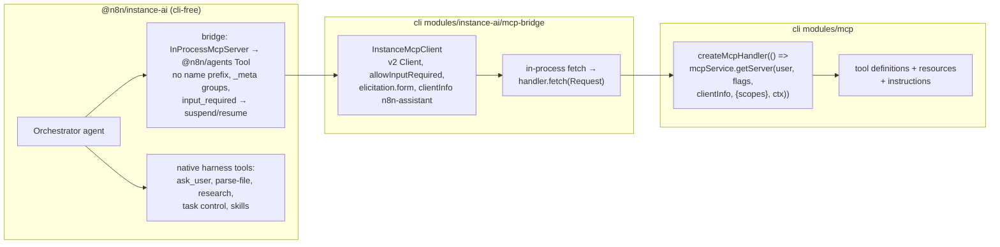

# PoC: MCP as the shared tool layer for n8n AI surfaces

Status: PoC, internal demo. Not for release. No feature flag: the branch bakes
the behaviour in.

## Goal

Find out to what extent the MCP protocol can be the tool layer that every AI
surface in n8n shares. The first consumer is the n8n Assistant
(`@n8n/instance-ai`). It becomes a real MCP client of the instance MCP server
(`packages/cli/src/modules/mcp`) and uses the server's workflow-building tools
instead of its native domain tools.

The deliverable is the capability matrix below, filled in with results, plus
eval score deltas and a list of protocol gaps.

## Decisions

| # | Decision | Choice |
|---|---|---|
| 1 | MCP client implementation | Add `@modelcontextprotocol/client@2.3.0` (same major and minor as the server) to `packages/cli` |
| 2 | Transport | In-process: the client's `fetch` calls `createMcpHandler(...).fetch(Request)`. No socket, no token. HTTP loopback is an optional last milestone |
| 3 | Where the bridge lives | cli host side (`packages/cli/src/modules/instance-ai/mcp-bridge/`), exposed to `@n8n/instance-ai` through the existing `LocalMcpServer` seam. No `@n8n/agents` changes in the PoC |
| 4 | Elicitation forms in the Assistant UI | Map `requestedSchema` onto the existing `questions` card |
| 5 | Confirmation elicitation on destructive MCP tools | Default on for every client that declares form elicitation |
| 6 | Sandbox | Both the compile service (M3) and the workspace over MCP (M4). No per-user quota |
| 7 | Rollout | No env var or PostHog flag. The branch replaces native tools group by group, per milestone |

## Facts the design rests on

- `McpService.getServer(user, featureFlags, clientInfo, auth, ctx)` is public
  (`packages/cli/src/modules/mcp/mcp.service.ts:515`). The public endpoint wraps
  it with `createMcpHandler(..., { legacy: 'stateless' })` and `toNodeHandler`
  (`mcp.controller.ts:246-263`). `handler.fetch(Request)` runs the same code
  path without Express and without the auth middleware
  (`__tests__/mcp-handshake-contract.test.ts:16-44`).
- Durable approval needs multi-round-trip elicitation (protocol revision
  2026-07-28): a tool returns `{ resultType: 'input_required', inputRequests,
  requestState }`; the client re-issues the same `tools/call` with
  `params.inputResponses` and `params.requestState`. The existing example is
  `tools/save-user-preference.tool.ts:114-117`. A 2025-era client on the
  stateless leg gets `isError: true` text instead.
- `requestState` is not integrity-protected unless the server configures
  `ServerOptions.requestState.verify`. Approval tools must sign it or re-derive
  the action on retry.
- `@n8n/agents` ships the v1 MCP client with `capabilities: {}` and no `_meta`
  hook (`runtime/mcp/mcp-connection.ts:137, 259-265`). It cannot be the client.
- The Assistant has the seams already: `LocalMcpServer`
  (`packages/@n8n/instance-ai/src/types.ts:1483-1491`),
  `createToolsFromLocalMcpServer` (`src/tools/create-tools-from-mcp-server.ts`),
  `orchestrationContext.disabledToolNames` (`src/agent/instance-agent.ts:194`),
  and `_meta` on tool definitions (`mcp.types.ts:49-50`).
- `mcp` lazy-imports `instance-ai` for the instance-context tools
  (`mcp.service.ts:755-759`). The Assistant host must resolve `McpService`
  lazily too, so the cli module graph has no static cycle.

## Architecture



Server-side changes are additive:

- Confirmation elicitation on destructive tools, default on when the request
  envelope declares `elicitation.form` (decision 5).
- `_meta['n8n/approvalDetails']` on the elicit request, so the Assistant can
  render its rich approval card while generic clients see `message` + form.
- `_meta['n8n/group']` on tool definitions, so the Assistant can group deferred
  tools (`workflows`, `nodes`, ...).
- Signed `requestState` through `ServerOptions.requestState.verify`.

## Capability matrix

Hypotheses. Replace each `?` with `yes`, `partial`, or `no` and a note when a
milestone proves it.

| Assistant need | Protocol carries it? | Mechanism | Result |
|---|---|---|---|
| Discovery, input schemas | native | `tools/list`; zod → JSON Schema → zod fidelity | **yes.** M1: the bridge hands the server's JSON Schema to `@n8n/agents` unchanged (`Tool.input()` takes JSON Schema), so there is no second conversion. Only the Anthropic sanitizer (`sanitizeMcpToolSchemas`) touches it, as for every MCP tool |
| Typed and multimodal outputs | native | `structuredContent`, `outputSchema`, content blocks | **yes.** M1: `structuredContent` goes to the model as JSON; media content blocks become model parts; `isError` becomes `{ error }` as native tools report it |
| Cancellation, progress | native | `AbortSignal` → `ctx.mcpReq.signal`; `notifications/progress` | M0: an aborted `signal` cancels the in-flight call and reaches the handler's `signal`. Progress: open |
| Durable approval before a write | native, modern leg only | `input_required` + `requestState` | M0: manual mode surfaces `input_required` with `inputRequests` and `requestState`; the retry with `inputResponses` completes the call. Suspend across a restart: M2 |
| Rich approval card | extension | `_meta['n8n/approvalDetails']` | ? |
| Session grants, admin rules, auto-approval judge | client-side | bridge answers the form from grants, policy, judge | ? |
| Tool groups for deferral | extension | tool `_meta['n8n/group']` | **yes, with `_meta`.** M1: the registrar stamps every tool (`mcp-tool-groups.ts`); the bridge reads it and the catalog groups by it. Generic clients ignore the key |
| Guidance | native | `server/discover.instructions`, resources | **partial.** M1: `instructions` render as a prompt section when instance tools are active. The `workflow-builder` skill still names the native tools; the model has to map them through `find_tools`. Measured in M3 |
| Workflow artifact tab | extension | `structuredContent.workflowId` → `onArtifactChanged` | ? |
| Thread state (file bindings, setup state, loop verdicts) | client-side | stays in Assistant orchestration tools | ? |
| Workspace and sandbox build loop | not native | identity-keyed workspace tools (M4) | ? |
| Legacy tool names in persisted threads | client-side | alias map; out of scope | - |
| Auth, scopes, rate limits | native over HTTP; bypassed in-process | scopes passed to `getServer` | ? |
| Telemetry attribution | native | `clientInfo.name = 'n8n-assistant'` | ? |

## Milestones

### M0: client foundation

- `@modelcontextprotocol/client@2.3.0` in the pnpm catalog and `packages/cli`.
- `InstanceMcpClient` in `packages/cli/src/modules/instance-ai/mcp-bridge/`:
  builds the handler from `McpService.getServer`, connects a v2 `Client` with
  an in-process `fetch`, declares `elicitation: { form: {} }`, uses
  `allowInputRequired` so `input_required` results reach the caller.
- API: `connect()` (discover: instructions, capabilities), `listTools()`,
  `callTool(name, args, { inputResponses?, requestState?, signal? })`,
  `readResource(uri)`, `close()`.
- Contract test against a stub `McpServer`: discover, list, call, resource
  read, `input_required` round trip, cancellation.

Proves: the modern leg works end to end without HTTP.

### M1: bridge and read-only tools

- `InProcessMcpServer` (host) that implements the `@n8n/instance-ai` seam for
  the instance server; the seam grows `callTool` options for retries.
- Bridge in `@n8n/instance-ai`: generalize `createToolsFromLocalMcpServer`
  for the instance server: no prefix, `_meta['n8n/group']` → tool group,
  `structuredContent` to the model, `outputSchema` kept.
- Wire it in `assistant-turn-environment.factory.ts`; disable the native
  `nodes` group, then `workflows` read tools, through `disabledToolNames`.
- Inject `server/discover.instructions` into the system prompt in place of the
  `workflow-builder` skill guidance for the swapped groups.

Proves: schema fidelity, grouping and deferral, tracing, instructions as
guidance.

### M2: approval over multi-round-trip elicitation

- Server: `publish_workflow`, `unpublish_workflow`, `archive_workflow`,
  `restore_workflow_version`, `update_workflow` return `inputRequired.elicit`
  before the write when the client declares form elicitation. Add
  `_meta['n8n/approvalDetails']`. Sign `requestState`.
- Bridge: `input_required` → `ctx.suspend({ inputType: 'questions', ... })`
  with `inputRequests` and `requestState` declared in the suspend schema;
  on resume, retry with `inputResponses`. Apply session grants, admin rules,
  and the auto-approval judge before the card shows.
- Frontend: map `requestedSchema` onto the `questions` card (enum → single,
  boolean → single, string → text).

Proves: durable HITL over the protocol, across a restart.

### M3: build path over MCP

- Assistant builds through `create_workflow_from_code`, `update_workflow`,
  `validate_workflow` (host AST interpreter) instead of
  `workflow_builder_build_workflow`. Measure the eval delta.
- Add `build_workflow({ files })`: the server compiles in the sandbox with
  `tsx` when the sandbox is enabled, else with the AST interpreter. Measure
  again.
- Resolve the save-path differences: `availableInMCP`, `builderVariant`,
  `source`, AI-temporary marking.

Proves: the distance between the protocol-exposed build path and the native
sandbox path, and whether the compile service closes it.

### M4: workspace over MCP

- `(userId, key)` sandbox identity scheme in `InstanceAiSandboxService`.
- MCP tools: `open_workspace`, `workspace_read_file`, `workspace_write_file`,
  `workspace_str_replace_file`, `workspace_execute_command`,
  `build_workflow({ workspaceKey, filePath })`.
- Assistant passes `key = threadId` and stops using `agent.workspace()` tools.

Proves: the Assistant runs on the MCP surface plus harness tools only.
External clients without a filesystem get the full builder loop.

### M5 (optional): HTTP loopback

- Short-lived internal token; the client talks to `POST /mcp-server/http`.

Proves: auth, scopes, and rate-limit parity.

## Evaluation

Same LangSmith dataset, three runs: native Assistant (baseline, `master`),
Assistant over MCP at each milestone, Claude over MCP
(`eval:instance-ai --build-via-mcp`). See
`packages/cli/src/modules/mcp/evaluations/README.md`.

## Structure

```
packages/cli/src/modules/instance-ai/mcp-bridge/
  instance-mcp-client.ts            # M0: v2 client, pinned 2026-07-28, manual input_required
  instance-mcp-client.factory.ts    # M0: handler from McpService.getServer for a user
  in-process-fetch.ts               # M0: Request → handler.fetch
  instance-mcp-server.ts            # M1: InstanceMcpServer seam implementation
  __tests__/
packages/@n8n/instance-ai/src/
  types.ts                          # M1: InstanceMcpServer seam types, context.instanceMcpServer
  tools/create-tools-from-instance-mcp-server.ts   # M1: bridge to @n8n/agents tools
  tools/tool-ids.ts                 # M1: NATIVE_TOOLS_REPLACED_BY_INSTANCE_MCP
  tools/index.ts                    # M1: drops the replaced native tools
  agent/instance-agent.ts           # M1: merges, reserves names, groups by _meta
  agent/system-prompt.ts            # M1: instance MCP instructions section
packages/cli/src/modules/mcp/
  mcp-tool-groups.ts                # M1: _meta['n8n/group'] per tool
  mcp.service.ts                    # M1: registrar stamps the group
  tools/workflow-builder/*          # M2-M4 additive changes
packages/cli/src/modules/instance-ai/turn-setup/
  assistant-turn-environment.factory.ts   # M1: connects the client per turn
```

## Implementation TODO

- [x] M0: dependency, `InstanceMcpClient`, in-process fetch, contract test
- [x] M1: seam, bridge, wiring, `nodes` group swapped
- [x] M1: `workflows` read tools swapped, instructions in the prompt
- [ ] M2: server elicitation on destructive tools, signed `requestState`
- [ ] M2: bridge suspend/resume, grants and judge, `questions` card mapping
- [ ] M3: build through `create_workflow_from_code`; eval delta
- [ ] M3: `build_workflow({ files })` compile service; eval delta
- [ ] M4: identity-keyed sandbox, workspace tools over MCP, Assistant on MCP only
- [ ] M5: HTTP loopback (optional)
- [ ] Fill in the capability matrix and the gap list

## Findings

- M0: the v2 client pinned to `2026-07-28` (`versionNegotiation: { mode: { pin } }`)
  with `inputRequired: { autoFulfill: false }` and `allowInputRequired: true` per
  call is enough: it stamps the `_meta` envelope and the `Mcp-Method` /
  `Mcp-Name` headers itself, and returns `input_required` results to the
  caller. The server side can run with `legacy: 'reject'`.
- M0: the retry fields `inputResponses` and `requestState` are top-level
  `tools/call` params outside the typed request params. The client passes a
  widened object through unchanged.
- M0: the SDK emits `RequestMetaEnvelope` as `{}`, so a handler reads the
  envelope through `Record<string, unknown>`.
- M0: `Client.close()` resets `instructions` and capabilities. Read them
  while the client is open.
- M1: `Client.listTools()` answers `[]` locally when the server advertises no
  `tools` capability. A stub server in a test needs at least one tool.
- M1: name collisions are real. The server's `validate_workflow` takes code;
  the Assistant's takes a workflow id. The bridge keeps an instance tool out
  while a native tool that is not swapped owns the name. Later milestones
  decide which one wins per name.
- M1: the integration test server loads no node packages, so `search_nodes`
  answers empty there. The protocol path to the real catalog handler works.

## Native tools swapped so far

| Native tool | Instance MCP tool(s) |
|---|---|
| `search_nodes`, `get_node_types`, `get_node_parameter_options` | `search_nodes`, `get_node_types`, `explore_node_resources`, `validate_node_config` |
| `list_workflows`, `get_workflow`, `list_workflow_versions`, `get_workflow_node_usage` | `search_workflows`, `get_workflow_details`, `get_workflow_history`, `get_workflow_version`, `get_workflow_versions_diff`, `get_node_usage` |

Kept native for now: `get_workflow_as_code`, `validate_workflow`, `setup_workflow`,
`execute_node`, `search_models`, and every write (M2, M3).

## Open questions

- Which `McpCallerAuth` to report for the Assistant. The type allows only
  `oauth` and `api_key`. Telemetry can use `clientInfo.name` instead.
- Which scopes the Assistant presents. Start with every `MCP_INSTANCE_SCOPES`
  entry; narrow later.
- How the Assistant's `OperationContext` reaches `getServer`. Start with `{}`.
