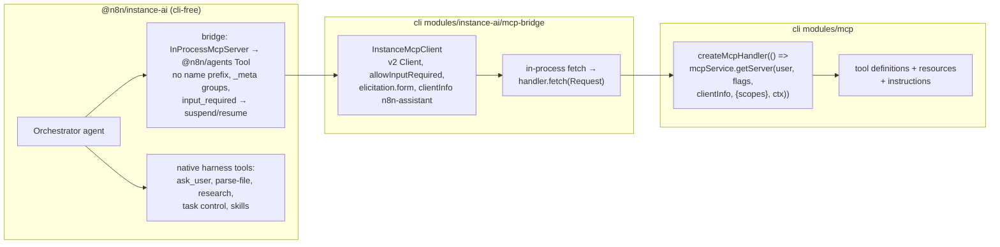

# PoC: MCP as the shared tool layer for n8n AI surfaces

Status: PoC, internal demo. Not for release. No feature flag: the branch bakes
the behaviour in.

## Goal

Find out to what extent the MCP protocol can be the tool layer that every AI
surface in n8n shares. The first consumer is the n8n Assistant
(`@n8n/instance-ai`). It becomes a real MCP client of the instance MCP server
(`packages/cli/src/modules/mcp`) and uses the server's workflow-building tools
instead of its native domain tools.

The deliverable is the capability matrix below, filled in with results, plus
eval score deltas and a list of protocol gaps.

## Decisions

| # | Decision | Choice |
|---|---|---|
| 1 | MCP client implementation | Add `@modelcontextprotocol/client@2.3.0` (same major and minor as the server) to `packages/cli` |
| 2 | Transport | In-process: the client's `fetch` calls `createMcpHandler(...).fetch(Request)`. No socket, no token. HTTP loopback is an optional last milestone |
| 3 | Where the bridge lives | cli host side (`packages/cli/src/modules/instance-ai/mcp-bridge/`), exposed to `@n8n/instance-ai` through the existing `LocalMcpServer` seam. No `@n8n/agents` changes in the PoC |
| 4 | Elicitation forms in the Assistant UI | Map `requestedSchema` onto the existing `questions` card |
| 5 | Confirmation elicitation on destructive MCP tools | Default on for every client that declares form elicitation |
| 6 | Sandbox | Both the compile service (M3) and the workspace over MCP (M4). No per-user quota |
| 7 | Rollout | No env var or PostHog flag. The branch replaces native tools group by group, per milestone |

## Facts the design rests on

- `McpService.getServer(user, featureFlags, clientInfo, auth, ctx)` is public
  (`packages/cli/src/modules/mcp/mcp.service.ts:515`). The public endpoint wraps
  it with `createMcpHandler(..., { legacy: 'stateless' })` and `toNodeHandler`
  (`mcp.controller.ts:246-263`). `handler.fetch(Request)` runs the same code
  path without Express and without the auth middleware
  (`__tests__/mcp-handshake-contract.test.ts:16-44`).
- Durable approval needs multi-round-trip elicitation (protocol revision
  2026-07-28): a tool returns `{ resultType: 'input_required', inputRequests,
  requestState }`; the client re-issues the same `tools/call` with
  `params.inputResponses` and `params.requestState`. The existing example is
  `tools/save-user-preference.tool.ts:114-117`. A 2025-era client on the
  stateless leg gets `isError: true` text instead.
- `requestState` is not integrity-protected unless the server configures
  `ServerOptions.requestState.verify`. Approval tools must sign it or re-derive
  the action on retry.
- `@n8n/agents` ships the v1 MCP client with `capabilities: {}` and no `_meta`
  hook (`runtime/mcp/mcp-connection.ts:137, 259-265`). It cannot be the client.
- The Assistant has the seams already: `LocalMcpServer`
  (`packages/@n8n/instance-ai/src/types.ts:1483-1491`),
  `createToolsFromLocalMcpServer` (`src/tools/create-tools-from-mcp-server.ts`),
  `orchestrationContext.disabledToolNames` (`src/agent/instance-agent.ts:194`),
  and `_meta` on tool definitions (`mcp.types.ts:49-50`).
- `mcp` lazy-imports `instance-ai` for the instance-context tools
  (`mcp.service.ts:755-759`). The Assistant host must resolve `McpService`
  lazily too, so the cli module graph has no static cycle.

## Architecture



Server-side changes are additive:

- Confirmation elicitation on destructive tools, default on when the request
  envelope declares `elicitation.form` (decision 5).
- `_meta['n8n/approvalDetails']` on the elicit request, so the Assistant can
  render its rich approval card while generic clients see `message` + form.
- `_meta['n8n/group']` on tool definitions, so the Assistant can group deferred
  tools (`workflows`, `nodes`, ...).
- Signed `requestState` through `ServerOptions.requestState.verify`.

## Capability matrix

Hypotheses. Replace each `?` with `yes`, `partial`, or `no` and a note when a
milestone proves it.

| Assistant need | Protocol carries it? | Mechanism | Result |
|---|---|---|---|
| Discovery, input schemas | native | `tools/list`; zod → JSON Schema → zod fidelity | **yes.** M1: the bridge hands the server's JSON Schema to `@n8n/agents` unchanged (`Tool.input()` takes JSON Schema), so there is no second conversion. Only the Anthropic sanitizer (`sanitizeMcpToolSchemas`) touches it, as for every MCP tool |
| Typed and multimodal outputs | native | `structuredContent`, `outputSchema`, content blocks | **yes.** M1: `structuredContent` goes to the model as JSON; media content blocks become model parts; `isError` becomes `{ error }` as native tools report it |
| Cancellation, progress | native | `AbortSignal` → `ctx.mcpReq.signal`; `notifications/progress` | M0: an aborted `signal` cancels the in-flight call and reaches the handler's `signal`. Progress: open |
| Durable approval before a write | native, modern leg only | `input_required` + `requestState` | **yes.** M2: `publish/unpublish/archive/restore` answer `input_required` before the write; the bridge suspends and keeps the request key and the HMAC-signed `requestState` in the suspension's `continuation`; the resumed call retries with `inputResponses` + `requestState` through the same checkpoint path every other card uses, so it survives a restart. The server binds the state to tool + user + arguments and a 24 h TTL |
| Rich approval card | extension | `_meta['n8n/approval']` | **yes, with `_meta`.** M2: the elicit request carries `{ approvalDetails, resourceName, severity }` in the Assistant's own vocabulary (`@n8n/api-types`); the bridge suspends with it, so the existing approval card, its title and its "Always allow" button render unchanged. A generic client sees `message` and a one-field boolean form |
| Session grants, admin rules, auto-approval judge | client-side | bridge answers the form from grants, policy, judge | **yes.** M2: the bridge maps `approvalDetails.action` to the admin permission and the `workflows:<action>:<id>` grant key the native tools use; `blocked` refuses without calling, `always_allow` and a grant answer the form at once, otherwise the card shows. Auto mode's probe wrapper works unchanged because the bridged tool suspends like a native one |
| Tool groups for deferral | extension | tool `_meta['n8n/group']` | **yes, with `_meta`.** M1: the registrar stamps every tool (`mcp-tool-groups.ts`); the bridge reads it and the catalog groups by it. Generic clients ignore the key |
| Guidance | native | `server/discover.instructions`, resources | **partial.** M1: `instructions` render as a prompt section when instance tools are active. The `workflow-builder` skill still names the native tools; the model has to map them through `find_tools`. Measured in M3 |
| Workflow artifact tab | extension | `structuredContent.workflowId` → `onArtifactChanged` | **yes, by convention.** M3: the bridge reads `workflowId`/`name` from the `structuredContent` of `create_workflow_from_code` and `update_workflow` and announces the artifact; no `_meta` needed because the output schema already names the workflow |
| Thread state (file bindings, setup state, loop verdicts) | client-side | stays in Assistant orchestration tools | **partial.** M3: thread ownership of a created workflow and the admin `createWorkflow: blocked` rule are client-side decorators in the bridge. File bindings and the build→verify→debug loop have no equivalent: the MCP build is one call with the code inline, and verification is not run after it |
| Workspace and sandbox build loop | not native | identity-keyed workspace tools (M4) | **yes, as tools.** M4: `open_workspace`, `workspace_read_file/write_file/str_replace_file/list_files/execute_command`, `build_workflow` and `get_workflow_as_code` expose the Assistant's sandbox to every client. The protocol carries no session, so the caller names its workspace (`workspaceKey`); the Assistant binds the key to its thread in the bridge and hides the parameter from the model. One sandbox per `(user, key)`, hashed into the sandbox identity |
| Conversation scope (current project) | client-side | bridge injects `projectId` from the thread context | **no, client-side.** Eval run 1: the server's create tools default to the caller's personal project, the Assistant's thread lives in the conversation's project. 152 of 309 building cases created a duplicate in the wrong project before the model noticed and rebuilt. The bridge now binds `projectId` to the thread's project, as the native build tool did |
| Legacy tool names in persisted threads | client-side | alias map; out of scope | - |
| Auth, scopes, rate limits | native over HTTP; bypassed in-process | scopes passed to `getServer` | **partial.** M1: scopes work as for OAuth clients. Per-resource exposure (`availableInMCP`) is a third-party policy the protocol has no word for; the server needs a trusted first-party marker on the auth context (`firstParty`), set by the host |
| Telemetry attribution | native | `clientInfo.name = 'n8n-assistant'` | ? |

## Milestones

### M0: client foundation

- `@modelcontextprotocol/client@2.3.0` in the pnpm catalog and `packages/cli`.
- `InstanceMcpClient` in `packages/cli/src/modules/instance-ai/mcp-bridge/`:
  builds the handler from `McpService.getServer`, connects a v2 `Client` with
  an in-process `fetch`, declares `elicitation: { form: {} }`, uses
  `allowInputRequired` so `input_required` results reach the caller.
- API: `connect()` (discover: instructions, capabilities), `listTools()`,
  `callTool(name, args, { inputResponses?, requestState?, signal? })`,
  `readResource(uri)`, `close()`.
- Contract test against a stub `McpServer`: discover, list, call, resource
  read, `input_required` round trip, cancellation.

Proves: the modern leg works end to end without HTTP.

### M1: bridge and read-only tools

- `InProcessMcpServer` (host) that implements the `@n8n/instance-ai` seam for
  the instance server; the seam grows `callTool` options for retries.
- Bridge in `@n8n/instance-ai`: generalize `createToolsFromLocalMcpServer`
  for the instance server: no prefix, `_meta['n8n/group']` → tool group,
  `structuredContent` to the model, `outputSchema` kept.
- Wire it in `assistant-turn-environment.factory.ts`; disable the native
  `nodes` group, then `workflows` read tools, through `disabledToolNames`.
- Inject `server/discover.instructions` into the system prompt in place of the
  `workflow-builder` skill guidance for the swapped groups.

Proves: schema fidelity, grouping and deferral, tracing, instructions as
guidance.

### M2: approval over multi-round-trip elicitation

- Server: `publish_workflow`, `unpublish_workflow`, `archive_workflow`,
  `restore_workflow_version`, `update_workflow` return `inputRequired.elicit`
  before the write when the client declares form elicitation. Add
  `_meta['n8n/approvalDetails']`. Sign `requestState`.
- Bridge: `input_required` → `ctx.suspend({ inputType: 'questions', ... })`
  with `inputRequests` and `requestState` declared in the suspend schema;
  on resume, retry with `inputResponses`. Apply session grants, admin rules,
  and the auto-approval judge before the card shows.
- Frontend: map `requestedSchema` onto the `questions` card (enum → single,
  boolean → single, string → text).

Proves: durable HITL over the protocol, across a restart.

### M3: build path over MCP

- Assistant builds through `create_workflow_from_code`, `update_workflow`,
  `validate_workflow` (host AST interpreter) instead of
  `workflow_builder_build_workflow`. Measure the eval delta.
- Add `build_workflow({ files })`: the server compiles in the sandbox with
  `tsx` when the sandbox is enabled, else with the AST interpreter. Measure
  again.
- Resolve the save-path differences: `availableInMCP`, `builderVariant`,
  `source`, AI-temporary marking.

Proves: the distance between the protocol-exposed build path and the native
sandbox path, and whether the compile service closes it.

### M4: workspace over MCP

- `(userId, key)` sandbox identity scheme in `InstanceAiSandboxService`.
- MCP tools: `open_workspace`, `workspace_read_file`, `workspace_write_file`,
  `workspace_str_replace_file`, `workspace_execute_command`,
  `build_workflow({ workspaceKey, filePath })`.
- Assistant passes `key = threadId` and stops using `agent.workspace()` tools.

Proves: the Assistant runs on the MCP surface plus harness tools only.
External clients without a filesystem get the full builder loop.

### M5 (optional): HTTP loopback

- Short-lived internal token; the client talks to `POST /mcp-server/http`.

Proves: auth, scopes, and rate-limit parity.

## Presentation

`docs/poc/mcp-shared-tool-layer/slides.html`: three slides (architecture, what
each layer gets, shortcuts and the road to production). Open the file in a
browser; arrow keys or a click move between slides.

`docs/poc/mcp-shared-tool-layer/eval-summary.md`: the eval results for the
team, with the verdict on PoC gaps versus protocol limits.

## Evaluation

Same LangSmith dataset, three runs: native Assistant (baseline, `master`),
Assistant over MCP at each milestone, Claude over MCP
(`eval:instance-ai --build-via-mcp`). See
`packages/cli/src/modules/mcp/evaluations/README.md`.

How to run: dispatch "Instance AI Evals: Experiments" from the branch ref
(`gh workflow run test-evals-instance-ai.yml --ref <branch> -f branch=<branch>
-f tier=pr -f iterations=3`). `tier=full` is the whole suite (~390 cases) and
fits the 90-minute job only with `iterations=1`. The harness counts a save
only for the native build tool's name, so `evaluations/outcome/event-parser.ts`
also accepts the server's save tools (`create_workflow_from_code`,
`update_workflow`, `build_workflow`).

### Results after M4 (branch at `7357512`, model `claude-sonnet-4-6`)

PR tier (11 cases × 3): 37 of 38 units green; the red unit is a process
expectation (`notification-router`: establish the payload shape before
building), 0/3 here and 42/45 across five same-day runs of other branches.
Cause: the `workflow-builder` skill's "ask before the build only when a choice
changes intent or topology" rule is gated off with the skill; the server's
instructions are a build recipe with no clarify step.

Full suite, three references: a same-day master control (`a80147a`, N=1,
1867 shared units), the July LangSmith baseline `instance-ai-baseline-13/07`
(N=10, 349 shared units), and an earlier N=1 PoC run (`7357512`). PoC at
`90119af`, N=3, 1167 builds. Experiments
`ci-poc_mcp-shared-tool-layer-90119af-57b1395e`, `ci-master-a80147a-0c474204`,
`ci-poc_mcp-shared-tool-layer-7357512-cc478cc8`. The team summary with the
per-theme tables: `docs/poc/mcp-shared-tool-layer/eval-summary.md`.

| | PoC N=3 | master N=1 | delta |
|---|---|---|---|
| aggregate pass rate (1867 units) | 87.9% (CI 87.0–88.7) | 89.3% (CI 87.8–90.6) | −1.4 pp |
| scenario units, executed workflows (351) | 79.5% | 81.5% | −1.9 pp |
| expectation units, judged behaviour (1516) | 89.9% | 91.1% | −1.2 pp |

Units master passed that the PoC failed 3/3: 54; the reverse: 44. The
asymmetry sits in one theme: **verification loop, 23 against 3**. Every
other theme (credentials 3 vs 8, asking 5 vs 2, publishing 1 vs 3, other
judged behaviour 14 vs 19, scenarios 8 vs 9) is balanced noise. Against the
July baseline the PoC is −2.4 pp with 24 hard regressions, but 15 of those
31 regressions also fail on today's master (the credential-offering group
and `notification-router`), so they are July-to-now drift. The two PoC runs
agree within +0.7 pp.

What the one regression is: "the agent ran a verification of the built
workflow" and its consequences (mocked verification before credentials, both
branches verified, re-verify after a swap, verify before publish) at 0/3.
The native build result carries `postBuildFlow`; the server's save result
does not, and the skill that follows it is off while the server builds. A
PoC gap, not a protocol limit: save results can carry next steps for any
client, and verify can be a server tool. Fixing those 23 units alone puts
the PoC at about 89.1%, parity with master.

Smaller: the gated `workflow-builder` skill also held the clarify-before-build
and inspect-before-edit rules (`notification-router` 0/9 on the PoC over three
runs; master failed it once in one trial). Conversational policy stays a
client skill that names server tools; MCP `instructions` is one string for
every client.

Wrong project (fixed): without `projectId` the server saves to the caller's
personal project. In the N=1 run the agent noticed and rebuilt in 98 of 382
builds (26%), leaving a duplicate; after the fix 0 of 1153. The judged
workflow matched the verified one in all but 11 N=1 runs, so the duplicates
cost a rebuild each, not the scores.

Harness notes: `evaluations/run/persist.ts` writes `eval-results.json` one
test case at a time, because a full-suite N=3 report (~1.2 GB pretty-printed)
exceeded V8's string length and the run lost its results file once. CI
experiments live in the EU LangSmith workspace "Staging"; an experiment's
per-unit buckets can be fetched with `fetchBaselineBucket` and compared with
`compareBuckets` offline.

## Structure

```
packages/cli/src/modules/instance-ai/mcp-bridge/
  instance-mcp-client.ts            # M0: v2 client, pinned 2026-07-28, manual input_required
  instance-mcp-client.factory.ts    # M0: handler from McpService.getServer for a user
  in-process-fetch.ts               # M0: Request → handler.fetch
  instance-mcp-server.ts            # M1: InstanceMcpServer seam implementation
  __tests__/
packages/@n8n/instance-ai/src/
  types.ts                          # M1: InstanceMcpServer seam types, context.instanceMcpServer
  tools/create-tools-from-instance-mcp-server.ts   # M1: bridge to @n8n/agents tools
  tools/tool-ids.ts                 # M1: NATIVE_TOOLS_REPLACED_BY_INSTANCE_MCP
  tools/index.ts                    # M1: drops the replaced native tools
  agent/instance-agent.ts           # M1: merges, reserves names, groups by _meta
  agent/system-prompt.ts            # M1: instance MCP instructions section
packages/@n8n/instance-ai/src/tools/
  instance-mcp-elicitation.ts       # M2: input_required → card payloads, policy, answers
packages/cli/src/modules/mcp/
  mcp-workspace.service.ts          # M4: (user, key) workspaces on the Assistant's sandbox service
  tools/workspace/workspace-tools.ts        # M4: open_workspace + the SDK workspace tools over MCP
  tools/workspace/build-workflow.tool.ts    # M4: sandbox compile → create or confirmed replace
  tools/workspace/get-workflow-as-code.tool.ts   # M4: SDK code of a saved workflow
  mcp-tool-groups.ts                # M1: _meta['n8n/group'] per tool
  mcp-caller-policy.ts              # M1: first-party caller policy (AsyncLocalStorage)
  mcp-confirmation.service.ts       # M2: elicitation before a write, signed requestState
  mcp.service.ts                    # M1: registrar stamps the group and the caller policy
  tools/publish-workflow.tool.ts, unpublish-workflow.tool.ts,
  tools/workflow-builder/delete-workflow.tool.ts, restore-workflow-version.tool.ts   # M2
  tools/workflow-builder/update-workflow.tool.ts          # M3: edit confirmation
  tools/workflow-builder/create-workflow-from-code.tool.ts # M3: first-party availability
packages/cli/src/modules/instance-ai/
  instance-ai-skills.service.ts     # M3: workflow-builder skill gated off when the server builds
packages/frontend/@n8n/i18n, editor-ui approvalDetails.ts   # M3: labels for the server tool names
packages/cli/src/modules/instance-ai/turn-setup/
  assistant-turn-environment.factory.ts   # M1: connects the client per turn
```

## Implementation TODO

- [x] M0: dependency, `InstanceMcpClient`, in-process fetch, contract test
- [x] M1: seam, bridge, wiring, `nodes` group swapped
- [x] M1: `workflows` read tools swapped, instructions in the prompt
- [x] M2: server elicitation on destructive tools, signed `requestState`
- [x] M2: bridge suspend/resume, grants and judge, `questions` card mapping
- [x] M3: build through `create_workflow_from_code`; eval delta (manual, see findings)
- [ ] M3: `build_workflow({ files })` compile service → folded into M4 (same identity-keyed sandbox)
- [x] M4: identity-keyed sandbox, workspace tools over MCP, Assistant on MCP only (manual run pending)
- [ ] M5: HTTP loopback (optional)
- [ ] Fill in the capability matrix and the gap list

## Findings

- M0: the v2 client pinned to `2026-07-28` (`versionNegotiation: { mode: { pin } }`)
  with `inputRequired: { autoFulfill: false }` and `allowInputRequired: true` per
  call is enough: it stamps the `_meta` envelope and the `Mcp-Method` /
  `Mcp-Name` headers itself, and returns `input_required` results to the
  caller. The server side can run with `legacy: 'reject'`.
- M0: the retry fields `inputResponses` and `requestState` are top-level
  `tools/call` params outside the typed request params. The client passes a
  widened object through unchanged.
- M0: the SDK emits `RequestMetaEnvelope` as `{}`, so a handler reads the
  envelope through `Record<string, unknown>`.
- M0: `Client.close()` resets `instructions` and capabilities. Read them
  while the client is open.
- M1: `Client.listTools()` answers `[]` locally when the server advertises no
  `tools` capability. A stub server in a test needs at least one tool.
- M1: name collisions are real. The server's `validate_workflow` takes code;
  the Assistant's takes a workflow id. The bridge keeps an instance tool out
  while a native tool that is not swapped owns the name. Later milestones
  decide which one wins per name.
- M1: the integration test server loads no node packages, so `search_nodes`
  answers empty there. The protocol path to the real catalog handler works.
- M1 (manual test): the per-workflow "Available in MCP" switch refused the
  Assistant's reads (`not_available_in_mcp` from `validateMcpWorkflow`). The
  switch is a policy for third-party clients. The fix: the host marks the
  Assistant's auth context `firstParty: true`; the registrar runs every call
  under an `AsyncLocalStorage` caller policy (`mcp-caller-policy.ts`, the
  pattern of `builder-telemetry-session.ts`); the gate and the executions
  filter read it. The policy comes from the server-side auth context, never
  from a client claim. Matrix row: "Auth, scopes" → the server also needs a
  notion of first-party vs third-party caller, which the protocol does not
  carry; `clientInfo` is a claim and cannot be it.

## Findings (M2)

- `Client.callTool()` validates every result against the tool's output schema
  and rejects an `input_required` result (no `structuredContent`) in manual
  mode (client 2.3.0). The bridge client sends `tools/call` through
  `Client.request()` instead, which also takes the retry fields as plain params.
- The SDK's `requestState` integrity hook (`ServerOptions.requestState.verify`)
  is server-wide, and `save_user_preference` already echoes a raw id as state.
  The confirmation service verifies its own HMAC state in the handler instead
  (`mcp-confirmation.service.ts`), bound to tool, user and arguments.
- A confirmation form is the Assistant's approval card only because the server
  speaks the Assistant's `approvalDetails` vocabulary through `_meta`. A
  generic client gets a boolean form. Where that vocabulary ends (verification
  evidence before a publish, supporting workflows), the protocol tool knows
  nothing: the native publish disclosed unverified builds; the MCP publish
  cannot. That gate is thread state and would need a client-side decorator.
- The server confirms for every form-capable client (decision 5). Claude
  Desktop and the like now get a confirmation before archive, publish,
  unpublish and restore. Clients without form elicitation keep the old
  unconfirmed behaviour.

## Findings (M3)

- The build path swaps cleanly at the tool level: `create_workflow_from_code`
  (code inline, host AST interpreter) and `update_workflow` (operations,
  confirmed through elicitation with `edit-workflow` details) replace
  `workflow_builder_build_workflow` and `get_workflow_as_code`. A native
  tool is dropped only when the server lists its replacement
  (`NATIVE_TOOL_REPLACEMENTS`), so `N8N_MCP_BUILDER_ENABLED=false` keeps the
  native path.
- Guidance is the real gap. The `workflow-builder` skill describes the native
  path, so it is gated off when the server builds; the model gets the server's
  `instructions` plus a prompt note on what the Assistant still owns
  (`setup_workflow` with `includeAllNodes`, testing on request). The skill's
  reference material (credential choices, model selection, trigger input
  shapes, publishing, error workflows) does not reach the model through the
  protocol; `get_workflow_best_practices` covers part of it.
- The server's `validate_workflow` (code) collides with the Assistant's
  `validate_workflow` (saved workflow issues). First manual run: the server's
  instructions told the model to validate code, the native tool answered
  with an error, and the model routed around it through `find_tools`. While
  the server builds, the server's tool now owns the name; the static check of
  a saved workflow is a capability an external client does not have either.
- First manual run: the model wrote the code to a workspace file before
  calling `create_workflow_from_code` (three extra calls and a typo recovery).
  The workspace has no job while the server builds, so the turn no longer
  creates one; the workspace returns as MCP tools in M4.
- First manual run (Gmail reminder on a schedule): one-shot success in about
  a minute: SDK reference → best practices → `search_nodes` →
  `get_node_types` → `create_workflow_from_code` → `setup_workflow`.
- A first-party create does not set `availableInMCP`; a third-party create
  still does. `builderVariant: 'mcp'` and `source: 'n8n-mcp'` stay as the
  server writes them (metrics on this instance count Assistant builds as MCP
  builds).
- The compile service (`build_workflow({ files })` in a sandbox) needs the same
  identity-keyed sandbox as M4, so it moves there.

## Findings (M4)

- The sandbox needed no new lifecycle: the Assistant's `InstanceAiSandboxService`
  keys entries by an opaque "thread id", so an MCP workspace is
  `mcp-<sha256(userId, key)[0:24]>` in the same cache, with the same settings
  invalidation, expiry and provider reclamation. The hash keeps Daytona names
  under 63 characters; a cut name must never merge two users' workspaces.
- The workspace tools are the `@n8n/agents` workspace tools themselves,
  created per call against the caller's scoped workspace and invoked by name.
  The MCP schemas mirror the SDK's; the path scoping is the SDK's.
- `build_workflow` reuses the Assistant's compiler (`compileWorkflowSource`:
  tsx in the sandbox, host re-validation) and the server's own create path
  (`create_workflow_from_code` takes a `compiledWorkflow` option). A replace
  of a saved workflow (`workflowId`) is a confirmed `edit-workflow`, with node
  ids, positions and setup values of kept nodes preserved
  (`prepareWorkflowForSave`).
- Statelessness shows up as a parameter: every workspace tool takes a
  `workspaceKey`. A generic client passes the key `open_workspace` returned;
  the Assistant's bridge injects its thread id and removes the parameter from
  the schema the model sees. This is the one place the bridge rewrites a
  server schema.
- `build_workflow({ files })` is the compile service: it writes the sources
  into the caller's workspace and builds the entry, so a client without a
  filesystem gets the full toolchain in one call.
- The Assistant now runs on the MCP surface for discovery, reads, lifecycle,
  building and the workspace. Still native: `setup_workflow`, executions,
  credentials, data tables, `execute_node`, and the harness tools.

## Native tools swapped so far

| Native tool | Instance MCP tool(s) |
|---|---|
| `search_nodes`, `get_node_types`, `get_node_parameter_options` | `search_nodes`, `get_node_types`, `explore_node_resources`, `validate_node_config` |
| `list_workflows`, `get_workflow`, `list_workflow_versions`, `get_workflow_node_usage` | `search_workflows`, `get_workflow_details`, `get_workflow_history`, `get_workflow_version`, `get_workflow_versions_diff`, `get_node_usage` |
| `publish_workflow`, `unpublish_workflow`, `archive_workflow`, `restore_workflow_version` | the same names, confirmed through multi-round-trip elicitation |
| `workflow_builder_build_workflow`, `get_workflow_as_code`, `validate_workflow` | `create_workflow_from_code`, `update_workflow` (edits confirmed through elicitation), `validate_workflow` (code) |
| the `@n8n/agents` workspace tools (sandbox) | `open_workspace`, `workspace_*`, `build_workflow`, `get_workflow_as_code` over MCP, keyed by the thread |

Kept native: `setup_workflow`, `unarchive_workflow`,
`update_workflow_version`, `execute_node`, `search_models`, executions,
credentials, data tables, and the orchestration tools (verification has no
build outcome to work from).

The bridge takes only the tools in `INSTANCE_MCP_TOOLS_IN_USE`
(`tools/tool-ids.ts`). The server lists many more; a write without an
approval path must not reach the model before its milestone.

## Open questions

- Which `McpCallerAuth` to report for the Assistant. The type allows only
  `oauth` and `api_key`. Telemetry can use `clientInfo.name` instead.
- Which scopes the Assistant presents. Start with every `MCP_INSTANCE_SCOPES`
  entry; narrow later.
- How the Assistant's `OperationContext` reaches `getServer`. Start with `{}`.
