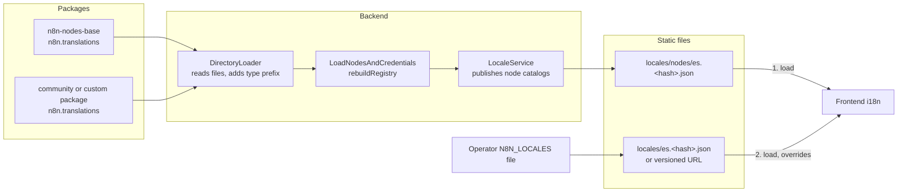

# Plan: translate native and custom nodes with `N8N_LOCALES`

Branch: `api-92-catalogs-from-static-server`. Builds on `LocaleService`, the local and versioned
catalogs, and the personal language picker.

## Scope

- Translate the node text in the UI: the node name and description, the parameter labels,
  tooltips, hints, placeholders, options, and the actions in the node creator.
- Support all nodes the same way: `n8n-nodes-base`, `@n8n/n8n-nodes-langchain`, community
  packages, and custom nodes in `~/.n8n/custom` or `N8N_CUSTOM_EXTENSIONS`.
- Support two sources of translations:
  - The **operator catalog**: the `N8N_LOCALES` file or the versioned URL. The operator owns it.
  - The **package translations**: files that a node package ships. The node author owns them.
- Non-goals:
  - Node output, error messages, and execution data. These come from the backend
    (`backend.*` keys) and are separate work.
  - Machine translation, or translations made by n8n for community nodes.

## Findings

### Translations of nodes today

There are two mechanisms. Both use only `N8N_DEFAULT_LOCALE`.

| Text | Source | Delivery | Key |
|---|---|---|---|
| Node name and description (nodes panel, default node name) | `nodes/<X>/translations/<locale>/<type>.json` → `header`. The build script `packages/core/bin/generate-translations` collects it into `dist/nodes/headers.js` | `GET /rest/node-translation-headers` → `addHeaders()` | `headers.<type>.displayName` |
| Parameters (node details view) | The same file. `NodeTypes.getDescriptionWithTranslation()` reads it for each request | `description.translation` → `addNodeTranslation()` | `n8n-nodes-base.nodes.<type>.nodeView.<param>…` |
| Actions (node creator) | None. `useActionsGeneration.ts` uses `option.action` | — | — |

The UI reads the keys through `nodeText()` and `headerText()` in `@n8n/i18n`. Each lookup is
`te(key) ? t(key) : englishFallback`. `<type>` is the full node type without the
`n8n-nodes-base.` prefix.

The repository has no `translations/` folders, so nobody uses this mechanism today.

### Problems

1. **The old path fails for all nodes outside `n8n-nodes-base`.**
   - The backend looks for `CUSTOM.example.json` or `n8n-nodes-demo-node.example.json`. The file
     name changes with the install method.
   - `addNodeTranslation({ 'CUSTOM.example': … })` merges a nested object whose key contains a dot.
     vue-i18n cannot resolve it. A test with vue-i18n 11.4.14 showed `te()` returns `false`.
   - The headers file is built for `n8n-nodes-base` only, at build time.
2. **The old path ignores the personal locale.** The backend uses `globalConfig.defaultLocale`.
   The frontend merges under `rootStore.defaultLocale`.
3. **The type of a custom node depends on how it is installed.**

   | Install | Loader | Node type |
   |---|---|---|
   | `~/.n8n/custom/node_modules/<pkg>` or `N8N_CUSTOM_EXTENSIONS` | `CustomDirectoryLoader` | `CUSTOM.example` |
   | Community package (`~/.n8n/nodes`) | `PackageDirectoryLoader` | `n8n-nodes-demo-node.example` |

   A node author cannot know the final key prefix.

### What already works

Flat keys in an `N8N_LOCALES` catalog resolve for every node type. A test with vue-i18n 11.4.14
confirmed this, also after other messages are merged as nested objects. The example shows the
current keys. Decision 1 replaces them:

```json
{
  "headers.CUSTOM.example.displayName": "Ejemplo",
  "n8n-nodes-base.nodes.CUSTOM.example.nodeView.myString.displayName": "Mi texto",
  "n8n-nodes-base.nodes.@acme/n8n-nodes-x.thing.nodeView.p.displayName": "…",
  "n8n-nodes-base.nodes.okta.nodeView.operation.options.create.displayName": "Crear"
}
```

These keys follow the personal locale, because the frontend loads the catalog of the active
locale. They need no build step.

### Problems with the current key prefix

The current keys work, but the scheme has these problems:

1. **The prefix is wrong for most nodes.** Custom and LangChain keys start with
   `n8n-nodes-base.nodes.`, but these nodes are not in `n8n-nodes-base`.
2. **One package has a special case.** `shortNodeType()` removes `n8n-nodes-base.` and nothing
   else. Each tool that makes or reads keys must copy this rule.
3. **One node has two roots.** The name and the description are under `headers.<type>.*`. The
   parameters are under `n8n-nodes-base.nodes.<type>.nodeView.*`.

Nobody depends on the full keys yet:

- The `N8N_LOCALES` feature is not released.
- The documented file format (`@n8n/i18n/docs/README.md`) has only `header` and `nodeView`.
  The code adds the prefix.

When the operator docs show the full keys, they become a public contract. Thus we rename now.

## Target design



## Decisions

1. **Rename the keys to one scheme for all nodes and credentials.** Use the full node type
   everywhere. Do not remove `n8n-nodes-base.` for built-in nodes. Put all text of a node under
   one root.

   | Text | Key |
   |---|---|
   | Node name, description | `nodeTypes.<type>.header.displayName`, `nodeTypes.<type>.header.description` |
   | Parameter | `nodeTypes.<type>.nodeView.<path>.displayName` (also `description`, `hint`, `placeholder`) |
   | Option | `nodeTypes.<type>.nodeView.<path>.options.<value>.displayName` (also `description`) |
   | Action (new) | `nodeTypes.<type>.nodeView.<param>.options.<value>.action` |
   | Collection buttons | `nodeTypes.<type>.nodeView.<param>.multipleValueButtonText`, `….addOptionalFieldButtonText` |
   | Event trigger text | `nodeTypes.<type>.nodeView.eventTriggerDescription` |
   | Credential field | `credentialTypes.<credType>.<param>.displayName` (also `description`, `hint`, `placeholder`, `options.<value>.*`) |

   `<type>` is the full node type, for example `n8n-nodes-base.okta`, `CUSTOM.example`,
   `n8n-nodes-demo-node.example`, or `@n8n/n8n-nodes-langchain.agent`.

   - A catalog key is the prefix plus a key of the documented file format (`header.*`,
     `nodeView.*`). The docs explain one format for files, catalogs, and packages.
   - `en.json` has no keys under `nodeTypes` or `credentialTypes`. Thus the new roots do not
     collide with UI keys.
   - Built-in keys are longer. This is not a problem, because translators start from the output
     of the extraction tool.
   - Engineers can challenge this decision later. Record it in an ADR (see Docs).

2. **Rewrite the old keys when a catalog loads.** A fork or an OEM can have catalogs with the
   old keys. When the frontend loads a catalog, it rewrites these keys once:

   | Old key | New key |
   |---|---|
   | `n8n-nodes-base.nodes.<short>.nodeView.<rest>` | `nodeTypes.<full>.nodeView.<rest>` |
   | `headers.<short>.<field>` | `nodeTypes.<full>.header.<field>` |
   | `n8n-nodes-base.credentials.<credType>.<rest>` | `credentialTypes.<credType>.<rest>` |

   - `<full>` is `n8n-nodes-base.<short>` when `<short>` has no dot. Otherwise `<full>` is
     `<short>`, because the old code removed only `n8n-nodes-base.`.
   - When a new key exists, the rewrite does not overwrite it.
   - The frontend logs one deprecation warning for each catalog with old keys.
   - Lookups stay single: `dynamicRender()` checks only the new key. A fallback lookup for each
     key would add a second `te()` call for each miss.
   - Remove the rewrite in phase 4, together with the old mechanism.

3. **Operator catalog wins.** The frontend loads the package translations first and the operator
   catalog second. The operator can correct a package translation without a change to the package.

4. **Package translations use keys relative to the package.** The node author does not know the
   type prefix. The loader adds it. The contract in the package `package.json`:

   ```json
   "n8n": {
     "nodes": ["dist/nodes/Example/Example.node.js"],
     "credentials": ["dist/credentials/MyCustomCredentialApi.credentials.js"],
     "translations": { "es": "translations/es.json" }
   }
   ```

   ```json
   {
     "nodes.example.header.displayName": "Ejemplo",
     "nodes.example.header.description": "Nodo de ejemplo básico",
     "nodes.example.nodeView.myString.displayName": "Mi texto",
     "nodes.example.nodeView.myString.placeholder": "Valor de ejemplo",
     "credentials.myCustomCredentialApi.apiKey.displayName": "Clave de API"
   }
   ```

   The loader maps the keys:

   | Package key | Published key |
   |---|---|
   | `nodes.<name>.<rest>` | `nodeTypes.<packageName>.<name>.<rest>` |
   | `credentials.<credType>.<rest>` | `credentialTypes.<credType>.<rest>` |

   `<packageName>` is the name that the loader uses: `CUSTOM`, the package name, or
   `n8n-nodes-base`. The mapping is the same for all packages. The loader drops keys that refer to
   a node or credential that the package does not declare. Thus a package cannot overwrite the
   text of another package.

5. **Publish package translations as a separate file for each locale.**
   - The backend cannot merge into a remote catalog from `N8N_VERSIONED_LOCALES_BASE_URL`.
   - Community packages change at runtime. Only the node file must be built again.
   - `AvailableLocale` gets a new field `nodesUrl`. English gets no file.

6. **Package translations are plain text.** The loader escapes the vue-i18n syntax characters
   (`{`, `}`, `@`, `|`). Node placeholders often contain `{{ $json.id }}`. A test with vue-i18n
   11.4.14 showed: `{` and `@` stop the compile of the message, and `|` cuts the text without an
   error, because vue-i18n reads it as a plural separator. `$` is safe. Operator catalogs stay
   vue-i18n messages, because the rest of the catalog uses interpolation. The key extraction tool
   writes escaped English text, so translators start from valid messages.

7. **A broken message does not break the UI.** `dynamicRender()` catches compile errors and shows
   the English text.

8. **Retire the old mechanism after the new path is complete.** Remove `translations/<locale>/`,
   `headers.js`, `GET /node-translation-headers`, `description.translation`,
   `addNodeTranslation()`, `addHeaders()`, and the rewrite of old keys (decision 2). The old
   mechanism is unused and broken for non-base nodes. The data
   worker can then read node descriptions from the local database for all locales, not only for
   English.

## Steps

### Phase 1: operator catalog for all nodes (frontend only)

This phase renames the keys and makes the catalog route complete. It needs no backend change,
because the backend does not make keys: the old translation files have keys relative to the node.

1. **New key scheme (decision 1).** In `@n8n/i18n`, make all node and credential keys from one
   helper, for example `nodeTypeKey(type, rest)` and `credentialTypeKey(credType, rest)`.
   - Use the helper in `nodeText()`, `credText()`, `eventTriggerDescription()`, and
     `localizeNodeName()`.
   - Use it for the `headerText()` calls in `NodeItem.vue`.
   - Use it for the `i18n.exists('n8n-nodes-base.credentials.…')` checks in
     `CredentialConfig.vue` and `InstanceAiSetupCredential.vue`.
   - Remove `shortNodeType()` from the key path.
2. **Old loaders write new keys.** Until phase 4, change `addNodeTranslation()`, `addHeaders()`,
   and `addCredentialTranslation()`. They must write flat keys under `nodeTypes.<full>.*` and
   `credentialTypes.<credType>.*`. This also fixes the nested key with a dot, which fails for all
   nodes outside `n8n-nodes-base`.
3. **Rewrite old catalog keys (decision 2).** In `loadLanguage()` or in `fetchLocaleCatalog()`,
   rewrite the old keys before the merge. Log one deprecation warning for each catalog.
4. **Actions.** In `useActionsGeneration.ts`, look up the `.action` key for `operationsCategory`,
   `modeCategory`, and the resource categories. Use the `.options.<value>.description` key for the
   action description. Fall back to the English text.
5. **Locale changes.** Generate the actions again when the locale changes. Clear the memoized
   `cachedBaseText`.
6. **Search.** Make the node creator search find the translated node names and action names, and
   also the English names.
7. **Canvas node names.** `useCanvasOperations.ts` passes `rootStore.defaultLocale` to
   `localizeNodeName()`. Pass the active locale.
8. **Safe render.** Wrap `t()` in `dynamicRender()` in `try`/`catch`.
9. **Credentials.** Make sure `credText()` works with flat keys for custom credential types.

### Phase 2: key extraction tool

Translators and node authors need a list of all keys with the English text.

1. Move the key derivation (`deriveMiddleKey`, `insertOptionsAndValues`, `normalize` in
   `@n8n/i18n/src/utils.ts`) to `n8n-workflow`. `@n8n/i18n`, the extraction tool, and the
   backend loader then use the same code.
2. Add a function that walks an `INodeTypeDescription` and returns all keys with their English
   text, for all versions of the node.
3. Add the CLI command `n8n locales:extract-nodes --output=<file>` in `packages/cli`. It writes
   the operator keys of all installed nodes, also custom nodes. Operators run it on their
   instance, also in a Docker container.
4. Add `n8n-node translations extract` to `@n8n/node-cli`. It writes the package-relative keys
   (decision 4) to `translations/en.json`.
5. Both tools write only the new keys (decision 1).

### Phase 3: package translations

1. **Types.** Add `translations?: Record<string, string>` to `n8n.PackageJson` in
   `packages/core/src/nodes-loader/types.ts`.
2. **Loader.** In `DirectoryLoader`, read the translation files of the package. Validate each
   file (a JSON object with string values, a size limit). Map and escape the keys. Skip a bad file
   with a warning, so it does not break startup.
   - `PackageDirectoryLoader` reads the field from its own `package.json`.
   - `CustomDirectoryLoader` reads the field from each `node_modules/*/package.json` that it
     already scans. All of them share the prefix `CUSTOM`.
3. **Registry.** In `LoadNodesAndCredentials.rebuildRegistry()`, collect the translations of all
   loaders by locale.
4. **Publish.** `LocaleService` writes `locales/nodes/<code>.<hash>.json` into
   `staticCacheDir`. Only locales in `N8N_LOCALES` get a file. Publish again after each
   `rebuildRegistry()`, which also runs after a community package install or uninstall.
5. **Settings.** Add `nodesUrl?: string` to `availableLocales` in `@n8n/api-types`. The value
   changes when the hash changes.
6. **Frontend.** In the locale watcher in `App.vue`, load `nodesUrl` before the operator catalog.
   Merge both with `mergeLocaleMessage()`, so the operator catalog overrides. When the frontend
   receives new settings after a package install, load the node catalog again.
7. **Multi-main.** Each main rebuilds its registry on the pub/sub event
   `community-package-install`. Make sure each main publishes the node catalogs again. All mains
   produce the same hash for the same packages.

### Phase 4: retire the old mechanism

Do decision 8 in a separate PR. Add a note to the breaking changes for v3, because a third party
could depend on `GET /node-translation-headers`. Land the removal on `3.x` if the team treats it
as breaking.

## Tests

- `@n8n/i18n`: `nodeTypes.*` keys for `n8n-nodes-base`, `CUSTOM.*`, package, and scoped node
  types. `credentialTypes.*` keys for credentials. `dynamicRender()` shows English for a message
  that does not compile.
- Rewrite of old keys: each row of the table in decision 2, a key of a non-base node with a dot,
  a new key that the rewrite must not overwrite, and one deprecation warning for each catalog.
- Old loaders: `addNodeTranslation()`, `addHeaders()`, and `addCredentialTranslation()` write keys
  that `nodeText()`, `headerText()`, and `credText()` find, also for `CUSTOM.*` nodes.
- `useActionsGeneration`: translated action names and descriptions, the fallback to English, and
  generation again after a locale change.
- Key derivation in `n8n-workflow`: the same keys as the current frontend for nested collections
  and fixed collections.
- Loader: the key mapping for `PackageDirectoryLoader` and `CustomDirectoryLoader`, the dropped
  keys for undeclared nodes, the escape, and a bad file.
- `LocaleService`: one node catalog for each configured locale, the content hash, the removal of
  old files, no file for a locale with no package translations.
- Playwright: a custom node package with a Spanish file. The nodes panel, the node details view,
  and the actions show Spanish. An operator key overrides a package key.

## Docs

- Operator docs: the `nodeTypes.*` and `credentialTypes.*` key scheme, the extraction script, and
  an example for a custom node. Do not show the old keys.
- Node author docs: the `n8n.translations` field, the key format, and
  `n8n-node translations extract`.
- `@n8n/i18n/docs/README.md`: update the examples that show full keys.
- ADR: `docs/adr/ADR-20261118-key-node-and-credential-translations-by-their-full-type.md`
  records the key scheme (decision 1). The rewrite of old keys (decision 2) is a transition step
  with no ADR. The ADR only says that old keys stop working unless the UI maps them.

## Open questions

1. `CUSTOM.*` keys in an operator catalog break when an operator moves a package from
   `~/.n8n/custom` to a community install. Is a note in the docs enough?
2. Is the catalog size acceptable when an operator translates all nodes? Do we need one file
   for each package, loaded on demand?
3. Do we show package translations from unverified community packages? The text renders in the
   same place as the English text and uses the same sanitization.
4. Do we need translations for `notice` parameters, node subtitles, and `hint` texts that the
   backend computes?
