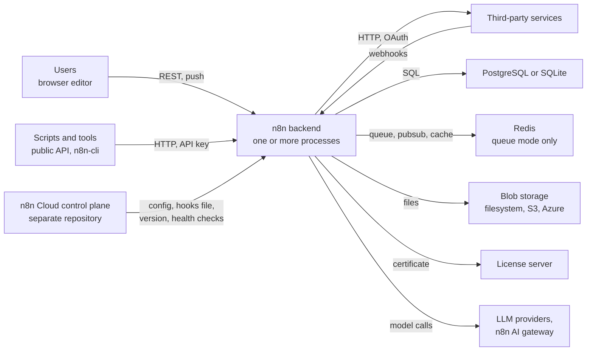

# Introduction

This folder is for an experienced TypeScript engineer who joined n8n and will work on the backend. It assumes that you know Node.js, Express, an ORM, and a monorepo. It assumes nothing about n8n.

It gives you a map of the backend, the reasons behind the shapes you will see, and the direction of the code. It does not teach you every subsystem. You learn that by working in the code. This folder tells you where to look, and what you are looking at when you get there.

These documents go with backend office hours. Each month the backend engineers hold an optional session for new joiners and anyone else who is interested. Read the Day 1 and Week 1 pages before you come, and bring your questions. When a question shows a gap in these pages, the answer goes back into this folder.

> [!NOTE]
> Setup is not here. `CONTRIBUTING.md` and the shared developer tools onboarding session cover local setup and the AI tooling. To read these pages as a site with rendered diagrams, run `pnpm docs:backend`.

## What the backend is, in one paragraph

n8n is a workflow automation platform. A **workflow** is a graph of **nodes**. A **trigger** node starts a run when something happens: an HTTP request, a schedule, or a message. Each following node receives **items**, which are JSON objects with optional binary references, and produces items. One run of a workflow is an **execution**, stored in the database with its status and its data. The backend is the Node.js server that stores workflows, registers triggers, runs executions, talks to the browser editor, and exposes a REST API. It ships as one npm package, `n8n`, built from a monorepo of about sixty packages. The same code runs for a self-hoster on one machine and for n8n Cloud across many thousands of instances.

## Vocabulary

Read these once. Every document in this folder uses them without definition. Renamed terms carry their old name, so that you can read older code and tickets.

**Domain terms.**

- **Workflow**: a graph of nodes and connections, stored as JSON in `workflow_entity`. It has a **draft**, the latest saved version, and optionally a **published** version whose triggers are live.
- **Node**: one step in a workflow. Its **node type** is a class that ships in a package. `typeVersion` on a node pins which version of the class runs.
- **Item**: `{ json, binary?, pairedItem? }`. Nodes take items in and put items out.
- **Execution**: one run of one workflow. The status is `new`, `running`, `waiting`, `success`, `error`, `canceled`, `crashed`, or `unknown`.
- **Execution mode**: why the run started: `webhook`, `trigger`, `manual`, `integrated` (a sub-workflow), `error`, `retry`, `cli`, `evaluation`, `chat`, `agent`, or `internal`.
- **Expression**: a parameter value that starts with `=` and contains `{{ }}` JavaScript over the workflow data.
- **Pinned data**: fixed items that replace the real output of a node during manual runs.
- **Production and manual execution**: a production run starts from a trigger in the world. A manual run starts from the test buttons in the editor. Manual runs use pinned data and stream results to the browser.
- **Webhook, poller, trigger**: the three kinds of trigger node. A webhook answers HTTP. A poller asks a third party on a schedule. A trigger holds a live resource, such as a connection or a timer. The Schedule Trigger is a trigger.
- **Waiting execution**: an execution paused on a Wait node, a form, or a send-and-wait. Time or a resume URL resumes it later.
- **Credential**: an encrypted secret that a node uses. A project owns it, and the backend decrypts it only at execution time.
- **Project**: the owner of workflows and credentials. Every user has a personal project. Team projects need a license.
- **Scope and role**: a scope is `resource:operation`. A role bundles scopes. A user has one global role and one project role for each project.

**Runtime terms.**

- **Regular mode and queue mode**: set by `EXECUTIONS_MODE`. Regular mode runs executions in the main process. Queue mode sends them as jobs through Redis to workers.
- **Main, worker, webhook process**: the three process roles. The main serves the editor, the API, and triggers. Workers run executions. Webhook processes receive production webhooks and put them on the queue. The CLI command decides the role.
- **Multi-main**: several mains behind a load balancer, with a license. A Redis key elects one main as the **leader**. The other mains are **followers**.
- **Durable scheduler**: the scheduler in `packages/@n8n/scheduler`. It writes each upcoming run to the database first, so that any main can fire it and a restart loses nothing. Schedule Trigger nodes and background system tasks use it. Poll triggers still use a timer in the process by default.
- **Publication outbox**: a table of pending workflow publications. The leader reads it and registers or removes the triggers.
- **Task runner**: a separate process that runs Code node user code in JavaScript or Python. A **task broker** inside the main or the worker matches requests to runners.
- **Push**: the channel from the server to the browser, over WebSocket or SSE. A **push reference** identifies each browser tab.
- **Pubsub**: Redis messages between processes in queue mode, on the channel `n8n.commands`.
- **Instance**: one n8n deployment. On Cloud, one customer. Its **instance id** stays fixed. Each process has its own **host id**.

**Code terms.**

- **Module**: a backend feature with a `<name>.module.ts` entrypoint. The backend loads a module when it is enabled, and initializes it only when the license allows it. Older modules live in `packages/cli/src/modules/<name>`. Newer modules are their own packages in `packages/modules/<name>/backend`.
- **Server subsystem**: a folder or a top-level file under `packages/cli/src` that is older than modules and loads with the process.
- **`.ee`**: the suffix on Enterprise code. The license decides whether the code runs. The suffix itself gates nothing.
- **License flag**: `feat:<name>` or `quota:<name>` in `@n8n/constants`. The license certificate grants it.
- **Lifecycle hooks**: callbacks around a workflow run and around each node. Everything that persists an execution happens in them.
- **Renamed**: data store became **data table**. Inbound secrets became **runtime credentials**. The distributed scheduler became the **durable scheduler**. Instance AI is **n8n Assistant** in the UI. The AI gateway is **Gateway credits** in the UI.

## The system in context

*Everything inside the box is this repository. Queue mode needs Redis, and other modes can use it. The control plane exists only on Cloud. It touches the backend through a small set of contracts, which [Cloud coupling points](cloud-coupling.md) describes.*

## Map of the code

This is the map at the level you need in your first weeks. Each row is one area, where it lives, and the one thing to know before you open it. The subsystem pages in `subsystems/` give each area more depth.

| Area | Where it lives | Know this first |
|---|---|---|
| Process start | `packages/cli/src/commands/` | `start`, `worker`, and `webhook` are CLI commands. The command decides the process role. [Startup and process roles](subsystems/startup-and-processes.md) |
| HTTP API | `packages/cli/src/controllers/`, `packages/cli/src/server.ts` | Controllers use decorators from `@n8n/decorators`. Request and response types live in `@n8n/api-types`, shared with the editor |
| Workflow publication and triggers | `packages/cli/src/workflows/publication/`, `packages/cli/src/active-workflow-manager.ts` | Publishing writes to an outbox. The leader turns outbox records into live triggers |
| Webhooks | `packages/cli/src/webhooks/` | Production and test webhooks take different paths. [Webhooks, push, and concurrency](subsystems/webhooks-push-and-concurrency.md) |
| Starting an execution | `packages/cli/src/workflow-runner.ts`, `packages/cli/src/scaling/` | `WorkflowRunner` runs the execution in this process, or puts it on the queue in queue mode |
| The v1 execution engine | `packages/core/src/execution-engine/` | `WorkflowExecute` runs the node graph. All persistence happens in lifecycle hooks, in `packages/cli/src/execution-lifecycle/` |
| Workflow model and expressions | `packages/workflow/`, `packages/@n8n/expression-runtime/` | `n8n-workflow` runs in the backend and the browser, so it has no Node-only code |
| Engine v2 | `packages/@n8n/engine/`, `packages/cli/src/modules/engine-v2/` | A new engine with its own data model. It is an opt-in module in development. [Engine v2](subsystems/engine-2.md) |
| Scheduling and waiting | `packages/@n8n/scheduler/`, `packages/cli/src/scheduling/`, `packages/cli/src/wait-tracker.ts` | New background work is a system task, not `setInterval`. See `packages/cli/src/scheduling/system-tasks/README.md` |
| Task runners | `packages/@n8n/task-runner/`, `packages/@n8n/task-runner-python/`, `packages/cli/src/task-runners/` | Code node user code never runs in the main process when task runners are on |
| Persistence | `packages/@n8n/db/`, `packages/@n8n/typeorm/` | Entities, repositories, and migrations live in `@n8n/db`. TypeORM stays in that layer. `@n8n/typeorm` is our fork of TypeORM |
| Push and collaboration | `packages/cli/src/push/`, `packages/cli/src/collaboration/` | Push is the only way the backend talks to an open editor |
| Auth, permissions, credentials | `packages/cli/src/auth/`, `packages/@n8n/permissions/`, `packages/cli/src/credentials/` | An endpoint declares the scope it needs, for example with `@GlobalScope` or `@ProjectScope`. Credentials decrypt only at execution time |
| Modules | `packages/cli/src/modules/`, `packages/modules/` | New backend features are modules. The module registry is in `@n8n/backend-common` |
| Shared backend foundations | `packages/@n8n/config/`, `packages/@n8n/di/`, `packages/@n8n/backend-common/`, `packages/@n8n/backend-services/`, `packages/@n8n/errors/` | Shared services and errors move out of `cli` into these packages, so that modules can become their own packages |
| Nodes | `packages/nodes-base/`, `packages/@n8n/nodes-langchain/`, `packages/cli/src/load-nodes-and-credentials.ts` | Nodes are plugins. The backend finds and loads their classes at startup from the installed node packages |
| Public API | `packages/cli/src/public-api/` | A separate, versioned REST API with API keys. Its contract is an OpenAPI file |
| AI features | `packages/@n8n/instance-ai/`, `packages/cli/src/modules/` (for example `agents`, `chat-hub`, `mcp`, `instance-ai`) | Most AI features are modules. [The AI platform](subsystems/ai-platform.md) |

[Legacy and new](legacy-and-new.md#status-labels) explains how to tell whether code is legacy or the target shape for new code.

## The same code, many shapes

The backend runs in several shapes at once. Most confusion in the first weeks comes from not knowing which shape a piece of code assumes. Ask three questions of any code path. Which process runs it? Does it run on every main or only on the leader? Does it change on Cloud or under a license?

| Behavior | Regular, one main | Queue, main | Queue, worker | Webhook process |
|---|---|---|---|---|
| Serve the editor and the REST API | yes | yes | no | no |
| Receive production webhooks | yes | yes, unless disabled | no | yes |
| Receive test webhooks | yes | yes | no | no |
| Run production executions | yes | no | yes | no |
| Run manual executions | yes | yes, unless offloaded to workers | yes, when offloaded | no |
| Fire schedules and pollers | yes | yes | no | no |

With multi-main, every main serves the editor and the API, and any main can fire a durable schedule. The leader also does the work that must happen once in the cluster. For example, it reads the publication outbox and holds live trigger connections and poll timers. It also resumes waiting executions by time. [Scaling and multi-main](subsystems/scaling-and-multi-main.md) has the full list.

> [!IMPORTANT]
> Code that must run once in the cluster uses a system task or a leader hook, never a plain timer.

Two more things cut across all of these. **License**: multi-main, S3 and Azure storage, SSO, log streaming, source control, and many other features need a flag in the certificate. [Enterprise gating](enterprise-gating.md) explains the three layers. **Cloud**: `N8N_DEPLOYMENT_TYPE=cloud` changes a small number of behaviors, and the control plane sets many environment variables. [Cloud coupling points](cloud-coupling.md) lists what a backend change can break there.

## What is moving

The backend is in the middle of several transitions. You will meet all of them in your first month. This table is the short form. [Legacy and new](legacy-and-new.md) is the long form, with the old shape and the new shape side by side.

| Transition | Stage | Flag or signal |
|---|---|---|
| Expressions run in a V8 isolate | Shipped, the default | `N8N_EXPRESSION_ENGINE=vm`. The value `legacy` opts out |
| The durable scheduler replaces timers in the memory of the leader | Shipped, the default. The in-memory scheduler is deprecated | `N8N_SCHEDULER_ENABLED` |
| Workflow publication goes through an outbox | Shipped, the default | `N8N_USE_WORKFLOW_PUBLICATION_SERVICE` |
| Modules move out of `cli` into their own packages | In progress | `packages/modules/<name>/backend`, `@n8n/backend-services`, `@n8n/errors` |
| Engine v2, a new execution engine with its own data model | Opt-in module, in development | `N8N_ENABLED_MODULES=engine-v2` |

## The four toggle systems

Four different switches decide what an instance does:

- License flags from the certificate.
- Module enablement from two environment variables.
- PostHog flags, evaluated for each user at runtime.
- Cloud instance feature flags, which the control plane maps to environment variables.

> [!WARNING]
> Never set module variables by hand on a Cloud instance. [Cloud coupling points](cloud-coupling.md#the-four-toggle-systems) has the comparison table.

## Who to ask

`OWNERS` at the repository root maps each path to the team that owns it, and GitHub asks that team to review changes to the path. To find who knows an area, look up the path in `OWNERS`, then ask in that team's channel. Each subsystem page in this folder also has an entry in `OWNERS`, so its owning team reviews changes to it.

When this folder does not answer a question, ask in your team channel or bring it to backend office hours. Then propose the answer as a change to this folder.

## Reading plan

**Day 1, about one hour.** This page, then [Recurring patterns](patterns.md). If you can, start the multi-main stack with `pnpm stack --mains 2 --workers 1` from `packages/quality/environments/containers/`. Then the process roles above are real to you.

**Week 1, about two hours with the code open.** Read in this order.

<!-- steps -->

1. [Life of a workflow publish](life-of-a-workflow-publish.md). An HTTP request through the controller, the service, the outbox, and trigger registration.
2. [Life of a webhook execution](life-of-a-webhook-execution.md). A production execution through webhook lookup, the engine, the lifecycle hooks, persistence, and the response, with the queue mode and waiting variants.
3. [Legacy and new](legacy-and-new.md). Each transition, the old shape and the new shape, and where to put new code today.
4. [Cloud coupling points](cloud-coupling.md) and [Enterprise gating](enterprise-gating.md). The two places where the code runs differently, and the three layers of licensing.

Then come to backend office hours with your questions.

**Month 1, on demand.** The `subsystems/` folder has one page for each area. Each page starts with a line that says when to read it. Read a page when you start work in its area, not before.

## Where the other documents are

Most of what a joiner needs already exists in the repository. This folder does not repeat it. It points to it.

| Document | Read this when |
|---|---|
| `AGENTS.md` at the root | Before your first PR. Conventions, error classes, the TypeORM boundary, security hygiene, PR titles |
| `packages/cli/AGENTS.md`, `packages/@n8n/db/AGENTS.md` | You write a query or a transaction |
| [Build a backend module](how-to/build-a-backend-module.md) | You create a module |
| `packages/modules/README.md` | You create a module as its own package |
| `packages/cli/src/scheduling/system-tasks/README.md` | You add background work that runs on a schedule |
| `.github/DEVELOPING_V3.md` | You change behavior that users see |
| `.agents/skills/` | You do a recurring task: protect an endpoint, write a migration, add telemetry, add a public API endpoint |
| `docs/db.md` and `docs/generated/` | You need the schema rules or the columns of a table |
| `docs/adr/` | You want to know why a past decision was made |
| docs.n8n.io, hosting section | You want the operator view of queue mode, scaling, task runners, and environment variables |

## How this folder stays correct

These pages describe things that change slowly: the map, the patterns, and the reasons. They name files and symbols instead of copying code. A CI check, `scripts/backend-docs-check.mjs`, fails when a page names a file, a symbol, or an environment variable that no longer exists. It runs on changes to this folder and once a week.

> [!TIP]
> When you find something wrong here, fix it. That is a good first PR.

## Self-check

Check what you learned on this page.

1. You add a cleanup job that must run every hour in a multi-main cluster. Where does it go, and why not `setInterval`?
   - A. In a `setInterval` in the constructor of a service. The container creates each service once, so the timer runs once.
   - B. In a system task. A plain timer runs once on every main, and it stops when the process restarts.
   - C. In a cron job outside n8n. The backend has no scheduler of its own.
   - D. In a workflow with a Schedule Trigger node.
2. A user publishes a workflow on a follower main. Which main registers its live trigger connections?
   - A. The follower, because the request arrived there.
   - B. Every main, so that each main can answer the triggers.
   - C. The leader. The follower writes the publication to the outbox, and the leader registers the triggers.
   - D. A worker, because triggers run in the queue.
3. In queue mode, a production webhook arrives at a webhook process. Which process runs the workflow?
   - A. The webhook process. It runs the workflow before it answers.
   - B. The leader main.
   - C. The main that published the workflow.
   - D. A worker. The webhook process puts the execution on the queue.
4. You need to know who reviews a change to `packages/cli/src/push/`. Where do you look?
   - A. In `OWNERS` at the repository root.
   - B. In the `package.json` of `packages/cli`, under `author`.
   - C. In the git history of the folder. The last author reviews.
   - D. In a `CODEOWNERS` file in the `.github` folder.
5. A file ends in `.ee.ts`. Does that make the code inside it a paid feature?
   - A. Yes. The build removes `.ee.ts` files from the community edition.
   - B. No. The suffix is a naming convention, and the license check in the code decides.
   - C. Yes. The module loader reads the suffix and asks the license service.
   - D. Only in cloud. Self-hosted instances ignore the suffix.

Answers

1. B. It goes in a system task, described in `packages/cli/src/scheduling/system-tasks/README.md`. A plain timer runs once on every main, and it stops when the process restarts.
2. C. The leader. The follower writes the publication to the outbox, and the leader reads the outbox and registers the triggers.
3. D. A worker. The webhook process puts the execution on the queue, and a worker takes it from Redis.
4. A. In `OWNERS` at the repository root. The last matching line names the owning team. The repository has no `CODEOWNERS` file.
5. B. No. The suffix is a naming convention. The license check in the code decides whether the feature runs.

