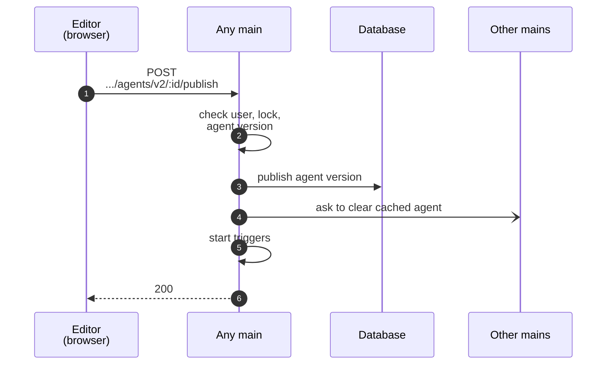

# Agent publication

On [Start here](README.md), you clicked **Publish** on your agent. On this page, we follow that click through the backend.

## Versions

Like a workflow, an agent has a **draft**, which is the last saved version, and a **published version**, which answers messages in production. Publishing makes a saved version the published version. A user can also republish an older version.

## Checks

Before the publication, the main runs these checks:

- The user may publish agents in the project, and no other browser tab is editing the agent.
- No policy refuses the agent version, and its configuration (e.g. tools) is valid.
- Each **chat integration** of the agent version can start. A chat integration allows the users of a chat app, e.g. Slack, to send messages to the agent. A chat integration cannot start if, say, another agent is already using the same credential.

If any check fails, the previous version stays published.

## Save

The main saves the agent version as the published version. If another user published the agent at the same moment, the main answers 409, and the user must try again.

Each main keeps the agents that it ran recently in a cache, ready to answer. The main therefore asks the other mains over pubsub to clear the agent from their caches. The next message on any main then reaches the new version.

## Agent triggers

Besides messages from the editor, two kinds of **triggers** can start an agent: chat integrations and schedules. A chat integration starts the agent when a user of the chat app sends a message. A schedule starts the agent at set times.

The main starts the triggers of the published version, and asks the other mains to start their chat integrations. Then the main answers the editor.

| Trigger | Where it runs |
|---|---|
| Chat integration | On every main, or only on the leader if the integration polls or keeps a connection open |
| Schedule | On the leader |

In your session from [Start here](README.md), your agent had no triggers, so the main started nothing.

## Outcome

If a chat integration fails to start (e.g. because the chat app is down), the publication still succeeds, and the main answers 200. A 200 therefore means that the agent version is published, not that every chat integration runs.

Each main regularly compares the chat integrations that run on the main with the published version, and starts any that are missing.

## Quiz

1. Two users publish the same agent at the same moment. What happens?
   - A. Both publications succeed, and the last one wins.
   - B. One succeeds, and the other gets 409.
   - C. The leader merges the two versions.
   - D. Both fail, and the agent stays unpublished.
2. A user publishes an agent with a Slack chat integration, and Slack is down. What happens?
   - A. The publication fails.
   - B. It succeeds, and Slack connects later.
   - C. The main waits until Slack is back.
   - D. n8n removes the chat integration from the agent.
3. How does a workflow publication differ from an agent publication?
   - A. Only a workflow publication uses an outbox.
   - B. Only an agent publication runs policy checks.
   - C. Only a workflow publication uses a transaction.
   - D. They do not differ.

Answers

1. B. The main detects the second publication, so the second request fails.
2. B. A failed chat integration does not make the publication fail. Each main starts the missing chat integrations later.
3. A. Agent publication does not go through an outbox. The main starts the triggers, and then answers.

