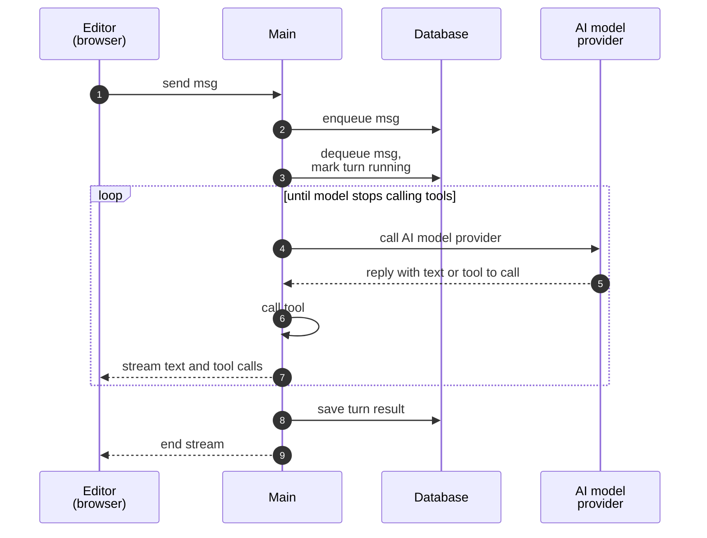

# Agent turn

On [Start here](README.md), you sent a message to your agent in the test chat, and the agent answered. On this page, we follow that message through the main.

## Queue

The test chat sends your message to the main, which keeps the HTTP response open to stream the answer. First, the main saves the message to a queue in the database, so a crash or a closed tab does not lose it.

## Turn start

Any main can dequeue a message, and the database makes sure that only one main dequeues each message. The messages of one conversation run in order, one at a time, and different conversations run at the same time. The main that dequeues your message records the turn as running and starts the agent runtime.

## Loop

The agent runtime on the main sends instructions, conversation, and available tools to the model at the AI model provider. For this call, it uses a credential, as a node does, or [Gateway credits](https://docs.n8n.io/deploy/use-n8n-cloud/gateway-credits). The model only decides what comes next: it replies with text, or with a tool to call. The runtime calls the tool, sends back the result, and asks the model again. The turn ends when the model replies with text only, or when a limit (e.g. a cost budget) stops it.

While the turn runs, the main streams text and tool calls in the open HTTP response. When the turn ends, the main saves the result to the conversation, so a reload shows the saved conversation instead of replaying the stream.

## Tools

The agent that you built on [Start here](README.md) had no tools. An agent can use four kinds of tools:

| Tool | What runs it |
|---|---|
| Node | Main, outside any workflow |
| Workflow | [Workflow execution](workflow-execution.md) |
| MCP server | External server, called via [Model Context Protocol](https://modelcontextprotocol.io) |
| Custom tool† | [V8 isolate](sandboxing.md) on the main |

† A [custom tool](https://docs.n8n.io/build/build-and-manage-agents#add-tools) is a small TypeScript function that a user adds to the agent in the editor. Its name, description, and input schema tell the model when and how to call it. The code comes from the user, so n8n runs it in an isolate, i.e. a separate JavaScript heap with its own memory limit.

In queue mode, a workflow tool runs on a worker, and the turn waits for it on the main.

## Other turns

Your message took the simplest path. Other turns differ from it in these common ways:

- **Other sources:** A published agent can also take messages from a chat platform (e.g. Slack), or run on a schedule. These messages go into the same queue.
- **Second message:** A second message to the same conversation waits in the queue until the turn ends. It can also **steer** the running turn, i.e. join it before the next call to the model. Only messages from the test chat and the n8n chat can steer.
- **Approval:** A tool can ask a person for approval. The turn then saves a checkpoint and pauses, and the approval resumes it from the checkpoint on any main.
- **Multi-main:** Mains relay the stream over pubsub, so a second tab or the Stop button works on any main.

The agent runtime comes from `@n8n/agents`, a library that knows nothing about n8n. Two products build on it. The `agents` module runs the agents that users build. The n8n Assistant in `@n8n/instance-ai` builds and fixes workflows for the user. The Assistant has its own threads and event log, and it reaches n8n through an adapter service.

The **AI Agent** node is not part of this runtime. It is a node inside a workflow. When its model asks for a tool, the node asks the engine to run the tool nodes that connect to it. The whole loop stays inside one execution.

## Read next

- [AI functionality](ai-functionality.md): how AI builds and fixes workflows and agents for the user.
- [APIs](apis.md#live-updates): what happens to a streamed reply when the connection drops.

## Quiz

1. A main crashes just after you send a message to an agent. Is the message lost?
   - A. Yes.
   - B. Only in multi-main.
   - C. No. Redis keeps the message.
   - D. No. The database keeps the message.
2. Two messages for the same conversation arrive on two different mains. How do they run?
   - A. At the same time, one on each main.
   - B. The second message cancels the first turn.
   - C. In order, one at a time.
   - D. On workers, one for each message.
3. In queue mode, an agent calls a workflow as a tool. Where does that workflow run?
   - A. On the main, with no execution.
   - B. On a worker, as an execution.
   - C. In a V8 isolate, like a custom tool.
   - D. On the leader, because tools need a leader.
4. The model replies with a tool to call. What calls the tool?
   - A. The AI model provider, before it replies.
   - B. The agent runtime on the main.
   - C. The editor, in your browser tab.
   - D. A worker, in every mode.
5. An AI Agent node in a workflow asks the model for a tool. Where does the tool run?
   - A. In an agent turn on the main.
   - B. In a child execution, as a sub-workflow.
   - C. In the same execution.
   - D. In a task runner.

Answers

1. D. A crash or a closed tab does not lose a saved message.
2. C. The database makes sure that only one main dequeues each message, and the messages of one conversation run in order.
3. B. A workflow tool starts a workflow execution, and queue mode runs executions on workers.
4. B. The model only decides what comes next. The runtime calls the tool, sends back the result, and asks the model again.
5. C. The AI Agent node is a node, not an agent of the `agents` module. The whole loop stays inside one execution.

