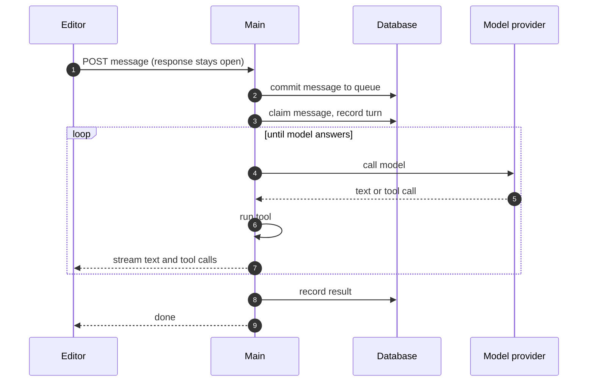

# Agent turn

On [Start here](README.md), you sent `My name is Ada.` to your agent. The work that answers one message is an **agent turn**. A turn is not a workflow execution: it has no row in `execution_entity`, and the execution engine does not run it. This page follows your message to the answer.

## Queue

The test chat sends your message to the main, and the main keeps the HTTP response open to stream the answer. Before any other work, the main commits the message to a queue table in the database. From that moment, a crash or a closed tab does not lose the message.

Messages also come from other places. A published agent can listen on a chat platform, such as Slack, or run on a schedule. Those messages go into the same queue.

## Claim

Each main runs a consumer that claims messages from the queue. The claim uses the database, so two mains never run the same message. The messages of one conversation run in order, one at a time. Different conversations run at the same time.

The consumer records the turn as running, and then it starts the runtime. If you send a second message while a turn runs, the second message waits in the queue. You can also let it **steer** the running turn: the runtime adds it before its next call to the model.

## Loop

The agent runtime in `@n8n/agents` calls the model with the instructions, the conversation, and the tools. The model answers with text, or it asks to call a tool. The runtime runs the tool, gives the result to the model, and calls the model again. The turn ends when the model answers without a tool call. A limit can also stop it, such as a budget for the cost of the calls.

The model call uses a credential of the project, as nodes do. An instance with an AI gateway license can use the gateway instead, which users know as "Gateway credits".

## Tools

The kind of tool decides what runs it:

| Tool | What runs | Workflow execution |
|---|---|---|
| A node | n8n runs that one node in memory | No |
| A workflow | `WorkflowRunner` starts a real execution, the same as on the previous page | Yes |
| An MCP server | A connection to a server that speaks the Model Context Protocol | No |
| Custom code | A V8 isolate | No |

A workflow tool is where the two kinds of work meet. The workflow must start with the trigger **When Executed by Another Workflow**. The test chat runs its draft, and a published agent runs its published version. In queue mode, that execution goes to a worker, and the turn waits for it on the main.

A tool can also ask a person for approval. The turn then saves a **checkpoint** and pauses. The approval resumes the turn from the checkpoint, on any main.

## Streaming

The runtime sends the text and each tool call to the open response while it works. Other mains relay these events over pubsub, so a second tab or a Stop button works on any main.

When the turn ends, the main records the result, and the conversation keeps it. After a reload, the editor reads the recorded conversation. The stream does not play again.

## Crashes

A crash does not run a turn again. On startup and on a timer, n8n looks for turns that are running but that no process updated for two minutes. It marks them as interrupted. A message that was still in the queue stays there and runs later. A turn that waited for an approval keeps its checkpoint.

A tool can therefore stop in the middle of its work. A tool that writes to another service needs to be safe to stop, or it needs to ask for an approval first.

## n8n Assistant

The n8n Assistant is the agent inside the editor that builds and fixes workflows. The code calls it Instance AI. It uses the same runtime library, but it has its own module and its own records. It keeps an event log in the database, so the editor can reconnect and replay the events that it missed. To build a workflow, it writes code against `@n8n/workflow-sdk`. The code compiles in a sandbox outside the process, which an admin turns on. Then the Assistant saves and runs the workflow through n8n like a user. [AI features](subsystems/ai-features.md) has more.

## Quiz

1. A main crashes just after a user sends a message to an agent. Is the message lost?
   - A. Yes. The message was only in the open HTTP request.
   - B. Only in multi-main.
   - C. No. Redis keeps the message until a main reads it.
   - D. No. The main commits the message to a queue table before any other work.
2. Two messages arrive for the same conversation, on two different mains. How do they run?
   - A. At the same time, one on each main.
   - B. The second message cancels the first turn.
   - C. In order, one at a time. The claim in the database stops two mains from running them together.
   - D. On workers, one for each message.
3. In queue mode, an agent calls a workflow as a tool. Where does that workflow run?
   - A. On the main, inside the agent runtime, with no execution row.
   - B. On a worker, as a real execution. The turn waits for it on the main.
   - C. In a V8 isolate, like custom code.
   - D. On the leader, because tools need a leader.
4. A process crashes during a turn. What does n8n do with that turn?
   - A. It marks the turn as interrupted after two minutes without an update. It does not run the turn again.
   - B. It runs the turn again from the start on another main.
   - C. It continues the turn from the last tool call.
   - D. It deletes the turn and the message.
5. A user reloads the editor after a turn ended. What does the editor show?
   - A. The stream of the turn, played again.
   - B. Nothing, until the user sends a new message.
   - C. A new answer, because the editor calls the model again.
   - D. The recorded conversation.

Answers

1. D. No. The main commits the message to a queue table before any other work. From the moment of the commit, a crash or a closed tab does not lose the message.
2. C. In order, one at a time. The claim in the database stops two mains from running them together. The messages of one conversation run in order. Different conversations run at the same time.
3. B. On a worker, as a real execution. The turn waits for it on the main. `WorkflowRunner` starts a real execution for a workflow tool, so queue mode sends it to a worker.
4. A. It marks the turn as interrupted after two minutes without an update. It does not run the turn again. A crash does not run a turn again. A tool that writes to another service must be safe to stop, or ask for an approval first.
5. D. The recorded conversation. When the turn ends, the main records the result. After a reload, the stream does not play again.

