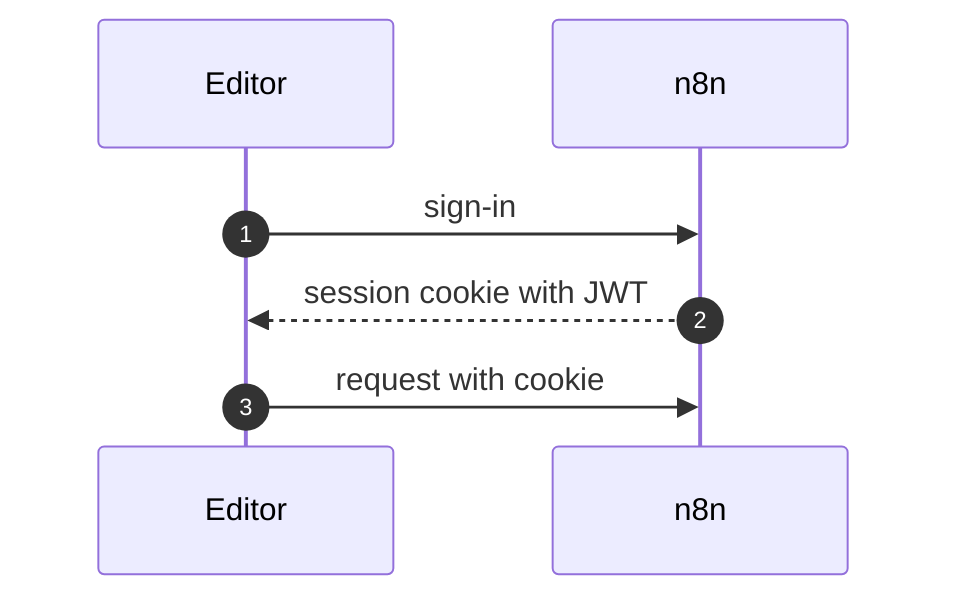
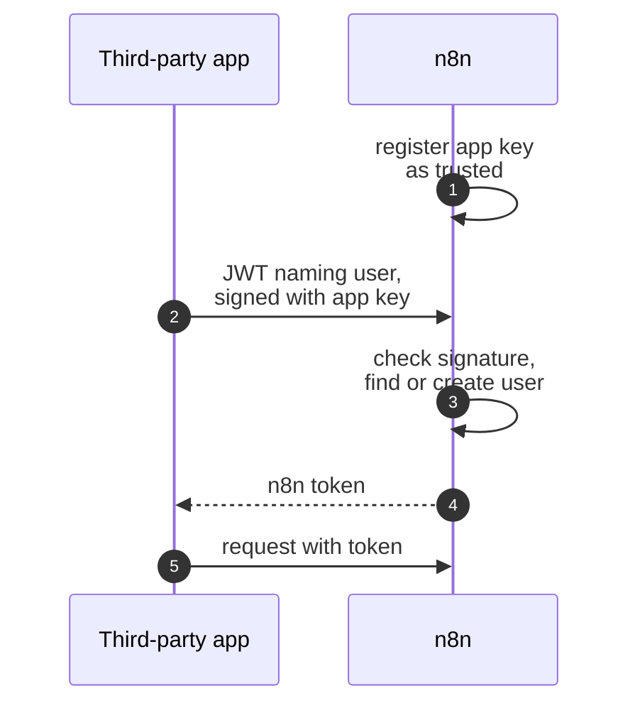
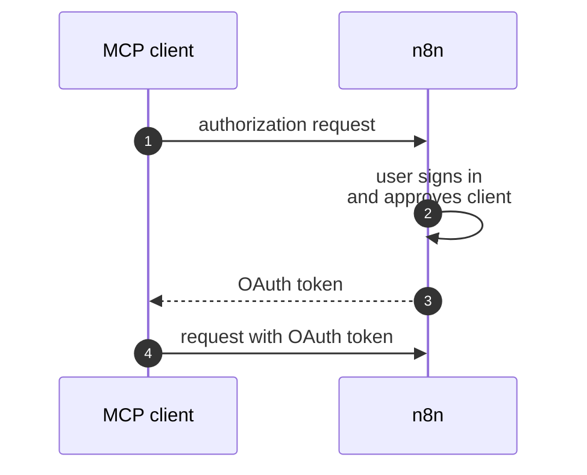

# Authentication

The [APIs](apis.md) page mentioned that authentication is the first check on a request.

This page explains how callers prove who they are and sign in, and how n8n checks their sessions.

## Callers

Each kind of caller proves its identity differently.

**Editor:** The user signs in, and n8n sets a session cookie that holds a JWT. The editor then sends this cookie with each request.

**Script:** A script sends an API key with each request to the public API.

**Third-party app:** An app that embeds n8n signs its users in with a **token exchange**.

**MCP client:** An MCP client sends an API key, a token from a token exchange, or an OAuth token. n8n can issue the OAuth token itself, after the user approves the client.

**Sessionless caller:** A user who opens an invitation link has no session yet, so the route for this link skips authentication. A route that skips authentication must verify the caller in another way.

## Sign-in

Users sign in with an email and a password by default. An admin can enable LDAP, SAML, or OIDC instead. SAML and OIDC send the user to an identity provider, and turn off password sign-in for most users.

With SAML or OIDC, the identity provider can also manage users:

- **Provisioning:** n8n sets the roles of a user from the identity provider at each sign-in.
- **SCIM:** The identity provider creates, updates, and removes users.

Every sign-in method ends with the same session cookie, so a route does not need to know how the user signed in.

## Sessions

n8n does not store sessions on the server. The session JWT holds a hash of the email, password, and multi-factor authentication (MFA) secret of the user, so a change to any of them ends the other sessions of that user. A logout adds the JWT to a block list.

If an admin requires MFA, a session without MFA can reach only the routes for MFA setup.

## Quiz

1. Your route skips authentication, because its caller has no session (e.g. a link in an email). What must the route do?
   - A. Nothing.
   - B. Check the caller in another way, e.g. with a signature.
   - C. Ask for an API key.
   - D. Check the license.
2. SAML is enabled. A member enters an email and a password on the sign-in page. What happens?
   - A. The sign-in works.
   - B. n8n refuses it, because password sign-in is off.
   - C. n8n sends the password to the identity provider.
   - D. n8n tries LDAP.
3. A user changes their password. What happens to their open sessions?
   - A. They stay valid until they expire.
   - B. n8n deletes them from a session table.
   - C. Only the current session stays valid.
   - D. They all end.

Answers

1. B. A route that skips authentication must verify the caller in another way.
2. B. With SAML or OIDC, password sign-in is off for most users.
3. C. The session JWT holds a hash of the password, so a change ends the other sessions of that user.

