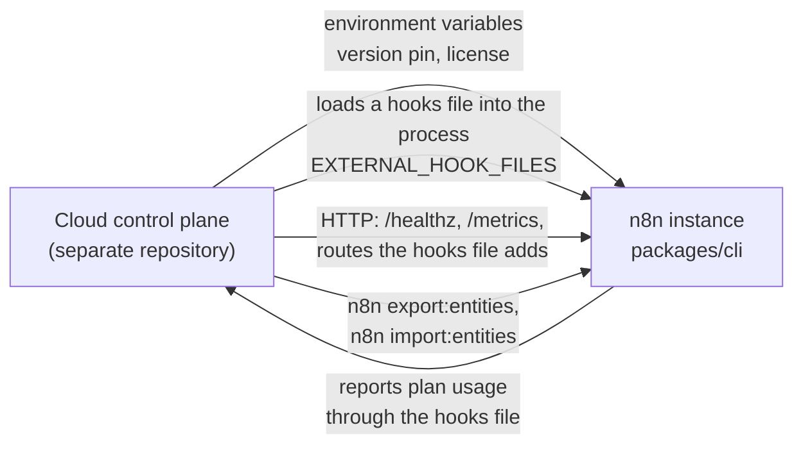

# Cloud coupling points

The same n8n backend runs in two very different homes. A **self-hoster** installs n8n, sets environment variables, chooses the version, and upgrades when they decide to. **n8n Cloud** runs one n8n instance for each customer. It sets the environment variables from the customer's plan, pins the version, and upgrades on a schedule. The **Cloud control plane** that does this lives in a separate, private repository. You will not work in it. You can break it from here.

This page names the places where the backend and Cloud touch. It exists so that you recognize a coupling point when you edit near one. The design rule is short. A backend change must not break an instance that Cloud manages. Cloud manages instances through a small set of contracts, and the backend must keep them.

> [!NOTE]
> Facts about the Cloud side come from the control plane repository. They cannot be checked from this repository, so each one carries the date it was last checked.

## How Cloud drives an instance



*Cloud does not edit the database of an instance directly for normal operation. It configures, injects, calls, and runs CLI commands. Every arrow is a contract.*

Cloud does four things to an instance.

- **It configures.** Many environment variables on each instance come from the plan and the version. `N8N_DEPLOYMENT_TYPE=cloud` is one of them.
- **It injects.** Cloud mounts a compiled hooks file into the container and loads it through `EXTERNAL_HOOK_FILES`. That file registers external hooks and adds HTTP routes to the Express app. Plan limits, usage reports, and support tooling reach the instance this way.
- **It calls.** Kubernetes health checks call `/healthz` and `/healthz/readiness`. Monitoring scrapes `/metrics`. Support tooling calls the routes that the hooks file added.
- **It upgrades.** Each instance is pinned to a version. An upgrade is a container restart with a new image. Database migrations run inside n8n at boot. Cloud runs no migration itself.

## The coupling points, from strongest to weakest

### External hooks

`ExternalHooks` in `packages/cli/src/external-hooks.ts` loads the files named in `EXTERNAL_HOOK_FILES`. It runs the registered functions at named moments. The hook names and their argument shapes are a contract. The hook map in the same file lists each hook, for example `n8n.ready`, `workflow.activate`, `workflow.postExecute`, `user.profile.beforeUpdate`, and `oauth2.callback`.

One detail of `ExternalHooks.run` matters for Cloud. When a hook throws, `run` reports its own error and then throws the original error again. The hook then decides what the user sees. The catch block in `packages/cli/src/external-hooks.ts` ends with:

```ts
				const error = new UnexpectedError(`External hook "${hookName}" failed`, { cause });
				this.errorReporter.error(error, { level: 'fatal' });

				// Throw original error, so that hooks control the error returned to use
				// For example on Cloud we return upgrade message when user reaches max executions or activations
				throw cause;
```

> [!WARNING]
> This is how a plan limit becomes an upgrade message in the editor. If you wrap or replace that error, the message disappears.

> [!CAUTION]
> **What breaks it.** A renamed hook, a change to the arguments of a hook, or a hook that fires at a different moment. The `n8n.ready` hook receives the server, and the hooks file uses its Express app to add routes. A replacement of that HTTP layer breaks every route that Cloud added.

### Compiled file paths and `HooksService`

The hooks file is compiled against the published `n8n` package. It imports compiled files by path, for example the compiled forms of `packages/cli/src/auth/jwt.ts` and `packages/cli/src/services/hooks.service.ts`. When one of those source files moves, every Cloud instance fails at startup with "Problem loading external hook file".

`HooksService` in `packages/cli/src/services/hooks.service.ts` exists for this reason. It is a stable surface that the hooks file calls. Its header says "DO NOT DELETE or RENAME any of the methods without making sure this is not used in cloud BE hooks". The same kind of marker sits on the deprecated `issueCookie` function in `packages/cli/src/auth/jwt.ts`.

> [!IMPORTANT]
> Search `packages/cli/src` for "cloud hooks" before you move or delete code. These markers are the only signal in this repository.

As of September 2026, the hooks file also imported the compiled `EventService` from `packages/cli`. That service now lives in `packages/@n8n/backend-services`. Check a move like this with Cloud before it ships.

> [!CAUTION]
> **What breaks it.** A deleted method on `HooksService`, a renamed file that the hooks file imports, or a change to the package layout of `n8n`.

### The legacy `convict` configuration

Five settings remain in `packages/cli/src/config/schema.ts`. Four exist because the hooks file still reads them, and each carries a "do not remove" comment. The fifth, `authenticationMethod`, is internal state. See [Patterns](patterns.md#configuration).

### Environment variable names

Cloud sets environment variables by name. A renamed variable changes behavior on every Cloud instance, and nobody is told. Use `DeprecationService` in `packages/cli/src/deprecation/deprecation.service.ts` to retire a variable. It warns at boot and names the replacement, while the old name keeps working for a release.

As of September 2026, the variables that Cloud sets fell into these groups.

| Group | Examples |
|---|---|
| Identity and plan | `N8N_DEPLOYMENT_TYPE`, the webhook URL, proxy hops |
| Hooks | `EXTERNAL_HOOK_FILES` |
| Licensing | `N8N_LICENSE_CERT`, or an activation key with a tenant id |
| Execution limits and pruning | `EXECUTIONS_*`, `N8N_CONCURRENCY_PRODUCTION_LIMIT` |
| Storage and database | `DB_*`, `N8N_DEFAULT_BINARY_DATA_MODE`, `N8N_EXECUTION_DATA_STORAGE_MODE` |
| Queue mode | `EXECUTIONS_MODE`, `QUEUE_BULL_REDIS_*`, `N8N_MULTI_MAIN_SETUP_ENABLED` |
| Security hardening | `NODES_EXCLUDE`, `N8N_BLOCK_ENV_ACCESS_IN_NODE`, `N8N_RESTRICT_FILE_ACCESS_TO` |
| Product surface | `N8N_HIDE_USAGE_PAGE`, `N8N_DIAGNOSTICS_*`, the version notification endpoints |
| Modules and flags | `N8N_ENABLED_MODULES`, `N8N_DISABLED_MODULES`, `N8N_SCHEDULER_ENABLED`, `N8N_USE_WORKFLOW_PUBLICATION_SERVICE`, `N8N_EXPRESSION_ENGINE` |

Cloud configures instances for each **version band**, a range of n8n versions that receive the same configuration. When a default changes in n8n, the band boundary moves on the Cloud side.

### Module names and defaults

Cloud enables and disables modules for each version band through `N8N_ENABLED_MODULES` and `N8N_DISABLED_MODULES`. Two failures are fatal at boot. A name in both lists throws `ModuleConfusionError`. A name that is not in `MODULE_NAMES` throws `UnknownModuleError`. A renamed module changes what a version band does on Cloud. A module that moves from opt-in to default changes it too. Treat `MODULE_NAMES` and `defaultModules` in `packages/@n8n/backend-common/src/modules/` as a public contract.

### License feature keys

Cloud maps a plan to a set of `feat:*` strings and quotas from `packages/@n8n/constants/src/index.ts`. As of September 2026, it also read the boolean methods on `LicenseState` to build targeting properties for product analytics. A renamed flag or method drops a property, and no error shows it. See [Enterprise gating](enterprise-gating.md).

### Health and metrics endpoints

`/healthz` answers liveness on mains and webhook processes. Workers answer it when `QUEUE_HEALTH_CHECK_ACTIVE` is set. `/healthz/readiness` returns 200 only when the database is connected and migrated and the server has marked itself ready. Otherwise it returns 503. `/metrics` on the main port serves Prometheus metrics. Kubernetes health checks, support tooling, and the sleep and wake logic for idle instances depend on these paths and their status codes. `AbstractServer` in `packages/cli/src/abstract-server.ts` defines the health routes.

### CLI commands

`n8n export:entities` and `n8n import:entities` move a whole database between deployment shapes, for example from SQLite to PostgreSQL. Cloud runs them inside the container. Their flags and their output layout are a contract.

### Table names

As of September 2026, the backup tooling for SQLite instances copied specific tables by name. These were workflows, credentials, users, projects, annotations, and the data table storage. It never copied execution tables. A migration that renames one of those tables breaks backups, and n8n shows no error. `.agents/skills/db-migrations/SKILL.md` asks for one release between the end of writes to a column and its removal. A rename of the tables above needs coordination with Cloud.

### Upgrades and migrations

Cloud restarts the container to upgrade an instance. A restart that exceeds a timeout counts as a failed upgrade. Migrations run at that boot, so a slow migration on a large instance looks like a failed upgrade. This has two results for you. Migrations must be fast and batched for large tables. Migrations must also stay backward compatible for one release, because a rollback starts the previous image against the migrated schema.

## What `N8N_DEPLOYMENT_TYPE=cloud` changes inside n8n

The flag is `DeploymentConfig.type` in `packages/@n8n/config/src/configs/deployment.config.ts`, a plain string with the default `default`.

The backend branches on it in a small number of places. Some examples:

- Telemetry adds Cloud-only properties, such as the user email, to some events.
- `ConcurrencyControlService` reports concurrency limit telemetry only on Cloud.
- The instance section of the security audit is skipped on Cloud.
- Two v2 breaking-change rules, about file permissions and the runner image, do not apply on Cloud, because Cloud controls both.
- Task runner error messages differ, because a self-hoster can act on them and a Cloud user cannot.
- The Instance AI module marks its settings as managed by Cloud.
- The `mcp-discovery` module and the agent budget alert emails act only on Cloud.
- The editor records sessions only on Cloud, through a setting that `FrontendService` sends.

> [!TIP]
> Almost everything else is the same code. Before you add a branch on `deployment.type`, ask whether a license flag or a config value can do the same job for self-hosters.

## The toggle systems

New joiners confuse five different switches. They differ in where they are defined, who evaluates them, and when they change.

| System | Defined in | Evaluated by | Changes when | On Cloud |
|---|---|---|---|---|
| **License flags** `feat:*` and `quota:*` | `packages/@n8n/constants/src/index.ts` | `LicenseState`, `@Licensed`, module `licenseFlag` | The license certificate renews or a plan changes | The plan decides the flags |
| **Module enablement** | `MODULE_NAMES` and `defaultModules` in `packages/@n8n/backend-common/src/modules/` | `ModuleRegistry` at boot | `N8N_ENABLED_MODULES` or `N8N_DISABLED_MODULES` changes, then a restart | Set for each version band by the control plane. Never edit it by hand on a Cloud instance |
| **PostHog feature flags** | The PostHog project. Backend flag keys are constants in `@n8n/api-types`, frontend keys in `packages/frontend/editor-ui/src/app/constants/experiments.ts` | `PostHogClient` at runtime, for each user | Up to 10 min after a change in PostHog, because each process caches the flags of each user. The editor gets flags at login and at page load. An instance with diagnostics off never calls PostHog | Shared with self-hosted instances unless the flag filters on the deployment type |
| **Cloud instance feature flags** | The control plane repository | The control plane, at signup, plan change, or version change | Only when the instance configuration is rebuilt | Each flag maps to environment variables on the instance |
| **Environment feature flags** `N8N_ENV_FEAT_*` | Environment variables on the instance | `isEnvFeatureEnabled` in `@n8n/backend-common`, and the editor through `envFeatureFlags` | At the next restart | Set by the control plane or the operator |

The fourth system is not visible from this repository. As of September 2026, an instance picked up a new Cloud flag only when its configuration was rebuilt. For this reason a Cloud rollout can show many more "eligible" instances than "enabled" ones.

> [!WARNING]
> A hand edit of `N8N_ENABLED_MODULES` on a Cloud instance bypasses that system and can stop the instance from booting.

## Self-hosters

Everything above is about the managed home. The self-hosted home has no hooks file, no control plane, and no version pin. The operator sets the environment variables, chooses the database, picks the version, and reads the breaking-change report before a major upgrade. The `breaking-changes` module in `packages/cli/src/modules/breaking-changes/` exists for them, and so does `DeprecationService`. The design principle in `AGENTS.md` exists for them too. Security must not add friction to the common case, and the common case is a person who runs one instance.

When you weigh a default, weigh it for both homes. Cloud can override a default with an environment variable. Every self-hoster lives with it.

## Rules near a coupling point

1. Keep the old name working for one release. Use `DeprecationService` for variables. Keep a re-export for a moved file that the hooks file imports.
2. Keep `/healthz`, `/healthz/readiness`, and `/metrics` stable in path and status codes.
3. Keep migrations fast and backward compatible for one release. See [Write a database migration](how-to/write-a-database-migration.md).
4. Coordinate with Cloud before you rename a module, a license flag, a table that the backup reads, or a `HooksService` method.
