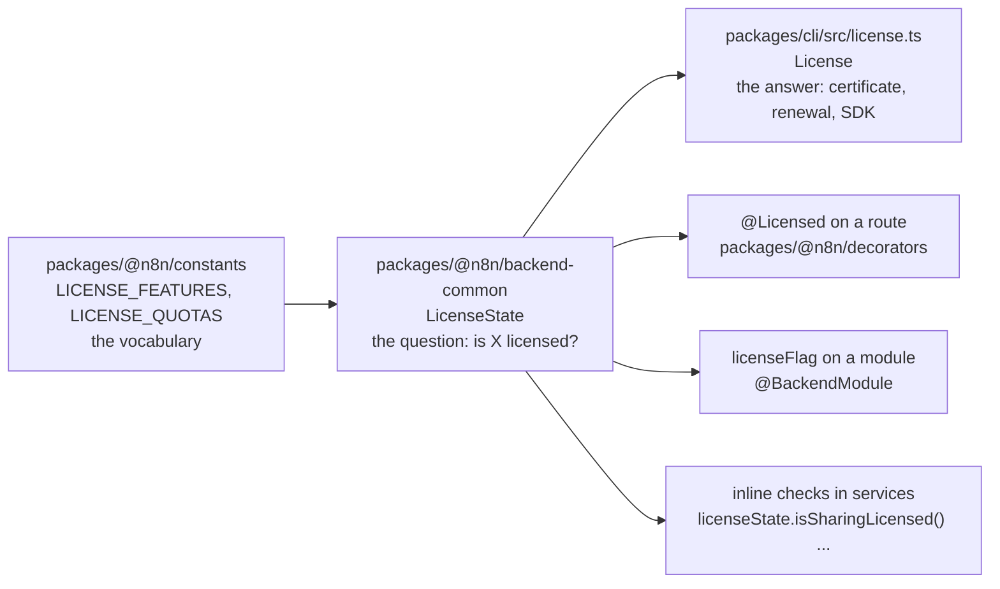

# Enterprise gating

n8n ships one codebase under two licenses. Files and folders with the `.ee` suffix fall under the Enterprise license in `LICENSE_EE.md`. They do their work only when the instance holds a license that grants the matching feature. The code for a paid feature is on your disk. The license decides whether it runs.

This page explains the convention, the three gating layers, and where a check goes. It does not list every feature. The flags are in one file.

## The `.ee` convention

A path that ends in `.ee` marks Enterprise code. Whole modules carry it, such as `packages/cli/src/modules/ldap.ee/`. Folders inside `packages/cli/src` carry it, such as `packages/cli/src/environments.ee/` and `packages/cli/src/permissions.ee/`. Single files carry it, such as `packages/cli/src/workflows/workflow.service.ee.ts`. A whole package can carry it, such as `packages/@n8n/ai-workflow-builder.ee/`.

The suffix is a statement about licensing, not about loading. An `.ee` file is compiled and shipped like any other file. The module loader even hides the suffix. `ModuleRegistry` looks for `<name>/<name>.module.js` first, then for `<name>.ee/<name>.module.js`. The module name `ldap` thus finds the folder `ldap.ee`. The suffix tells a reader and a reviewer that the code must not run without a license check somewhere on its path.

## The three layers

Gating happens at three levels, and a feature usually uses two of them.



*The constants name the features. `LicenseState` answers questions about them. `License` holds the certificate and talks to the license server. Routes, modules, and services ask `LicenseState`, never `License`.*

**Layer 1, the vocabulary.** `LICENSE_FEATURES` and `LICENSE_QUOTAS` in `packages/@n8n/constants/src/index.ts` are the only place where feature strings are defined. A boolean feature is `feat:<name>`. A numeric limit is `quota:<name>`, such as `quota:users` or `quota:activeWorkflows`. These strings are a contract with the license server and with n8n Cloud, which maps plans to them. A rename breaks both. See [Cloud coupling points](cloud-coupling.md#license-feature-keys).

**Layer 2, the question.** `LicenseState` in `packages/@n8n/backend-common/src/license-state.ts` is the injectable read side. It has a generic `isLicensed` method and a named getter for each feature. `isLicensed` also accepts an array, which means "any of these". `LicenseState` lives in `backend-common`, not in `cli`. This lets extracted packages and packaged modules ask about licensing without a dependency on the server.

**Layer 3, the answer.** `License` in `packages/cli/src/license.ts` wraps the license SDK and holds the certificate. It implements the provider that `LicenseState` asks. It stores the certificate in the `settings` table, so a restart does not need the license server. `N8N_LICENSE_CERT` can supply a certificate directly instead. Renewal runs as `LicenseRenewalTask` in `packages/cli/src/license/license-renewal.task.ts`, a cluster-wide system task. Other mains learn about a reload through the `reload-license` pubsub command.

## Where a check goes

Three places, chosen by what you gate.

**A route.** Put `@Licensed('feat:...')` between the route decorator and the scope decorator. The decorator in `packages/@n8n/decorators/src/controller/licensed.ts` only records metadata. `ControllerRegistry` in `packages/cli/src/controller.registry.ts` turns it into a middleware. On an unlicensed instance the middleware answers 403 with "Plan lacks license for this feature".

**A module.** Put `licenseFlag` in the `@BackendModule` options. `ModuleRegistry.initModules` skips the module's `init()` on an unlicensed instance, so none of its controllers or hooks exist there. Its entities were collected earlier, so its tables do exist. The SAML module in `packages/cli/src/modules/sso-saml/sso-saml.module.ts` is the smallest example:

```ts
@BackendModule({ name: 'sso-saml', licenseFlag: 'feat:saml', instanceTypes: ['main'] })
```

`licenseFlag` also accepts an array. The provisioning module in `packages/cli/src/modules/provisioning.ee/provisioning.module.ts` uses one, because it serves SAML, OIDC, and LDAP alike.

A module that is partly free and partly paid does not use `licenseFlag`. It gates the paid routes with `@Licensed` and keeps the rest open. The insights module in `packages/modules/insights/backend/` collects data for everyone. It gates the dashboard routes and the hourly data.

**A service.** Sometimes the decision is not for each route. Then call a named getter on `LicenseState` inside the service, and throw `FeatureNotLicensedError` or degrade. Variables do this for the maximum count. Redaction does this at read time, because the module is on by default and the license decides whether it acts.

> [!NOTE]
> The review rule in `.agents/review-rules/backend/license-enforcement.md` states the order and the separation. A scope decorator is a permission check, not a license check. The `@Licensed` flag must be one of the `LICENSE_FEATURES` values.

## Quotas

A quota is a number, not a boolean. `LicenseState` has getters such as `getMaxUsers()` and `getMaxActiveWorkflows()`. The code compares against them where it creates or activates something. An unlimited quota is `-1`. Without a certificate, each getter falls back to a default written next to it. Users and active workflows are unlimited. Team projects and AI credits are zero. Insights gets fixed numbers. This is why a fresh install has limits without a certificate.

## Community, trial or plan, and Cloud

Three shapes of license reach the backend. A **community** install has no certificate and gets the fallback defaults in `LicenseState`. A **trial or plan** certificate comes from an activation key and a tenant id. It renews against the license server. On **Cloud**, the control plane passes a certificate directly. The frontend receives the resolved flags through the settings endpoint, so the editor hides what the instance cannot do.

> [!IMPORTANT]
> The backend still checks. A hidden button does not mean that the route is protected.

## Adding a feature flag

<!-- steps -->

1. Add the constant to `LICENSE_FEATURES` in `packages/@n8n/constants/src/index.ts`.
2. Add a named getter to `LicenseState` if services will ask.
3. Gate the surface: `licenseFlag` on the module, `@Licensed` on the routes, or a check in a service.
4. Expose the flag to the frontend through `FrontendService` if the editor must hide something.
5. Coordinate with the license server owners and with Cloud. A plan must grant the new flag before anyone can use the feature.

## Try it

<!-- steps -->

1. Set `N8N_LICENSE_ACTIVATION_KEY` to a development key and `N8N_LICENSE_TENANT_ID` to its tenant id. Then start n8n as `CONTRIBUTING.md` describes. Ask at backend office hours for a development key.
2. Run `n8n license:info` to print the license that the instance holds.
3. When a local certificate expires, run `n8n license:clear` and start again.

> [!TIP]
> Integration tests do not need a certificate. `setupTestServer` in `packages/cli/test/integration/shared/utils/test-server.ts` mocks the license. A test enables a feature with `testServer.license.enable('feat:...')`. See [Patterns](patterns.md#testing).
>