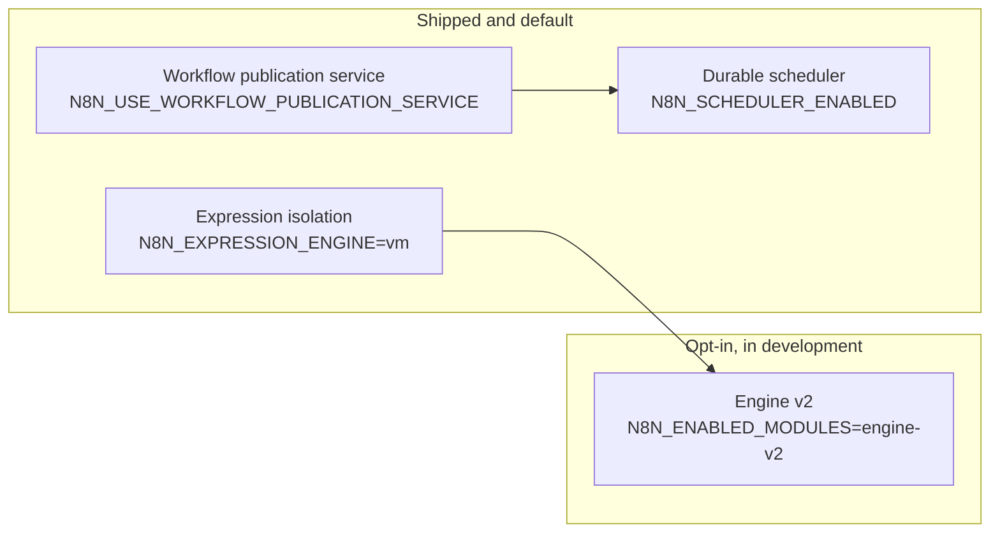

# Legacy and new

The n8n backend is ten years old and in the middle of several transitions at once. You will open two files that do the same job in different ways. Both were correct for their time. This page names each transition, shows the old shape and the new shape side by side, and says where to put new code today.

Two kinds of transition are in progress. **Structural migrations** change how code is organized without changing what n8n does. **Runtime transitions** change how n8n works at run time, each behind a flag at first. A third item, the v3 release, is the release in which several breaking changes land together.

## Status labels

Each label describes a piece of code, not a team. The label tells you what to do when you touch that code.

| Label | Meaning | What you do | Examples |
|---|---|---|---|
| `legacy-active` | Older structure that still receives features | Extend with care. Move code out when you touch it | `packages/cli/src/workflows/`, the v1 engine in `packages/core/src/execution-engine/` |
| `legacy-frozen` | Code with an announced successor | Do not add features. Point at the successor | The `convict` schema in `packages/cli/src/config/schema.ts`, the `legacy` expression engine |
| `extracted` | A focused package or module, the target shape for new code | Add features here | `packages/modules/insights/backend/`, `packages/@n8n/scheduler/` |
| `experimental` | Behind a flag or opt-in, not on by default | Read the flag before you assume the code runs | The `engine-v2` module, the `quickjs` expression engine |
| `deprecated` | Marked deprecated in the code, scheduled for removal | Do not use. Remove a use when you see one | `ApplicationError`, the `N8N_SCHEDULER_ENABLED` variable |

## Structural migrations

### Features into modules

| | Legacy | Now |
|---|---|---|
| Where a feature lives | A folder under `packages/cli/src`, wired by hand into the server and the start command | A module with a `<name>.module.ts` entrypoint |
| How it loads | Always, with the process | Only when enabled and licensed, through `ModuleRegistry` |
| How it registers entities and routes | Imported into the global entity list and the server | `entities()` and dynamic imports in `init()` |
| Cost when unused | Paid by every instance | Nothing is imported |

The module pattern started with insights in March 2025. Later, legacy features such as source control, log streaming, SAML, OIDC, and LDAP moved into modules. Many server subsystems in `packages/cli/src` are still not modules. Two enterprise folders, `packages/cli/src/environments.ee/` and `packages/cli/src/evaluation.ee/`, also wait outside the module system.

**Where modules live.** Modules started in `packages/cli/src/modules/<name>`. The direction now is one workspace package for each module half, under `packages/modules/<name>/backend` and `packages/modules/<name>/frontend`. Insights, data tables, the workflow builder, quick connect, apps, and execution limits already have a backend package there. `packages/cli/src/modules/modules.manifest.ts` lists the packaged modules, each behind a lazy import. `ModuleRegistry` in `packages/@n8n/backend-common/src/modules/module-registry.ts` loads a packaged module from that manifest. It loads every other module from `packages/cli/src/modules/`. The aim is to shrink `packages/cli`, which still holds most of the backend.

**The path.** `pnpm n8n-module-sdk create <name> --stack=backend` scaffolds a packaged module. [Build a backend module](how-to/build-a-backend-module.md) is the how-to. It keeps `pnpm setup-backend-module` only for a module that must stay in `packages/cli/src/modules/`. New features are modules. When you touch a legacy subsystem, ask whether it can become one.

### TypeORM into the persistence layer

| | Legacy | Now |
|---|---|---|
| Who imports `@n8n/typeorm` | Services, controllers, anything | Repositories in `@n8n/db` or a module's `database/` folder |
| How a service queries | A generic `find` with TypeORM operators | A use-case-named repository method with plain parameters |
| Transactions | `repository.manager.transaction(...)` in the service | `TransactionRunner.run` with an `OperationContext` passed to repositories |

The Code Health rule `typeorm-persistence-boundary` fails CI on a new import of `@n8n/typeorm` in business logic. Existing imports sit in `.code-health-baseline.json`, which only shrinks. Root `AGENTS.md` describes the target shape, and [Patterns](patterns.md#services-repositories-and-the-typeorm-boundary) shows it.

### Outbound HTTP into one package

| | Legacy | Now |
|---|---|---|
| Where network code lives | Scattered across `packages/core` and several packages | `@n8n/backend-network`, with `OutboundHttp` as the single entry point |
| Proxy handling and the SSRF guard | Per call site | One place, one policy |

`packages/@n8n/backend-network/README.md` states the intent: the package is "the single home for n8n's backend outbound-network concerns". The lint rule `no-uncentralized-http`, set in `packages/@n8n/eslint-config/src/configs/backend-network-boundary.ts`, keeps new HTTP clients out of other packages. SSRF protection is still off by default through `N8N_SSRF_PROTECTION_ENABLED`.

### One error hierarchy

| | Legacy | Now |
|---|---|---|
| Class | `ApplicationError` | `UserError`, `OperationalError`, `UnexpectedError` by cause |
| Level and reporting | Set by hand | Defaulted by class |

The old class in `packages/@n8n/errors/src/application.error.ts` is a shim. Its header says that it exists only for community nodes. The lint rule `no-application-error` fails on a new use. The migration in our own code is complete. Only the shim remains.

### Three smaller ones

**Configuration.** `convict` in `packages/cli/src/config/schema.ts` gave way to `@n8n/config` classes. Five settings remain in the old schema. Four exist because the Cloud hooks file reads them, and one is internal state. Do not add to it. See [Cloud coupling points](cloud-coupling.md).

**Jest to Vitest.** The backend packages moved to Vitest. Root `AGENTS.md` names the decorator-aware Vitest preset that backend packages must use.

**Public API handlers to controllers.** Legacy handler modules gave way to `@PublicApiController` classes in `packages/cli/src/public-api/v1/controllers/`. This move is complete. The `handlers/` folders keep the OpenAPI specs. `.agents/skills/public-api/SKILL.md` is the how-to.

## Runtime transitions

Four transitions change how n8n runs. Three of them are now the default. One is still in development.



*The arrows are dependencies. The durable scheduler needs the publication service to take over Schedule Trigger nodes. Engine v2 builds on isolated expressions.*

### Expressions

| | Legacy | Now |
|---|---|---|
| Where an expression runs | In the main process, through a template compiler | In a V8 isolate with a memory limit and a timeout |
| Data access | Direct object access | Lazy proxies that fetch one path at a time |
| Package | `packages/workflow/src/expression.ts`, with `@n8n/tournament` behind `packages/workflow/src/expression-evaluator-proxy.ts` | `@n8n/expression-runtime` |

<!-- steps -->

1. **Was**

   Expressions ran in process, inside a sandbox that we had to keep patching.
2. **Is**

   The `vm` engine is the backend default. `N8N_EXPRESSION_ENGINE=legacy` opts out.
3. **Goes**

   The config comment marks `legacy` as "soon to be deprecated". A QuickJS engine exists as an experiment. The editor runs expressions in the browser, where the native isolate is not available. It uses `legacy` by default, and `N8N_EXPRESSION_ENGINE_FRONTEND=quickjs` opts in to QuickJS. The config class in `packages/@n8n/config/src/configs/expression-engine.config.ts` names the three engines:

```ts
	/**
	 * Which expression engine to use.
	 * - `vm` (default) runs expressions in a V8 isolate (isolated-vm).
	 * - `legacy` runs expressions without isolation. Less secure and soon to be deprecated.
	 * - `quickjs` runs expressions in a QuickJS WASM sandbox. Experimental.
	 */
```

> [!TIP]
> Read `packages/@n8n/expression-runtime/ARCHITECTURE.md`. It is one of the best architecture documents in the repo. The subsystem page is [Expressions](subsystems/expressions.md).

### Scheduling

| | Legacy | Now |
|---|---|---|
| Where a schedule lives | A `cron` timer in the leader's memory | Rows in `scheduled_job` and `scheduled_task` |
| Who fires it | The leader only | Any main, through a claim with a lease |
| A missed fire | Lost | Handled by a misfire policy |
| Package | `ScheduledTaskManager` in `packages/core` | `@n8n/scheduler`, with the host in `packages/cli/src/scheduling/` |

<!-- steps -->

1. **Was**

   Four scheduling mechanisms existed: the Schedule Trigger, pollers, system task timers, and the wait tracker. All ran on the leader, and most ran in memory.
2. **Is**

   The durable scheduler is on by default. Schedule Trigger nodes move to it only while the publication service is also on. Pollers move to it only with `N8N_SCHEDULER_POLL_TRIGGERS_ENABLED`, which is off by default. System tasks run on it too. A system task is a `@SystemTask()` class, described in `packages/cli/src/scheduling/system-tasks/README.md`. Wait node resumes still use `WaitTracker` in `packages/cli/src/wait-tracker.ts`, which is a leader timer.
3. **Goes**

   `N8N_SCHEDULER_ENABLED=false` still selects the in-memory scheduler. The variable is deprecated, and the config comment says both will be removed. The lint rule `no-on-leader-takeover` pushes every new periodic leader job to a `@SystemTask()` class. The goal is a multi-main deployment with no leader at all. Read `packages/@n8n/scheduler/README.md` and the subsystem page [Scheduling and waiting](subsystems/scheduling-and-waiting.md).

### Publication

| | Legacy | Now |
|---|---|---|
| Activation | Synchronous, in the HTTP request, through `ActiveWorkflowManager` | An outbox record, drained by the leader |
| Re-publish | Remove every trigger, add every trigger | Diff the trigger nodes, touch only the changed ones |
| Partial failure | Roll the whole row back | Leave the version published with a status for each node |

<!-- steps -->

1. **Was**

   Activation ran inside the HTTP request through `ActiveWorkflowManager`. A compensating rollback in code replaced a transaction across the row and the triggers.
2. **Is**

   The workflow publication service is on by default. `N8N_USE_WORKFLOW_PUBLICATION_SERVICE=false` returns to the old path. The flag is `useWorkflowPublicationService` in `packages/@n8n/config/src/configs/workflows.config.ts`.
3. **Goes**

   The old activation path in `ActiveWorkflowManager` goes away once nothing needs the opt-out. [Life of a workflow publish](life-of-a-workflow-publish.md) walks the new path and the legacy path.

### Engine v2

| | Legacy, the v1 engine | Now, engine v2 |
|---|---|---|
| Model | A loop over a node stack, in one process | A graph of steps consumed from work queues |
| State | In memory, saved by hooks | Its own PostgreSQL database, the data plane |
| Where it runs | The main or a worker | A data plane, in the main process or in a separate `n8n engine` process |
| Package | `packages/core/src/execution-engine` | `@n8n/engine`, `@n8n/node-engine-compatibility`, and the `engine-v2` module |

<!-- steps -->

1. **Was**

   One engine, the loop in `packages/core`, ran every execution since 2019.
2. **Is**

   An opt-in module. The config comments in `packages/@n8n/config/src/configs/engine.config.ts` say "This is in development and not ready for use". A workflow opts in with `settings.engineType` set to `v2`. `N8N_ENGINE_MODE` selects an in-process or a remote data plane.
3. **Goes**

   The control plane and the data plane split, and v1 nodes run through a compatibility layer.

Two rules keep that split possible. First, `packages/@n8n/engine/AGENTS.md` keeps the engine core free of `express`, `pg`, `@n8n/typeorm`, and `n8n-workflow`. `@n8n/config` and `@n8n/di` stay in the composition layer. Second, `EngineDataPlaneClient` in `packages/cli/src/modules/engine-v2/engine-data-plane-client.ts` talks to the engine over HTTP even in process. Its comment says this lets the engine move out of the process later without a change to any caller. The engine records its decisions as ADRs in `packages/@n8n/engine/docs/adr/`.

> [!NOTE]
> `packages/@n8n/engine/README.md` still says that the package is a scaffold and not yet wired into n8n. That sentence is out of date.

The subsystem page is [Engine v2](subsystems/engine-2.md).

## The v3 release

`.github/DEVELOPING_V3.md` planned v3 for about October 2026. `master` still carries the 2.x line. v3 is not a feature release. It is the release in which breaking changes land together. Until then two branches exist, as `.github/DEVELOPING_V3.md` states:

```md
> - Normal feature work → land on **`master`**, behind an **opt-in feature flag**.
> - Breaking changes → a separate PR targeting **`3.x`** directly. **Never on `master`.**
> - `master` is synced into `3.x` **daily**, automatically.
```

The `breaking-changes` module ships the in-product report that shows a self-hoster what will change. Its v3 rules are in `packages/cli/src/modules/breaking-changes/rules/v3/`. Examples of v3 changes: manual executions always run on workers in queue mode, unverified community packages stop loading by default, and binary data leaves memory.

## Where to put new code today

- A new feature is a packaged module under `packages/modules/<name>/backend`.
- A new query is a use-case-named repository method in `@n8n/db` or in the module's `database/` folder.
- A new outbound HTTP call goes through `OutboundHttp` from `@n8n/backend-network`.
- A new error is one of the three error classes.
- A new periodic background job is a `@SystemTask()` class.
- A new public endpoint is a `@PublicApiController` class.
- A new environment variable is an `@Env` field in `@n8n/config`.
- A new breaking change is a separate PR to `3.x`.
- A new cross-package boundary gets its own package under `packages/@n8n/`. State its purity rules and test them, as `@n8n/scheduler` and `@n8n/engine` do.

## Self-check

Check what you learned on this page.

1. You build a small feature with one table and two routes. Where does the code go, and how do you create the skeleton?
   - A. In `packages/cli/src/<name>/`, next to the other controllers. You copy an existing folder.
   - B. In `packages/cli/src/modules/<name>`, created with `pnpm setup-backend-module`.
   - C. In a packaged module at `packages/modules/<name>/backend`, created with `pnpm n8n-module-sdk create`.
   - D. In `packages/@n8n/db`, because the feature has a table.
2. Your service must load rows whose ids are in a list. You reach for the `In` operator from `@n8n/typeorm`. What do you write instead?
   - A. A use-case-named method on the repository, such as one that takes a list of ids.
   - B. The same code, with `In` imported from `@n8n/db` instead.
   - C. A raw SQL query in the service.
   - D. A loop that loads one row for each id.
3. You need a cleanup that runs once an hour across the cluster. Why not a `setInterval` inside an `@OnLeaderTakeover` method?
   - A. It is fine. `@OnLeaderTakeover` is the recommended way.
   - B. The timer would run on every main.
   - C. `@OnLeaderTakeover` runs only once, at startup.
   - D. The lint rule `no-on-leader-takeover` rejects it. A `@SystemTask()` class handles leadership, shutdown, metrics, and retries.
4. Your change makes a default stricter, and some existing workflows would stop working. Where does it land?
   - A. On `master`, behind an opt-in flag that becomes the default later.
   - B. In a separate PR to `3.x`, with a v3 rule in the `breaking-changes` module.
   - C. On `master`, with a note in the release notes.
   - D. On `master` and `3.x` in the same PR.
5. You need a new setting that operators can change. You find a similar setting in `packages/cli/src/config/schema.ts`. Do you add yours next to it?
   - A. Yes. Similar settings belong together.
   - B. Yes, but only if the setting is for the CLI package.
   - C. No. That schema is `legacy-frozen`. Add an `@Env` field to a config class in `@n8n/config`.
   - D. No. Settings go in the database, in the settings table.

<details>
<summary>Answers</summary>

1. C. In a packaged module at `packages/modules/<name>/backend`. Run `pnpm n8n-module-sdk create <name> --stack=backend`, which also adds the module to `modules.manifest.ts`. `pnpm setup-backend-module` is only for a module that must stay in `packages/cli/src/modules/`.
2. A. A use-case-named method on the repository, such as one that takes a list of ids. The `typeorm-persistence-boundary` rule fails CI on the import in a service. A relabeled import from `@n8n/db` only hides the dependency.
3. D. The lint rule `no-on-leader-takeover` rejects it. Write a `@SystemTask()` class, and the runner handles leadership, shutdown, metrics, and retries.
4. B. In a separate PR to `3.x`, never on `master`. Add a v3 rule to the `breaking-changes` module so that self-hosters see the change before they upgrade.
5. C. No. That schema is `legacy-frozen`. Add an `@Env` field to a config class in `@n8n/config`.

</details>
