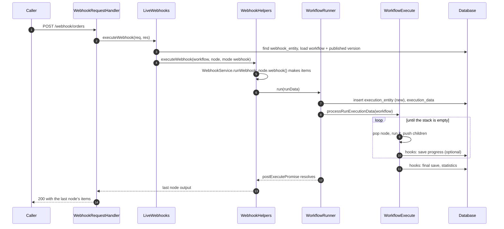
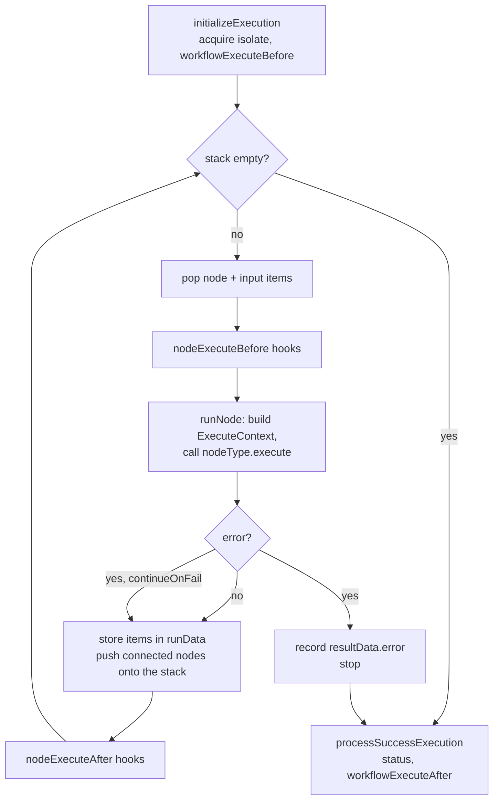
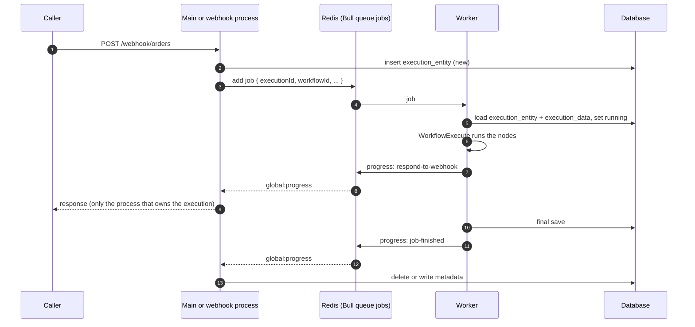

# Life of a webhook execution

A third-party service sends `POST /webhook/orders` to an n8n instance. A workflow with a Webhook node runs, and the caller receives the output of the last node. This page follows that request through the backend. Its sibling, [Life of a workflow publish](life-of-a-workflow-publish.md), explains how the webhook came to exist.

We follow one default path first: regular mode, one main process, and a Webhook node with the response mode **When Last Node Finishes**. Then we show the variants: other response modes, queue mode, multi-main, waiting executions, and sub-workflows.

## The vocabulary

- An **execution** is one run of one workflow. It has a row in `execution_entity` and a status such as `new`, `running`, `waiting`, `success`, or `error`.
- **Run data** (`IRunExecutionData`) is the state of an execution in memory: the items that each node produced and the nodes still to run.
- An **item** is one JSON object, of type `INodeExecutionData`. The **node execution stack** lists the nodes that wait to run, with their input items.
- **Lifecycle hooks** are the callbacks that the engine runs before and after each node and each workflow. All persistence happens in a hook.

## The path at a glance



*All participants run in the main process. In this default path the HTTP response waits for the whole execution.*

## Stage 0. Before the request

Publication inserted a row into `webhook_entity`, keyed by path and HTTP method. The row points at the workflow and the node. Express has no route for each webhook. See [Life of a workflow publish](life-of-a-workflow-publish.md#stage-7-the-applier-registers-the-triggers).

## Stage 1. The route

`AbstractServer.start` in `packages/cli/src/abstract-server.ts` mounts one catch-all handler for each webhook kind, such as `/webhook/*path`. It mounts them **before** the JSON body parser, because a Webhook node must read the original bytes of a raw body or a file upload.

Two classes extend `AbstractServer`. `Server` in `packages/cli/src/server.ts` is the main process. It serves production and test webhooks, unless `N8N_DISABLE_PRODUCTION_MAIN_PROCESS` turns production webhooks off. `WebhookServer` in `packages/cli/src/webhooks/webhook-server.ts` is the dedicated **webhook process**, started with `n8n webhook`. It serves production webhooks only. The command in `packages/cli/src/commands/webhook.ts` refuses to start outside queue mode. Without the queue, the main process cannot see or stop the executions of the webhook process.

`InstanceSettings` in `packages/core/src/instance-settings/instance-settings.ts` gets the process type from `instanceTypeFromArgv(process.argv)` and puts it into the `hostId`. Logs tell processes apart by that id.

## Stage 2. The handler

`WebhookRequestHandler.handleRequest` in `packages/cli/src/webhooks/webhook-request-handler.ts` checks the HTTP method, answers CORS preflight requests, and calls the webhook manager. It writes the response in one of two shapes. A typed `WebhookResponse` (checked with `isWebhookResponse`) is the target shape. A legacy object goes through `sendLegacyResponse`.

> [!TIP]
> You meet this often in the backend: a new shape and an old shape exist together, and the boundary translates between them.

## Stage 3. The lookup

`LiveWebhooks.executeWebhook` in `packages/cli/src/webhooks/live-webhooks.ts` finds the webhook and loads the workflow.

`WebhookService.findWebhook` in `packages/cli/src/webhooks/webhook.service.ts` tries a static path first. It reads the cache key `webhook:<METHOD>-<path>`, then the database. If no static row matches, `findDynamicWebhook` treats the first segment as the node's `webhookId`. A cache read failure falls back to the database, so a Redis problem does not stop webhooks.

The cache is `CacheService` in `packages/@n8n/backend-services/src/services/cache/cache.service.ts`. `N8N_CACHE_BACKEND` selects memory or Redis. The default `auto` selects Redis in queue mode.

Then `LiveWebhooks` builds a `Workflow` object from the **published** nodes and connections, not from the draft. It passes on a copy of the workflow data without the draft, so no later code reads the draft by mistake.

`LiveWebhooks` calls `executeWebhook` in `packages/cli/src/webhooks/webhook-helpers.ts` with the execution mode `webhook` and no push reference. The mode selects the concurrency queue and the save settings. The missing push reference means that no browser receives live updates for this execution.

## Stage 4. The node's webhook method

`executeWebhook` is the longest function on this path. It builds the **additional data**, the object for each execution with hooks, helpers, and the HTTP request. Then it parses the body and runs the node.

`WebhookService.runWebhook` builds a `WebhookContext` and calls the node type's `webhook()` method. `WebhookContext` in `packages/core/src/execution-engine/node-execution-context/webhook-context.ts` turns the request body, headers, params, and query into the input item.

The node returns `workflowData`, the items that start the workflow. It can also return `webhookResponse`, or `noWebhookResponse: true` when it wrote to the response itself. Without `workflowData` the workflow does not run. `handleImmediateWebhookResponse` then answers with the given body or with "Webhook call received".

Otherwise `prepareExecutionData` builds the run data. The stack starts with the Webhook node and its items. The helper calls `WorkflowRunner.run` and then `ActiveExecutions.setResponseMode`. The runner needs the response mode later in queue mode. See [Variant 2](#variant-2-queue-mode).

## Stage 5. Starting the execution

`WorkflowRunner.run` in `packages/cli/src/workflow-runner.ts` is the entry point for every execution.

> [!NOTE]
> **Engine v2 first.** If the workflow setting `engineType` is `v2`, `EngineV2Dispatcher` takes the whole run. That path writes no `execution_entity` row. See [Engine v2](subsystems/engine-2.md). The rest of this page follows the v1 engine.

<!-- steps -->

1. **The row**

   `ActiveExecutions.add` in `packages/cli/src/active-executions.ts` calls `ExecutionPersistence.create` in `packages/cli/src/executions/execution-persistence.ts`. That method inserts `execution_entity` with status `new` and writes the run data. In regular mode, `ActiveExecutions.add` then sets the status to `running`.
2. **The throttle**

   In regular mode, `ConcurrencyControlService` in `packages/cli/src/concurrency/concurrency-control.service.ts` limits how many production executions run at once. `N8N_CONCURRENCY_PRODUCTION_LIMIT` sets the limit, and the default is no limit. A throttled execution waits with status `new`, and the HTTP request stays open. In queue mode the worker concurrency replaces this service.
3. **The branch**

   With the row written, the runner decides where the execution runs. In `packages/cli/src/workflow-runner.ts`:

   ```ts
   const shouldEnqueue =
     process.env.OFFLOAD_MANUAL_EXECUTIONS_TO_WORKERS === 'true'
       ? this.executionsConfig.mode === 'queue'
       : this.executionsConfig.mode === 'queue' && data.executionMode !== 'manual';
   ```

   A production webhook in queue mode always goes to a worker. The environment variable changes only manual runs. In our default path, `runMainProcess` builds the hooks for a regular main and creates a `WorkflowExecute`. The engine receives nothing about HTTP.

## Stage 6. The engine

`WorkflowExecute` in `packages/core/src/execution-engine/workflow-execute.ts` is the v1 engine. `processRunExecutionData` is a loop over the node execution stack.



*One iteration for each node run. Nothing in this loop writes to the database. The hooks do.*

<!-- steps -->

1. **The loop**

   Each iteration pops one entry, adds paired item lineage, and computes the run index. The same node with the same run index twice in a row stops the run as an endless loop. **Paired items** record which input item produced which output item. With this record, an expression such as `$('Webhook').item.json.id` finds the right item several nodes upstream.
2. **Running a node**

   `runNode` calls `executeNode`, which builds an `ExecuteContext` and calls the node type's `execute` method. The context holds everything a node can reach.
3. **Scheduling children**

   For each output with items, the engine adds the connected nodes to the stack. With the workflow setting `executionOrder` at `v1`, the default for new workflows, the engine sorts children by canvas position. A node with more than one input waits until all its inputs have data.
4. **Errors**

   If `continuesOnError` is true for the node, the engine passes the items on. Otherwise it records the error in `resultData.error` and stops.
5. **The end**

   `processSuccessExecution` sets one of three outcomes: an error, a wait, or finished. Then it runs `workflowExecuteAfter`. The wait is [Variant 4](#variant-4-waiting).

## Stage 7. Inside a node

A node reaches three things outside the engine.

**Expressions.** A node reads its settings with `getNodeParameter`. The engine evaluates an expression such as `={{ $json.email }}` at that moment, not before the run. `Expression.renderExpression` in `packages/workflow/src/expression.ts` evaluates it against the data of the current item and the run data. `N8N_EXPRESSION_ENGINE` selects the evaluator, and the default is `vm`. See [Legacy and new](legacy-and-new.md#expressions).

**Credentials.** `getCredentials` goes through `CredentialsHelper` in `packages/cli/src/credentials-helper.ts`, which decrypts the row from `credentials_entity`.

**Code.** The Code node in `packages/nodes-base/nodes/Code/Code.node.ts` does not run user code in the main process. Its `JsTaskRunnerSandbox` sends the task through `TaskRequester` in `packages/cli/src/task-runners/task-managers/task-requester.ts` to a runner. By default the runner is a child process. See [Task runners](subsystems/task-runners.md).

## Stage 8. The lifecycle hooks

`ExecutionLifecycleHooks` in `packages/core/src/execution-engine/execution-lifecycle-hooks.ts` runs the handlers of a hook one after another. The handlers depend on the process. `packages/cli/src/execution-lifecycle/execution-lifecycle-hooks.ts` has one builder for each case, such as `getLifecycleHooksForRegularMain` and `getLifecycleHooksForScalingWorker`. On our path the regular main set does this:

| Hook | Effect |
|---|---|
| `workflowExecuteBefore` | Emits events for telemetry and log streaming. No database write. |
| `nodeExecuteAfter` | Emits a node event. If the workflow saves progress, writes the run data with status `running`. |
| `nodeFetchedData` | Feeds `workflow_statistics`. |
| `workflowExecuteAfter` | Saves or deletes the execution, starts the error workflow, and runs module handlers such as insights. |
| `sendResponse` | Resolves the webhook response promise. See Variant 1. |

**Save or delete.** `hookFunctionsSave` applies the **save settings**. A workflow can choose not to keep successful executions. Then the hook deletes the row that Stage 5 created. A waiting execution and a manual run never take this delete path. `toSaveSettings` in `packages/cli/src/execution-lifecycle/to-save-settings.ts` merges the workflow settings with the environment defaults.

> [!NOTE]
> **Why create a row and then delete it?** The execution needs an id while it runs. Cancellation, the resume URL, and the queue mode response relay all address it by id.

**Modules join in.** A module attaches handlers with `@OnLifecycleEvent`. The insights module in `packages/modules/insights/backend/src/insights-collection.service.ts` counts executions this way. See [Patterns](patterns.md#lifecycle-hooks).

## Stage 9. Persistence

Two tables hold an execution. `execution_entity` holds the columns you filter on, such as `status`, `waitTill`, and `storedAt`. `execution_data` holds the run data as one flattened string and a snapshot of the workflow. The snapshot lets the editor show the execution after the workflow changes.

**Where the data lives.** `N8N_EXECUTION_DATA_STORAGE_MODE` sets the store for new executions: `database`, `filesystem`, `s3`, or `azure`. `StorageConfig` in `packages/core/src/storage.config.ts` turns the mode into a tag that the row records in `storedAt`. Each read follows the tag of its row, so a mode change needs no migration. With a blob store, the run data goes to a JSON bundle and `execution_data` gets no row. See [Persistence](subsystems/persistence.md).

**The update.** `ExecutionPersistence.updateExistingExecution` writes the row and the data in one transaction. Its status guard is the key to Variant 4.

**Binary data.** Files never sit inside the run data. `BinaryDataService` in `packages/core/src/binary-data/binary-data.service.ts` writes them to the store that `N8N_DEFAULT_BINARY_DATA_MODE` selects, and puts an id in the item.

## Stage 10. The response

With **When Last Node Finishes**, `executeWebhook` waits on `ActiveExecutions.getPostExecutePromise`. The runner resolves that promise through `ActiveExecutions.finalizeExecution` when the engine returns. The helper then answers with the output of the last node. If the execution ended with an error, the caller receives status 500 and "Error in workflow".

## Stage 11. What else happened

No push message reached a browser. `hookFunctionsPush` returns at once when the push reference is missing. Users see production runs in the executions list, which reads the database.

If the execution failed and the workflow has an **error workflow**, the save hook started it. `executeErrorWorkflow` in `packages/cli/src/execution-lifecycle/execute-error-workflow.ts` starts a new execution in mode `error` at the Error Trigger node. It does not start an error workflow for its own failure.

## Variant 1. The other response modes

The response mode decides when the response goes out, and who writes it.

| Mode | Who answers | When |
|---|---|---|
| Immediately (`onReceived`) | the helper | after the execution id exists, before any node runs |
| When Last Node Finishes (`lastNode`) | the helper | after the execution ends, with the last node's items |
| Using Respond to Webhook Node (`responseNode`) | the Respond to Webhook node, through `sendResponse` | when that node runs |
| Streaming (`streaming`) | the node, through `sendChunk` | during the run |

`onReceived` waits for the execution id, so that `$execution.id` and the resume URL can appear in the response body.

For `responseNode`, the helper gives a deferred promise to the runner. The Respond to Webhook node calls `this.sendResponse`, which runs the `sendResponse` hook. In regular mode the handler resolves the promise in the same process. In queue mode the handler sends a message from the worker to the main.

## Variant 2. Queue mode

In **queue mode** the main or webhook process accepts the request, and a **worker** runs the execution. A Bull queue in Redis sits between them. See [Scaling and multi-main](subsystems/scaling-and-multi-main.md). Stages 0 to 5 do not change, then the runner calls `enqueueExecution`.



*The job carries ids, not run data. The run data is already in the database.*

<!-- steps -->

1. **The job**

   `enqueueExecution` calls `ScalingService.addJob` with a small `JobData` object. A webhook that still owes a response gets priority 50, and other runs get 100.
2. **The worker**

   `JobProcessor.processJob` in `packages/cli/src/scaling/job-processor.ts` loads the execution from the database. It refuses an execution with status `crashed`, because Bull retries and n8n recovery can both enqueue one. It runs the same `WorkflowExecute` with the worker hooks. Its `sendResponse` handler sends a `respond-to-webhook` message, and the end of the job sends `job-finished`.
3. **The main listens**

   Every main and webhook process subscribes to `global:progress` in `packages/cli/src/scaling/scaling.service.ts`, so each one hears every message. In `packages/cli/src/active-executions.ts`:

   ```ts
   resolveResponsePromise(executionId: string, response: IExecuteResponsePromiseData): void {
     const execution = this.activeExecutions[executionId];
     execution?.responsePromise?.resolve(response);
   }
   ```

   Only the process that accepted the HTTP request has an entry for that id. Nothing routes the message.
4. **Who writes what**

   The worker saves the execution data and never deletes it. When the job finishes, the main applies the save settings. It writes metadata only after that decision, to avoid foreign key errors.

**When does the main read the database?** `WorkflowRunner.needsFullExecutionData` returns true for `lastNode`, for sub-workflows, and when an external `workflow.postExecute` hook exists. That is why Stage 4 records the response mode.

**Recovery.** The leader runs `ScalingService.recoverFromQueue` on an interval. It marks as `crashed` an execution that is `new` or `running` in the database but absent from the queue.

## Variant 3. Multi-main

For a webhook execution the leader has no special role. Any main or webhook process accepts the request, adds the job, and holds the response promise. The leader matters for triggers, waiting executions, and queue recovery.

## Variant 4. Waiting

A Wait node pauses an execution. `Wait.node.ts` in `packages/nodes-base/nodes/Wait/` calls `putExecutionToWait`. The decision to sleep or to suspend is in `packages/core/src/execution-engine/node-execution-context/base-execute-context.ts`:

```ts
		if (options?.acceptsResumeRequest === false && waitMs < MAX_IN_PROCESS_WAIT_MS) {
			// A cancelled execution ends the wait, and the step still returns its input.
			return await sleep(waitMs, this.abortSignal).catch(() => undefined);
		}
```

`MAX_IN_PROCESS_WAIT_MS` in `packages/workflow/src/constants.ts` is 65 seconds. `WaitTracker` polls every 60 seconds, so a shorter suspended wait would resume late. A wait with a resume URL always suspends.

A longer wait sets `waitTill`. The engine pushes the Wait node back onto the stack and leaves the loop. The save hook writes the execution with status `waiting`.

**Resume by time.** `WaitTracker` in `packages/cli/src/wait-tracker.ts` runs on the leader only. Every 60 seconds `getWaitingExecutions` loads the executions due in the next 70 seconds and sets a timer for each. A timer calls `WorkflowRunner.run` with `expectedStatus: 'waiting'`. `ActiveExecutions.add` then claims the row with `updateExistingExecution` and the `requireStatus` guard. If another process claimed the row first, the update changes no row, and `ExecutionAlreadyResumingError` stops the second resume.

**Resume by webhook.** A Wait node can wait for a call to `/webhook-waiting/<executionId>`. `WaitingWebhooks` in `packages/cli/src/webhooks/waiting-webhooks.ts` checks the resume token and the status. Then it calls `executeWebhook` with the existing execution id.

> [!NOTE]
> The durable scheduler in [Scheduling and waiting](subsystems/scheduling-and-waiting.md) moves schedule and poll triggers into the database. `WaitTracker` still resumes Wait node executions.

## Variant 5. Sub-workflows

An Execute Workflow node starts a **sub-workflow**. `executeWorkflow` in `packages/cli/src/workflow-execute-additional-data.ts` loads the published child and creates a new execution row in mode `integrated`. Then it runs a new `WorkflowExecute` in the same process. In queue mode the child does not become a job. It runs on the worker of the parent. If the child waits, the parent waits too, and `WaitTracker.resumeParentExecution` resumes it later.

## Where each stage lives

| Stage | File | Symbol |
|---|---|---|
| 0. Registration | `packages/cli/src/webhooks/webhook.service.ts` | `WebhookService.storeWebhook` |
| 1. Route | `packages/cli/src/abstract-server.ts` | `AbstractServer.start` |
| 2. Handler | `packages/cli/src/webhooks/webhook-request-handler.ts` | `WebhookRequestHandler.handleRequest` |
| 3. Lookup | `packages/cli/src/webhooks/live-webhooks.ts` | `LiveWebhooks.executeWebhook` |
| 4. Node webhook method | `packages/cli/src/webhooks/webhook-helpers.ts` | `executeWebhook` |
| 5. Start | `packages/cli/src/workflow-runner.ts` | `WorkflowRunner.run` |
| 6. Engine | `packages/core/src/execution-engine/workflow-execute.ts` | `WorkflowExecute.processRunExecutionData` |
| 7. Inside a node | `packages/core/src/execution-engine/node-execution-context/execute-context.ts` | `ExecuteContext` |
| 8. Hooks | `packages/cli/src/execution-lifecycle/execution-lifecycle-hooks.ts` | `getLifecycleHooksForRegularMain` |
| 9. Persistence | `packages/cli/src/executions/execution-persistence.ts` | `ExecutionPersistence.updateExistingExecution` |
| 10. Response | `packages/cli/src/active-executions.ts` | `ActiveExecutions.getPostExecutePromise` |
| 11. Push skipped | `packages/cli/src/execution-lifecycle/execution-lifecycle-hooks.ts` | `hookFunctionsPush` |
| Queue worker | `packages/cli/src/scaling/job-processor.ts` | `JobProcessor.processJob` |
| Wait resume | `packages/cli/src/wait-tracker.ts` | `WaitTracker.getWaitingExecutions` |
| Webhook resume | `packages/cli/src/webhooks/waiting-webhooks.ts` | `WaitingWebhooks.executeWebhook` |
| Sub-workflow | `packages/cli/src/workflow-execute-additional-data.ts` | `executeWorkflow` |

## Try it

<!-- steps -->

1. Start the backend as `CONTRIBUTING.md` describes, with `N8N_LOG_LEVEL=debug`. Create a workflow with a Webhook node on the path `orders`, and publish it.
2. Send a request to the production URL:

   ```sh
   curl -X POST http://localhost:5678/webhook/orders -H 'Content-Type: application/json' -d '{"id": 1}'
   ```

   The log shows `Started execution of workflow "<name>" from webhook with execution ID <id>`.
3. Put a breakpoint in `LiveWebhooks.executeWebhook` and one in `WorkflowRunner.run`. Send the request again and step to the `shouldEnqueue` branch.

## Self-check

Check what you learned on this page.

1. A production execution runs, and the editor shows nothing live. Which argument explains this?
   - A. The push hooks skip executions in mode `webhook`.
   - B. `LiveWebhooks` passes no push reference to `executeWebhook`.
   - C. A production execution writes no run data until it ends, so push has nothing to send.
   - D. The editor polls for live data, and the poll skips production executions.
2. A workflow does not keep successful executions. The execution succeeds. What does `execution_entity` see, in order?
   - A. Nothing. A workflow that keeps no successful executions writes no row.
   - B. One insert with status `success` when the execution ends.
   - C. An insert with status `new` and an update to `success`. The row stays, and only the run data goes.
   - D. An insert with status `new`, an update to `running`, and a delete in the save hook.
3. In queue mode, three mains run. Which one writes the webhook response, and how does it know?
   - A. The leader. It reads the result of the job and sends the response to the other mains.
   - B. No main. The worker writes the response to the socket of the request.
   - C. Every main hears the response, and only the main with the execution in `ActiveExecutions` acts on it.
   - D. The main that created the job. Bull sends the events of a job only to that main.
4. You add a new response mode that needs the full run data in the main. Which function in `WorkflowRunner` must you change?
   - A. `needsFullExecutionData`
   - B. `enqueueExecution`
   - C. `runMainProcess`
   - D. `prepareNewExecution`
5. A Wait node waits 30 seconds. Which process holds the timer? Now it waits 30 minutes. Which process resumes it?
   - A. `WaitTracker` on the leader handles both waits.
   - B. The process that runs the execution sleeps for both waits.
   - C. The process that runs the execution sleeps for 30 seconds. For 30 minutes the execution suspends, and `WaitTracker` on the leader resumes it.
   - D. Both waits suspend the execution, and the process that started it resumes it.

<details>
<summary>Answers</summary>

1. B. `LiveWebhooks` passes no push reference to `executeWebhook`. `hookFunctionsPush` then returns at once. The hooks check the push reference, not the mode.
2. D. An insert with status `new`, an update to `running`, and a delete in the save hook. The row exists so that the execution has an id while it runs.
3. C. Every main hears the `respond-to-webhook` message. Only the process that accepted the request has the execution in `ActiveExecutions`, so only it resolves the promise.
4. A. `needsFullExecutionData`. Without it the main finishes from the `job-finished` message and never reads the run data.
5. C. A wait shorter than `MAX_IN_PROCESS_WAIT_MS` (65 seconds) sleeps in the process that runs the execution. A longer wait suspends, and `WaitTracker` on the leader resumes it.

</details>
