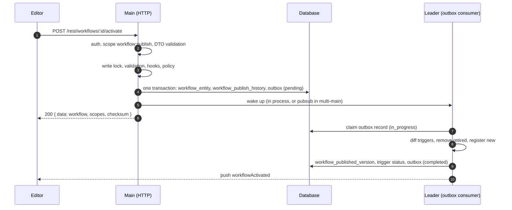
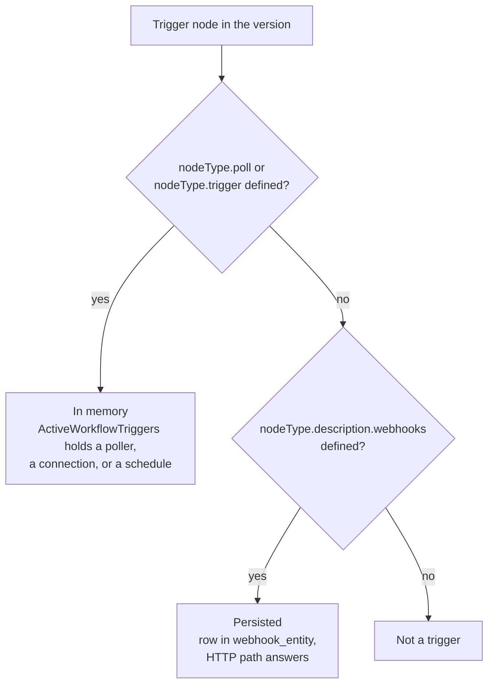
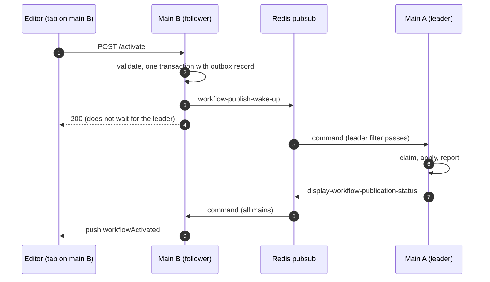

# Life of a workflow publish

A user clicks **Publish** in the editor. Soon after, the triggers of the workflow are live: a webhook path answers, a schedule fires, a poller polls. This page follows that click through the backend, stage by stage. It names the file and the symbol at each stage, and it explains why each stage has its shape. Its sibling, [Life of a webhook execution](life-of-a-webhook-execution.md), follows what happens when one of those triggers fires.

We follow the default path first: a single main process with the workflow publication service on. The publication service is on by default. Then we show multi-main, queue mode, and the legacy path that registers triggers through `ActiveWorkflowManager`. Deactivation closes the page.

## What "publish" means

A row in `workflow_entity` has two columns that matter here. `versionId` points at the latest saved draft in `workflow_history`. `activeVersionId` points at the version that should be live. Publishing sets `activeVersionId` and registers the triggers of that version.

> [!WARNING]
> The `active` boolean column still gets written, but it is deprecated. `WorkflowPublicationApplier.apply` says so in a comment: `activeVersionId` is the source of truth for activity.

This split lets a user keep editing while an older version runs in production. Saving writes `versionId`. Publishing writes `activeVersionId`.

The publication service adds a third pointer. `workflow_published_version` records the version whose triggers are registered. An outbox record carries the work from `activeVersionId` to it.

## The path at a glance



*The HTTP response returns after one transaction. The leader does the trigger work afterwards. In a single main, the HTTP process and the leader are the same process.*

## Stage 0. The click

The publish modal calls `publishWorkflow` in `packages/frontend/editor-ui/src/app/stores/workflows.store.ts`. The store sends `POST /rest/workflows/:id/activate` with an `ActivateWorkflowDto` from `packages/@n8n/api-types/src/dto/workflows/activate-workflow.dto.ts`. The body names the version, and can add a name, a description, and a checksum.

The body cannot send `active: true`. `PATCH /rest/workflows/:id` cannot set it either, because the allowlist in `packages/cli/src/workflows/workflow-entity-mapper.ts` excludes it.

> [!NOTE]
> **Why a dedicated route?** Publishing has side effects outside the database. Webhook paths get claimed, third parties get webhook registrations, and timers start. A boolean on a generic update would hide those side effects. A dedicated route gets its own scope, `workflow:publish`, its own DTO, and its own error shapes.

## Stage 1. The Express app and the router

`AbstractServer.start` in `packages/cli/src/abstract-server.ts` mounts the webhook handlers before the body parser. A Webhook node can then read a raw binary body. REST routes come after the body parser, so our JSON body is parsed before the controller sees it.

`Server.configure` in `packages/cli/src/server.ts` calls `ControllerRegistry.activate`. `ControllerRegistry.activateController` in `packages/cli/src/controller.registry.ts` mounts one router per controller, here under `/rest/workflows`. The `@RestController` decorator registered the class at import time. See [Patterns](patterns.md#controllers-and-routes).

## Stage 2. The middleware chain

`ControllerRegistry.buildMiddlewares` builds the same chain for every route. Three links do work for our route.

<!-- steps -->

1. **Authentication**

   The route does not set `skipAuth`, so the chain starts with the cookie JWT middleware from `AuthService`. A request without a valid cookie ends here with 401.
2. **Authorization**

   The route carries `@ProjectScope('workflow:publish')`. `ControllerRegistry.createScopedMiddleware` calls `userHasScopes` in `packages/cli/src/permissions.ee/check-access.ts` with `req.params`. That function resolves the project that owns the workflow and checks the global role, the project role, and sharing. A user who can edit but not publish ends here with 403.
3. **Validation**

   The handler closure parses the `@Body` argument with the DTO's `safeParse`. A body without `versionId` ends here with 400.

The route has no `@Licensed` decorator. Publishing is a community feature.

## Stage 3. The controller

`WorkflowsController.activate` in `packages/cli/src/workflows/workflows.controller.ts` does one check, one call, and builds the response.

The check is the write lock from [Realtime and collaboration](subsystems/realtime.md). `CollaborationService.validateWriteLock` reads the `push-ref` header, which identifies the browser tab. Another tab of the same user gives 409. Another user gives 423.

The call is `WorkflowService.activateWorkflow`. After it returns, the controller adds the user's scopes and a new checksum, and broadcasts the update. The service knows nothing about HTTP. This is the layering from [Patterns](patterns.md#services-repositories-and-the-typeorm-boundary).

## Stage 4. The service validates

`WorkflowService.activateWorkflow` in `packages/cli/src/workflows/workflow.service.ts` is the single entry point for publishing. The internal route, the public API, the MCP tool, source control import, and the save path all call it. Its first half validates and writes nothing.

<!-- steps -->

1. **Find the workflow and the version**

   `WorkflowFinderService.findWorkflowForUser` requires `workflow:publish`. A fallback accepts editor scopes, but only to re-apply the live version after a settings change. The target is the requested version, or the latest draft.
2. **Check and validate**

   Each check can end the request:

   - `_detectConflicts` gives 409 when the checksum shows that someone else changed the workflow.
   - `_detectWebhookConflicts` gives 409 when another workflow already owns a webhook path.
   - `_validateNodes` and the other `_validate` methods reject a version that cannot run.
3. **Hooks, policy, and review**

   The service builds a candidate entity and runs the external hook `workflow.activate` on it. The hook runs before any write, so a veto leaves the previous version running. On n8n Cloud this hook enforces plan limits. See [Cloud coupling points](cloud-coupling.md).

   Then `enforceWorkflowPublishPolicy` checks the configured policies. `WorkflowPublishGuard.assertCanPublish` runs when the version changes. The workflow reviews module uses it to require an approved review.

> [!IMPORTANT]
> Nothing is written yet. Every failure so far leaves the database as it was.

## Stage 5. The service writes one transaction

With the publication service on, `WorkflowService._publishViaOutbox` opens one transaction. `_recordPublishInTransaction` writes three things in it:

- `activeVersionId` on `workflow_entity`, with `updatedAt` kept, because the content did not change.
- A `deactivated` row for the old version and an `activated` row for the new version in `workflow_publish_history`.
- An outbox record through `WorkflowPublicationOutboxRepository.enqueue` in `packages/@n8n/db/src/repositories/workflow-publication-outbox.repository.ts`.

The enqueue is an upsert on a partial unique index. A workflow has at most one pending record. A second publish before the drain replaces the version on that record.

> [!NOTE]
> **Why one transaction?** The row and the outbox record must commit together. If only the row commits, no process ever registers the triggers. If only the record commits, the leader applies a version that the row does not name. The trigger work talks to third parties and starts timers, so it cannot join the transaction. The outbox moves that work out of the request.

After the commit, `WorkflowPublicationNotifier.requestDrain` in `packages/cli/src/workflows/publication/workflow-publication-notifier.ts` wakes the leader:

```ts
		const wake = this.instanceSettings.isMultiMain
			? this.publisher.publishCommand({ command: 'workflow-publish-wake-up' })
			: this.wakeLocalConsumer();

		void wake.catch((error) => this.errorReporter.error(error, { shouldBeLogged: true }));
	}
```

In a single main the wake is an in-process call. In multi-main it is a pubsub command. The service does not wait for the drain. It emits `workflow-activated`, runs `afterWorkflowPublished`, and returns.

> [!IMPORTANT]
> The response says that the version is published. It does not say that the triggers are live. The editor learns that from a push message in Stage 8.

## Stage 6. The leader claims the record

`WorkflowPublicationOutboxConsumer` in `packages/cli/src/workflows/publication/workflow-publication-outbox-consumer.ts` runs only on the leader. `WorkflowPublicationOutboxConsumer.wakeUp` starts a drain. Three events call it: the wake-up command, leader takeover, and a fallback poll. The poll exists because pubsub delivery is not guaranteed. Its interval is `N8N_WORKFLOW_PUBLICATION_OUTBOX_POLL_INTERVAL_MS`.

A pool of workers claims records with `claimNextPendingRecord`. On PostgreSQL the claim is one `UPDATE` with `FOR UPDATE SKIP LOCKED`. On SQLite a `BEGIN IMMEDIATE` transaction serializes the claimers. The claim skips a workflow that already has a record in progress. Records of one workflow therefore run in order, one at a time.

A record carries a lease. If the leader dies, a later claim takes back the expired record. The rerun is safe because the applier works from a diff.

## Stage 7. The applier registers the triggers

`WorkflowPublicationApplier.apply` in `packages/cli/src/workflows/publication/workflow-publication-applier.ts` handles one record. A null `activeVersionId` means unpublish. Otherwise it publishes the new version.

**Diff, do not restart.** The applier compares the enabled trigger nodes of the old published version with the new version. `computeTriggerDiff` in `packages/cli/src/workflows/publication/trigger-diff.ts` returns the nodes to add and to remove. The applier also adds any desired trigger that is missing locally, which covers startup and crash recovery.

Unchanged triggers keep running. When they fire, they read the published version from the database, so they use the new version without a restart.

**The order.** The applier removes the retired triggers, then advances the published version, then registers the new triggers. `advancePublishedVersion` keeps the cache correct during the write:

`packages/cli/src/workflows/publication/workflow-publication-applier.ts`
```ts
		// Invalidate → write → refresh: with the cache empty across the write, reads
		// fall through to the database (the source of truth) rather than ever serving
		// a stale version, before the new version is cached again.
		await this.workflowPublishedDataService.invalidateCache(record.workflowId);
		await this.workflowPublishedVersionRepository.setPublishedVersion(
			record.workflowId,
			record.publishedVersionId,
		);
		await this.workflowPublishedDataService.refreshCache(record.workflowId);
```

**Three kinds of trigger.** The node type decides the kind, not the workflow. `WorkflowTriggerActivator.getTriggerKinds` in `packages/cli/src/workflows/triggers/workflow-trigger-activator.ts` sorts the nodes.



*A webhook answers an HTTP request from outside. A poller asks a third party for changes on a schedule. A trigger holds a live resource, such as a queue connection. Manual and other pseudo triggers count as persisted, because nothing stays in memory for them.*

`WorkflowTriggerActivator.activate` registers both groups in parallel:

- `WebhookTriggerRegistrar` in `packages/cli/src/workflows/triggers/webhook-trigger-registrar.ts` calls `WebhookService.storeWebhook`. The primary key of `webhook_entity` is the path and the method, so the database rejects a path that another workflow owns. Then the node's own webhook methods register with the third party, for example Slack or GitHub.
- `NonWebhookTriggerRegistrar` in `packages/cli/src/workflows/triggers/non-webhook-trigger-registrar.ts` adds pollers and triggers to `ActiveWorkflowTriggers` in `packages/core/src/execution-engine/active-workflow-triggers.ts`. A Schedule Trigger writes `scheduled_job` rows instead of a timer, because the durable scheduler is on by default. See [Legacy and new](legacy-and-new.md#scheduling).

Activation is per node. One broken trigger does not stop the others. At the end the activator writes `triggerCount` and the static data. Nodes such as Slack store the id of their third-party registration in static data.

## Stage 8. The reporter records the outcome

`PublicationStatusReporter` in `packages/cli/src/workflows/publication/publication-status-reporter.ts` is the only writer of terminal outbox states. It writes one `workflow_publication_trigger_status` row per trigger node. Then it marks the record and pushes one of `workflowActivated`, `workflowPartiallyActivated`, or `workflowFailedToActivate`.

A partial failure keeps the version published, with a status per node. The legacy path rolls the whole row back instead. `GET /rest/workflows/:workflowId/publication-status` returns the derived state: `in_progress`, `published`, `partial`, `failed`, or `not_published`.

**Background repair.** `WorkflowPublicationReconciler` in `packages/cli/src/workflows/publication/workflow-publication-reconciler.service.ts` ticks on every main. On the leader it checks that memory and the publication tables agree, and re-enqueues a workflow that does not. On a follower it sweeps triggers that the follower must not hold. `WorkflowPublicationOutboxCleanupService` deletes old outbox rows.

**Startup.** `packages/cli/src/commands/start.ts` starts the consumer and the reconciler. The first drain runs in the background, so startup does not wait for every trigger.

## Variant 1. Multi-main

In multi-main, several main processes serve the UI and the API. See [Scaling and multi-main](subsystems/scaling-and-multi-main.md). One main is the leader, chosen in `packages/cli/src/scaling/multi-main-setup.ee.ts`. Only the leader holds in-memory triggers. Two mains with the same poller would start every execution twice.

The HTTP request can land on any main. Stages 0 to 5 run there. The wake-up is the pubsub command `workflow-publish-wake-up`. The consumer handles it with `@OnPubSubEvent` and the filter `instanceRole: 'leader'`.

What if the leader itself answered the request? Redis delivers a message to the sender too, but n8n drops its own messages by default. The command is on the self-send list in `packages/cli/src/scaling/constants.ts`:

```ts
export const SELF_SEND_COMMANDS = new Set<PubSub.Command['command']>([
	'add-webhooks-triggers-and-pollers',
	'remove-triggers-and-pollers',
	// The leader may itself enqueue an outbox record, so it must receive its own wake-up.
	'workflow-publish-wake-up',
]);
```

The first two entries serve the legacy path.

**How does the editor on a follower learn the result?** The reporter pushes to the users connected to the leader. It also publishes `display-workflow-publication-status`. Every main handles that command and pushes to its own users through `WorkflowPushNotifier.notify`.



**Leader change.** On stepdown, `PublishedWorkflowTriggerDeactivator` removes the in-memory triggers. `WorkflowPublicationLifecycleLock` stops that teardown from running during an apply of the same workflow. On takeover, the new leader drains the outbox.

> [!NOTE]
> Multi-main requires queue mode and the license flag `feat:multipleMainInstances`.

## Variant 2. Queue mode

In queue mode, workers run executions and the main does not. Triggers still live on the leader main. `packages/cli/src/commands/worker.ts` does not start `ActiveWorkflowManager` or the outbox consumer. When a trigger fires, the main enqueues a job in Redis and a worker runs it.

`Publisher.publishCommand` in `packages/cli/src/scaling/pubsub/publisher.service.ts` returns without sending outside queue mode. Every pubsub command on this page is therefore queue mode only.

## The legacy path: ActiveWorkflowManager

Set `N8N_USE_WORKFLOW_PUBLICATION_SERVICE=false` to get the older path. `start.ts` then calls `ActiveWorkflowManager.init` instead of the consumer.

> [!WARNING]
> A comment in `ActiveWorkflowManager.addNonWebhookTriggers` calls the manager "slated for removal". Do not add features to it.

**Synchronous, with a manual rollback.** In `WorkflowService.activateWorkflow`, the service removes the old triggers and updates the row. Then `_addToActiveWorkflowManager` calls `ActiveWorkflowManager.add` in `packages/cli/src/active-workflow-manager.ts`. The response waits for the third-party registrations.

If `add` throws, the service calls `remove` to undo a partial registration. Then it resets `activeVersionId` to null. No transaction can span the side effects, so the code compensates by hand. A re-publish removes every trigger and adds every trigger, even the unchanged ones.

**What `add` does.** It runs `enforceWorkflowPublishPolicy` again, because trigger code runs at registration. It builds a `Workflow` and checks with `validateWorkflowHasTriggerLikeNode`. Then it adds webhooks, pollers, and triggers, writes `triggerCount`, and saves static data. On failure it records the message in `ActivationErrorsService`, and the editor shows it.

**Leader and follower.** `ActiveWorkflowManager.shouldAddNonWebhookTriggers` returns true only on the leader. In multi-main, `add` publishes `add-webhooks-triggers-and-pollers` and returns. The leader handles it with `shouldPublish: false`, so it does not publish again.

**Still used with the flag on.** Workflow transfer in `packages/cli/src/workflows/workflow.service.ee.ts` and credential resolver cleanup still call `add` and `remove`. Both systems share `ActiveWorkflowTriggers` and `WebhookService`. Read [Legacy and new](legacy-and-new.md#status-labels) for what the status of such code means.

## Deactivation

The route is `POST /rest/workflows/:workflowId/deactivate` with `@ProjectScope('workflow:unpublish')`. `WorkflowService.deactivateWorkflow` checks conflicts and runs the `workflow.deactivate` hook.

With the publication service on, `_unpublishViaOutbox` sets `activeVersionId` to null and enqueues a record in one transaction. They must commit together. Otherwise the consumer could claim the record while the workflow still looks active. The applier sees the null and tears down the triggers of the version in `workflow_published_version`.

In the legacy path, `ActiveWorkflowManager.remove` calls each webhook node's delete method, deletes the `webhook_entity` rows, and removes the in-memory triggers.

## Where each stage lives

| Stage | File | Symbol |
|---|---|---|
| 0. The click | `packages/frontend/editor-ui/src/app/stores/workflows.store.ts` | `publishWorkflow` |
| 1. The router | `packages/cli/src/controller.registry.ts` | `ControllerRegistry.activateController` |
| 2. The middleware chain | `packages/cli/src/controller.registry.ts` | `ControllerRegistry.createScopedMiddleware` |
| 3. The controller | `packages/cli/src/workflows/workflows.controller.ts` | `WorkflowsController.activate` |
| 4. The service validates | `packages/cli/src/workflows/workflow.service.ts` | `WorkflowService.activateWorkflow` |
| 5. One transaction | `packages/cli/src/workflows/workflow.service.ts` | `WorkflowService._recordPublishInTransaction` |
| 5. Wake the leader | `packages/cli/src/workflows/publication/workflow-publication-notifier.ts` | `WorkflowPublicationNotifier.requestDrain` |
| 6. Claim the record | `packages/@n8n/db/src/repositories/workflow-publication-outbox.repository.ts` | `WorkflowPublicationOutboxRepository.claimNextPendingRecord` |
| 7. Diff and register | `packages/cli/src/workflows/publication/workflow-publication-applier.ts` | `WorkflowPublicationApplier.apply` |
| 7. Trigger registration | `packages/cli/src/workflows/triggers/workflow-trigger-activator.ts` | `WorkflowTriggerActivator.activate` |
| 8. Report the outcome | `packages/cli/src/workflows/publication/publication-status-reporter.ts` | `PublicationStatusReporter.report` |
| Legacy registration | `packages/cli/src/active-workflow-manager.ts` | `ActiveWorkflowManager.add` |

## Try it

<!-- steps -->

1. Start the backend with `N8N_LOG_LEVEL=debug` and `N8N_LOG_SCOPES=workflow-publication`. Publish a workflow with a Schedule Trigger. Look for the log lines `Started processing workflow publication outbox record` and `Calculated trigger diff for workflow publication`.
2. Put a breakpoint in `WorkflowPublicationApplier.apply`. Publish again without a change to the triggers. Step through and see that the diff is empty and only the published version advances.
3. In the browser developer tools, open the network tab and request `GET /rest/workflows/<id>/publication-status` from the editor tab. The call uses your session cookie. Read the state.

For local setup, see `CONTRIBUTING.md`.

## Self-check

Check what you learned on this page.

1. You add a check that must stop a bad publish. Where do you put it, so that a failure leaves the previous version running?
   - A. In the validation half of `WorkflowService.activateWorkflow`, before `_publishViaOutbox`.
   - B. In `WorkflowTriggerActivator`, before it registers the triggers.
   - C. In the reporter, so that it can mark the publish as failed.
   - D. In the frontend, before the editor sends the request.
2. The `POST /activate` response returned 200. Does that mean the triggers are live?
   - A. Yes. The request waits until the leader registers the triggers.
   - B. Yes, on a single main. No, in multi-main.
   - C. No. The version is published and an outbox record is committed. A push message says later whether the triggers are live.
   - D. No. It means only that the request was valid. Nothing is written yet.
3. You change a trigger in `ActiveWorkflowManager.add` and test it locally. Does your change run on the default path?
   - A. Yes. All trigger registration goes through `ActiveWorkflowManager.add`.
   - B. No. The default path registers triggers through `WorkflowTriggerActivator`.
   - C. Yes, but only for webhook triggers.
   - D. Only when the instance runs in multi-main.
4. In multi-main, a request lands on a follower. Which process registers the triggers, and how does the follower's editor learn the result?
   - A. The follower registers them and pushes the result to its own users.
   - B. The leader registers them. The editor polls the publication status every few seconds.
   - C. The leader registers them and pushes the result straight to every browser.
   - D. The leader registers them. The reporter publishes a command, and the follower pushes the result to its own users.
5. A workflow has three triggers and one fails to register. What state is the workflow in, on the default path and on the legacy path?
   - A. On both paths the service rolls back, and the workflow is not active.
   - B. Default path: published with status `partial`, and two triggers run. Legacy path: rolled back, and not active.
   - C. On both paths the workflow stays published, and two triggers run.
   - D. Default path: rolled back. Legacy path: published with status `partial`.

<details>
<summary>Answers</summary>

1. A. In the validation half of `WorkflowService.activateWorkflow`, before `_publishViaOutbox`. Nothing is written before that point. The activator and the reporter run after the version is published, and a check in the frontend does not protect the API.
2. C. No. It means the version is published and an outbox record is committed. The push message from the reporter says whether the triggers are live.
3. B. No. The default path registers triggers through `WorkflowTriggerActivator`. `ActiveWorkflowManager.add` serves the legacy path and transfer flows only.
4. D. The leader. The reporter publishes `display-workflow-publication-status`, and the follower pushes the result to its own users.
5. B. Default path: the version stays published with status `partial`, and two triggers run. Legacy path: the service rolls back and the workflow is not active.

</details>
