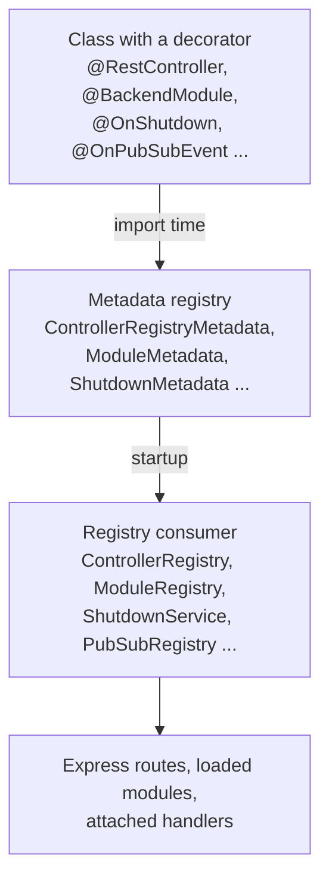

# Recurring patterns

The n8n backend is a set of classes. Decorators wire them together. Almost every pattern on this page works the same way. A decorator writes a fact about a class into a **metadata registry** at import time. A registry consumer reads those facts at startup and acts on them. Controllers become routes, modules get loaded, and hooks get attached.



Two facts follow from this design:

- If nothing imports the file with the class, the decorator never runs. Nothing errors. The route answers 404, the module does not start, or the hook never fires. When something you wrote does not appear, check the import first.
- The decorated class is almost always also a `@Service()`, because the consumer resolves it from the dependency injection container. `@RestController`, `@BackendModule`, and `@Config` apply `@Service()` for you. The method decorators do not.

## Dependency injection

**What it is.** The `@n8n/di` package provides `@Service()` and one global `Container`. A class declares its collaborators as constructor parameters. The container creates each class once and gives the same instance to every consumer.

**Why.** n8n replaced `typedi` with its own small container in early 2025, because `typedi` is no longer maintained. `packages/@n8n/di/README.md` gives the other reasons.

> [!WARNING]
> **The rule that is not obvious.** Do not write `import type { Foo }` for a class that is a constructor parameter. TypeScript erases the type, and the container injects `undefined` without an error. The lint rule `no-type-only-import-in-di` exists for this reason.

**Tests.** One container exists for each process. A test replaces a registration with `mockInstance` from `packages/@n8n/backend-test-utils/src/mocking.ts`. `packages/cli/vitest.config.base.ts` runs each test file in its own forked process, so mocks do not leak between files.

## Configuration

**What it is.** Each environment variable needs a type, a default, and one declaration. You decorate a config class with `@Config` and each field with `@Env('N8N_...')`. Each field has an explicit type and a default. `GlobalConfig` in `packages/@n8n/config/src/index.ts` nests every config class with `@Nested`. Consumers inject `GlobalConfig` or one sub-config.

From `packages/@n8n/config/src/configs/tags.config.ts`:

```ts
@Config
export class TagsConfig {
	/** When true, workflow tags are disabled (no tagging UI or filtering by tag). */
	@Env('N8N_WORKFLOW_TAGS_DISABLED')
	disabled: boolean = false;
}
```

> [!WARNING]
> **The rule that is not obvious.** The type annotation does the parsing. The decorator reads the `design:type` metadata, and `: boolean` is what turns `'true'` into `true`. The lint rule `no-untyped-config-class-field` fails the build for this case.

**How to add a variable.** Add an `@Env` field to the right class under `packages/@n8n/config/src/configs/`. Add the default to `defaultConfig` in `packages/@n8n/config/test/config.test.ts`, or the test fails. Any variable `X` can also arrive as `X_FILE`, a path to a file that holds the value.

**The doc comment is public.** The docs team exports the JSDoc on `@Env` fields into the environment variable reference on docs.n8n.io. Follow `.agents/skills/env-var-docs/SKILL.md` when you write it.

**The remnant.** Before `@n8n/config`, n8n used the `convict` library. Its schema is still in `packages/cli/src/config/schema.ts`, marked `@deprecated`. Do not add to it. The cloud hooks file still reads it. See [Cloud coupling points](cloud-coupling.md).

## Controllers and routes

**What it is.** You decorate a class with `@RestController('/base-path')`. You decorate each handler with `@Get`, `@Post`, `@Patch`, `@Put`, or `@Delete`. You decorate each argument with `@Param('key')`, `@Body`, or `@Query`. At startup, `ControllerRegistry.activate` mounts one Express router for each controller under the REST prefix.

From `packages/cli/src/controllers/tags.controller.ts`:

```ts
@RestController('/tags')
export class TagsController {
	constructor(private readonly tagService: TagService) {}

	@Get('/')
	@GlobalScope('tag:list')
	async getAll(_req: AuthenticatedRequest, _res: Response, @Query query: RetrieveTagQueryDto) {
		return await this.tagService.getAll({ withUsageCount: query.withUsageCount });
```

The first two parameters are always the Express request and response. Decorated arguments follow. The handler returns a value, and the registry wraps it as `{ data }`.

**Why.** Every route gets the same middleware chain, response shape, and error mapping. Nobody calls `app.get(...)`.

**The middleware order.** IP and body-keyed rate limits run before authentication. User-keyed rate limits, the license check, and the scope check run after it, because they need `req.user`.

> [!WARNING]
> **The rule that is not obvious.** Something must import the controller file, or its decorators never run. Core controllers are side-effect imports at the top of `packages/cli/src/server.ts`. Module controllers are imported in the module's `init()` method. A controller file that nothing imports answers 404 on every route, and startup prints nothing.

**Errors to HTTP status.** A handler throws, and `sendErrorResponse` in `packages/cli/src/response-helper.ts` answers. `classifyRestError` in `packages/@n8n/backend-services/src/errors/rest-error-classifier.ts` decides the status:

- A `ResponseError` subclass carries its own status. For example, `NotFoundError` is 404.
- A plain `UserError` becomes 400.
- Any other error becomes 500 and goes to the error reporter.

The shared response errors live in `packages/@n8n/errors/src/response-errors/`. Errors for one feature can stay in that feature, for example `packages/cli/src/errors/response-errors/`.

## Authorization and licensing on routes

**What it is.** Authorization and licensing are separate gates after authentication. Every authenticated route carries one scope decorator. A scope is a string `resource:operation`, for example `workflow:update`. `@GlobalScope` checks the user's global role only. `@ProjectScope` checks the global role first. Then it checks the project role for the resource named in the URL, and then any sharing row. `@Licensed('feat:...')` checks a license feature flag.

**Why.** A missing scope check lets a user reach a resource in a project that is not theirs.

> [!WARNING]
> **The rule that is not obvious.** `.agents/skills/protect-endpoints/SKILL.md` states it:
>
> > **Rule:** every authenticated route on a `@RestController` MUST carry an access-scope decorator. If you add a route without one, the IDOR/permission bypass is on you.

A URL with a project or resource id gets `@ProjectScope`. A URL without one gets `@GlobalScope`. A route with `skipAuth: true` gets no scope decorator. It gets a comment that explains the other authentication. If you put `@ProjectScope` on a `skipAuth` route, every call answers 401, because `req.user` is undefined.

**Example.** The `update` handler in `packages/cli/src/workflows/workflows.controller.ts` uses `@ProjectScope('workflow:update')`. `userHasScopes` in `packages/cli/src/permissions.ee/check-access.ts` does the check. Roles map to scopes in `packages/@n8n/permissions/src/roles/role-maps.ee.ts`.

## Request validation with DTOs

**What it is.** TypeScript types do not exist at runtime, so a request body needs a runtime check. A DTO is a class built from a zod schema with `Z.class` from `packages/@n8n/api-types/src/zod-class.ts`. The class is both a static type and a runtime validator. The controller registry calls `safeParse` on `@Body` and `@Query` arguments before the handler runs. A failure answers 400 with the first zod issue.

**Where DTOs live.** DTOs that the frontend shares go in `packages/@n8n/api-types/src/dto/`. DTOs for one module go in the module's `dto/` folder.

> [!WARNING]
> **The rule that is not obvious.** The registry validates only when the argument type has a `safeParse` method. If you type a body with a plain interface, or forget `@Body`, nothing validates. The handler receives `undefined`, and no 400 is returned. The review rule in `.agents/review-rules/backend/controller-request-validation.md` flags this case.

## Services, repositories, and the TypeORM boundary

**What it is.** The pattern has three layers. A **controller** parses the request and calls a service. A **service** holds the business logic and calls repositories. A **repository** owns every TypeORM import and exposes methods named after use cases. Repositories live in `@n8n/db` or in a module's `database/` folder. Migrations define the schema, because the connection runs with `synchronize: false`.

**Why.** If a service imports `In` from `@n8n/typeorm`, the service depends on TypeORM, and query shapes leak upward. A method such as `findById(id, ctx)` keeps the operators inside the persistence layer.

**The target shape.** A repository composes a table. It does not extend one. It is a plain `@Service()` class with a file-private `BaseRepository` subclass as a private field. From `packages/cli/src/modules/inbound-auth-core/database/repositories/trusted-source.repository.ts`:

```ts
class TrustedSourceTable extends BaseRepository<TrustedSourceEntity> {
	constructor(dataSource: DataSource, transactionRunner: TransactionRunner) {
		super(TrustedSourceEntity, dataSource.manager, transactionRunner);
	}
}
```

`TrustedSourceRepository` holds this table and calls `this.table.managerFor(ctx)` in each use-case method. Services that inject it see only those methods, not `find`, `save`, or `.manager`.

**What you see in old code.** Most repositories, such as `TagRepository` in `packages/@n8n/db/src/repositories/tag.repository.ts`, still extend `BaseRepository`. They are legacy. Do not copy them, and do not convert them in unrelated PRs.

> [!WARNING]
> **The rule that is not obvious.** The Code Health rule `typeorm-persistence-boundary` fails CI on a new `@n8n/typeorm` import in business logic. Existing leaks sit in `.code-health-baseline.json`, which only shrinks. Do not relabel the import as `import { In } from '@n8n/db'`. The rule catches that too, and reviewers reject it. The "Persistence layer & the TypeORM boundary" section of `AGENTS.md` has the full list of rules.

**Where shared services go.** `@n8n/backend-services` holds services that many backend modules share, such as `EventService`, `UrlService`, and `CacheService`. It sits above `@n8n/db` and below `cli`. Code there must not import from `cli`.

## Transactions

**What it is.** Inject the abstract `TransactionRunner` from `packages/@n8n/db/src/services/transaction.ts`. Call `txRunner.run(ctx, async (ctx) => ...)`. The callback receives an `OperationContext` that carries the active transaction. Business logic cannot look inside it. Pass that `ctx` into every repository call inside the callback. The repository gets the right manager with `managerFor(ctx)`.

**Why.** Two writes must succeed or fail together. The code that decides this is a service, and a service must not see a driver type.

> [!WARNING]
> **The rule that is not obvious.** `run` always requires a context. Pass an empty `{}` at the entry point of the operation. Below that, reuse the context you received. A context that already carries a transaction joins it. `packages/cli/src/modules/oauth-server/oauth-token.service.ts` is the worked example.

**Three shapes coexist.** `packages/cli/AGENTS.md` names them. Older code calls `manager.transaction(...)` directly. The `withTransaction` helper in `packages/@n8n/db/src/utils/transaction.ts` is `@deprecated`, because it gives the callback an `EntityManager`. `TransactionRunner` is the target, and new code uses only it.

## Backend modules

**What it is.** A backend module packages one optional feature: its entities, controllers, settings, and startup work. Its entrypoint `<name>.module.ts` is a class decorated with `@BackendModule({ name, licenseFlag?, instanceTypes? })` that implements `ModuleInterface`. `ModuleInterface` in `packages/@n8n/decorators/src/module/module.ts` lists the optional methods, such as `init`, `entities`, `settings`, `context`, and `systemTasks`.

From `packages/cli/src/modules/favorites/favorites.module.ts`:

```ts
@BackendModule({ name: 'favorites', instanceTypes: ['main'] })
export class FavoritesModule implements ModuleInterface {
	async init() {
		await import('./favorites.controller.js');

		const { FavoritesEventRelay } = await import('./favorites.event-relay.js');
		Container.get(FavoritesEventRelay).init();
	}
```

**Why.** An instance that does not use a feature should not load its code. Every relative import in the entrypoint is a dynamic `await import()`, and the class has no constructor. A constructor would load its dependencies when the module class is imported, even for a disabled module.

**Where modules live.** Modules are moving from `packages/cli/src/modules/<name>/` into workspace packages at `packages/modules/<name>/backend`. A packaged module is listed in `packages/cli/src/modules/modules.manifest.ts`. A packaged module must not import `cli`. The best example is the insights module, `InsightsModule` in `packages/modules/insights/backend/src/insights.module.ts`. Create a new packaged module with `pnpm n8n-module-sdk create <name> --stack=backend`.

**The lifecycle.** `ModuleRegistry` in `packages/@n8n/backend-common/src/modules/module-registry.ts` runs it:

<!-- steps -->

1. `eligibleModules` takes the defaults, adds `N8N_ENABLED_MODULES`, and removes `N8N_DISABLED_MODULES`.
2. `loadModules` collects `entities()` before the database connects. The tables of an unlicensed module still exist.
3. `initModules` skips unlicensed modules and other instance types, then calls `init()`.

> [!WARNING]
> **The rules that are not obvious.** The entrypoint has no top-level relative imports and no constructor. Lint enforces this only in `packages/cli`. Under `module: NodeNext`, every dynamic import needs an explicit `.js` extension. A module name must be in `MODULE_NAMES` in `packages/@n8n/backend-common/src/modules/modules.config.ts`, or startup throws `UnknownModuleError`.

Read more: [Build a backend module](how-to/build-a-backend-module.md).

## Lifecycle hooks

**What it is.** Some moments concern many classes: the process stops, this main becomes the leader, a Redis command arrives, a workflow execution ends. Each moment has a method decorator with its own registry and consumer. Each one requires the class to be a `@Service()`.

| Decorator | Moment | Consumer |
|---|---|---|
| `@OnShutdown(priority?)` | The process is stopping | `ShutdownService` in `packages/cli/src/shutdown/shutdown.service.ts` |
| `@OnLeaderTakeover()`, `@OnLeaderStepdown()` | This main gains or loses leadership in multi-main | `MultiMainSetup` in `packages/cli/src/scaling/multi-main-setup.ee.ts` |
| `@OnPubSubEvent(command, filter?)` | A Redis pubsub command arrives | `PubSubRegistry` in `packages/cli/src/scaling/pubsub/pubsub.registry.ts` |
| `@OnLifecycleEvent(event)` | A workflow or node starts or ends | `ModulesHooksRegistry` in `packages/cli/src/execution-lifecycle/execution-lifecycle-hooks.ts` |

**Why.** Each class declares its own interest. No central file has to know every subscriber.

**Examples.** `WaitTracker` in `packages/cli/src/wait-tracker.ts` polls only while it is the leader. `License.reload` in `packages/cli/src/license.ts` handles `reload-license` on every process.

> [!WARNING]
> **The rule that is not obvious.** Periodic leader-only work belongs on a `@SystemTask()` class in a `*.task.ts` file, not on an `@OnLeaderTakeover` timer. The lint rule `no-on-leader-takeover` enforces this. `@OnLeaderTakeover` is for services that hold live resources on the leader, such as webhooks, pollers, and sockets. A good system task example is `InsightsCompactionTask` in `packages/modules/insights/backend/src/insights-compaction.task.ts`. See [Legacy and new](legacy-and-new.md#scheduling).

If you decorate a class that is not a `@Service()`, `ShutdownService.validate` fails at startup with a message that names the class.

## Events and relays

**What it is.** `EventService` in `packages/@n8n/backend-services/src/events/event.service.ts` is a typed emitter. A service emits an event with a typed payload, for example `workflow-saved` in `packages/cli/src/workflows/workflow.service.ts`. A **relay** extends `EventRelay` from `packages/cli/src/events/relays/event-relay.ts`. It maps event names to handler methods and forwards each event to its destination.

**Why.** When a workflow is saved, telemetry, log streaming, and some modules want to know. The workflow service should not know any of them.

**How the types work.** `EventMap` is an open interface. Each event owner adds its payload types through TypeScript module augmentation. The CLI does this in `packages/cli/src/events/event-map.ts`, with the map files in `packages/cli/src/events/maps/`. This keeps domain types out of the shared package.

> [!WARNING]
> **The rule that is not obvious.** Add the payload type to a map before you emit. The lint rule `no-type-unsafe-event-emitter` blocks an untyped emitter. Telemetry events also go through the `@n8n/telemetry` registry. Run `pnpm --filter @n8n/telemetry catalog` to list them. Read `packages/cli/src/events/relays/log-streaming.event-relay.ts` first.

## Errors

**What it is.** Three base classes from `@n8n/errors`, chosen by cause. `n8n-workflow` re-exports them.

| Class | Use when | Default level |
|---|---|---|
| `UserError` | The user caused it: invalid input, an unauthorized action, a business rule | `info` |
| `OperationalError` | A transient, expected problem, such as a network timeout | `warning` |
| `UnexpectedError` | A bug that developers must fix | `error`, reported |

See `packages/@n8n/errors/src/user.error.ts` and its siblings. In HTTP handlers, throw a `ResponseError` subclass when a specific status matters (see [Controllers and routes](#controllers-and-routes)).

**Why.** The class decides the log level, the Sentry report, and the HTTP status.

> [!WARNING]
> **The rules that are not obvious.**
>
> - Do not use `ApplicationError`. It is a deprecated shim in `packages/@n8n/errors/src/application.error.ts` so that community nodes still resolve. The lint rule `no-application-error` blocks new uses.
> - Do not `throw new Error('...')` in a service. It lands as a 500 with no level and no tags.
> - A `UserError` from a controller answers 400, not 404. Only a `ResponseError` subclass carries another status.

Read more: `.agents/review-rules/backend/error-classes.md`.

## Logging

**What it is.** Inject `Logger` from `@n8n/backend-common`. Call `this.logger.scoped('license')` once in the constructor, so that every line carries a scope. Log a string message and put the context in a metadata object. Operators set `N8N_LOG_LEVEL` and, optionally, `N8N_LOG_SCOPES`.

> [!WARNING]
> **The rule that is not obvious.** A scope name must be in `LOG_SCOPES` in `packages/@n8n/config/src/configs/logging.config.ts`, or typecheck fails. When `N8N_LOG_SCOPES` is set, the filter drops every record without a matching scope. The code is `Logger.scoped` in `packages/@n8n/backend-common/src/logging/logger.ts`.

## Pubsub across processes

**What it is.** In queue mode, a change on one main must reach every other main and worker. `Publisher` in `packages/cli/src/scaling/pubsub/publisher.service.ts` publishes a typed command on a Redis channel. Every main and worker runs a `Subscriber` on that channel. `PubSubRegistry` then calls each `@OnPubSubEvent` handler whose instance type and role match.

**Example.** `ActiveWorkflowManager` in `packages/cli/src/active-workflow-manager.ts` publishes `add-webhooks-triggers-and-pollers`.

> [!WARNING]
> **The rules that are not obvious.**
>
> - `Publisher.publishCommand` returns without publishing unless the executions mode is `queue`. In regular mode, no other process exists.
> - The subscriber drops messages that the host sent itself, unless the command is in `SELF_SEND_COMMANDS`.
> - Commands are debounced by default, so a burst becomes one. Commands in `IMMEDIATE_COMMANDS` opt out. Request and response commands must opt out, or concurrent requests merge.

**How to add a command.** Add a payload type to `PubSubCommandMap` in `packages/cli/src/scaling/pubsub/pubsub.event-map.ts`. Add the command to the union in `packages/cli/src/scaling/pubsub/pubsub.types.ts`. Decide on the two sets in `packages/cli/src/scaling/constants.ts`. Then write an `@OnPubSubEvent` handler.

## Lazy loading heavy modules

**What it is.** When only one code path needs a dependency, use `await import()` at the point of use. A top-level import of a native module or a large parser loads it into every process at boot.

**The rule.** `AGENTS.md` states it, and `.agents/review-rules/backend/lazy-load-heavy-modules.md` enforces it in review. `packages/cli/eslint.config.mjs` blocks static imports of the Instance AI runtime dependencies.

**Examples.** `PostHogClient` in `packages/cli/src/posthog/index.ts` imports `posthog-node` only when diagnostics are enabled. `packages/cli/src/modules/agents/runtime/agent-secure-runtime.ts` imports `isolated-vm` only when it first builds its pool.

## Feature flags

**What it is.** New behavior lands on `master` disabled, behind an opt-in flag. A flag has a key constant in `@n8n/api-types` and an `@Env('N8N_...')` boolean that defaults to `false`. `PostHogClient.applyEnvOverrides` in `packages/cli/src/posthog/index.ts` wires the override. PostHog owns the rollout.

**Why.** Until v3 ships, `3.x` is `master` plus the breaking changes, synced daily. `.github/DEVELOPING_V3.md` describes the flow.

> [!WARNING]
> **The rules that are not obvious.**
>
> - The env toggle can only force a flag on. Setting it to `false` defers to PostHog. Only `N8N_FEATURE_FLAG_OVERRIDES` with the flag set to `false` forces it off.
> - A surface behind a flag that is off answers 404, not 403. See `AgentEvalsFlagGate` in `packages/cli/src/modules/agent-evals/agent-evals-flag-gate.ts`.
> - Breaking changes go only to `3.x`, in a PR that targets `3.x`.

The other toggle systems are license flags, cloud instance flags, and module enablement. [Cloud coupling points](cloud-coupling.md#the-four-toggle-systems) compares them.

## Testing

**What it is.** A unit test uses typed mocks and no database. An integration test drives a real Express app and a real test database over HTTP.

**Unit tests.** Use `mock<T>` from `vitest-mock-extended` for values and `mockInstance` for container registrations. `packages/cli/src/services/__tests__/ai-usage.service.test.ts` is a short example. Hoist shared fixtures to module scope.

**Integration tests.** `setupTestServer` in `packages/cli/test/integration/shared/utils/test-server.ts` builds the app with only the controller groups you ask for. It mocks the logger, telemetry, PostHog, and the license, and starts the test database. `packages/cli/test/integration/api-keys.api.test.ts` calls it with `endpointGroups: ['apiKeys']`.

**How to run one file.** From `packages/cli`:

```bash
pnpm test src/services/__tests__/ai-usage.service.test.ts
pnpm test:integration test/integration/api-keys.api.test.ts
pnpm test:postgres test/integration/api-keys.api.test.ts
```

The first runs a unit test. The second runs an integration test against SQLite. The third runs it against PostgreSQL.

> [!WARNING]
> **The rule that is not obvious.** A Vitest package that uses `@n8n/di` decorators must use `createVitestConfigWithDecorators` from `@n8n/vitest-config/node-decorators`. Without it, the test can load two copies of the `Container`. The decorators register in one, the test reads the other, and `Container.get(...)` returns `undefined`.

Read more: `packages/@n8n/backend-test-utils/`, `.agents/review-rules/testing/coverage.md`, and [Verify changes](../../AGENTS.md#verify-changes) in the root `AGENTS.md`.
