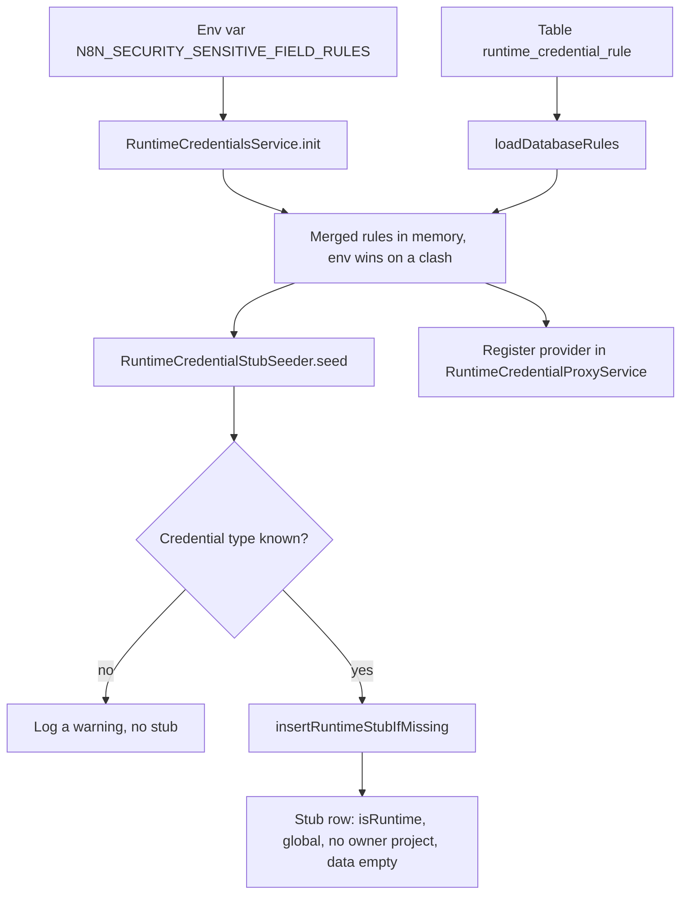
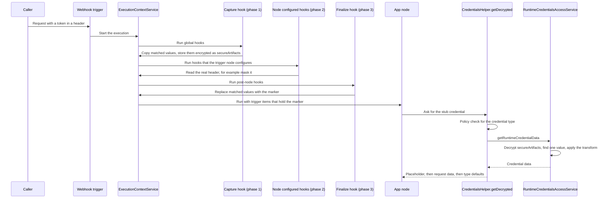

# Runtime credentials

**tl;dr:** A caller sends a token with a request, for example `Authorization: Bearer <token>` on a webhook. An instance admin defines a rule that names the key path of the token and a credential type. n8n creates a stub credential for each rule. A builder picks the stub in a normal node. When the workflow runs, n8n moves the token out of the trigger output into the encrypted execution context. When the node asks for the stub, n8n lays the token over the stub data. n8n never writes the token to a credential row and never verifies it.

This page is for an engineer who reads or changes the feature. It explains the parts, the data flow, the security stance, and the reading order of the code. The decisions behind the design are in the records that [the decision table](#decisions) lists.

## Context and problem

A node that uses a credential type cannot take a raw string as its secret. A builder who holds a user token must use an HTTP Request node. This loses the operations of the app node, such as Gmail or Salesforce.

This feature is **bring your own token**. It is not on-behalf-of. The token authenticates the caller to the app. It does not authenticate the caller to the workflow. A webhook that must reject unknown callers needs its own authentication. n8n documents this and does not enforce it.

[Credentials](credentials.md) describes end-user credentials, which are a different feature. For them n8n stores a token for each user and checks the identity of the user. Runtime credentials carry a value that the caller sends for one execution. See [the comparison](#two-mechanisms-for-two-questions).

## Components

The feature sits behind the environment flag `N8N_ENV_FEAT_RUNTIME_CREDENTIALS`. The module is `runtime-credentials`.

| Part | Path |
|---|---|
| Module entry, init order | `packages/cli/src/modules/runtime-credentials/runtime-credentials.module.ts` |
| Config (env var `N8N_SECURITY_SENSITIVE_FIELD_RULES`) | `packages/cli/src/modules/runtime-credentials/runtime-credentials.config.ts` |
| Rule schema | `packages/cli/src/modules/runtime-credentials/runtime-credentials.schemas.ts` |
| Rules in memory, marker, stub id, `strip()` | `packages/cli/src/modules/runtime-credentials/runtime-credentials.service.ts` |
| Path matching and glob | `packages/cli/src/modules/runtime-credentials/path-traversal.ts` |
| Capture hook and finalize hook | `packages/cli/src/modules/runtime-credentials/runtime-credentials-context-hook.ts` |
| Stub seeder | `packages/cli/src/modules/runtime-credentials/runtime-credential-stub.seeder.ts` |
| Overlay data and errors | `packages/cli/src/modules/runtime-credentials/runtime-credentials-access.service.ts` |
| Admin REST controller and service | `packages/cli/src/modules/runtime-credentials/runtime-credential-rules.controller.ts`, `packages/cli/src/modules/runtime-credentials/runtime-credential-rules.service.ts` |
| Rule impact (expression scan) | `packages/cli/src/modules/runtime-credentials/runtime-credential-rule-impact.service.ts`, `packages/cli/src/modules/runtime-credentials/rule-impact-matcher.ts`, `WorkflowRepository.findNodesPageForImpactScan` in `packages/@n8n/db/src/repositories/workflow.repository.ts` |
| Provider seam between `cli` and `backend-services` | `packages/@n8n/backend-services/src/services/runtime-credential-proxy.service.ts` |
| Overlay call site (`isRuntime` branch) | `packages/cli/src/credentials-helper.ts` |
| Output scrubber | `packages/core/src/execution-engine/runtime-credential-scrubber.ts`, wired in `packages/core/src/execution-engine/workflow-execute.ts` |
| Audit event | `packages/cli/src/modules/runtime-credentials/runtime-credential-usage-audit.service.ts`, `packages/cli/src/events/maps/relay.event-map.ts`, `packages/cli/src/events/relays/log-streaming.event-relay.ts` |
| Publish check | `packages/cli/src/workflows/workflow-validation.service.ts` (`validateRuntimeCredentials`) |
| Hook phases | `packages/core/src/execution-engine/execution-context.service.ts`, `packages/core/src/execution-engine/execution-context-hook-registry.service.ts`, `packages/@n8n/decorators/src/context-establishment/context-establishment-hook-metadata.ts` |
| Policy kind | `packages/cli/src/modules/type-availability-policies/request-fed-credential-type-policy.ts` and the two `request-fed-credential-type-policy-*.controller.ts` files |
| Entities and repositories | `packages/@n8n/db/src/entities/credentials-entity.ts`, `packages/@n8n/db/src/entities/runtime-credential-rule.ts`, `packages/@n8n/db/src/repositories/runtime-credential-rule.repository.ts`, `packages/@n8n/db/src/repositories/credentials.repository.ts` |
| Migrations | `packages/@n8n/db/src/migrations/common/1794995238085-AddIsRuntimeToCredentials.ts`, `packages/@n8n/db/src/migrations/sqlite/1794995238085-AddIsRuntimeToCredentials.ts`, `packages/@n8n/db/src/migrations/common/1795006844318-CreateRuntimeCredentialRuleTable.ts`, `packages/@n8n/db/src/migrations/common/1795020741941-AddAllowedDomainsToRuntimeCredentialRule.ts` |
| Stub protection | `packages/cli/src/credentials/credentials.service.ts` (`assertNotRuntime`), `packages/cli/src/credentials/credentials.service.ee.ts`, `packages/cli/src/credentials/credentials.controller.ts` |
| Scopes | `packages/@n8n/permissions/src/constants.ee.ts`, `packages/@n8n/permissions/src/roles/scopes/global-scopes.ee.ts` |
| Pubsub command | `packages/@n8n/backend-services/src/pubsub/pubsub.types.ts`, `packages/@n8n/decorators/src/pubsub/pubsub.event-map.ts` |
| Frontend module | `packages/modules/runtime-credentials/frontend/src/runtime-credentials.module.ts` |
| Node dropdown label and list behavior | `packages/frontend/editor-ui/src/features/credentials/components/NodeCredentials.vue`, `packages/frontend/editor-ui/src/features/credentials/components/CredentialCard.vue` |

## Startup

At startup the module loads the rules, then creates the stubs, then registers the overlay provider. Each main does this. The stub insert ignores a row that exists, so no leader gate is needed.



Note the order in `RuntimeCredentialsModule.init()`: rules first, seeder second, hooks and provider last. A rule with no `credentialType` creates no stub. It only moves the value to the execution context under its alias.

## A request from webhook to node call

Two hooks work on the trigger items. The capture hook copies the values. The finalize hook clears them after the hooks that the trigger node configures have read the same items.



## Data model

| Item | Where | Notes |
|---|---|---|
| `isRuntime` | Column on `credentials_entity`, boolean, not null, default `false` | Set only by the seeder. The create API does not accept it. |
| Stub row | `credentials_entity` | `isGlobal` true, `usageScope` `project`, no owner row, data `{}` encrypted. |
| Stub id | Derived | `runtime-` plus the first 16 hex characters of the SHA-256 hash of the alias. |
| Rule row | Table `runtime_credential_rule` | Columns `id`, `alias` (unique), `nodeType`, `path`, `credentialType`, `transform` (nullable), `allowedDomains` (nullable text), and timestamps. |
| Environment rule | Memory only | Read-only. Wins on an alias clash. |
| Request values | `runtimeData.secureArtifacts` of the execution context | Encrypted with `cipher.encryptV2` as one blob. Shape `{ version: 1, artifacts: { <alias>: [...] } }`. |
| Marker | Trigger output | The string `[moved to credential: <credentialType>]`. |

A rule has these fields:

- `nodeType`: a trigger node type, or `*`.
- `path`: a dot path with `[*]` for arrays. A `*` inside a key is a glob, for example `headers.x-auth-*`.
- `credentialType`: for example `gmailOAuth2Api`. A stub needs it.
- `transform`: `bearer` (default) or `field:<name>`. A transform needs a credential type.
- `allowedDomains` (optional): comma separated hosts that the secret can be sent to. `*.example.com` matches subdomains only. See [Allowed domains](#allowed-domains).

The transform `bearer` removes a leading `Bearer ` and sets `oauthTokenData.access_token`. The transform `field:<name>` copies the value to the named field.

### Target field rules

n8n controls some credential fields. A rule cannot write a request value to them. A `field:<name>` rule is valid only when all of these are true:

- `<name>` is a property of the credential type. Properties from `extends` parent types count.
- `<name>` is not an OAuth endpoint or flow field (`OAUTH_PINNED_FIELDS`), and not a field of dynamic client registration (`DCR_MANAGED_CREDENTIAL_FIELDS`). Both lists are in `oauth/dcr-managed-fields.ts`.
- `<name>` is not `allowedHttpRequestDomains` or `allowedDomains`.
- The property of `<name>` does not have `type: 'hidden'`.
- The instance does not overwrite `<name>` for the type (`CredentialsOverwrites.getOverwrites`, parent types included).

The pure function `isProtectedCredentialField` in `credential-field-target.ts` holds the protected-field list. `CredentialFieldTargetValidator` collects the type properties and overwrite keys, and builds the error text. The `bearer` transform is not checked.

Three places enforce the rules:

- The REST API returns 400 with the reason when a rule is created, or when a patch sets a `field:<name>` transform. The patch checks against the stored credential type.
- At startup, the stub seeder logs a warning with the alias and skips the stub for an env or database rule that breaks the rules. The rule stays loaded, so the matcher still removes the value from the trigger output.
- At run time, `RuntimeCredentialsAccessService.getRuntimeCredentialData` checks the rule again and throws a `UserError`. The check covers a rule that was valid when it loaded and is not valid now, for example after an overwrite change.

## Hook phases

The registry runs hooks in three phases.

| Phase | Hooks | Runtime credentials uses it for |
|---|---|---|
| 1. Global | Hooks with `alwaysExecute: true` | `RuntimeCredentialsContextHook` copies the matched values. It works on a clone and leaves the items as they are. |
| 2. Node configured | Hooks named in the parameters of the trigger node | None. Bearer and header extractors of dynamic credentials read and mask `headers.authorization` here. |
| 3. Post-node | Hooks with `runAfterNodeHooks: true` | `RuntimeCredentialsFinalizeHook` replaces the matched values with the marker. |

Why three phases: a runtime rule often names `headers.authorization`. The extractors of dynamic credentials need the real header. If the rule cleared it first, they would find nothing. If the rule cleared it after them, it would capture the mask. Capture runs first and clear runs last.

The capture hook drops values that are the marker. A partial run can start from a node whose input the finalize hook already changed. The marker is not a request value.

A hook with both `alwaysExecute` and `runAfterNodeHooks` runs only in phase 3. A post-node hook runs even when the trigger node has no configured hooks.

## Overlay at run time

In `CredentialsHelper.getDecrypted`, a row with `isRuntime` takes the runtime branch before the dynamic branch.

1. If the policy for request-fed types is active, `assertAllowed` runs. A denied type fails here.
2. `getRuntimeCredentialData` finds the rule from the stub id. It throws when the rule is gone or has another credential type.
3. It decrypts `secureArtifacts` and collects every string for the alias. No value is an error. More than one distinct value is an error. The messages name the rule and the path and never contain a value.
4. It applies the transform.
5. `getDecrypted` keeps the request data apart. When the rule has `allowedDomains`, it adds `allowedHttpRequestDomains` set to `domains` and `allowedDomains` set to the list. These two values win over the request value and the transform.
6. `getDecrypted` applies the defaults, overwrites, and expressions of the type to the placeholder data only. Then it lays the request data over the result. A request value that starts with `=` stays plain data. n8n never evaluates it as an expression.
7. It does not set `currentNodeUsedDynamicCredentials`. A stub is not an end-user credential, and the flag would redact the execution data and show the end-user label.

`updateCredentialsOauthTokenData` returns early for a stub. A refreshed token never reaches the row.

A manual run has no request. The stub fails with "This credential gets its value from the incoming request. Run the workflow through its trigger."

## Allowed domains

A rule can limit the hosts that its secret can reach. The field `allowedDomains` is a comma separated list. `*.example.com` matches subdomains only, not `example.com`. The API and the environment schema reject an empty entry, a space inside an entry, and the characters `/`, `:`, `@`, and `\`. They also reject a `*` that is not a leading `*.`. A rule without the field has no restriction.

n8n reuses the credential fields. It sets `allowedHttpRequestDomains` to `domains` and `allowedDomains` to the list of the rule, after the request value is merged. The code does not check the URL itself. A node that already checks these fields enforces the list.

Where the list applies (the nodes call `getCredentialAllowedDomains` or `assertCredentialAllowsUrl`):

- HTTP Request (V1, V2, V3) and GraphQL. A request to another host fails with "Domain not allowed", also after a redirect.
- Declarative nodes (routing). A node that defines its own host keeps that host allowed. The list limits a base URL that the user sets.
- HTTP Request Tool and MCP Client.
- AI nodes that check a URL: the OpenAI helper, Ollama (chat, LLM, embeddings), Hugging Face Inference (LLM, embeddings), Azure OpenAI embeddings, and Databricks. These nodes check their own endpoint, so the list must name that host.

Where the list does not apply: nodes that send the request through their own API helper and never read the fields. The Gmail node is one example. It sends the token to its fixed Google host whatever the list says. The Anthropic chat model is another example that does not check. Treat the list as a limit for the nodes above and not as a network control. An admin who needs a hard limit must also restrict the nodes that builders can use, or restrict outbound traffic.

Only an instance admin (`securitySettings:manage`) sets the list. It belongs to the rule, so every use of the stub gets the same list. The record is `ADR-20261118-limit-run-time-secrets-to-allowed-domains-with-credential-fields`.

## Output scrubbing

An API can echo the token that it received, and an error can quote it. After a node that resolved a stub finishes, the engine replaces the request value with `[runtime credential: <alias>]` in the output items and in the error of that node.

- **Scope.** The engine scrubs the output of each node that resolved a stub, and of the parent node when a sub-node resolved it. It resets the alias list before each node.
- **Matching.** It matches the value in any string of the item, in nested objects and arrays. It also matches the value without the `Bearer ` prefix. A value shorter than 6 characters is skipped, because it matches unrelated text.
- **No mutation.** The scrubber works on copies. Pinned data and the items of upstream nodes do not change. Pinned nodes are not scrubbed.
- **Errors.** The text fields and other fields of the error are replaced in place, before the error goes to the task data, the execution result, and the error chunk.

Not covered:

- The output of a sub-node (only the parent node is scrubbed).
- A response that the node streams to the caller before the engine sees it.
- A value that the node changes: base64, URL encoding, a hash, or a part of the value.
- A value shorter than 6 characters.
- Binary data.
- A node that gets the value from another node without a stub. Such a node reads it with `getRuntimeCredential` on purpose.
- Logs of the external service that received the value.

If the decryption of the values fails, the output stays as it is. The stub resolution fails for the same reason.

## Audit event

The event `runtime-credential-used` goes to log streaming as `n8n.audit.runtime-credential.used`. n8n sends it once for each execution, stub, and node. A node that asks for its credential for each item sends one event. The payload holds `alias`, `credentialId`, `credentialType`, `workflowId`, `executionId`, `nodeName`, and `nodeType`. It never holds the value. `RuntimeCredentialUsageAudit` keeps the sent keys for the last 1000 executions in the memory of the process. A run without an execution id sends the event every time.

## Security model

The goal is that a request value does not appear in trigger output, expressions, or execution history, and does not rest in a credential row.

What n8n guarantees:

- The value is encrypted in the execution context.
- A credential row holds only placeholder data.
- A rule matches by key path only. It never matches on a value.
- A path with the segment `__proto__`, `constructor`, or `prototype` never matches. Only own properties match.
- The glob matcher runs in linear time and uses no regular expression.
- Error messages name the rule and the path. They never contain a value.
- The engine scrubs the value from the output and the errors of a node that used a stub (with the limits in [Output scrubbing](#output-scrubbing)).
- A user cannot edit, delete, share, transfer, or test a stub.
- Only an instance Owner or Admin (`securitySettings:manage`) manages rules.
- A rule with `allowedDomains` limits the hosts for the nodes that check the credential fields. See [Allowed domains](#allowed-domains) for the nodes that do not.
- Error workflows receive no values. Their context is an allow-listed copy without `secureArtifacts`.

What n8n does not guarantee:

- It does not verify the token. The app accepts or rejects it.
- It does not remove a copy of the value from other parts of the request. An admin lists the one path where the token arrives.
- It does not remove a real value that a user pastes into pin data by hand.
- It does not scrub a value that a node changes before it writes it to the output.
- It does not restrict which node uses the stub. Any node can use a credential that the builder gives it. A list of allowed domains does not stop a node that skips the credential field check.

Webhook authentication is documented, not enforced. A caller who can reach the webhook can make the workflow call the app with a token that the caller holds.

Sub-workflows inherit the values from the parent execution, as for other context fields.

## Multi-main and queue mode

- Each process that starts the module reads the environment rules and the database rules into memory.
- A rule change goes to the table first. The main that handled the request reloads, then publishes the pubsub command `reload-runtime-credential-rules`. Each process that handles the command reloads.
- A failed publish logs a warning. The change is stored and other processes read it at the next start or the next change.
- The seeder runs on every process that starts the module. The insert is idempotent.
- The execution context is encrypted with the instance key. A process that runs a node needs the same key and the same rules.

Not verified locally: live reload of rules on a worker, and the full flow in queue mode. See [Run queue mode locally](how-to/run-queue-mode-locally.md).

## Engine v2

Engine v2 fails closed. Its control plane resolves credentials through `EngineCredentialsService`. That path builds its own `additionalData` with no execution context. A stub then has no value, and `getRuntimeCredentialData` throws the missing value error. `getRuntimeCredential` on the engine v2 additional data is `unimplemented`.

## Admin API

All routes are under `/rest/runtime-credential-rules` and need `securitySettings:manage`.

| Route | Effect |
|---|---|
| `GET /` | Lists rules that have a credential type, with `source` (`environment` or `database`) and `stubCredentialId`. |
| `POST /` | Creates a database rule and its stub. The body can hold `allowedDomains`. 400 for an unknown credential type or a `field:<name>` target that n8n controls (see [Target field rules](#target-field-rules)), 409 for an alias that exists. |
| `PATCH /:alias` | Updates `nodeType`, `path`, `transform`, or `allowedDomains` (`null` removes the list). 400 when the body names `alias` or `credentialType`, or when the new `field:<name>` transform targets a field that n8n controls. 403 for an environment rule, 404 for an unknown alias. |
| `DELETE /:alias` | Deletes a database rule. The stub stays. |
| `POST /impact` | Body `{ nodeType, path }`. Lists workflows (id, name, project id and name, node names) with a node expression that reads the value the rule would remove from the trigger output. At most 100 workflows. `truncated` is true when the list is not complete (more than 100 matches, or 5000 workflows scanned). Matching is a hint, see "Known limits". |

The policy for request-fed credential types has its own routes: `/rest/request-fed-credential-type-policies/instance` and `/rest/projects/:projectId/request-fed-credential-type-policies/project`. They need the scope `credentialTypePolicy:manageRequestFed` and the license feature of type availability policies.

## UI

The frontend is a module package at `packages/modules/runtime-credentials/frontend`.

- An instance page "Run-time inputs" in the Security section of the settings sidebar. It needs `securitySettings:manage`.
- A project tab "Run-time inputs". It shows or edits the project policy for request-fed types.
- The node credential dropdown shows the label "Provided at run time" for a stub. The credentials list shows the same label and does not open a stub.

## Walkthrough: read the code in this order

1. **Rules and matching.** Read `runtime-credentials.schemas.ts`, then `path-traversal.ts`, then `runtime-credentials.service.ts` (`strip`, `stripMarker`, `runtimeStubId`).
2. **Column and seeder.** Read the `IsRuntime` migration, `CredentialsRepository.insertRuntimeStubIfMissing`, and `runtime-credential-stub.seeder.ts`. Then read `runtime-credentials.module.ts` for the init order.
3. **Hook phases.** Read `context-establishment-hook-metadata.ts`, the registry, and `augmentExecutionContextWithHooks` in `execution-context.service.ts`. Then read `runtime-credentials-context-hook.ts`.
4. **Overlay.** Read `runtime-credential-proxy.service.ts`, `runtime-credentials-access.service.ts`, and the `isRuntime` branch of `getDecrypted` in `credentials-helper.ts`.
5. **Publish check.** Read `validateRuntimeCredentials` and its call in `workflow.service.ts`.
6. **Stub protection.** Search for `assertNotRuntime` in `packages/cli/src/credentials/`. Then read the visibility integration test.
7. **Rule store and API.** Read the rule entity and repository, the `CreateRuntimeCredentialRuleTable` migration, then `runtime-credential-rules.service.ts` and the controller.
8. **Policy kind.** Read `constants.ts` and `request-fed-credential-type-policy.ts` in `type-availability-policies`, then the two controllers.
9. **Frontend.** Read `runtime-credentials.module.ts`, then the views and the API client.

## How to extend

**A new transform.**

1. Extend `credentialTransformSchema` in `runtime-credentials.schemas.ts`.
2. Add the case to `applyTransform` in `runtime-credentials-access.service.ts`.
3. Add the transform to the DTO in `@n8n/api-types` and to the rule modal in the frontend.
4. Add a unit test in `runtime-credentials-access.service.test.ts`.

**A new credential type.** No code change. An admin adds a rule with that `credentialType`. The seeder needs the type to be known to `CredentialTypes`. If the type reads its secret from a field other than the OAuth2 access token, use the transform `field:<name>`.

**A new hook.** Decorate the class with `@ContextEstablishmentHook`. Use `alwaysExecute: true` for phase 1. Use `runAfterNodeHooks: true` for phase 3. A node configured hook (phase 2) is listed in the trigger node parameters. Keep hooks free of side effects on the items they do not own.

**A new credential operation.** Call `assertNotRuntime` before it acts on a credential. Add a case to the visibility integration test.

## How to test

Run these from `packages/cli/`. See [Test a backend change](how-to/test-a-backend-change.md) for the helpers.

```bash
# Unit tests of the module
pnpm test src/modules/runtime-credentials --maxWorkers=1

# Overlay in the credentials helper
pnpm test src/__tests__/credentials-helper.test.ts --maxWorkers=1

# Integration tests on SQLite
pnpm test:integration test/integration/modules/runtime-credentials-scrub.integration.test.ts --maxWorkers=1
pnpm test:integration test/integration/modules/runtime-credentials.integration.test.ts --maxWorkers=1
pnpm test:integration test/integration/modules/runtime-credential-stubs.integration.test.ts --maxWorkers=1
pnpm test:integration test/integration/modules/runtime-credential-rules.integration.test.ts --maxWorkers=1
pnpm test:integration test/integration/modules/runtime-credential-stub-visibility.integration.test.ts --maxWorkers=1
pnpm test:integration test/integration/modules/runtime-credentials-hook-order.integration.test.ts --maxWorkers=1
pnpm test:integration test/integration/modules/runtime-credentials-pinned.integration.test.ts --maxWorkers=1

# Integration test with a real HTTP Request node and allowed domains
pnpm test:integration test/integration/modules/runtime-credential-allowed-domains.integration.test.ts --maxWorkers=1

# Migration tests
pnpm test:sqlite:migrations test/migration/1794995238085-add-is-runtime-to-credentials.test.ts
pnpm test:sqlite:migrations test/migration/1795020741941-add-allowed-domains-to-runtime-credential-rule.test.ts
```

Other tests:

- `packages/core`: `execution-context.service.test.ts` and `execution-context-hook-service.test.ts` cover the post-node phase.
- `packages/core`: `runtime-credential-scrubber.test.ts`.
- `packages/@n8n/backend-services`: `runtime-credential-proxy.service.test.ts`.
- `packages/cli/src/modules/type-availability-policies/__tests__/request-fed-credential-type-policy.test.ts`.
- Frontend: `pnpm turbo test --filter=@n8n/frontend-module-runtime-credentials`.

## Known limits

- Exact paths and globs only. No regular expressions, because the repository has no linear-time engine.
- Engine v2 cannot run a workflow that uses a stub.
- The impact endpoint finds reads by static text. It misses a path that an expression builds at run time, `$items()`, `$prevNode`, and a read after a node that renames the field. A read of the parent object only (`$json.headers`) is not reported. It can report a workflow that does not break, for example a `$json` read after a node that replaces the data.
- No OAuth refresh or expiry handling.
- A stub whose rule is removed stays in the database and fails at run time.
- The project tab uses the scope `credentialTypePolicy:manage` to decide visibility, while the project routes need `credentialTypePolicy:manageRequestFed`.

## Open items

- Run metadata `{alias, rule, status}` without values.
- Audit events for rule changes. The use of a stub has an event.
- A warning when a user saves pin data that holds a real value at a matched path.
- Regenerate the schema docs with `pnpm db:schema:docs`. The tool `tbls` was not available.
- Verify the migrations and the integration tests on PostgreSQL. Run the migration revert test.
- A test of the migration for `runtime_credential_rule`. A migration test exists only for `isRuntime`.
- Enterprise license flag for the feature (undecided).
- Which customers need this, and with which token types.

## Decisions

| Decision | Record |
|---|---|
| Goal and stance: bring your own token, no verification, webhook auth not enforced | `ADR-20261118-feed-a-request-value-to-a-credential-without-verifying-it` |
| Two mechanisms, one execution context | `ADR-20261118-keep-runtime-credentials-separate-from-dynamic-credentials` |
| One stub credential for each rule | `ADR-20261118-create-one-stub-credential-for-each-rule-at-startup` |
| Stubs locked against user changes | `ADR-20261118-lock-stub-credentials-against-user-changes` |
| Key path matching, globs, marker, transforms | `ADR-20261118-match-request-values-by-key-path-with-linear-time-globs` |
| Overlay order, errors, no write-back, engine v2 | `ADR-20261118-overlay-the-request-value-when-n8n-resolves-a-stub-credential` |
| Third hook phase | `ADR-20261118-clear-request-values-after-the-node-configured-hooks-run` |
| Policy kind | `ADR-20261118-govern-request-fed-credential-types-with-a-policy-kind` |
| Rule store, API, multi-main refresh | `ADR-20261118-store-rules-in-the-environment-and-the-database` |
| Allowed domains per rule | `ADR-20261118-limit-run-time-secrets-to-allowed-domains-with-credential-fields` |
| Publish check | `ADR-20261118-require-a-matching-trigger-before-publishing-a-workflow-with-a-stub` |
| Scrub by value, no end-user flag | `ADR-20261118-scrub-run-time-values-from-node-output-by-value` |

The records are in [`packages/cli/docs/adr/`](../../packages/cli/docs/adr/) and, for the hook phase, [`packages/core/docs/adr/`](../../packages/core/docs/adr/).

Smaller decisions without a record:

- Sub-workflows inherit the values. Error workflows receive none. This follows the existing context rules.
- Pin data taken from an execution output shows the marker. A real pasted value stays.
- The UI lives in the Security area as a frontend module. The label is "Provided at run time".

## Two mechanisms for two questions

| | Dynamic credentials | Runtime credentials |
|---|---|---|
| Who owns the token | n8n stores it for the user | The caller sends it |
| Verification | Resolver checks the identity | None |
| Context field | `credentials` | `secureArtifacts` |
| Credential row | Real data | Stub with placeholder data |
| Refresh | Yes | No |

Both use the hook mechanism and overlay data in `getDecrypted`. Only dynamic credentials set the redaction flag. Runtime credentials scrub the value from the output of the nodes that use a stub.
