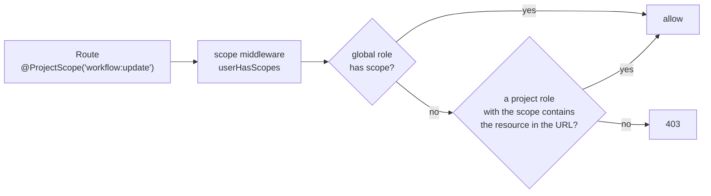

# Authorization

Read this when you add a route, a scope, or a role. Also read it to learn who may see a workflow or a credential.

## What it is

Authorization in n8n is scope based. A **scope** is a string `resource:operation`, such as `workflow:read`. A **role** is a named set of scopes. Every user has one global role, and each project membership has a project role. Projects own workflows and credentials, not users. The rows in `shared_workflow` and `shared_credentials` link a resource to a project and carry a sharing role, such as `workflow:owner`. Every user has a personal project. Team projects need a license.

*The URL identifies the resource. The resource identifies the project. The project role gives the answer. Without a resource id in the URL, only the global role can answer. That is what `@GlobalScope` means.*

## Why it has this shape

- **One source of truth for scopes.** `@n8n/permissions` depends only on zod. The backend and the editor both use it. `RESOURCES` defines every resource and its operations, and the `Scope` type comes from it.
- **Decorators only record metadata.** `@GlobalScope` and `@ProjectScope` stash the scope. `ControllerRegistry` turns it into a middleware that runs after authentication and after the license check.
- **The URL decides the check.** `userHasScopes` tries the global role first. Then it looks for a `credentialId`, `workflowId`, `dataTableId`, or `projectId` in the URL parameters. If a `@ProjectScope` route has none of these, it throws an error that tells the developer to use `@GlobalScope`.
- **Roles in the database.** Since August 2025, roles and scopes are rows in `role`, `scope`, and `role_scope`. This made custom project roles possible under a license. The static role maps still exist as the defaults for the built-in roles.
- **List queries narrow by project.** A list endpoint cannot check each row through the URL. It asks `ProjectScopeService` for the projects where the user has the scope, and filters on those.

## Where it lives

| Part | File | Symbol |
|---|---|---|
| Resources and operations | `packages/@n8n/permissions/src/constants.ee.ts` | `RESOURCES` |
| API key resources | `packages/@n8n/permissions/src/constants.ee.ts` | `API_KEY_RESOURCES` |
| Built-in role maps | `packages/@n8n/permissions/src/roles/role-maps.ee.ts` | `GLOBAL_OWNER_SCOPES` |
| Route decorators | `packages/@n8n/decorators/src/controller/scoped.ts` | `ProjectScope` |
| Scope middleware | `packages/cli/src/controller.registry.ts` | `createScopedMiddleware` |
| The check | `packages/cli/src/permissions.ee/check-access.ts` | `userHasScopes` |
| Accessible projects for lists | `packages/@n8n/backend-services/src/services/project-scope.service.ts` | `ProjectScopeService.getProjectIds` |
| Roles from the database | `packages/@n8n/backend-services/src/services/role.service.ts` | `RoleService.isRoleLicensed` |
| Role cache | `packages/@n8n/backend-services/src/services/role-cache.service.ts` | `RoleCacheService` |
| Role routes | `packages/cli/src/controllers/role.controller.ts` | `RoleController` |

The recipe for a new scope is in `.agents/skills/protect-endpoints/SKILL.md`.

## What is moving

New scopes keep arriving, for example `nodeTypePolicy:manage`. `packages/@n8n/permissions/src/principal.ee.ts` adds a `Principal` type for the resolved caller, with room for service accounts. `check-access.ts` uses repositories directly, which is older than the persistence boundary rule.

## Read more

- [Patterns](../patterns.md#authorization-and-licensing-on-routes)
- [Enterprise gating](../enterprise-gating.md)
- [Authentication and sessions](authentication.md)
- docs.n8n.io: RBAC pages
