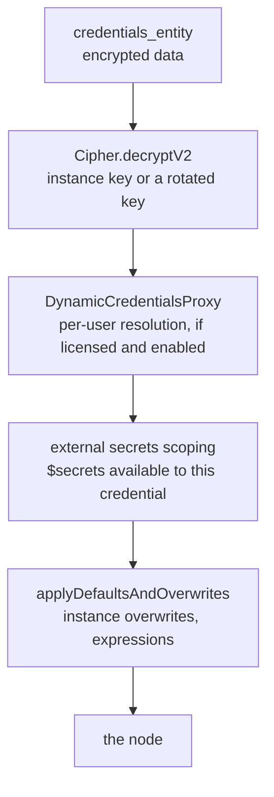

# Credentials

Read this when you touch how secrets are stored, decrypted, resolved at run time, refreshed through OAuth, or supplied from an external secret store.

## What it is

Credentials are the encrypted secrets that nodes use to call external services. A credential row stores a ciphertext and a type name. A `shared_credentials` row ties it to the project that owns it or that it is shared with. The backend decrypts a credential only when a node asks for it at run time. Then it adds per-user resolution, external secrets, and instance-wide overwrites.

*`CredentialsHelper.getDecrypted` runs this chain for every credential that a node asks for. Nothing decrypted is stored.*

## Why it has this shape

- **Decrypt where the node runs.** Workers decrypt too, so every process type holds the encryption key.
- **Key ids in the ciphertext.** With key rotation on, `Cipher.encryptV2` prefixes the ciphertext with the id of the active data encryption key. `decryptV2` reads the prefix to pick the key. Ciphertext without a prefix is the legacy format and uses the instance key. New code must use only `encryptV2` and `decryptV2`. The rules in `packages/@n8n/eslint-config/src/configs/encryption-boundary.ts` enforce this.
- **Optional features behind proxies.** Core code calls a proxy, and a module supplies the handler. The dynamic credentials proxy and the OAuth2 JWE proxy follow this pattern. Core then works the same way when the module is absent.
- **Resolvers for per-user secrets.** A resolver is a class with `@CredentialResolver()`. It gets and sets a secret for a credential and an identity. The n8n resolver backs "private credentials", one secret per user. Other resolvers serve external identities. Manual runs skip resolution unless an identity context is present, so that canvas tests can use static data.
- **Instance credentials are not for workflows.** Owners and admins manage these rows. They have no project owner, and workflows cannot use them. Trusted backend features reach them only through `InstanceCredentialBroker`.

## Where it lives

| Part | File | Symbol |
|---|---|---|
| Run-time resolution chain | `packages/cli/src/credentials-helper.ts` | `CredentialsHelper.getDecrypted` |
| REST routes | `packages/cli/src/credentials/credentials.controller.ts` | `CredentialsController` |
| Encryption | `packages/core/src/encryption/cipher.ts` | `Cipher.decryptV2` |
| Key provider wiring at startup | `packages/cli/src/encryption/encryption-bootstrap.service.ts` | `EncryptionBootstrapService` |
| OAuth flows | `packages/cli/src/oauth/oauth.service.ts` | `OauthService` |
| OAuth2 callback | `packages/cli/src/controllers/oauth/oauth2-credential.controller.ts` | `OAuth2CredentialController` |
| Instance-wide overwrites | `packages/cli/src/credentials-overwrites.ts` | `CredentialsOverwrites` |
| Per-user resolvers | `packages/cli/src/modules/dynamic-credentials.ee/dynamic-credentials.module.ts` | `isEnvFeatureEnabled` |
| Secrets from trigger payloads | `packages/cli/src/modules/runtime-credentials/runtime-credentials.module.ts` | `N8N_ENV_FEAT_RUNTIME_CREDENTIALS` |
| External secret stores | `packages/cli/src/modules/external-secrets.ee/external-secrets.module.ts` | `ExternalSecretsModule` |
| n8n as an OAuth 2.1 server | `packages/cli/src/modules/oauth-server/oauth-server.module.ts` | `OAuthServerModule` |
| Credentials for trusted features | `packages/cli/src/credentials/instance-credential-broker.ts` | `InstanceCredentialBroker` |

External secrets appear as `$secrets.<provider>.<name>` in credential expressions only. The `oauth-server` module issues tokens for the instance MCP server and other protected resources. Quick connect now lives in `packages/modules/quick-connect/backend`.

## What is moving

Several parts sit behind `N8N_ENV_FEAT_*` gates while they mature: key rotation, runtime credentials, and external resolvers for dynamic credentials. Key seeding and key provider wiring now run in `BaseCommand` for every entry point, not in the module.

## Read more

- `packages/cli/src/credentials/instance-credentials.md`, how a feature integrates with instance credentials
- `.agents/skills/node-add-oauth/SKILL.md`
- [Enterprise gating](../enterprise-gating.md)
- docs.n8n.io: credentials, external secrets, and the encryption key pages
