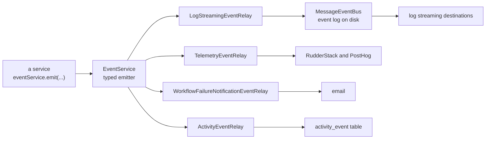

# Observability and audit

Read this when you add an event or a metric. Also read it when you touch log streaming, telemetry, tracing, redaction, the security audit, or insights.

## What it is

This area covers every path by which n8n reports on itself. `EventService` is the one typed emitter for backend events. Relays pass its events on to other consumers. The `MessageEventBus` serves licensed **log streaming**. RudderStack and PostHog receive **product telemetry**. One relay sends an email on the first production failure, and one writes the `activity_event` table. Next to this sit the Prometheus `/metrics` endpoint, the OpenTelemetry tracing module, execution data **redaction**, and the `n8n audit` security report. **Insights** turns execution counts into period rows for the dashboard.

*One emit, several consumers. To add an event, add its payload type to an event map, emit it, and handle it in the relays that need it.*

## Why it has this shape

- **The service is shared, the payloads are not.** `EventService` lives in `@n8n/backend-services` with an empty `EventMap`. Each owner adds payload types through module augmentation. The CLI does this in `packages/cli/src/events/event-map.ts`, so the shared package does not depend on CLI code.
- **The event bus is also the crash recovery log.** `MessageEventBus.send` writes each message to a rotating log on disk before it emits to destinations. At startup, the bus reads the log and marks executions with no final event as crashed, or recovers them. When no destination listens, the bus confirms each message at once, so that the log does not grow without limit. For this reason the bus stays in core, while the destinations live in the `log-streaming` module.
- **Event names are a public contract.** Log streaming destinations outside n8n filter on names such as `n8n.workflow.*` and `n8n.audit.*`. A rename breaks those filters.
- **Telemetry events have a registry.** `@n8n/telemetry` holds typed event definitions. `Telemetry.track` validates the properties when it gets a definition, and logs a warning on a mismatch. Adoption is gradual. The `n8n:telemetry` skill covers new events.
- **One place decides which runs count.** `packages/@n8n/backend-services/src/executions/counting-rules.ts` defines which runs count for billing, insights, time saved, and execution limits. Insights collection asks `isInsightsProduction` instead of its own mode list.
- **Redaction through a proxy.** Execution code depends on `ExecutionRedactionServiceProxy`. The `redaction` module supplies the handler. The policy is captured when an execution starts and applied when someone reads the data.

## Where it lives

| Part | File | Symbol |
|---|---|---|
| Typed emitter | `packages/@n8n/backend-services/src/events/event.service.ts` | `EventService` |
| CLI event payloads | `packages/cli/src/events/event-map.ts` | `EventMap` |
| Relay base class | `packages/cli/src/events/relays/event-relay.ts` | `EventRelay.setupListeners` |
| Event bus and its log | `packages/cli/src/eventbus/message-event-bus/message-event-bus.ts` | `MessageEventBus.send` |
| Log streaming destinations | `packages/cli/src/modules/log-streaming.ee/log-streaming-destination.service.ts` | `LogStreamingDestinationService` |
| Product telemetry | `packages/cli/src/telemetry/index.ts` | `Telemetry.track` |
| Prometheus metrics | `packages/cli/src/metrics/prometheus/prometheus.service.ts` | `PrometheusMetricsService` |
| Tracing | `packages/cli/src/modules/otel/otel.service.ts` | `OtelService` |
| Redaction proxy | `packages/@n8n/backend-services/src/executions/execution-redaction-proxy.service.ts` | `ExecutionRedactionServiceProxy` |
| Which runs count | `packages/@n8n/backend-services/src/executions/counting-rules.ts` | `isInsightsProduction` |
| Insights collection | `packages/modules/insights/backend/src/insights-collection.service.ts` | `InsightsCollectionService` |
| Security audit | `packages/cli/src/security-audit/security-audit.service.ts` | `SecurityAuditService.run` |

Run `pnpm --filter @n8n/telemetry catalog` to list the registered telemetry events.

## Per process

The event bus and the log streaming relay run on every process type, each with its own log file. Tracing runs on mains, workers, and webhook processes. Insights collects on mains and webhook processes. Compaction is a cluster system task.

## What is moving

Insights is a separate package under `packages/modules/insights`, with a backend and a frontend part. Most Prometheus metrics are services in `packages/cli/src/metrics/prometheus/`, each with its own `N8N_METRICS_INCLUDE_*` flag. The version, active workflow count, and leader role metrics have no flag of their own.

## Read more

- [Roll out a change](../how-to/roll-out-a-change.md) for the metrics flags, health endpoints, log settings, and the event log file
- `packages/cli/src/modules/log-streaming.ee/README.md`, `packages/cli/src/modules/otel/README.md`
- `packages/@n8n/telemetry/README.md`
- [Patterns](../patterns.md#events-and-relays)
- docs.n8n.io: logging, log streaming, monitoring, and insights pages
