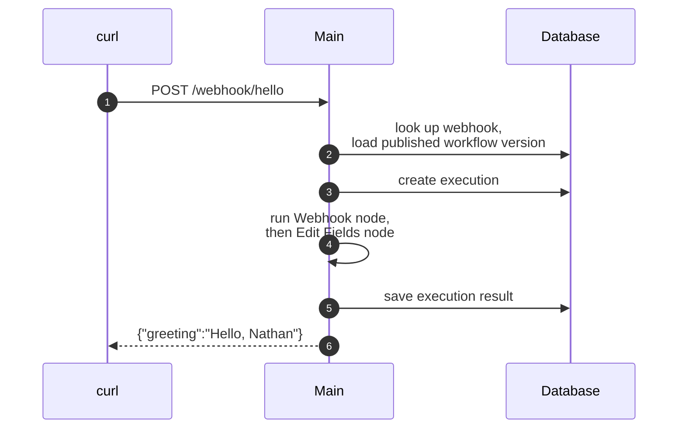

# Workflow execution

On [Start here](README.md), you called the production URL of the webhook in your workflow, and you got a greeting back. On this page, we follow that call through the main.

## Lookup

When your call arrives, the main looks up which workflow has a webhook with the path `hello` and the method `POST`. Then it loads the published version of that workflow. Edits to the draft do not change production until you publish them.

## Start

Every execution starts the same way, whether a webhook call, a schedule, a manual execution, a retry, another workflow, or an agent started it. n8n creates the execution in the database, and then runs it in the main in regular mode, or on a worker in queue mode.

## Engine

The engine keeps a stack of nodes that are ready to run. It takes a node, runs it with its input items, and adds the nodes that come next to the stack. It stops when the stack is empty. So the engine runs one branch to its end before it starts the next. Workflows from before n8n 1.0 keep the old breadth-first order, because the order is a setting of each workflow.

In your execution, the Webhook node turned the request into one item, with the request body under `body`. The Edit Fields node then evaluated its expression `'Hello, ' + $json.body.name` for this item, in a sandbox, and output one item, `{"greeting":"Hello, Nathan"}`.

In other workflows, a node that calls a service gets its credential, decrypted only for this execution. A Code node sends its code to a **task runner**, a separate process for user code.

## Lifecycle hooks

The engine never writes to the database itself. Instead, it calls **lifecycle hooks** before and after each node and the whole workflow. The hooks save progress and the result, start an error workflow after a failure, and send progress to the editor. Modules can add their own hooks.

## Response

The Webhook node in your workflow responds **When Last Node Finishes**, so the main waited for the last node and answered with its output. The other options answer at once, or allow a **Respond to Webhook** node in the workflow to give the answer.

After the execution, the database holds its status, mode, start and end times, and its data, i.e. every item of every node. A setting can send that data to blob storage instead.

## Other executions

Your call took the simplest path. Other executions differ from it in these common ways:

- **Manual execution:** When you clicked **Execute**, the main listened for a single call to the test URL. A manual execution can also use **pinned data**, i.e. fixed output saved on a node, to test the next nodes without the real call. Production executions ignore pinned data. When a user runs one node, the editor sends the run data that it already has, and the engine runs only the nodes on the path to that node whose input changed. In queue mode, a worker runs the manual execution, and a main relays the progress. This setup is `OFFLOAD_MANUAL_EXECUTIONS_TO_WORKERS=true`, and it is the only supported setup for queue mode.
- **Queue mode:** The main or webhook process that takes the call keeps the HTTP request open. When the worker sends the result back through the queue, that process answers.
- **Wait:** A Wait node pauses an execution. A short wait stays in memory, and a longer wait saves the execution to the database until the leader resumes it. A call to a resume URL can also end a wait, which is how forms and human-in-the-loop approvals work.
- **Sub-workflow:** An Execute Workflow node starts a child execution in the same process as the parent. By default, the parent waits for its result. An agent can also call a workflow as a tool, which starts a child execution as well.

A message to an agent starts an [agent turn](agent-turn.md) instead.

## Read next

- [Sandboxing](sandboxing.md): where Code nodes and expressions run.
- [Persistence](persistence.md): where n8n saves executions and their data.
- [APIs](apis.md#live-updates): how the editor gets the progress of a run.

## Quiz

1. The engine finishes a node. What saves the result to the database?
   - A. The engine itself.
   - B. A lifecycle hook.
   - C. The Webhook node.
   - D. The editor, when it receives the result.
2. You edit and save a published workflow, but you do not publish it again. A call to its production URL arrives. Which version runs?
   - A. The draft, because it is the last saved version.
   - B. The published version.
   - C. Both versions, one after the other.
   - D. None. The call fails until you publish the draft.
3. In queue mode, a Webhook node responds **When Last Node Finishes**. Which process sends the HTTP response?
   - A. The main or webhook process that holds the open request.
   - B. The worker, directly to the caller.
   - C. The leader, for all webhook calls.
   - D. Any main, because each one gets the result.
4. A Wait node waits for two days. What happens to the execution?
   - A. The process sleeps for two days.
   - B. The worker keeps the job for two days.
   - C. n8n saves it to the database, and the leader resumes it when it is due.
   - D. n8n fails the execution, because a wait has a limit.
5. In a manual execution, a user runs one node in the middle of a workflow. Which nodes does the engine run?
   - A. All nodes of the workflow, from the trigger.
   - B. Only the nodes on the path to that node whose input changed.
   - C. Only that node, with no input.
   - D. That node and all nodes after it.

Answers

1. B. The engine never writes to the database itself. It calls the hooks before and after each node and the whole workflow.
2. B. The main loads the published version of the workflow. Edits to the draft do not change production until you publish them.
3. A. The worker sends the result back through the queue.
4. C. Only a short wait stays in memory.
5. B. The editor sends the run data that it already has, so the engine runs only what changed.

