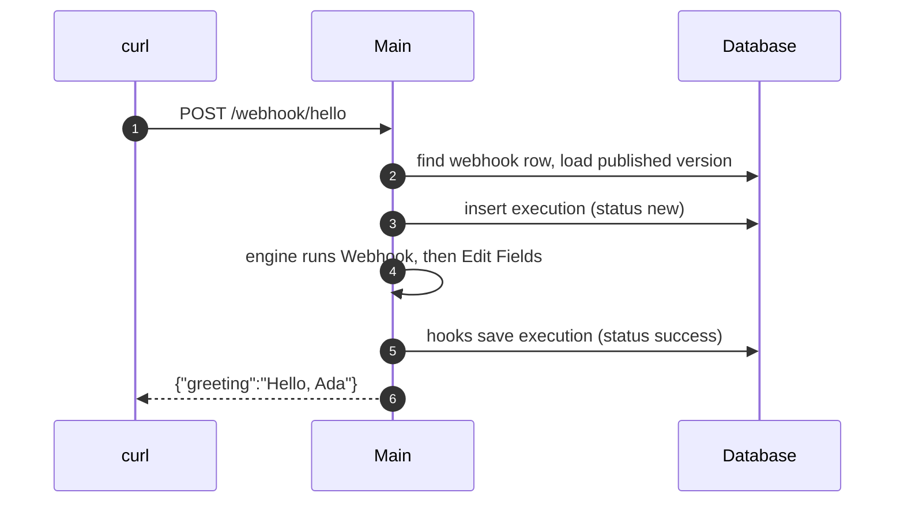

# Workflow execution

On [Start here](README.md), you sent `{"name":"Ada"}` to `/webhook/hello`, and you got `{"greeting":"Hello, Ada"}` back. This page follows that request on your one process. Then it shows what changes for a manual run, in queue mode, and for a workflow that waits.

## Lookup

Express has no route for each workflow. One route takes every request under `/webhook/`. The handler looks up the path `hello` and the method `POST` in `webhook_entity`, the row that the publication created. Then it loads the published version of the workflow. The draft does not matter here.

The webhook route runs before Express parses the body as JSON. A Webhook node can therefore also take files and raw bytes.

## Runner

`WorkflowRunner` starts every execution in n8n: webhook calls, schedules, manual runs, retries, calls from other workflows, and calls from agents. It inserts a row in `execution_entity` with the status `new`. Then it decides where the execution runs. On your laptop it runs in this process. In queue mode it goes to a worker.

## Engine

The engine keeps a stack of nodes that are ready to run. It takes a node, runs it with its input items, and adds the nodes that come next to the stack. It stops when the stack is empty.

In your run, the Webhook node turned the request into one item with the keys `body`, `headers`, `params`, `query`, `webhookUrl`, and `executionMode`. The Edit Fields node then read its field value. That value is an expression, so n8n evaluated `'Hello, ' + $json.body.name` for this item. Expressions run in a V8 isolate, apart from the memory of the process. The Edit Fields node gave one item, `{"greeting":"Hello, Ada"}`.

Other workflows reach further. A node that calls a service gets its credential, decrypted only for this run. A Code node sends its code to a **task runner**, a separate process for user code.

## Hooks

The engine never writes to the database itself. The runner gives it **lifecycle hooks**, which run before and after each node and the whole workflow. The hooks save progress, save the final result, start an error workflow after a failure, and send progress to the editor. Modules add their own hooks.

A worker gets a different set of hooks than a main. Code that must run after every execution therefore goes into a hook, not into the engine.

A workflow can choose not to keep successful runs. Then the last hook deletes the row. The row still exists during the run, because a cancel or a resume finds the execution by its id.

## Response

You set **Respond** to **When Last Node Finishes**, so the handler waited for the engine and returned the output of the last node. The other two options answer at once, or let a **Respond to Webhook** node in the workflow give the answer.

After the run, the row in `execution_entity` holds the status, the mode, and the times. The data of the run, with every item of every node, went to `execution_data`. A setting can send that data to blob storage instead. Each row records where its data is.

## Manual run

The call to `/webhook-test/hello` took a slightly different path. When you clicked **Execute**, the editor asked the main to listen for one call on the test URL. The main kept that registration in a cache, not in `webhook_entity`, and removed it after the call.

The run itself used the same runner and engine with the mode `manual`. The hooks for a manual run send each node result to the browser tab that started it. The canvas showed `1 item` because of these messages. A manual run can also use **pinned data**. Pinned data is fixed output that a user saves on a node, to test the next nodes without the real call.

## Queue mode

A main or a webhook process takes the request and inserts the row. Then it adds a job with the id of the execution to the queue in Redis, and it keeps the HTTP request open. A worker takes the job, loads the execution, and runs the same engine with the worker hooks.

The worker sends the response back through the queue. Every main and webhook process hears it, but only the one that holds the open request answers. If the worker dies, n8n marks the execution `crashed`.

## Waits

A **Wait** node pauses a run. A short wait sleeps in the process. A longer wait saves the execution with the status `waiting` and a time. The leader checks for due executions every minute and resumes them from the Wait node. A call to a resume URL can also end the wait, which is how forms and human approvals work.

## Sub-workflows

An **Execute Workflow** node starts a child execution. The child runs in the same process as the parent, also on a worker, and by default the parent waits for its result.

An agent can call a workflow as a tool, and that also creates an execution. A message to an agent does not. [Agent turn](agent-turn.md) follows one.

## Quiz

1. Your code must run after every execution, on mains and on workers. Where does it go?
   - A. In the execution engine, after the last node.
   - B. In the webhook controller, after the response.
   - C. In a lifecycle hook.
   - D. In `WorkflowRunner`, after the call to the engine.
2. How does the handler find the workflow for `POST /webhook/hello`?
   - A. Express has one route for each published workflow.
   - B. It looks up the path and the method in `webhook_entity`, then loads the published version.
   - C. It loads the draft with that path.
   - D. It asks the leader, which holds the webhooks in memory.
3. In queue mode, the Webhook node answers "When Last Node Finishes". Which process sends the HTTP response?
   - A. The main or webhook process that holds the open request. The worker sends the result back through the queue.
   - B. The worker, directly to the caller.
   - C. The leader, for all webhook calls.
   - D. Any main, because each one gets the result.
4. A workflow does not keep successful runs. Why does it still get a row in `execution_entity`?
   - A. Billing counts the rows at the end of each day.
   - B. The engine writes each item to the row.
   - C. The row holds the job for Redis.
   - D. A cancel or a resume finds the execution by its id during the run. The last hook deletes the row.
5. A Wait node waits for two days. What happens to the execution?
   - A. The process sleeps for two days.
   - B. The worker keeps the job for two days.
   - C. n8n saves it with the status `waiting` and a time. The leader resumes it when it is due.
   - D. n8n fails the execution, because a wait has a limit.

Answers

1. C. In a lifecycle hook. The engine never writes to the database itself. The runner gives it hooks, and a worker gets its own set of hooks.
2. B. It looks up the path and the method in `webhook_entity`, then loads the published version. One route takes every request under `/webhook/`. The draft does not matter for a production call.
3. A. The main or webhook process that holds the open request. The worker sends the result back through the queue. Every main and webhook process hears the result, but only the one that holds the open request answers.
4. D. A cancel or a resume finds the execution by its id during the run. The last hook deletes the row. The row exists during the run, and the last hook deletes it after a success.
5. C. n8n saves it with the status `waiting` and a time. The leader resumes it when it is due. A short wait sleeps in the process. A longer wait goes to the database, and the leader checks every minute.

