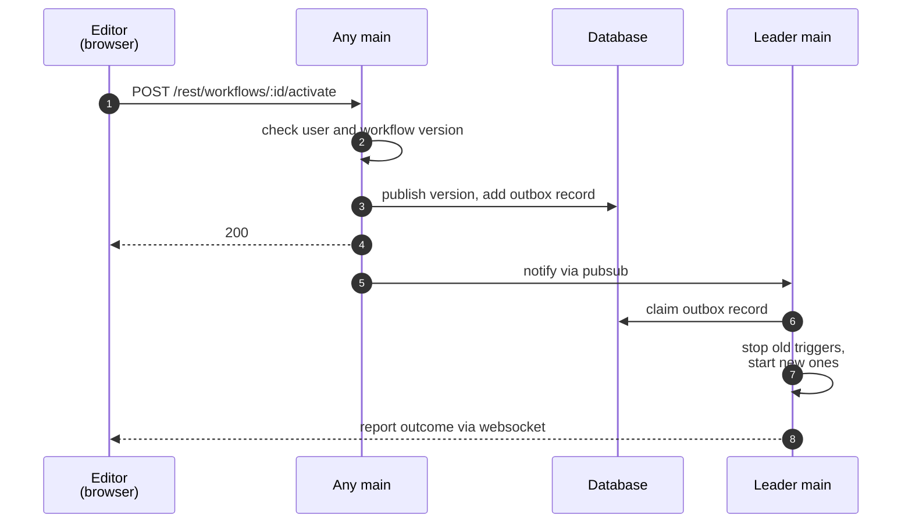

# Workflow publication

On [Start here](README.md), you clicked **Publish**, and the production URL of the webhook in your workflow went live. On this page, we follow that click through the backend.

## Versions

A workflow has a **draft**, which is the last saved version, and a **published version**, which runs in production. Publishing makes the draft the published version. n8n keeps each saved version in the workflow history, so a user can publish an older version again.

## Checks

First, the main checks that the user may publish the workflow and that the version can run (e.g. that its webhook path is free). Policies (e.g. a required review) can also refuse the publication.

The main runs all checks before it changes anything, so a refused publication leaves the previous version live. Every way to publish (e.g. editor, public API, or source control) runs the same checks.

## Outbox

In one transaction, the main publishes the version and saves a task to start its triggers. This task is a record in the **publication outbox**. Then the main answers 200.

The main does not start the triggers during the request. Starting a trigger can change another service (e.g. create a webhook in a GitHub repository), and a database rollback cannot undo that change. With the outbox, the published version and the task to start its triggers are always saved together.

A 200 therefore means that the version is published, not that the triggers are live.

## Trigger start

The leader starts the triggers. In regular mode, the main is also the leader. If the leader stops before it finishes, another main picks up the task. When a main becomes the leader (e.g. at startup), it starts the triggers of every published workflow in the same way.

The leader compares the old and new versions: it stops removed triggers, starts new ones, and leaves the rest running. Each kind of trigger runs in its own way:

| Trigger | How it runs |
|---|---|
| Webhook | Instance sends each call for its path and method to the workflow. No two workflows can share a path and method |
| Poller | Leader polls the source |
| Trigger that holds a connection (e.g. to a message queue) | Leader keeps the connection open |
| Schedule | Any main starts each due run, from a job in the database |

Your workflow has a webhook trigger, so after the publication, each call to its production URL starts an execution. [Workflow execution](workflow-execution.md) follows one of these calls.

## Outcome

The leader records whether each trigger started. If one trigger fails, the others still run, and the editor shows the workflow as a partial publish. The editor learns the outcome via websocket.

The leader also checks regularly that the running triggers match the published versions, and fixes any mismatch (e.g. after a crash).

## Quiz

1. The editor gets a 200 for its publish request. Are the triggers live?
   - A. Yes.
   - B. Not yet.
   - C. Yes on one main, and no in multi-main.
   - D. No. Nothing is saved yet.
2. A check refuses the publication because the webhook path is taken. What runs now?
   - A. The previous published version.
   - B. No version.
   - C. The new version, without its webhook.
   - D. The draft, until a user fixes the path.
3. One of three triggers fails to start. What is the state of the workflow?
   - A. n8n rolls back the publication.
   - B. No trigger runs until all three start.
   - C. It is a partial publish.
   - D. The workflow goes back to the previous version.

Answers

1. B. The main answers after the transaction. The leader starts the triggers after that, and a websocket message reports the outcome.
2. A. A refused publication changes nothing, so the previous version stays published.
3. C. The leader records whether each trigger started. One failure does not stop the others.

