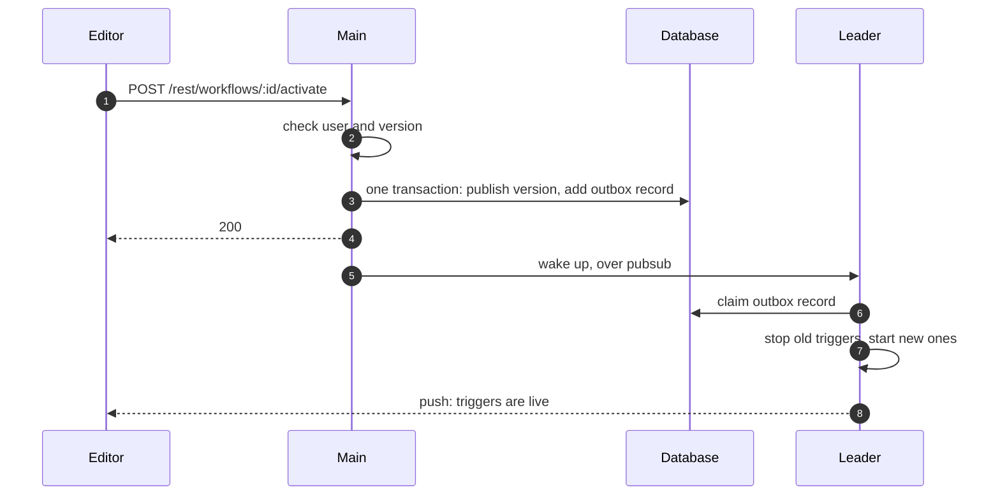

# Workflow publication

On [Start here](README.md), you clicked **Publish**, and `/webhook/hello` started to answer. This page follows that click through the backend.

## Versions

A workflow row points to two versions. `versionId` is the draft, the last version that someone saved. `activeVersionId` is the published version. A save moves the first pointer, and a publication moves the second one to the draft. Each saved version stays in the workflow history, so a user can publish an older version again.

## Checks

The editor sends `POST /rest/workflows/:id/activate`. The main checks that the user has the permission `workflow:publish` in the project of the workflow. Then it checks the version. Another user can have saved a newer draft in the meantime. Another workflow can own the same webhook path. A node can be one that this instance cannot run. Policies, such as a required review, can also refuse the publication.

All checks run before the first write. A refused publication therefore leaves the previous version live. The editor, the public API, MCP clients, and source control all publish through the same service, so the checks apply to each of them.

## Outbox

The main moves the pointer, writes a history row, and adds a record to the **publication outbox**, all in one transaction. Then it answers 200.

The main does not start the triggers in the request. To start a trigger can mean a call to another service, for example to create a webhook in a GitHub repository. A database transaction cannot undo that call. The outbox record is a task in the database that says "start the triggers of this version". The transaction makes sure that the pointer and the task never disagree.

The 200 therefore means that the version is published. It does not mean that the triggers are live yet.

## Trigger start

The main wakes the leader with a pubsub command. On your laptop, the main is also the leader. The leader claims the outbox record with a lease. If the leader dies before it finishes, another main takes the record when the lease expires.

The leader compares the triggers of the old version and the new version. It stops the triggers that are gone, starts the new ones, and leaves the others running. Each kind of trigger starts in its own way:

| Trigger | How it starts |
|---|---|
| Webhook | A row in the table `webhook_entity`, with the path and the method as its key. A second workflow with the same path cannot get a row |
| Poller, or a trigger that holds a connection | An object in the memory of the leader. It polls, or it keeps a connection open, such as to a message queue |
| Schedule | Rows for the scheduler in the database, so that any main can fire them |

Your Day 1 workflow has a webhook trigger. After the publication, a row with the path `hello` and the method `POST` exists. Each call to `/webhook/hello` starts with a lookup of that row. [Workflow execution](workflow-execution.md) continues from there.

## Outcome

The leader records a status for each trigger. If one trigger fails to start, the others still start, and the workflow stays published with the status `partial`. The editor learns the outcome through push.

The leader also checks on a timer that the running triggers match the published versions. When they do not match, it adds a new outbox record. This repairs a lost wake-up or a crash.

## Quiz

1. `POST /rest/workflows/:id/activate` returns 200. Are the triggers live?
   - A. Yes. The request waits until the leader starts the triggers.
   - B. Not yet. The version is published and the outbox record is committed. A push message tells the editor later.
   - C. Yes on one main, and no in multi-main.
   - D. No. The 200 means only that the checks passed, and nothing is written yet.
2. Another workflow already owns the webhook path, so a check refuses the publication. What runs now?
   - A. The previous published version, because all checks run before the first write.
   - B. No version. The refused publication unpublishes the workflow.
   - C. The new version, without its webhook.
   - D. The draft, until a user fixes the path.
3. Why does the main not start the triggers inside the request transaction?
   - A. The request would take longer than the HTTP timeout.
   - B. Triggers start only after a restart of the process.
   - C. The transaction locks the table `webhook_entity`.
   - D. To start a trigger can call another service, and a database transaction cannot undo that call.
4. A workflow has three triggers, and one of them fails to start. What is the state of the workflow?
   - A. n8n rolls back the publication, and no trigger runs.
   - B. The leader retries until all three triggers start, and none run until then.
   - C. It stays published with the status `partial`, and the other two triggers run.
   - D. The workflow goes back to the previous version.
5. The leader dies after it claims the outbox record. What happens to the record?
   - A. It is lost, and the user must publish again.
   - B. Another main takes it when the lease expires.
   - C. A worker takes it from the queue in Redis.
   - D. The editor sends the request again.

Answers

1. B. Not yet. The version is published and the outbox record is committed. A push message tells the editor later. The main answers after the transaction. The leader starts the triggers after that, and push reports the outcome.
2. A. The previous published version, because all checks run before the first write. A refused publication writes nothing, so the previous version stays live.
3. D. To start a trigger can call another service, and a database transaction cannot undo that call. The outbox record is a task in the database. The transaction keeps the pointer and the task in agreement.
4. C. It stays published with the status `partial`, and the other two triggers run. The leader records a status for each trigger. One failure does not stop the others.
5. B. Another main takes it when the lease expires. The leader claims the record with a lease. A timer also adds a new record when the triggers do not match the published versions.

