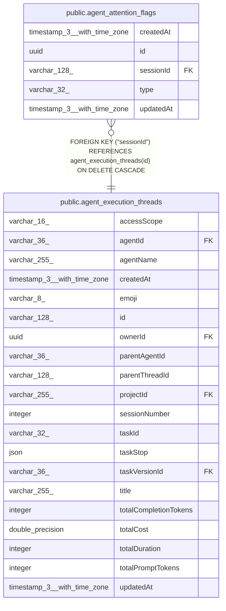

# public.agent_attention_flags

## Columns

| Name | Type | Default | Nullable | Children | Parents | Comment |
| ---- | ---- | ------- | -------- | -------- | ------- | ------- |
| createdAt | timestamp(3) with time zone | CURRENT_TIMESTAMP(3) | false |  |  |  |
| id | uuid |  | false |  |  | UUIDv7 returned to clients for explicit dismissal |
| sessionId | varchar(128) |  | false |  | [public.agent_execution_threads](public.agent_execution_threads.md) | Session that needs administrator attention |
| type | varchar(32) |  | false |  |  | Attention reason: session-error |
| updatedAt | timestamp(3) with time zone | CURRENT_TIMESTAMP(3) | false |  |  |  |

## Constraints

| Name | Type | Definition |
| ---- | ---- | ---------- |
| CHK_agent_attention_flags_type | CHECK | CHECK (((type)::text = 'session-error'::text)) |
| FK_c4a1e0092b90219a7c4b951d7eb | FOREIGN KEY | FOREIGN KEY ("sessionId") REFERENCES agent_execution_threads(id) ON DELETE CASCADE |
| PK_1ffaef9b58ace90e2e2f817c04e | PRIMARY KEY | PRIMARY KEY (id) |
| agent_attention_flags_createdAt_not_null | n | NOT NULL "createdAt" |
| agent_attention_flags_id_not_null | n | NOT NULL id |
| agent_attention_flags_sessionId_not_null | n | NOT NULL "sessionId" |
| agent_attention_flags_type_not_null | n | NOT NULL type |
| agent_attention_flags_updatedAt_not_null | n | NOT NULL "updatedAt" |

## Indexes

| Name | Definition |
| ---- | ---------- |
| IDX_b9b809f51859fe693ada9a29dd | CREATE UNIQUE INDEX "IDX_b9b809f51859fe693ada9a29dd" ON public.agent_attention_flags USING btree ("sessionId", type) |
| PK_1ffaef9b58ace90e2e2f817c04e | CREATE UNIQUE INDEX "PK_1ffaef9b58ace90e2e2f817c04e" ON public.agent_attention_flags USING btree (id) |

## Relations

---

> Generated by [tbls](https://github.com/k1LoW/tbls)
