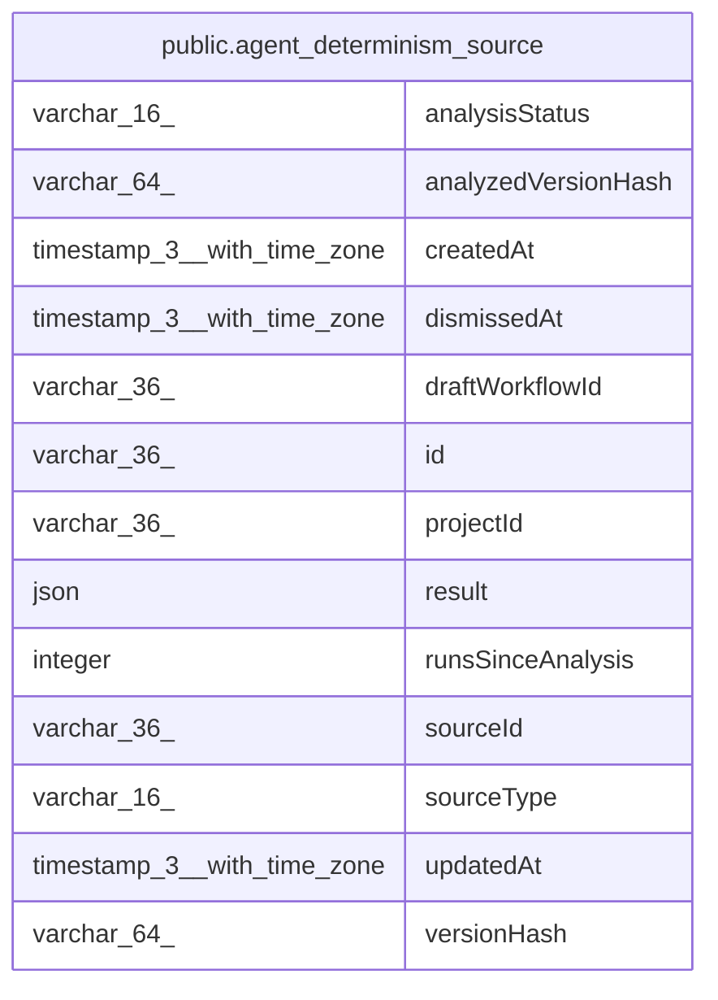

# public.agent_determinism_source

## Columns

| Name | Type | Default | Nullable | Children | Parents | Comment |
| ---- | ---- | ------- | -------- | -------- | ------- | ------- |
| analysisStatus | varchar(16) |  | false |  |  |  |
| analyzedVersionHash | varchar(64) |  | true |  |  |  |
| createdAt | timestamp(3) with time zone | CURRENT_TIMESTAMP(3) | false |  |  |  |
| dismissedAt | timestamp(3) with time zone |  | true |  |  |  |
| draftWorkflowId | varchar(36) |  | true |  |  |  |
| id | varchar(36) |  | false |  |  |  |
| projectId | varchar(36) |  | false |  |  |  |
| result | json |  | true |  |  |  |
| runsSinceAnalysis | integer | 0 | false |  |  |  |
| sourceId | varchar(36) |  | false |  |  |  |
| sourceType | varchar(16) |  | false |  |  |  |
| updatedAt | timestamp(3) with time zone | CURRENT_TIMESTAMP(3) | false |  |  |  |
| versionHash | varchar(64) |  | false |  |  |  |

## Constraints

| Name | Type | Definition |
| ---- | ---- | ---------- |
| PK_3f9fd2c6abbbd83f0600d2fad81 | PRIMARY KEY | PRIMARY KEY (id) |
| agent_determinism_source_analysisStatus_not_null | n | NOT NULL "analysisStatus" |
| agent_determinism_source_createdAt_not_null | n | NOT NULL "createdAt" |
| agent_determinism_source_id_not_null | n | NOT NULL id |
| agent_determinism_source_projectId_not_null | n | NOT NULL "projectId" |
| agent_determinism_source_runsSinceAnalysis_not_null | n | NOT NULL "runsSinceAnalysis" |
| agent_determinism_source_sourceId_not_null | n | NOT NULL "sourceId" |
| agent_determinism_source_sourceType_not_null | n | NOT NULL "sourceType" |
| agent_determinism_source_updatedAt_not_null | n | NOT NULL "updatedAt" |
| agent_determinism_source_versionHash_not_null | n | NOT NULL "versionHash" |

## Indexes

| Name | Definition |
| ---- | ---------- |
| IDX_4c9a157e747aa128183938bf1d | CREATE UNIQUE INDEX "IDX_4c9a157e747aa128183938bf1d" ON public.agent_determinism_source USING btree ("sourceType", "sourceId") |
| PK_3f9fd2c6abbbd83f0600d2fad81 | CREATE UNIQUE INDEX "PK_3f9fd2c6abbbd83f0600d2fad81" ON public.agent_determinism_source USING btree (id) |

## Relations

---

> Generated by [tbls](https://github.com/k1LoW/tbls)
