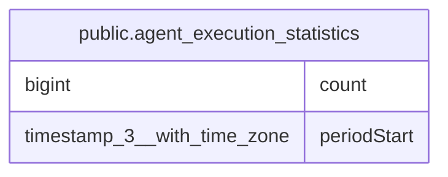

# public.agent_execution_statistics

## Columns

| Name | Type | Default | Nullable | Children | Parents | Comment |
| ---- | ---- | ------- | -------- | -------- | ------- | ------- |
| count | bigint |  | false |  |  |  |
| periodStart | timestamp(3) with time zone |  | false |  |  | Start of the UTC day |

## Constraints

| Name | Type | Definition |
| ---- | ---- | ---------- |
| PK_9e595a9ca973314fb192d7516a3 | PRIMARY KEY | PRIMARY KEY ("periodStart") |
| agent_execution_statistics_count_not_null | n | NOT NULL count |
| agent_execution_statistics_periodStart_not_null | n | NOT NULL "periodStart" |

## Indexes

| Name | Definition |
| ---- | ---------- |
| PK_9e595a9ca973314fb192d7516a3 | CREATE UNIQUE INDEX "PK_9e595a9ca973314fb192d7516a3" ON public.agent_execution_statistics USING btree ("periodStart") |

## Relations

---

> Generated by [tbls](https://github.com/k1LoW/tbls)
