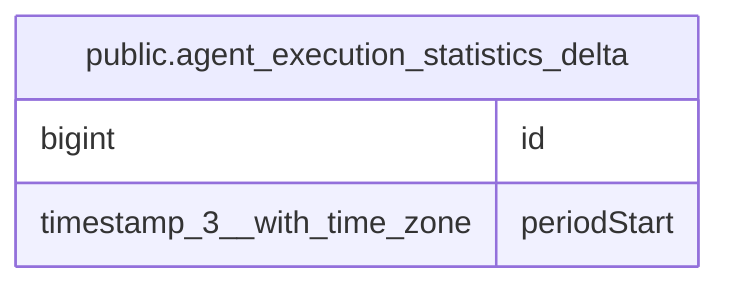

# public.agent_execution_statistics_delta

## Columns

| Name | Type | Default | Nullable | Children | Parents | Comment |
| ---- | ---- | ------- | -------- | -------- | ------- | ------- |
| id | bigint |  | false |  |  |  |
| periodStart | timestamp(3) with time zone |  | false |  |  | Start of the UTC day of the turn |

## Constraints

| Name | Type | Definition |
| ---- | ---- | ---------- |
| PK_bb860b7e532ec4863c0f5e37df9 | PRIMARY KEY | PRIMARY KEY (id) |
| agent_execution_statistics_delta_id_not_null | n | NOT NULL id |
| agent_execution_statistics_delta_periodStart_not_null | n | NOT NULL "periodStart" |

## Indexes

| Name | Definition |
| ---- | ---------- |
| PK_bb860b7e532ec4863c0f5e37df9 | CREATE UNIQUE INDEX "PK_bb860b7e532ec4863c0f5e37df9" ON public.agent_execution_statistics_delta USING btree (id) |

## Relations

---

> Generated by [tbls](https://github.com/k1LoW/tbls)
