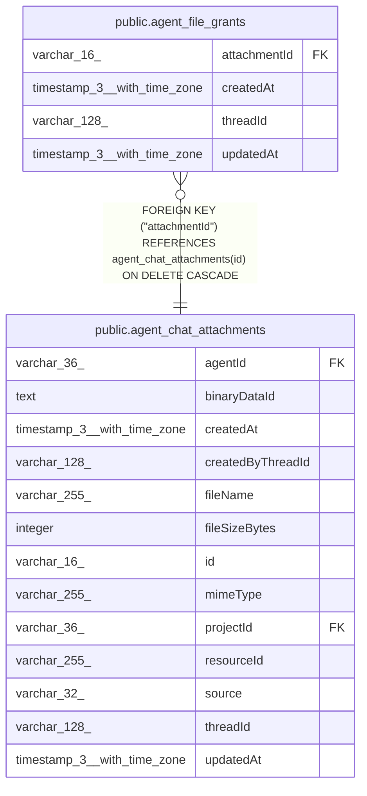

# public.agent_file_grants

## Columns

| Name | Type | Default | Nullable | Children | Parents | Comment |
| ---- | ---- | ------- | -------- | -------- | ------- | ------- |
| attachmentId | varchar(16) |  | false |  | [public.agent_chat_attachments](public.agent_chat_attachments.md) | Granted file |
| createdAt | timestamp(3) with time zone | CURRENT_TIMESTAMP(3) | false |  |  |  |
| threadId | varchar(128) |  | false |  |  | Thread that can read the file |
| updatedAt | timestamp(3) with time zone | CURRENT_TIMESTAMP(3) | false |  |  |  |

## Constraints

| Name | Type | Definition |
| ---- | ---- | ---------- |
| FK_10af5c940fc14c3637358924508 | FOREIGN KEY | FOREIGN KEY ("attachmentId") REFERENCES agent_chat_attachments(id) ON DELETE CASCADE |
| PK_921dd394e419fc4b733dc242922 | PRIMARY KEY | PRIMARY KEY ("attachmentId", "threadId") |
| agent_file_grants_attachmentId_not_null | n | NOT NULL "attachmentId" |
| agent_file_grants_createdAt_not_null | n | NOT NULL "createdAt" |
| agent_file_grants_threadId_not_null | n | NOT NULL "threadId" |
| agent_file_grants_updatedAt_not_null | n | NOT NULL "updatedAt" |

## Indexes

| Name | Definition |
| ---- | ---------- |
| PK_921dd394e419fc4b733dc242922 | CREATE UNIQUE INDEX "PK_921dd394e419fc4b733dc242922" ON public.agent_file_grants USING btree ("attachmentId", "threadId") |

## Relations

---

> Generated by [tbls](https://github.com/k1LoW/tbls)
