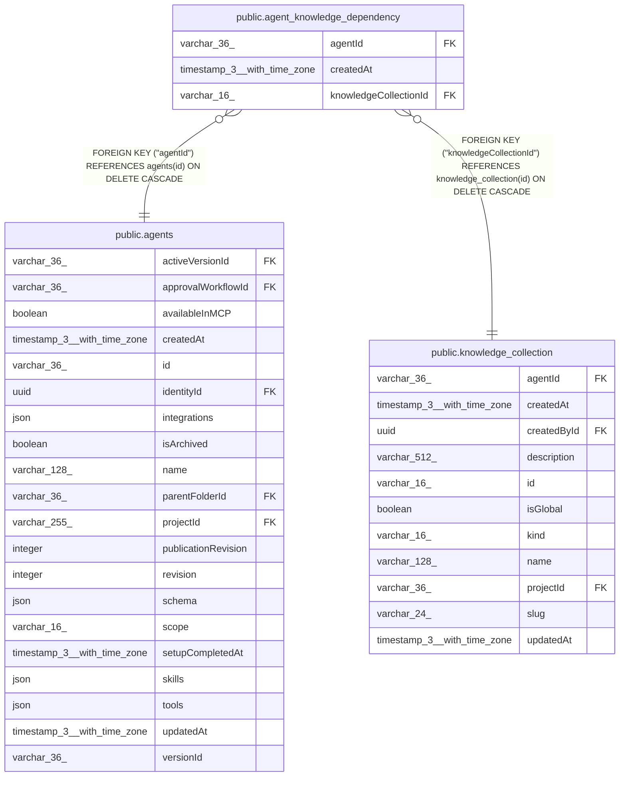

# public.agent_knowledge_dependency

## Columns

| Name | Type | Default | Nullable | Children | Parents | Comment |
| ---- | ---- | ------- | -------- | -------- | ------- | ------- |
| agentId | varchar(36) |  | false |  | [public.agents](public.agents.md) |  |
| createdAt | timestamp(3) with time zone | CURRENT_TIMESTAMP(3) | false |  |  |  |
| knowledgeCollectionId | varchar(16) |  | false |  | [public.knowledge_collection](public.knowledge_collection.md) |  |

## Constraints

| Name | Type | Definition |
| ---- | ---- | ---------- |
| FK_25c107679cd738e030bdd7f4a66 | FOREIGN KEY | FOREIGN KEY ("knowledgeCollectionId") REFERENCES knowledge_collection(id) ON DELETE CASCADE |
| FK_26036d7e3f258bf7f5a8d3d84c1 | FOREIGN KEY | FOREIGN KEY ("agentId") REFERENCES agents(id) ON DELETE CASCADE |
| PK_f78a22f5db2b1179bdcafb48bba | PRIMARY KEY | PRIMARY KEY ("agentId", "knowledgeCollectionId") |
| agent_knowledge_dependency_agentId_not_null | n | NOT NULL "agentId" |
| agent_knowledge_dependency_createdAt_not_null | n | NOT NULL "createdAt" |
| agent_knowledge_dependency_knowledgeCollectionId_not_null | n | NOT NULL "knowledgeCollectionId" |

## Indexes

| Name | Definition |
| ---- | ---------- |
| IDX_25c107679cd738e030bdd7f4a6 | CREATE INDEX "IDX_25c107679cd738e030bdd7f4a6" ON public.agent_knowledge_dependency USING btree ("knowledgeCollectionId") |
| PK_f78a22f5db2b1179bdcafb48bba | CREATE UNIQUE INDEX "PK_f78a22f5db2b1179bdcafb48bba" ON public.agent_knowledge_dependency USING btree ("agentId", "knowledgeCollectionId") |

## Relations

---

> Generated by [tbls](https://github.com/k1LoW/tbls)
