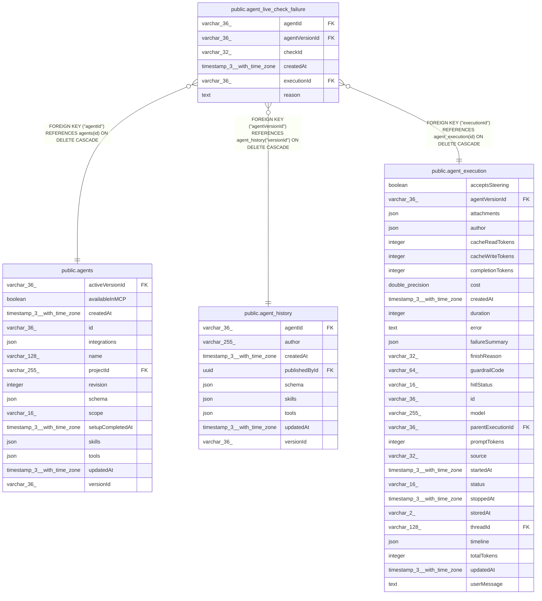

# public.agent_live_check_failure

## Columns

| Name | Type | Default | Nullable | Children | Parents | Comment |
| ---- | ---- | ------- | -------- | -------- | ------- | ------- |
| agentId | varchar(36) |  | false |  | [public.agents](public.agents.md) |  |
| agentVersionId | varchar(36) |  | false |  | [public.agent_history](public.agent_history.md) | Published agent version that ran the execution |
| checkId | varchar(32) |  | false |  |  | Code check that failed, from the agent-evals tool checks |
| createdAt | timestamp(3) with time zone | CURRENT_TIMESTAMP(3) | false |  |  |  |
| executionId | varchar(36) |  | false |  | [public.agent_execution](public.agent_execution.md) |  |
| reason | text |  | false |  |  | Why the check failed, as shown to the builder |

## Constraints

| Name | Type | Definition |
| ---- | ---- | ---------- |
| CHK_agent_live_check_failure_checkId | CHECK | CHECK ((("checkId")::text = ANY ((ARRAY['tool:empty_reply'::character varying, 'tool:tool_failed'::character varying, 'tool:repeated_call'::character varying, 'tool:acted_after_no'::character varying, 'tool:hit_limit'::character varying])::text[]))) |
| FK_7c9052dbeaefdb7d222a37dc804 | FOREIGN KEY | FOREIGN KEY ("agentVersionId") REFERENCES agent_history("versionId") ON DELETE CASCADE |
| FK_aaeac29fbbc9a9f3f5bd4f4f570 | FOREIGN KEY | FOREIGN KEY ("executionId") REFERENCES agent_execution(id) ON DELETE CASCADE |
| FK_e9f8050785b3263d8535bf6a848 | FOREIGN KEY | FOREIGN KEY ("agentId") REFERENCES agents(id) ON DELETE CASCADE |
| PK_3764c113fbee1e0235203e3fd09 | PRIMARY KEY | PRIMARY KEY ("executionId", "checkId") |
| agent_live_check_failure_agentId_not_null | n | NOT NULL "agentId" |
| agent_live_check_failure_agentVersionId_not_null | n | NOT NULL "agentVersionId" |
| agent_live_check_failure_checkId_not_null | n | NOT NULL "checkId" |
| agent_live_check_failure_createdAt_not_null | n | NOT NULL "createdAt" |
| agent_live_check_failure_executionId_not_null | n | NOT NULL "executionId" |
| agent_live_check_failure_reason_not_null | n | NOT NULL reason |

## Indexes

| Name | Definition |
| ---- | ---------- |
| IDX_e9f8050785b3263d8535bf6a84 | CREATE INDEX "IDX_e9f8050785b3263d8535bf6a84" ON public.agent_live_check_failure USING btree ("agentId") |
| IDX_f9e92761f8a9b1b8b6c1667b87 | CREATE INDEX "IDX_f9e92761f8a9b1b8b6c1667b87" ON public.agent_live_check_failure USING btree ("agentVersionId", "checkId") |
| PK_3764c113fbee1e0235203e3fd09 | CREATE UNIQUE INDEX "PK_3764c113fbee1e0235203e3fd09" ON public.agent_live_check_failure USING btree ("executionId", "checkId") |

## Relations

---

> Generated by [tbls](https://github.com/k1LoW/tbls)
