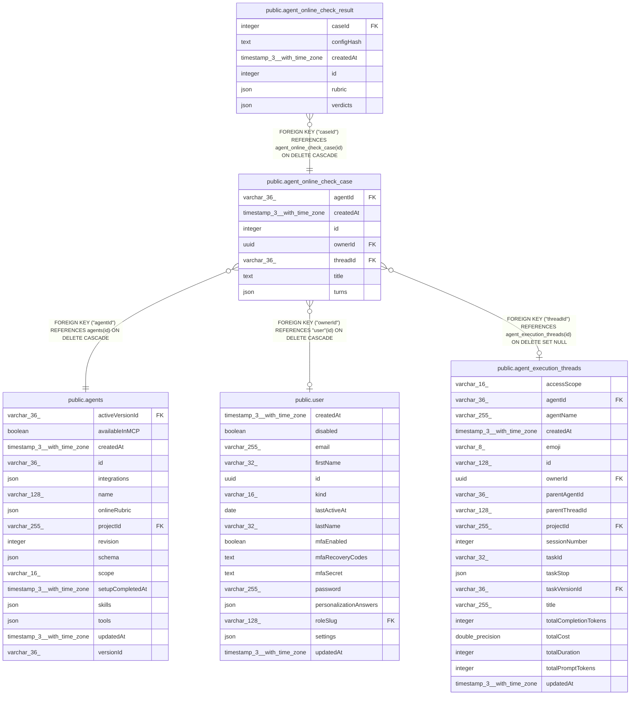

# public.agent_online_check_case

## Columns

| Name | Type | Default | Nullable | Children | Parents | Comment |
| ---- | ---- | ------- | -------- | -------- | ------- | ------- |
| agentId | varchar(36) |  | false |  | [public.agents](public.agents.md) |  |
| createdAt | timestamp(3) with time zone | CURRENT_TIMESTAMP(3) | false |  |  |  |
| id | integer |  | false | [public.agent_online_check_result](public.agent_online_check_result.md) |  |  |
| ownerId | uuid |  | true |  | [public.user](public.user.md) | Private session owner; null for a shared project session |
| threadId | varchar(36) |  | true |  | [public.agent_execution_threads](public.agent_execution_threads.md) | Source session; null after the session is deleted |
| title | text |  | false |  |  |  |
| turns | json |  | false |  |  | Fixed recorded conversation and tool timeline used for checks |

## Constraints

| Name | Type | Definition |
| ---- | ---- | ---------- |
| FK_0c29c5228e51f60abec88c55221 | FOREIGN KEY | FOREIGN KEY ("threadId") REFERENCES agent_execution_threads(id) ON DELETE SET NULL |
| FK_7682eae615389d171b08c60448a | FOREIGN KEY | FOREIGN KEY ("agentId") REFERENCES agents(id) ON DELETE CASCADE |
| FK_f1f3f3140085687ec765326693c | FOREIGN KEY | FOREIGN KEY ("ownerId") REFERENCES "user"(id) ON DELETE CASCADE |
| PK_56a739b95eb1c2577eb56611faf | PRIMARY KEY | PRIMARY KEY (id) |
| agent_online_check_case_agentId_not_null | n | NOT NULL "agentId" |
| agent_online_check_case_createdAt_not_null | n | NOT NULL "createdAt" |
| agent_online_check_case_id_not_null | n | NOT NULL id |
| agent_online_check_case_title_not_null | n | NOT NULL title |
| agent_online_check_case_turns_not_null | n | NOT NULL turns |

## Indexes

| Name | Definition |
| ---- | ---------- |
| IDX_0c29c5228e51f60abec88c5522 | CREATE INDEX "IDX_0c29c5228e51f60abec88c5522" ON public.agent_online_check_case USING btree ("threadId") |
| IDX_c8070d4ec8131270dbf8e0ec02 | CREATE UNIQUE INDEX "IDX_c8070d4ec8131270dbf8e0ec02" ON public.agent_online_check_case USING btree ("agentId", "threadId") |
| IDX_f1f3f3140085687ec765326693 | CREATE INDEX "IDX_f1f3f3140085687ec765326693" ON public.agent_online_check_case USING btree ("ownerId") |
| PK_56a739b95eb1c2577eb56611faf | CREATE UNIQUE INDEX "PK_56a739b95eb1c2577eb56611faf" ON public.agent_online_check_case USING btree (id) |

## Relations

---

> Generated by [tbls](https://github.com/k1LoW/tbls)
