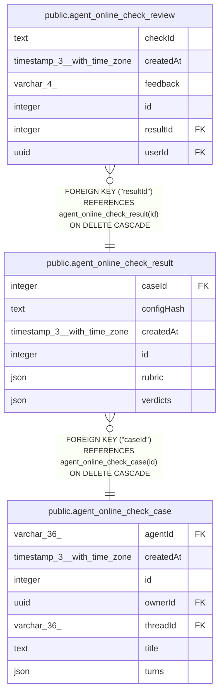

# public.agent_online_check_result

## Columns

| Name | Type | Default | Nullable | Children | Parents | Comment |
| ---- | ---- | ------- | -------- | -------- | ------- | ------- |
| caseId | integer |  | false |  | [public.agent_online_check_case](public.agent_online_check_case.md) |  |
| configHash | text |  | false |  |  | Agent configuration hash at assessment time |
| createdAt | timestamp(3) with time zone | CURRENT_TIMESTAMP(3) | false |  |  |  |
| id | integer |  | false | [public.agent_online_check_review](public.agent_online_check_review.md) |  |  |
| rubric | json |  | false |  |  | Checks and generation date used for this assessment |
| verdicts | json |  | false |  |  | One verdict and reason for each check |

## Constraints

| Name | Type | Definition |
| ---- | ---- | ---------- |
| FK_93833ba94399609db442c1feafc | FOREIGN KEY | FOREIGN KEY ("caseId") REFERENCES agent_online_check_case(id) ON DELETE CASCADE |
| PK_dd6182a6680c0ddf3ab41f9f0be | PRIMARY KEY | PRIMARY KEY (id) |
| agent_online_check_result_caseId_not_null | n | NOT NULL "caseId" |
| agent_online_check_result_configHash_not_null | n | NOT NULL "configHash" |
| agent_online_check_result_createdAt_not_null | n | NOT NULL "createdAt" |
| agent_online_check_result_id_not_null | n | NOT NULL id |
| agent_online_check_result_rubric_not_null | n | NOT NULL rubric |
| agent_online_check_result_verdicts_not_null | n | NOT NULL verdicts |

## Indexes

| Name | Definition |
| ---- | ---------- |
| IDX_93833ba94399609db442c1feaf | CREATE INDEX "IDX_93833ba94399609db442c1feaf" ON public.agent_online_check_result USING btree ("caseId") |
| PK_dd6182a6680c0ddf3ab41f9f0be | CREATE UNIQUE INDEX "PK_dd6182a6680c0ddf3ab41f9f0be" ON public.agent_online_check_result USING btree (id) |

## Relations

---

> Generated by [tbls](https://github.com/k1LoW/tbls)
