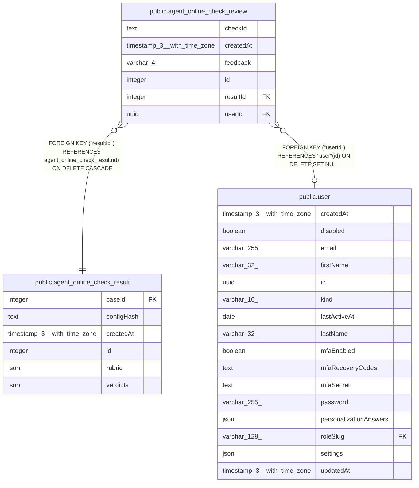

# public.agent_online_check_review

## Columns

| Name | Type | Default | Nullable | Children | Parents | Comment |
| ---- | ---- | ------- | -------- | -------- | ------- | ------- |
| checkId | text |  | false |  |  | Check ID in the assessment rubric |
| createdAt | timestamp(3) with time zone | CURRENT_TIMESTAMP(3) | false |  |  |  |
| feedback | varchar(4) |  | false |  |  | Human assessment of the recorded response |
| id | integer |  | false |  |  |  |
| resultId | integer |  | false |  | [public.agent_online_check_result](public.agent_online_check_result.md) |  |
| userId | uuid |  | true |  | [public.user](public.user.md) | Reviewer; null after the user is deleted |

## Constraints

| Name | Type | Definition |
| ---- | ---- | ---------- |
| CHK_agent_online_check_review_feedback | CHECK | CHECK (((feedback)::text = ANY ((ARRAY['good'::character varying, 'bad'::character varying])::text[]))) |
| FK_2b75b7a8b26454440367fa6e625 | FOREIGN KEY | FOREIGN KEY ("userId") REFERENCES "user"(id) ON DELETE SET NULL |
| FK_53dd5681e35e283f5a6fada90d5 | FOREIGN KEY | FOREIGN KEY ("resultId") REFERENCES agent_online_check_result(id) ON DELETE CASCADE |
| PK_6e68c51ba012e1b03179ab63132 | PRIMARY KEY | PRIMARY KEY (id) |
| agent_online_check_review_checkId_not_null | n | NOT NULL "checkId" |
| agent_online_check_review_createdAt_not_null | n | NOT NULL "createdAt" |
| agent_online_check_review_feedback_not_null | n | NOT NULL feedback |
| agent_online_check_review_id_not_null | n | NOT NULL id |
| agent_online_check_review_resultId_not_null | n | NOT NULL "resultId" |

## Indexes

| Name | Definition |
| ---- | ---------- |
| IDX_2b75b7a8b26454440367fa6e62 | CREATE INDEX "IDX_2b75b7a8b26454440367fa6e62" ON public.agent_online_check_review USING btree ("userId") |
| IDX_53dd5681e35e283f5a6fada90d | CREATE INDEX "IDX_53dd5681e35e283f5a6fada90d" ON public.agent_online_check_review USING btree ("resultId") |
| PK_6e68c51ba012e1b03179ab63132 | CREATE UNIQUE INDEX "PK_6e68c51ba012e1b03179ab63132" ON public.agent_online_check_review USING btree (id) |

## Relations

---

> Generated by [tbls](https://github.com/k1LoW/tbls)
