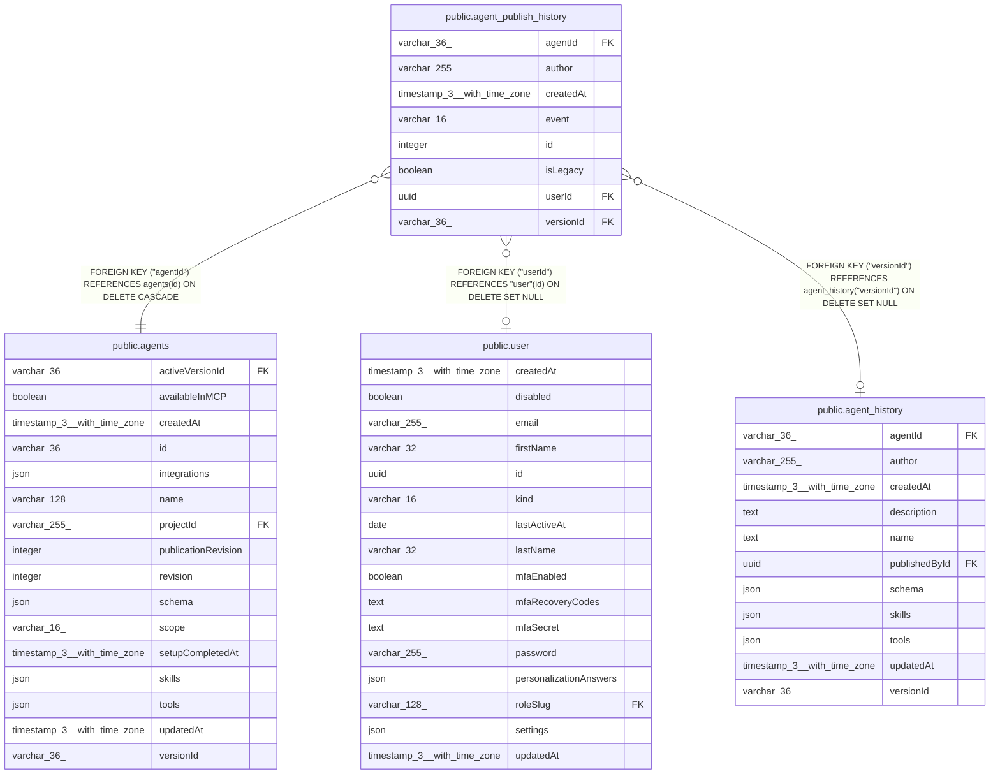

# public.agent_publish_history

## Columns

| Name | Type | Default | Nullable | Children | Parents | Comment |
| ---- | ---- | ------- | -------- | -------- | ------- | ------- |
| agentId | varchar(36) |  | false |  | [public.agents](public.agents.md) |  |
| author | varchar(255) |  | false |  |  |  |
| createdAt | timestamp(3) with time zone | CURRENT_TIMESTAMP(3) | false |  |  |  |
| event | varchar(16) |  | false |  |  | Publication or explicit unpublication |
| id | integer |  | false |  |  |  |
| isLegacy | boolean | false | false |  |  | Legacy publication with an unknown end time |
| userId | uuid |  | true |  | [public.user](public.user.md) |  |
| versionId | varchar(36) |  | true |  | [public.agent_history](public.agent_history.md) |  |

## Constraints

| Name | Type | Definition |
| ---- | ---- | ---------- |
| CHK_agent_publish_history_event | CHECK | CHECK (((event)::text = ANY ((ARRAY['activated'::character varying, 'deactivated'::character varying])::text[]))) |
| FK_338ce0ca892475cbf83e950323c | FOREIGN KEY | FOREIGN KEY ("agentId") REFERENCES agents(id) ON DELETE CASCADE |
| FK_6b706839e7bff5e94cf73d9c691 | FOREIGN KEY | FOREIGN KEY ("userId") REFERENCES "user"(id) ON DELETE SET NULL |
| FK_c76452ef7aca39928df3ca8dccd | FOREIGN KEY | FOREIGN KEY ("versionId") REFERENCES agent_history("versionId") ON DELETE SET NULL |
| PK_b6975aebe8927f1cb7b368f9724 | PRIMARY KEY | PRIMARY KEY (id) |
| agent_publish_history_agentId_not_null | n | NOT NULL "agentId" |
| agent_publish_history_author_not_null | n | NOT NULL author |
| agent_publish_history_createdAt_not_null | n | NOT NULL "createdAt" |
| agent_publish_history_event_not_null | n | NOT NULL event |
| agent_publish_history_id_not_null | n | NOT NULL id |
| agent_publish_history_isLegacy_not_null | n | NOT NULL "isLegacy" |

## Indexes

| Name | Definition |
| ---- | ---------- |
| IDX_44fd771f99afcdf71ffa55721f | CREATE INDEX "IDX_44fd771f99afcdf71ffa55721f" ON public.agent_publish_history USING btree ("agentId", id) |
| IDX_6b706839e7bff5e94cf73d9c69 | CREATE INDEX "IDX_6b706839e7bff5e94cf73d9c69" ON public.agent_publish_history USING btree ("userId") |
| IDX_c76452ef7aca39928df3ca8dcc | CREATE INDEX "IDX_c76452ef7aca39928df3ca8dcc" ON public.agent_publish_history USING btree ("versionId") |
| PK_b6975aebe8927f1cb7b368f9724 | CREATE UNIQUE INDEX "PK_b6975aebe8927f1cb7b368f9724" ON public.agent_publish_history USING btree (id) |

## Relations

---

> Generated by [tbls](https://github.com/k1LoW/tbls)
