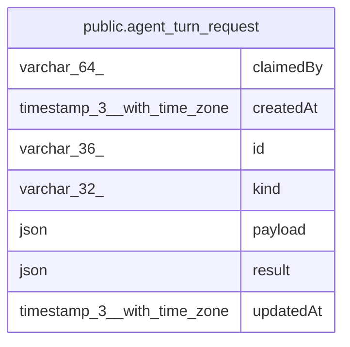

# public.agent_turn_request

## Columns

| Name | Type | Default | Nullable | Children | Parents | Comment |
| ---- | ---- | ------- | -------- | -------- | ------- | ------- |
| claimedBy | varchar(64) |  | true |  |  | Instance key of the process that claimed the turn; NULL means pending |
| createdAt | timestamp(3) with time zone | CURRENT_TIMESTAMP(3) | false |  |  |  |
| id | varchar(36) |  | false |  |  |  |
| kind | varchar(32) |  | false |  |  | Kind of turn, for example chat-resume |
| payload | json |  | false |  |  | Input of the turn and the identity that runs it |
| result | json |  | true |  |  | Outcome of a turn whose caller waits for one reply; NULL until the turn ends |
| updatedAt | timestamp(3) with time zone | CURRENT_TIMESTAMP(3) | false |  |  |  |

## Constraints

| Name | Type | Definition |
| ---- | ---- | ---------- |
| PK_80c32a47f97383d8021b22eae37 | PRIMARY KEY | PRIMARY KEY (id) |
| agent_turn_request_createdAt_not_null | n | NOT NULL "createdAt" |
| agent_turn_request_id_not_null | n | NOT NULL id |
| agent_turn_request_kind_not_null | n | NOT NULL kind |
| agent_turn_request_payload_not_null | n | NOT NULL payload |
| agent_turn_request_updatedAt_not_null | n | NOT NULL "updatedAt" |

## Indexes

| Name | Definition |
| ---- | ---------- |
| PK_80c32a47f97383d8021b22eae37 | CREATE UNIQUE INDEX "PK_80c32a47f97383d8021b22eae37" ON public.agent_turn_request USING btree (id) |

## Relations

---

> Generated by [tbls](https://github.com/k1LoW/tbls)
