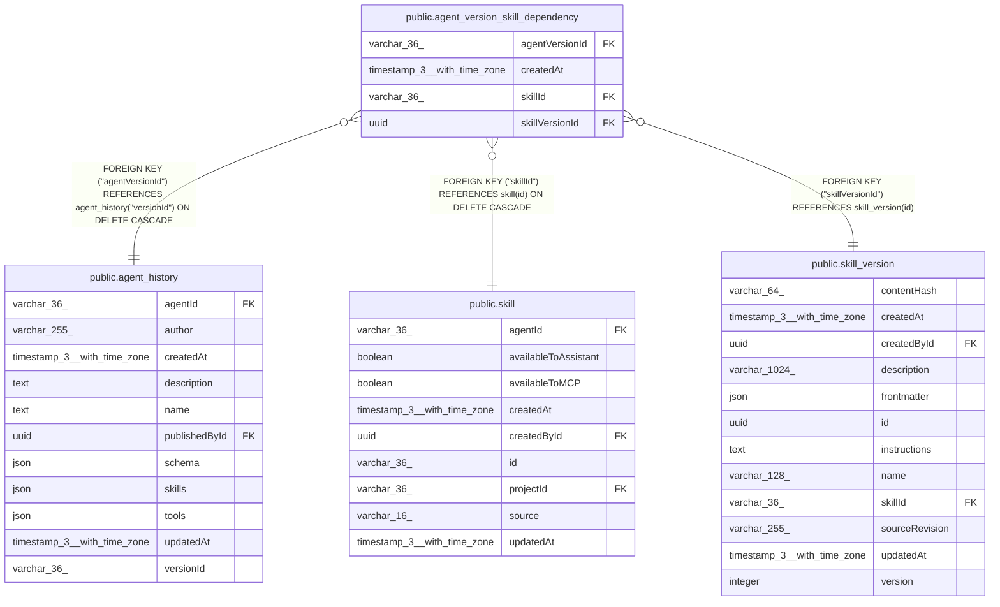

# public.agent_version_skill_dependency

## Columns

| Name | Type | Default | Nullable | Children | Parents | Comment |
| ---- | ---- | ------- | -------- | -------- | ------- | ------- |
| agentVersionId | varchar(36) |  | false |  | [public.agent_history](public.agent_history.md) |  |
| createdAt | timestamp(3) with time zone | CURRENT_TIMESTAMP(3) | false |  |  |  |
| skillId | varchar(36) |  | false |  | [public.skill](public.skill.md) |  |
| skillVersionId | uuid |  | false |  | [public.skill_version](public.skill_version.md) |  |

## Constraints

| Name | Type | Definition |
| ---- | ---- | ---------- |
| FK_97472baf9196d914d9cd9de6201 | FOREIGN KEY | FOREIGN KEY ("agentVersionId") REFERENCES agent_history("versionId") ON DELETE CASCADE |
| FK_c494292243a7e510acd0331c3d1 | FOREIGN KEY | FOREIGN KEY ("skillId") REFERENCES skill(id) ON DELETE CASCADE |
| FK_df63badfd7d3f2aa622ece471c4 | FOREIGN KEY | FOREIGN KEY ("skillVersionId") REFERENCES skill_version(id) |
| PK_df0a2577371b94f3c7008d81822 | PRIMARY KEY | PRIMARY KEY ("agentVersionId", "skillId") |
| agent_version_skill_dependency_agentVersionId_not_null | n | NOT NULL "agentVersionId" |
| agent_version_skill_dependency_createdAt_not_null | n | NOT NULL "createdAt" |
| agent_version_skill_dependency_skillId_not_null | n | NOT NULL "skillId" |
| agent_version_skill_dependency_skillVersionId_not_null | n | NOT NULL "skillVersionId" |

## Indexes

| Name | Definition |
| ---- | ---------- |
| IDX_c494292243a7e510acd0331c3d | CREATE INDEX "IDX_c494292243a7e510acd0331c3d" ON public.agent_version_skill_dependency USING btree ("skillId") |
| IDX_df63badfd7d3f2aa622ece471c | CREATE INDEX "IDX_df63badfd7d3f2aa622ece471c" ON public.agent_version_skill_dependency USING btree ("skillVersionId") |
| PK_df0a2577371b94f3c7008d81822 | CREATE UNIQUE INDEX "PK_df0a2577371b94f3c7008d81822" ON public.agent_version_skill_dependency USING btree ("agentVersionId", "skillId") |

## Relations

---

> Generated by [tbls](https://github.com/k1LoW/tbls)
