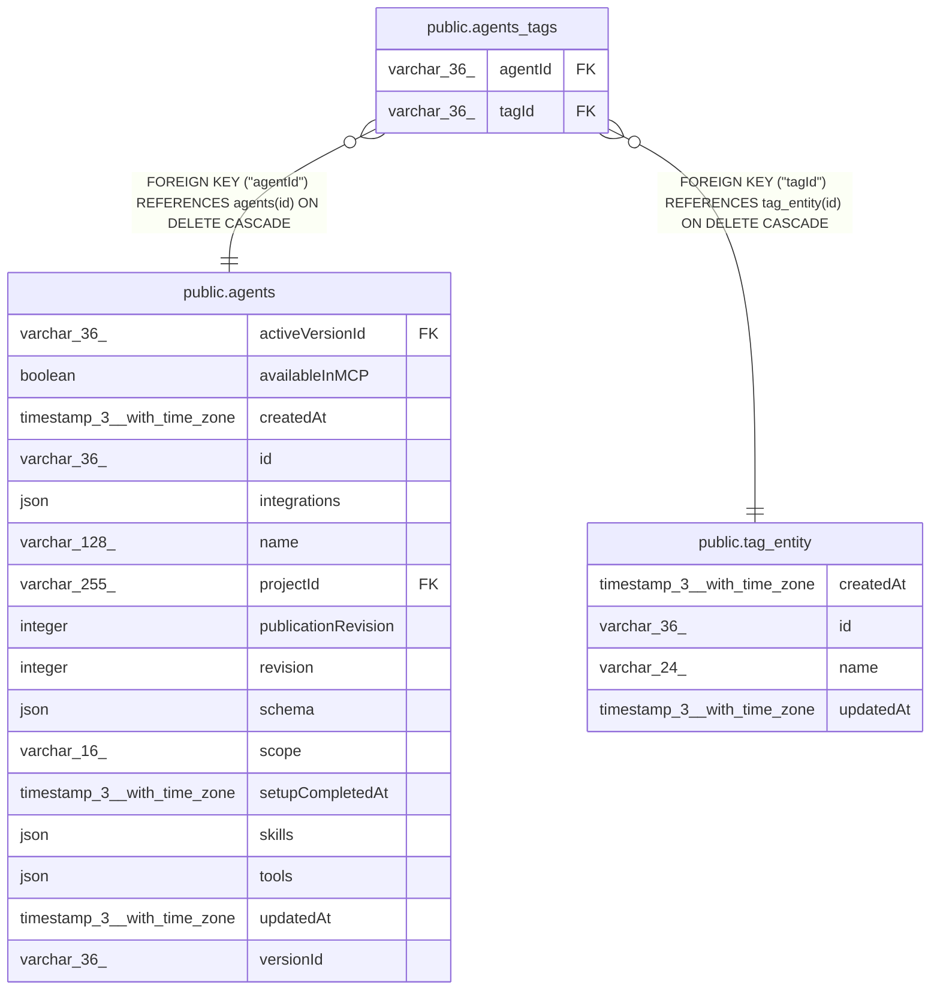

# public.agents_tags

## Columns

| Name | Type | Default | Nullable | Children | Parents | Comment |
| ---- | ---- | ------- | -------- | -------- | ------- | ------- |
| agentId | varchar(36) |  | false |  | [public.agents](public.agents.md) |  |
| tagId | varchar(36) |  | false |  | [public.tag_entity](public.tag_entity.md) |  |

## Constraints

| Name | Type | Definition |
| ---- | ---- | ---------- |
| FK_330ed9e51d337fe4b4a4ba63aa3 | FOREIGN KEY | FOREIGN KEY ("tagId") REFERENCES tag_entity(id) ON DELETE CASCADE |
| FK_bfc8a1ea9f09d842c53a5a781a2 | FOREIGN KEY | FOREIGN KEY ("agentId") REFERENCES agents(id) ON DELETE CASCADE |
| PK_847dcd3889a9a795c14053b76a4 | PRIMARY KEY | PRIMARY KEY ("agentId", "tagId") |
| agents_tags_agentId_not_null | n | NOT NULL "agentId" |
| agents_tags_tagId_not_null | n | NOT NULL "tagId" |

## Indexes

| Name | Definition |
| ---- | ---------- |
| PK_847dcd3889a9a795c14053b76a4 | CREATE UNIQUE INDEX "PK_847dcd3889a9a795c14053b76a4" ON public.agents_tags USING btree ("agentId", "tagId") |

## Relations

---

> Generated by [tbls](https://github.com/k1LoW/tbls)
