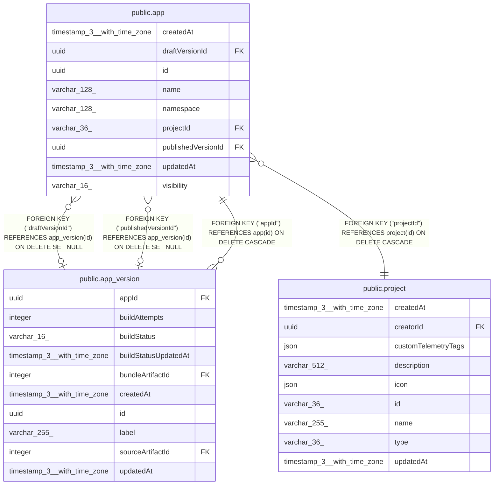

# public.app

## Columns

| Name | Type | Default | Nullable | Children | Parents | Comment |
| ---- | ---- | ------- | -------- | -------- | ------- | ------- |
| createdAt | timestamp(3) with time zone | CURRENT_TIMESTAMP(3) | false |  |  |  |
| draftVersionId | uuid |  | true |  | [public.app_version](public.app_version.md) | Current working app version |
| id | uuid |  | false | [public.app_version](public.app_version.md) |  |  |
| name | varchar(128) |  | false |  |  |  |
| namespace | varchar(128) |  | false |  |  | Unique URL path segment for the app |
| projectId | varchar(36) |  | false |  | [public.project](public.project.md) |  |
| publishedVersionId | uuid |  | true |  | [public.app_version](public.app_version.md) | Published app version; null when unpublished |
| updatedAt | timestamp(3) with time zone | CURRENT_TIMESTAMP(3) | false |  |  |  |
| visibility | varchar(16) | 'project'::character varying | false |  |  | App access: everyone, project members, or instance users |

## Constraints

| Name | Type | Definition |
| ---- | ---- | ---------- |
| CHK_app_visibility | CHECK | CHECK (((visibility)::text = ANY ((ARRAY['public'::character varying, 'project'::character varying, 'instance'::character varying])::text[]))) |
| FK_f84dd7eb539e46e0c233fa09b20 | FOREIGN KEY | FOREIGN KEY ("projectId") REFERENCES project(id) ON DELETE CASCADE |
| PK_9478629fc093d229df09e560aea | PRIMARY KEY | PRIMARY KEY (id) |
| app_createdAt_not_null | n | NOT NULL "createdAt" |
| app_draftVersionId_foreign | FOREIGN KEY | FOREIGN KEY ("draftVersionId") REFERENCES app_version(id) ON DELETE SET NULL |
| app_id_not_null | n | NOT NULL id |
| app_name_not_null | n | NOT NULL name |
| app_namespace_not_null | n | NOT NULL namespace |
| app_projectId_not_null | n | NOT NULL "projectId" |
| app_publishedVersionId_foreign | FOREIGN KEY | FOREIGN KEY ("publishedVersionId") REFERENCES app_version(id) ON DELETE SET NULL |
| app_updatedAt_not_null | n | NOT NULL "updatedAt" |
| app_visibility_not_null | n | NOT NULL visibility |

## Indexes

| Name | Definition |
| ---- | ---------- |
| IDX_a73a1fa47c9e5097660f1161b3 | CREATE UNIQUE INDEX "IDX_a73a1fa47c9e5097660f1161b3" ON public.app USING btree (namespace) |
| IDX_ca0a32194dd73ba54acb0adabf | CREATE INDEX "IDX_ca0a32194dd73ba54acb0adabf" ON public.app USING btree ("draftVersionId") |
| IDX_e1c99aaf677c86879562203218 | CREATE INDEX "IDX_e1c99aaf677c86879562203218" ON public.app USING btree ("publishedVersionId") |
| IDX_f84dd7eb539e46e0c233fa09b2 | CREATE INDEX "IDX_f84dd7eb539e46e0c233fa09b2" ON public.app USING btree ("projectId") |
| PK_9478629fc093d229df09e560aea | CREATE UNIQUE INDEX "PK_9478629fc093d229df09e560aea" ON public.app USING btree (id) |

## Relations

---

> Generated by [tbls](https://github.com/k1LoW/tbls)
