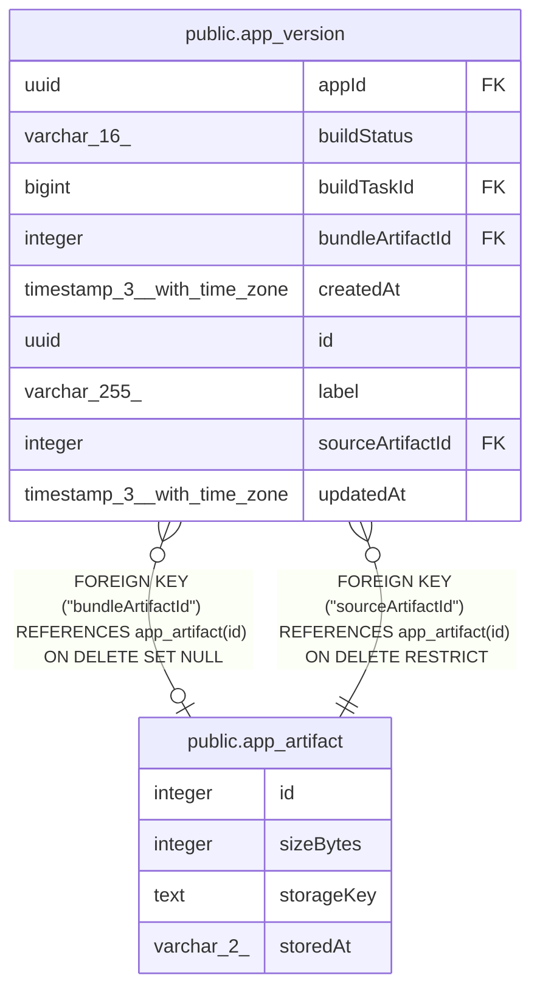

# public.app_artifact

## Columns

| Name | Type | Default | Nullable | Children | Parents | Comment |
| ---- | ---- | ------- | -------- | -------- | ------- | ------- |
| id | integer |  | false | [public.app_version](public.app_version.md) |  |  |
| sizeBytes | integer |  | false |  |  |  |
| storageKey | text |  | false |  |  | Reference to the object within its storage backend |
| storedAt | varchar(2) |  | false |  |  | Storage backend: database, filesystem, S3, or Azure |

## Constraints

| Name | Type | Definition |
| ---- | ---- | ---------- |
| CHK_app_artifact_storedAt | CHECK | CHECK ((("storedAt")::text = ANY ((ARRAY['db'::character varying, 'fs'::character varying, 's3'::character varying, 'az'::character varying])::text[]))) |
| PK_307f7470d2b759f7c4bc056d3a5 | PRIMARY KEY | PRIMARY KEY (id) |
| app_artifact_id_not_null | n | NOT NULL id |
| app_artifact_sizeBytes_not_null | n | NOT NULL "sizeBytes" |
| app_artifact_storageKey_not_null | n | NOT NULL "storageKey" |
| app_artifact_storedAt_not_null | n | NOT NULL "storedAt" |

## Indexes

| Name | Definition |
| ---- | ---------- |
| PK_307f7470d2b759f7c4bc056d3a5 | CREATE UNIQUE INDEX "PK_307f7470d2b759f7c4bc056d3a5" ON public.app_artifact USING btree (id) |

## Relations

---

> Generated by [tbls](https://github.com/k1LoW/tbls)
