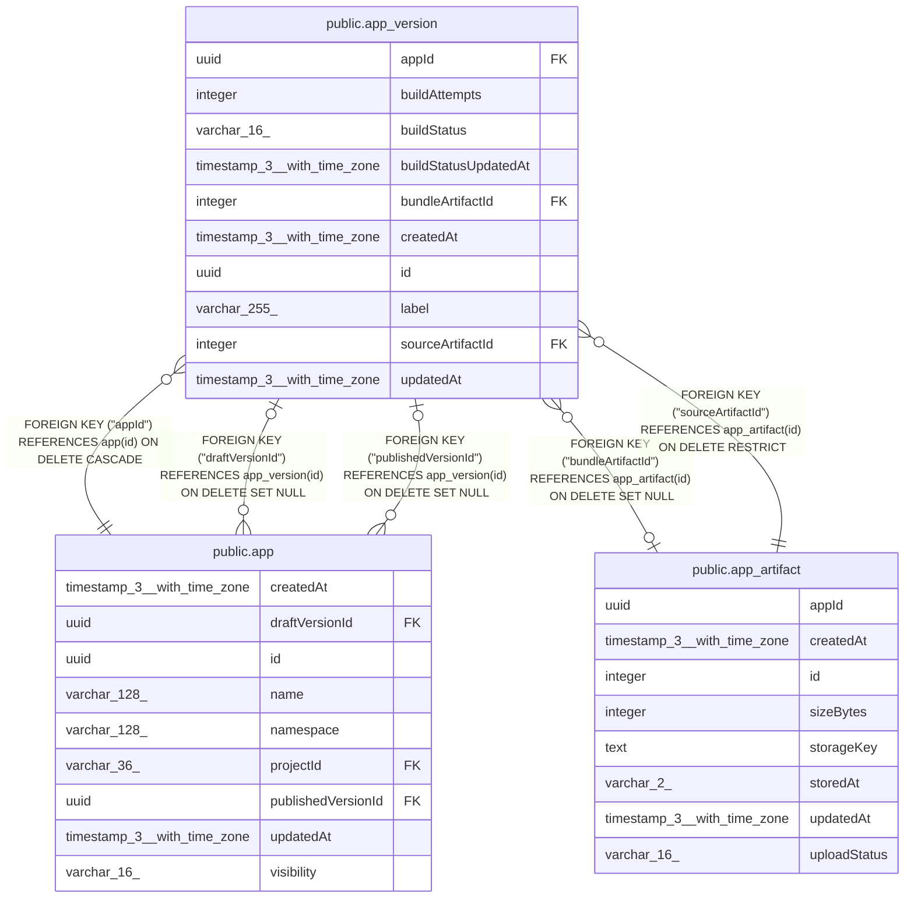

# public.app_version

## Columns

| Name | Type | Default | Nullable | Children | Parents | Comment |
| ---- | ---- | ------- | -------- | -------- | ------- | ------- |
| appId | uuid |  | false |  | [public.app](public.app.md) |  |
| buildAttempts | integer | 0 | false |  |  |  |
| buildStatus | varchar(16) | 'queued'::character varying | false |  |  | Build state: queued, running, succeeded, or failed |
| buildStatusUpdatedAt | timestamp(3) with time zone |  | true |  |  |  |
| bundleArtifactId | integer |  | true |  | [public.app_artifact](public.app_artifact.md) |  |
| createdAt | timestamp(3) with time zone | CURRENT_TIMESTAMP(3) | false |  |  |  |
| id | uuid |  | false | [public.app](public.app.md) |  |  |
| label | varchar(255) |  | true |  |  |  |
| sourceArtifactId | integer |  | false |  | [public.app_artifact](public.app_artifact.md) |  |
| updatedAt | timestamp(3) with time zone | CURRENT_TIMESTAMP(3) | false |  |  |  |

## Constraints

| Name | Type | Definition |
| ---- | ---- | ---------- |
| CHK_app_version_buildStatus | CHECK | CHECK ((("buildStatus")::text = ANY ((ARRAY['queued'::character varying, 'running'::character varying, 'succeeded'::character varying, 'failed'::character varying])::text[]))) |
| FK_2ab536cbf97d71bad59517afee5 | FOREIGN KEY | FOREIGN KEY ("bundleArtifactId") REFERENCES app_artifact(id) ON DELETE SET NULL |
| FK_9f1db6f02f5a0d1ae2f2b41a327 | FOREIGN KEY | FOREIGN KEY ("sourceArtifactId") REFERENCES app_artifact(id) ON DELETE RESTRICT |
| FK_e9aeab5b1db8dc77708231ae44e | FOREIGN KEY | FOREIGN KEY ("appId") REFERENCES app(id) ON DELETE CASCADE |
| PK_f2573b981a7eac664875e7483ac | PRIMARY KEY | PRIMARY KEY (id) |
| app_version_appId_not_null | n | NOT NULL "appId" |
| app_version_buildAttempts_not_null | n | NOT NULL "buildAttempts" |
| app_version_buildStatus_not_null | n | NOT NULL "buildStatus" |
| app_version_createdAt_not_null | n | NOT NULL "createdAt" |
| app_version_id_not_null | n | NOT NULL id |
| app_version_sourceArtifactId_not_null | n | NOT NULL "sourceArtifactId" |
| app_version_updatedAt_not_null | n | NOT NULL "updatedAt" |

## Indexes

| Name | Definition |
| ---- | ---------- |
| IDX_2ab536cbf97d71bad59517afee | CREATE INDEX "IDX_2ab536cbf97d71bad59517afee" ON public.app_version USING btree ("bundleArtifactId") |
| IDX_9f1db6f02f5a0d1ae2f2b41a32 | CREATE INDEX "IDX_9f1db6f02f5a0d1ae2f2b41a32" ON public.app_version USING btree ("sourceArtifactId") |
| IDX_e9aeab5b1db8dc77708231ae44 | CREATE INDEX "IDX_e9aeab5b1db8dc77708231ae44" ON public.app_version USING btree ("appId") |
| PK_f2573b981a7eac664875e7483ac | CREATE UNIQUE INDEX "PK_f2573b981a7eac664875e7483ac" ON public.app_version USING btree (id) |

## Relations

---

> Generated by [tbls](https://github.com/k1LoW/tbls)
