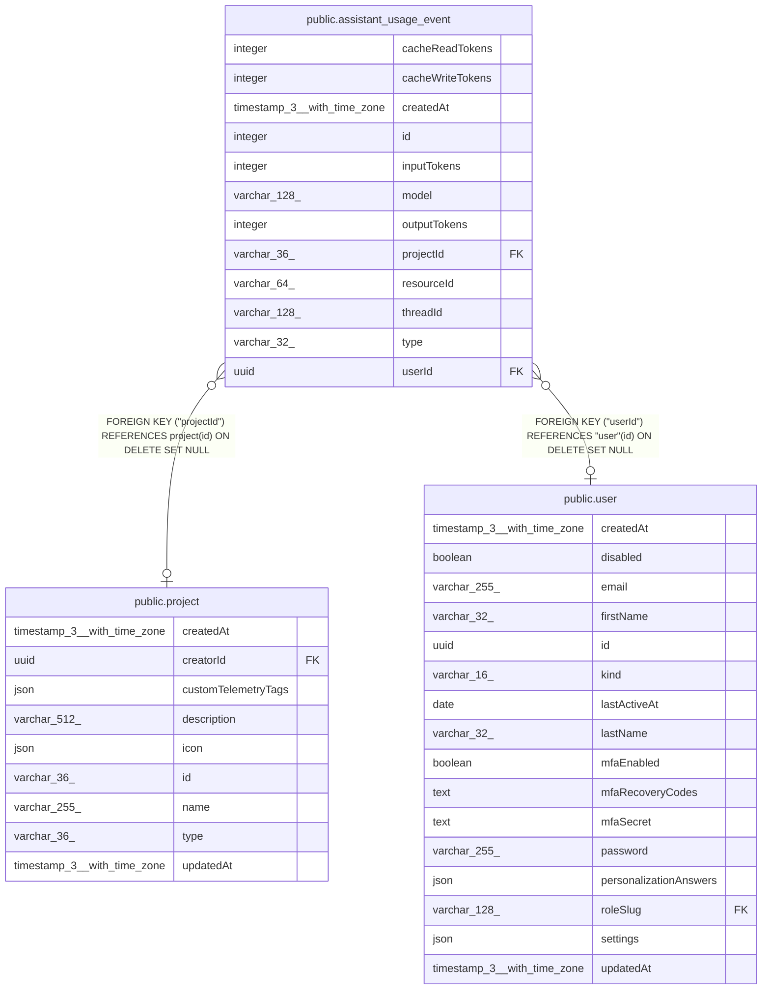

# public.assistant_usage_event

## Columns

| Name | Type | Default | Nullable | Children | Parents | Comment |
| ---- | ---- | ------- | -------- | -------- | ------- | ------- |
| cacheReadTokens | integer |  | true |  |  | Input tokens read from the prompt cache. Only for token-usage |
| cacheWriteTokens | integer |  | true |  |  | Input tokens written to the prompt cache. Only for token-usage |
| createdAt | timestamp(3) with time zone | CURRENT_TIMESTAMP(3) | false |  |  |  |
| id | integer |  | false |  |  |  |
| inputTokens | integer |  | true |  |  | Input tokens, cache reads and writes included. Only for token-usage |
| model | varchar(128) |  | true |  |  | Model of the calls, such as anthropic/claude-sonnet-5-5. Only for token-usage |
| outputTokens | integer |  | true |  |  | Output tokens. Only for token-usage |
| projectId | varchar(36) |  | true |  | [public.project](public.project.md) | Project of the created resource, else the working project of the thread. NULL after the project is deleted |
| resourceId | varchar(64) |  | true |  |  | ID of the created resource. NULL for messages. Kept after the resource is deleted |
| threadId | varchar(128) |  | false |  |  | Agents runtime thread of the conversation. Kept after the thread is deleted |
| type | varchar(32) |  | false |  |  | message: a user sent a message. *-created: the Assistant created a resource. token-usage: model calls of the Assistant used tokens |
| userId | uuid |  | true |  | [public.user](public.user.md) | User of the conversation. NULL after the user is deleted |

## Constraints

| Name | Type | Definition |
| ---- | ---- | ---------- |
| CHK_assistant_usage_event_type | CHECK | CHECK (((type)::text = ANY ((ARRAY['message'::character varying, 'workflow-created'::character varying, 'agent-created'::character varying, 'data-table-created'::character varying, 'token-usage'::character varying])::text[]))) |
| FK_32769c0d4eea8fa85c539ad6356 | FOREIGN KEY | FOREIGN KEY ("userId") REFERENCES "user"(id) ON DELETE SET NULL |
| FK_3442c145d6d184730643dacebb4 | FOREIGN KEY | FOREIGN KEY ("projectId") REFERENCES project(id) ON DELETE SET NULL |
| PK_0f886448c5262f8e3f7b27b00eb | PRIMARY KEY | PRIMARY KEY (id) |
| assistant_usage_event_createdAt_not_null | n | NOT NULL "createdAt" |
| assistant_usage_event_id_not_null | n | NOT NULL id |
| assistant_usage_event_threadId_not_null | n | NOT NULL "threadId" |
| assistant_usage_event_type_not_null | n | NOT NULL type |

## Indexes

| Name | Definition |
| ---- | ---------- |
| IDX_32769c0d4eea8fa85c539ad635 | CREATE INDEX "IDX_32769c0d4eea8fa85c539ad635" ON public.assistant_usage_event USING btree ("userId") |
| IDX_assistant_usage_event_type_resourceId | CREATE UNIQUE INDEX "IDX_assistant_usage_event_type_resourceId" ON public.assistant_usage_event USING btree (type, "resourceId") WHERE ("resourceId" IS NOT NULL) |
| IDX_b4b7423ae2a4840793865b7913 | CREATE INDEX "IDX_b4b7423ae2a4840793865b7913" ON public.assistant_usage_event USING btree ("projectId", "createdAt") |
| IDX_de48a3665b0da1f8356733f54a | CREATE INDEX "IDX_de48a3665b0da1f8356733f54a" ON public.assistant_usage_event USING btree ("createdAt") |
| PK_0f886448c5262f8e3f7b27b00eb | CREATE UNIQUE INDEX "PK_0f886448c5262f8e3f7b27b00eb" ON public.assistant_usage_event USING btree (id) |

## Relations

---

> Generated by [tbls](https://github.com/k1LoW/tbls)
