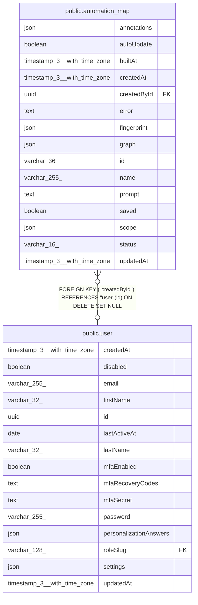

# public.automation_map

## Columns

| Name | Type | Default | Nullable | Children | Parents | Comment |
| ---- | ---- | ------- | -------- | -------- | ------- | ------- |
| annotations | json |  | true |  |  |  |
| autoUpdate | boolean | false | false |  |  |  |
| builtAt | timestamp(3) with time zone |  | true |  |  |  |
| createdAt | timestamp(3) with time zone | CURRENT_TIMESTAMP(3) | false |  |  |  |
| createdById | uuid |  | true |  | [public.user](public.user.md) |  |
| error | text |  | true |  |  |  |
| fingerprint | json |  | true |  |  |  |
| graph | json |  | true |  |  |  |
| id | varchar(36) |  | false |  |  |  |
| name | varchar(255) |  | false |  |  |  |
| prompt | text |  | false |  |  |  |
| saved | boolean | false | false |  |  |  |
| scope | json |  | false |  |  |  |
| status | varchar(16) |  | false |  |  |  |
| updatedAt | timestamp(3) with time zone | CURRENT_TIMESTAMP(3) | false |  |  |  |

## Constraints

| Name | Type | Definition |
| ---- | ---- | ---------- |
| FK_5cacb7639be33cda47d23840b3e | FOREIGN KEY | FOREIGN KEY ("createdById") REFERENCES "user"(id) ON DELETE SET NULL |
| PK_2273569a7d912a27c3dc546ed9b | PRIMARY KEY | PRIMARY KEY (id) |
| automation_map_autoUpdate_not_null | n | NOT NULL "autoUpdate" |
| automation_map_createdAt_not_null | n | NOT NULL "createdAt" |
| automation_map_id_not_null | n | NOT NULL id |
| automation_map_name_not_null | n | NOT NULL name |
| automation_map_prompt_not_null | n | NOT NULL prompt |
| automation_map_saved_not_null | n | NOT NULL saved |
| automation_map_scope_not_null | n | NOT NULL scope |
| automation_map_status_not_null | n | NOT NULL status |
| automation_map_updatedAt_not_null | n | NOT NULL "updatedAt" |

## Indexes

| Name | Definition |
| ---- | ---------- |
| IDX_f3204374aabbcb65db59c728bb | CREATE INDEX "IDX_f3204374aabbcb65db59c728bb" ON public.automation_map USING btree (saved) |
| PK_2273569a7d912a27c3dc546ed9b | CREATE UNIQUE INDEX "PK_2273569a7d912a27c3dc546ed9b" ON public.automation_map USING btree (id) |

## Relations

---

> Generated by [tbls](https://github.com/k1LoW/tbls)
