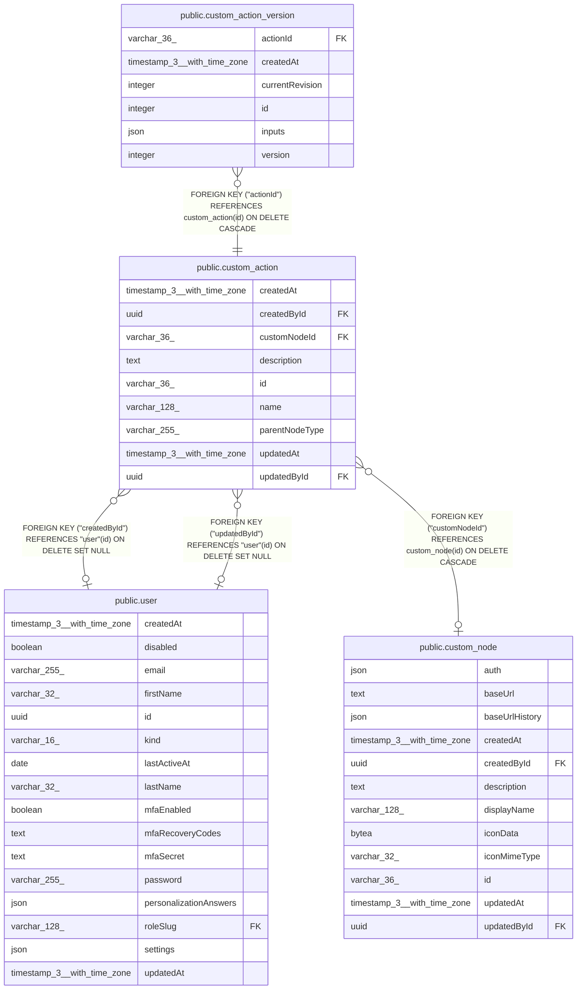

# public.custom_action

## Columns

| Name | Type | Default | Nullable | Children | Parents | Comment |
| ---- | ---- | ------- | -------- | -------- | ------- | ------- |
| createdAt | timestamp(3) with time zone | CURRENT_TIMESTAMP(3) | false |  |  |  |
| createdById | uuid |  | true |  | [public.user](public.user.md) |  |
| customNodeId | varchar(36) |  | true |  | [public.custom_node](public.custom_node.md) |  |
| description | text |  | true |  |  |  |
| id | varchar(36) |  | false | [public.custom_action_version](public.custom_action_version.md) |  | Nano ID |
| name | varchar(128) |  | false |  |  |  |
| parentNodeType | varchar(255) |  | true |  |  | Type of the built-in node that shows this action. NULL for a custom node |
| updatedAt | timestamp(3) with time zone | CURRENT_TIMESTAMP(3) | false |  |  |  |
| updatedById | uuid |  | true |  | [public.user](public.user.md) |  |

## Constraints

| Name | Type | Definition |
| ---- | ---- | ---------- |
| CHK_custom_action_parent | CHECK | CHECK (((("parentNodeType" IS NOT NULL) AND ("customNodeId" IS NULL)) OR (("parentNodeType" IS NULL) AND ("customNodeId" IS NOT NULL)))) |
| FK_3a035fafb41c019cd30a18c7d64 | FOREIGN KEY | FOREIGN KEY ("customNodeId") REFERENCES custom_node(id) ON DELETE CASCADE |
| FK_b727a942323fc5b00ea3ddcbe55 | FOREIGN KEY | FOREIGN KEY ("createdById") REFERENCES "user"(id) ON DELETE SET NULL |
| FK_d362f7764fba8a99c24fa090ba8 | FOREIGN KEY | FOREIGN KEY ("updatedById") REFERENCES "user"(id) ON DELETE SET NULL |
| PK_6f6cb2dd91155d62197d8cdf673 | PRIMARY KEY | PRIMARY KEY (id) |
| custom_action_createdAt_not_null | n | NOT NULL "createdAt" |
| custom_action_id_not_null | n | NOT NULL id |
| custom_action_name_not_null | n | NOT NULL name |
| custom_action_updatedAt_not_null | n | NOT NULL "updatedAt" |

## Indexes

| Name | Definition |
| ---- | ---------- |
| IDX_22700f189b1c75a496129b4ce7 | CREATE INDEX "IDX_22700f189b1c75a496129b4ce7" ON public.custom_action USING btree ("parentNodeType") |
| IDX_3a035fafb41c019cd30a18c7d6 | CREATE INDEX "IDX_3a035fafb41c019cd30a18c7d6" ON public.custom_action USING btree ("customNodeId") |
| IDX_b727a942323fc5b00ea3ddcbe5 | CREATE INDEX "IDX_b727a942323fc5b00ea3ddcbe5" ON public.custom_action USING btree ("createdById") |
| IDX_d362f7764fba8a99c24fa090ba | CREATE INDEX "IDX_d362f7764fba8a99c24fa090ba" ON public.custom_action USING btree ("updatedById") |
| PK_6f6cb2dd91155d62197d8cdf673 | CREATE UNIQUE INDEX "PK_6f6cb2dd91155d62197d8cdf673" ON public.custom_action USING btree (id) |

## Relations

---

> Generated by [tbls](https://github.com/k1LoW/tbls)
