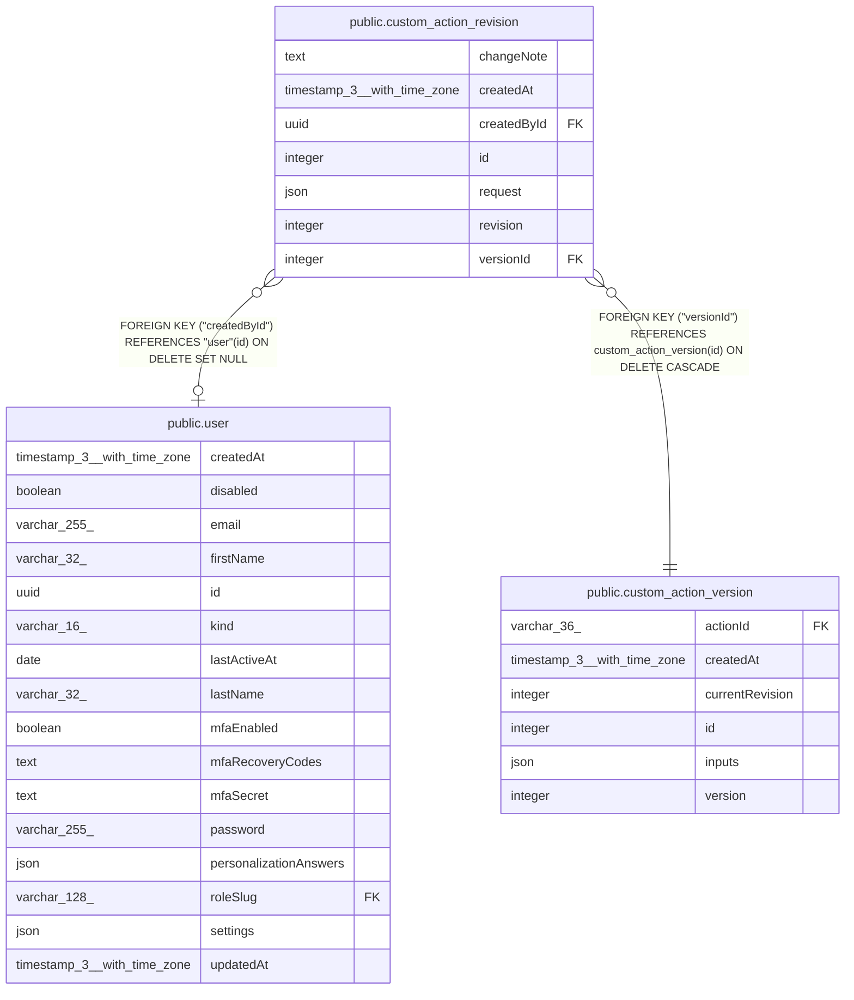

# public.custom_action_revision

## Columns

| Name | Type | Default | Nullable | Children | Parents | Comment |
| ---- | ---- | ------- | -------- | -------- | ------- | ------- |
| changeNote | text |  | true |  |  |  |
| createdAt | timestamp(3) with time zone | CURRENT_TIMESTAMP(3) | false |  |  |  |
| createdById | uuid |  | true |  | [public.user](public.user.md) |  |
| id | integer |  | false |  |  |  |
| request | json |  | false |  |  | Request template: method, URL, headers, query, body and the target of each input |
| revision | integer |  | false |  |  | Revision number in the version, starts at 1 |
| versionId | integer |  | false |  | [public.custom_action_version](public.custom_action_version.md) |  |

## Constraints

| Name | Type | Definition |
| ---- | ---- | ---------- |
| FK_907abd1deb7ca98701bedbc0972 | FOREIGN KEY | FOREIGN KEY ("versionId") REFERENCES custom_action_version(id) ON DELETE CASCADE |
| FK_9b6c94576c09f1dfe02f7a10acb | FOREIGN KEY | FOREIGN KEY ("createdById") REFERENCES "user"(id) ON DELETE SET NULL |
| PK_9a82eeb6728471fed835ca113f1 | PRIMARY KEY | PRIMARY KEY (id) |
| custom_action_revision_createdAt_not_null | n | NOT NULL "createdAt" |
| custom_action_revision_id_not_null | n | NOT NULL id |
| custom_action_revision_request_not_null | n | NOT NULL request |
| custom_action_revision_revision_not_null | n | NOT NULL revision |
| custom_action_revision_versionId_not_null | n | NOT NULL "versionId" |

## Indexes

| Name | Definition |
| ---- | ---------- |
| IDX_9b6c94576c09f1dfe02f7a10ac | CREATE INDEX "IDX_9b6c94576c09f1dfe02f7a10ac" ON public.custom_action_revision USING btree ("createdById") |
| IDX_fa5ac3f69d61ac6e758bbcc50b | CREATE UNIQUE INDEX "IDX_fa5ac3f69d61ac6e758bbcc50b" ON public.custom_action_revision USING btree ("versionId", revision) |
| PK_9a82eeb6728471fed835ca113f1 | CREATE UNIQUE INDEX "PK_9a82eeb6728471fed835ca113f1" ON public.custom_action_revision USING btree (id) |

## Relations

---

> Generated by [tbls](https://github.com/k1LoW/tbls)
