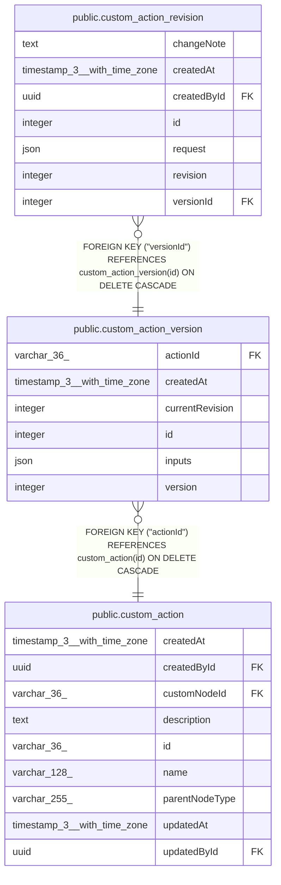

# public.custom_action_version

## Columns

| Name | Type | Default | Nullable | Children | Parents | Comment |
| ---- | ---- | ------- | -------- | -------- | ------- | ------- |
| actionId | varchar(36) |  | false |  | [public.custom_action](public.custom_action.md) |  |
| createdAt | timestamp(3) with time zone | CURRENT_TIMESTAMP(3) | false |  |  |  |
| currentRevision | integer |  | false |  |  | Revision number of the request that executions of this version use |
| id | integer |  | false | [public.custom_action_revision](public.custom_action_revision.md) |  |  |
| inputs | json |  | false |  |  | Input contract of the version: array of input definitions |
| version | integer |  | false |  |  | Version number in the action, starts at 1 |

## Constraints

| Name | Type | Definition |
| ---- | ---- | ---------- |
| FK_d7e1a3ea1ddb3a45448d5d5f9e4 | FOREIGN KEY | FOREIGN KEY ("actionId") REFERENCES custom_action(id) ON DELETE CASCADE |
| PK_df4bb723446a38012c5f35d6126 | PRIMARY KEY | PRIMARY KEY (id) |
| custom_action_version_actionId_not_null | n | NOT NULL "actionId" |
| custom_action_version_createdAt_not_null | n | NOT NULL "createdAt" |
| custom_action_version_currentRevision_not_null | n | NOT NULL "currentRevision" |
| custom_action_version_id_not_null | n | NOT NULL id |
| custom_action_version_inputs_not_null | n | NOT NULL inputs |
| custom_action_version_version_not_null | n | NOT NULL version |

## Indexes

| Name | Definition |
| ---- | ---------- |
| IDX_f5e563b87c510a9af5f3f086b5 | CREATE UNIQUE INDEX "IDX_f5e563b87c510a9af5f3f086b5" ON public.custom_action_version USING btree ("actionId", version) |
| PK_df4bb723446a38012c5f35d6126 | CREATE UNIQUE INDEX "PK_df4bb723446a38012c5f35d6126" ON public.custom_action_version USING btree (id) |

## Relations

---

> Generated by [tbls](https://github.com/k1LoW/tbls)
