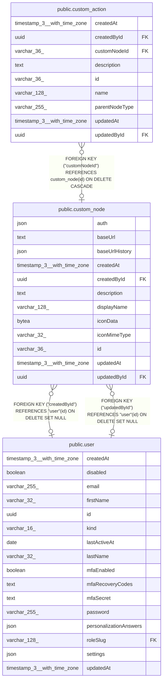

# public.custom_node

## Columns

| Name | Type | Default | Nullable | Children | Parents | Comment |
| ---- | ---- | ------- | -------- | -------- | ------- | ------- |
| auth | json |  | false |  |  | Authentication of the node: { kind: "none" \| "predefined" \| "generic", ... } |
| baseUrl | text |  | false |  |  | Base URL of all requests of the node |
| baseUrlHistory | json | '[]'::json | false |  |  | Earlier base URLs: array of { baseUrl, changedAt, changedById } |
| createdAt | timestamp(3) with time zone | CURRENT_TIMESTAMP(3) | false |  |  |  |
| createdById | uuid |  | true |  | [public.user](public.user.md) |  |
| description | text |  | true |  |  |  |
| displayName | varchar(128) |  | false |  |  |  |
| iconData | bytea |  | true |  |  | Raw icon bytes, not base64 encoded |
| iconMimeType | varchar(32) |  | true |  |  | MIME type of iconData. NULL when the node has no icon |
| id | varchar(36) |  | false | [public.custom_action](public.custom_action.md) |  | Nano ID. The node type name contains it |
| updatedAt | timestamp(3) with time zone | CURRENT_TIMESTAMP(3) | false |  |  |  |
| updatedById | uuid |  | true |  | [public.user](public.user.md) |  |

## Constraints

| Name | Type | Definition |
| ---- | ---- | ---------- |
| CHK_custom_node_iconMimeType | CHECK | CHECK ((("iconMimeType")::text = ANY ((ARRAY['image/png'::character varying, 'image/svg+xml'::character varying])::text[]))) |
| FK_6aeb42fe6cec12e0fdfcc8ba764 | FOREIGN KEY | FOREIGN KEY ("createdById") REFERENCES "user"(id) ON DELETE SET NULL |
| FK_9854fde40fc84bbeeef603feaf2 | FOREIGN KEY | FOREIGN KEY ("updatedById") REFERENCES "user"(id) ON DELETE SET NULL |
| PK_16947a0272af171469a075a8d8d | PRIMARY KEY | PRIMARY KEY (id) |
| custom_node_auth_not_null | n | NOT NULL auth |
| custom_node_baseUrlHistory_not_null | n | NOT NULL "baseUrlHistory" |
| custom_node_baseUrl_not_null | n | NOT NULL "baseUrl" |
| custom_node_createdAt_not_null | n | NOT NULL "createdAt" |
| custom_node_displayName_not_null | n | NOT NULL "displayName" |
| custom_node_id_not_null | n | NOT NULL id |
| custom_node_updatedAt_not_null | n | NOT NULL "updatedAt" |

## Indexes

| Name | Definition |
| ---- | ---------- |
| IDX_6aeb42fe6cec12e0fdfcc8ba76 | CREATE INDEX "IDX_6aeb42fe6cec12e0fdfcc8ba76" ON public.custom_node USING btree ("createdById") |
| IDX_9854fde40fc84bbeeef603feaf | CREATE INDEX "IDX_9854fde40fc84bbeeef603feaf" ON public.custom_node USING btree ("updatedById") |
| PK_16947a0272af171469a075a8d8d | CREATE UNIQUE INDEX "PK_16947a0272af171469a075a8d8d" ON public.custom_node USING btree (id) |

## Relations

---

> Generated by [tbls](https://github.com/k1LoW/tbls)
